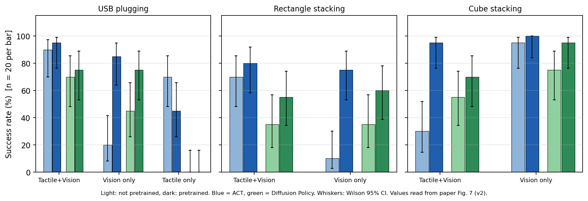

## 한눈에

- 논문은 촉각 센서를 학습 때만 쓰고 추론은 시각만 쓰는 방법(VITaL)을 제안합니다. 시각 전용 ACT는 USB 꽂기에서 20%에서 85%로 올랐습니다. 이 차이는 통계적으로 확실합니다(Fisher p = 0.0001).
- 촉각+시각 정책의 사전학습 향상(USB에서 5%p)은 n = 20에서 구별되지 않습니다(p = 1.0). "moderate improvement"는 방향 주장으로만 읽어야 합니다.
- 시각 전용 Diffusion Policy의 45→75는 방향만 맞고 p = 0.105입니다.
- 공식 코드(MIT)는 논문과 시점 수(5 대 7), 간격(20 대 10스텝), 촉각 인코더 동결(ACT만)이 다릅니다.
- 재현은 불가능합니다. 데이터와 체크포인트가 공개되지 않았고 실로봇이 필요합니다.

## 방법

촉각과 시각 인코더를 같은 시점 집합에서 대비 학습합니다. 시점은 같은 에피소드에서 최소 간격을 두고 뽑고, 촉각 헤드는 말단 위치를 함께 받습니다. 사전학습한 시각 인코더는 ACT와 Diffusion Policy의 백본으로 쓰입니다.

*그래프: 논문 그림 7을 20회 시행의 성공 수로 환산한 값과 Wilson 95% 구간. 우리가 그렸습니다. 논문 그림은 원문 라이선스(CC BY-NC-SA 4.0) 때문에 싣지 않았습니다.*

## 검증 방식

표 재계산과 Fisher 검정 (Holm 보정), 공식 코드의 정적 대조 (MIT, 실행하지 않음). 재현은 하지 않았습니다.

## 한계

- 그림 7은 눈으로 판독했습니다(5%p 단위, ±1회 오차).
- 접선 변형률 감소 수치는 원자료가 없어 확인하지 못했습니다.
- 공식 코드의 마지막 커밋(2024-08-23)은 논문 v2보다 앞섭니다.

## 자료

- [통합 리포트 PDF](report/report_public.pdf)
- [01. 논문 분석: VITaL Pretraining](analysis/01_paper_analysis.md)
- [02. 선행연구와 관련 저장소](analysis/02_prior_work.md)
- [03. 수치 재계산과 주장 검증](analysis/03_analysis.md)
- [04. 공식 코드 대조 (정적 읽기)](analysis/04_code_verification.md)
