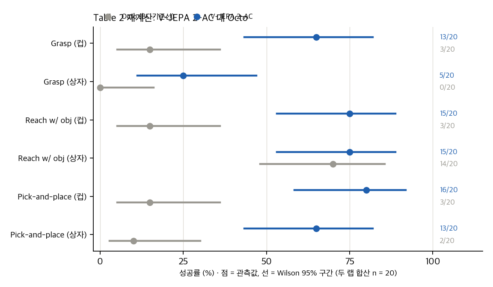

> **논문:** Mahmoud Assran 외 29명. *V-JEPA 2: Self-Supervised Video Models Enable Understanding, Prediction and Planning.* arXiv:2506.09985 (v1, 2025-06-11). 학회 표기는 없습니다.
> 공식 코드(facebookresearch/vjepa2, MIT)는 정적으로만 읽었고 실행하지 않았습니다. 이 글의 그래프는 우리가 만든 것입니다.

## 논문이 하는 일

V-JEPA 2는 인터넷 영상으로 마스크 잠재 예측을 학습한 ViT-g 인코더 위에, DROID의 약 62시간 로봇 영상으로 **행동 조건 세계모델 V-JEPA 2-AC**를 학습합니다. 계획은 목표 이미지와 예측 잠재 표현의 L1 거리를 CEM으로 줄이는 방식입니다. 보상이 없고, 두 실험실의 Franka 팔에서 이미지 목표만으로 잡기와 놓기를 한다고 보고합니다.

## 이 글에서 확인한 것

**인코더는 양방향입니다.** 공식 코드(`src/models/vision_transformer.py`)와 transformers 구현 모두 어텐션 마스크가 없습니다. 클립 전체를 한 번에 인코딩하면 시각 t의 특징이 미래 프레임을 볼 수 있습니다. 반면 V-JEPA 2-AC 학습과 계획은 프레임을 따로 인코딩하므로 이 문제가 없습니다. 이 구분은 같은 인코더를 쓰는 다른 VLA 논문을 읽을 때 중요합니다.

**"L1 볼"은 코드와 다릅니다.** 논문은 행동을 반지름 0.075인 L1 볼에서 샘플링한다고 쓰지만, 코드는 각 축을 ±0.075로 자릅니다. 논문이 말한 "한 번에 최대 약 13 cm"는 이 상자의 대각 길이(0.075√3)와 맞습니다. 용어가 틀린 것입니다.

**계획 설정도 다릅니다.** 표 3의 설정(샘플 800, 지평 1, CEM 초기 분산 1)은 저장소 기본값(샘플 400, 지평 2, 초기 분산 maxnorm)과 다릅니다. 공개 학습 설정은 논문의 16프레임 대신 8프레임입니다.

**로봇 결과는 방향만 봅니다.** 셀당 시도는 실험실 두 곳을 합쳐 20회입니다. 컵 과제(Grasp, Reach w/ obj, P&P)의 차이는 Fisher 검정에서 p < 0.01입니다. 상자 과제는 표본이 작아 방향만 말할 수 있습니다.

*그림: 논문 표 2 값을 다시 계산한 성공률과 Wilson 95% 구간입니다. 점은 관측값, 선은 구간입니다. 우리가 그린 그래프입니다.*

**Cosmos 대비는 조건이 다릅니다.** Cosmos 계획은 샘플 80, V-JEPA 2-AC는 샘플 800입니다. 시간은 4분 대 16초입니다. 방향은 V-JEPA 2-AC 쪽이지만 같은 계산량의 비교가 아닙니다.

**이해 표는 본문과 맞습니다.** SSv2 77.3, EK100 39.7(이전 최고 대비 +43.8%), PerceptionTest 84.0 등은 표와 맞습니다. 표 4의 ViT-g384 6과제 평균만 재계산 88.13으로 보고 88.2와 0.07 차이가 있습니다.

## 구현할 수 있는지

- **모델과 계획 알고리즘:** 공개 코드로 재구성할 수 있습니다. 학습은 GPU가 필요합니다.
- **로봇 결과:** 공개 코드에 로봇 인터페이스, 카메라 보정, 목표 이미지 수집 코드가 없습니다. 논문 설명만으로는 재현할 수 없습니다.
- **이 맥(M4 Pro, 24 GiB, CUDA 없음):** 학습과 로봇 실험은 불가능합니다. 체크포인트 추론은 2-AC 가중치(약 11.8 GB)를 받은 뒤에야 가능하고, 크기 때문에 승인이 필요합니다.

## 다음에 볼 것

인코딩 단위를 바꾸면 세계모델의 누수 성질이 바뀝니다. 클립 단위 인코더를 쓰는 VLA 설계에서는 과거 스텝 특징에 미래 정보가 섞이는지 실측하는 것이 첫 단계입니다. 카메라 각도에 따라 행동 좌표축이 회전하는 문제도 논문이 인정한 한계입니다.

## 자료

- [통합 리포트 PDF](report/report_public.pdf)
- [01. V-JEPA 2 논문 분석](analysis/01_paper_analysis.md)
- [02. 선행연구, 가까운 대안, 공식 자료](analysis/02_prior_work.md)
- [03. 보고 수치 재계산과 일관성 검사](analysis/03_analysis.md)
- [04. 논문과 공식 코드 대조](analysis/04_code_verification.md)
