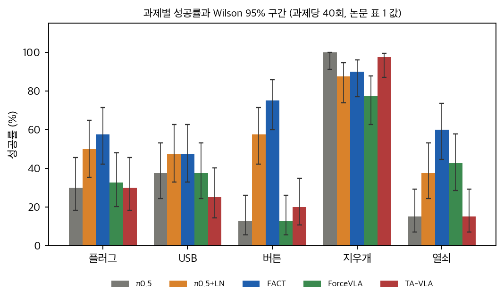
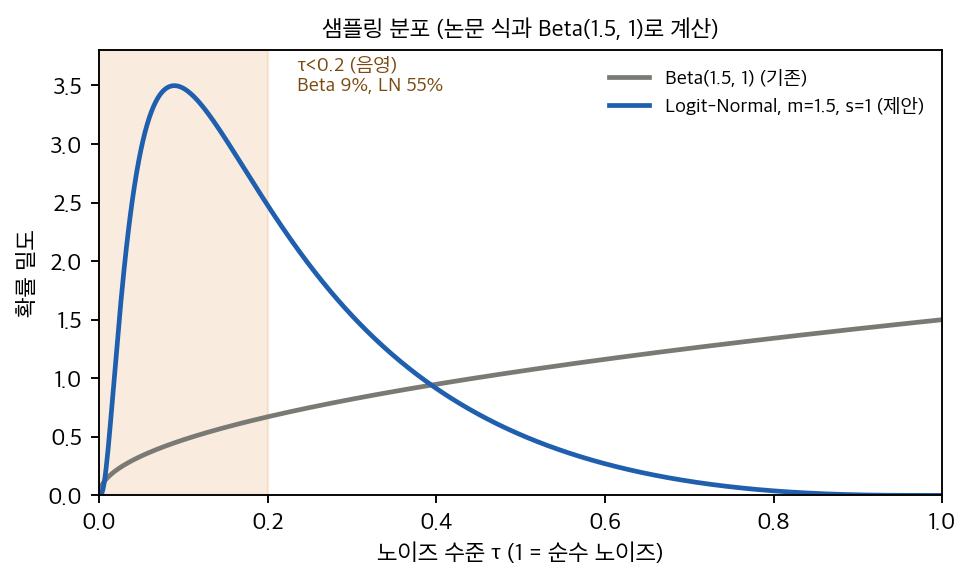
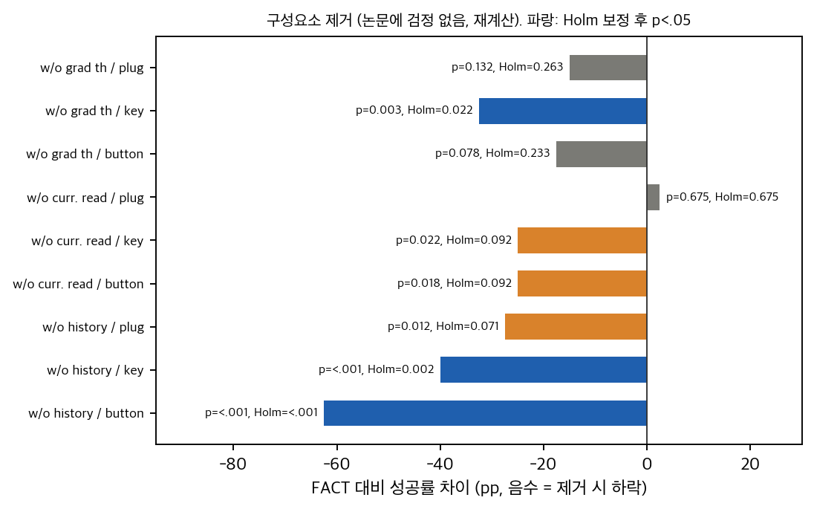
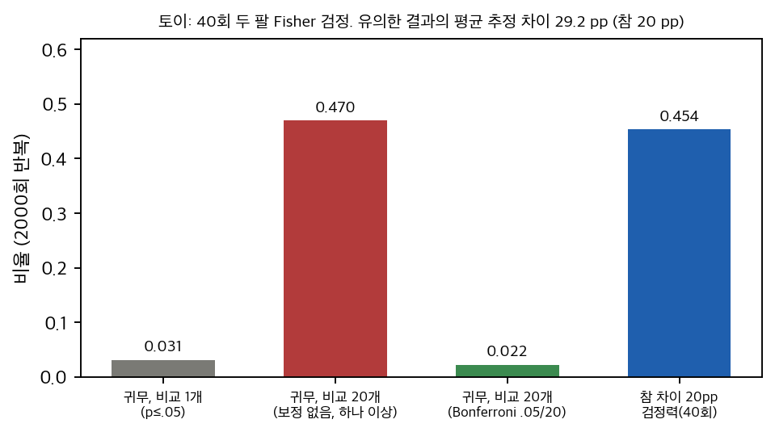

> **논문:** Parés-Morlans 외 4인 (Stanford University). *Demystifying When and Why VLAs Fail in Contact-Rich Tasks and How to Fix Them.* CoRL 2026 Spotlight, arXiv:2608.01402 (v2, 2026-10-16).
> **라이선스:** arXiv 페이지의 CC BY-SA 4.0입니다(평범한 CC BY가 아님). 그래서 논문 그림은 싣지 않았습니다. 이 글의 그래프는 논문 표의 수치를 옮겨 직접 그렸습니다.
> **코드:** 공식 저장소 `stanford-iprl-lab/fact`(Apache-2.0)를 읽기만 했습니다. 실행하거나 설치하지 않았습니다.

---

## 논문이 묻는 것

비전-언어-행동(VLA) 모델은 자유 공간 조작에서는 잘 작동하지만, 커넥터 삽입처럼 접촉 힘을 맞춰야 하는 작업에서는 자주 실패합니다. 기존 연구는 힘 신호를 모델에 넣는 구조(ForceVLA, TA-VLA 등)를 주로 고쳤습니다. 이 논문은 실패의 원인을 둘로 나눕니다.

- **정밀 실패:** 접촉 중 작은 보정 행동을 내지 못합니다.
- **힘 실패:** 접촉 힘에 반응하지 못합니다.

처방도 둘입니다. 첫째, 흐름 정합 학습의 노이즈 시간 샘플링을 Beta(1.5, 1)에서 Logit-Normal(m=1.5, s=1)로 바꿉니다(LN). 둘째, 현재 힘을 AdaRMS 스케일에 더하고 과거 2초의 힘 이력을 시간 합성곱 인코더(TCN)로 토큰화합니다. 두 가지를 합친 FACT는 다섯 접촉 과제 평균 성공률 66%를 보고합니다. 최고 기준선은 40.5%입니다.

## 표는 다시 계산해도 맞습니다

과제마다 40회씩 평가했습니다. 논문의 성공 수를 복원해 보니 모든 셀이 정수였고, 평균과 p값이 모두 맞았습니다. 롤아웃 수는 표 기준 61개 실행 × 40 = 2,440회입니다. 초록의 "거의 2,500회"와 맞습니다.

*그래프: 과제별 성공률과 Wilson 95% 구간(과제당 40회, 논문 Table 1 값). 우리가 그린 그래프입니다.*

그런데 20개 비교에 Holm 보정을 적용하면 남는 것이 셋뿐입니다. FACT의 버튼과 열쇠, π0.5+LN의 버튼입니다. FACT의 플러그 차이(p=.012)는 보정 후 0.19가 됩니다. 논문은 보정 없이 p<.05를 쓰고, 부록에 그 사실을 적었습니다.

## LN은 "정밀"을 늘리지만, 높은 노이즈를 거의 없앱니다

LN의 설계 목표는 τ<0.2 구간의 학습을 늘리는 것입니다. 논문 식을 그대로 계산하면 이 구간 질량은 Beta의 0.089에서 LN의 0.545로 약 6배 늘어납니다. 몬테카를로로도 같은 값이 나옵니다.

*그래프: Beta(1.5, 1)와 Logit-Normal(m=1.5, s=1)의 노이즈 샘플링 밀도. 논문 식으로 계산했습니다.*

그런데 같은 분포에서 τ≥0.8 질량은 0.285에서 0.0019로 줄어듭니다. 추론은 순수 노이즈(τ=1)에서 시작하므로, 이 구간의 흐름 예측 품질이 중요합니다. 논문 부록의 흐름 오차 진단은 낮은 노이즈 구간(5 mm 이하 행동)만 보고합니다. 고노이즈 구간의 오차는 보고되지 않았습니다.

## "정밀 실패" 진단과 LN의 이득이 맞지 않습니다

논문은 플러그와 USB를 정밀 과제, 버튼과 열쇠를 힘 과제로 나눕니다. 결과는 반대 방향입니다.

| 과제 (종류) | π0.5 → π0.5+LN | 차이 | p (단측, 보정 없음) |
|---|---|---|---|
| 플러그 (정밀) | 30.0 → 50.0 | +20.0 | 0.055 |
| USB (정밀) | 37.5 → 47.5 | +10.0 | 0.249 |
| 버튼 (힘) | 12.5 → 57.5 | **+45.0** | <0.001 |
| 열쇠 (힘) | 15.0 → 37.5 | +22.5 | 0.020 |

가장 큰 이득은 힘 과제에 있습니다. 정밀 과제의 이득은 유의하지 않습니다. 실패 유형도 롤아웃마다 세지 않고 과제 종류로 나눴습니다. 그래서 "정밀 실패를 고쳤다"는 주장은 과제 종류와 방법의 상호작용으로 읽어야 합니다.

## 같은 표에서 두 가지 "일관성" 주장이 흔들립니다

- **"모든 기준선에 LN이 일관된 이득을 준다":** TA-VLA에서는 세 과제 모두 올랐지만, ForceVLA에서는 열쇠가 42.5에서 30.0으로 떨어졌습니다.
- **"FACT가 모든 과제에서 25 pp 이상 앞선다":** 평균 차이는 25.5 pp입니다. 과제별로는 +25, +10, +62.5, +12.5, +17.5 pp입니다.

구성요소 제거 실험(Table 3)에는 검정이 없습니다. 재계산하면 여러 비교를 보정한 뒤에도 유의한 것은 이력 제거(열쇠, 버튼)와 그래디언트 임계 제거(열쇠)뿐입니다. 현재 힘 읽기를 빼면 플러그 성공률은 오히려 2.5 pp 올라갑니다. 캡션의 "모든 구성요소가 필요하다"는 뒷받침되지 않습니다.

*그래프: 구성요소 제거에 따른 FACT 대비 성공률 차이와 단측 Fisher p, Holm 보정 값(9개 비교). 논문에는 검정이 없어서 우리가 재계산했습니다.*

## 40회 평가는 검출력이 낮습니다

과제당 두 팔 40회에서 80% 검출력을 얻으려면 기준 성공률 30%에서 30 pp 차이가 필요합니다. 참 차이가 20 pp인 경우 검출력은 0.45입니다. 이때 유의한 결과의 평균 추정 차이는 29 pp로 부풀려집니다. 귀무 가설 아래에서 20개 비교 중 하나 이상이 p≤.05를 얻을 확률은 0.47입니다.

*그래프: 40회 두 팔 Fisher 검정의 귀무·검정력 시뮬레이션(2000회 반복). 우리가 만든 토이 결과입니다.*

## 공식 코드는 논문을 대체로 따릅니다

공식 저장소는 openpi를 바탕으로 한 JAX 코드입니다. 정적으로 읽은 결과는 다음과 같습니다.

- **맞는 것:** LN 샘플러(부호와 값), Beta 기준, 흐름 시간 규약, 힘 창 27샘플, 이력 30스텝, 4블록 인과 TCN, 모든 층에 같은 AdaRMS 보정, 0 초기화 투영, 0.5 N 임계, LoRA 설정.
- **다른 것:** 접촉 게이트는 현재 힘 분기에만 걸리고 이력 토큰에는 걸리지 않습니다. 논문은 "모든 힘 인코딩 요소"라고 씁니다. 공식 설정의 학습 스텝은 30,000이고 논문은 20,000입니다.
- **없는 것:** π0 백본의 힘 조건(force_adarms는 pi05 설정에서만 허용), ForceVLA와 TA-VLA 재구현, 노이즈 대체 실험, 데이터, BOM과 STL입니다. 배치 크기와 학습률은 논문에 없고, 공식 설정은 기본값을 그대로 씁니다.

## 이 맥에서 할 수 있는 것

공식 재현은 이 맥에서 불가능합니다. FACT는 JAX 전용이고 NVIDIA GPU(LoRA 권장 22.5 GB 이상)가 필요합니다. 실로봇 평가는 Franka 팔과 손목 힘 센서가 있어야 합니다. 반면 다음은 CPU나 MPS로 할 수 있습니다.

- 표 재계산과 검정, 검출력 계산(완료).
- LN 샘플링 질량 토이(완료).
- 아이디어를 torch로 소형 재구현해 저노이즈와 고노이즈 구간의 오차를 비교하는 실험(시작 가능).

아이디어 재구현은 수백 줄, 1–2주 규모로 추정합니다. 다만 논문 수치를 맞추려면 실로봇이 필요합니다.

## 정리

이 논문의 표는 다시 계산해도 맞습니다. 그러나 정밀과 힘이라는 진단이 과제 종류에 기대고 있고, LN의 효과도 힘 과제에서 더 큽니다. 고노이즈 구간의 손실은 보고되지 않았습니다. 40회 평가로는 10–20 pp 차이를 판정하기 어렵습니다. 이 글은 논문의 결과를 부정하지 않습니다. 같은 질문을 더 정확하게 묻기 위한 체크리스트로 읽으면 좋겠습니다.

---

**출처와 자료.** 논문: arXiv:2608.01402 v2. 공식 코드: `stanford-iprl-lab/fact` (Apache-2.0, 2ccfe8f 대조). 재계산과 토이 스크립트는 이 글과 함께 게시한 폴더에 있습니다. 논문 그림과 원문 PDF는 넣지 않았습니다.

## 자료

- [통합 리포트 PDF](report/report_public.pdf)
- [Demystifying When and Why VLAs Fail in Contact-Rich Tasks and How to Fix Them (arXiv:2608.01402) 논문 분석](analysis/01_paper_analysis.md)
- [선행연구와 관련 자료 (arXiv:2608.01402)](analysis/02_prior_work.md)
- [03. 수치 재계산, 신뢰구간, 검정, 주장 일관성 (arXiv:2608.01402 v2)](analysis/03_analysis.md)
- [04. 코드 대조와 구현 가능성 (arXiv:2608.01402 v2 ↔ stanford-iprl-lab/fact)](analysis/04_code_verification.md)
