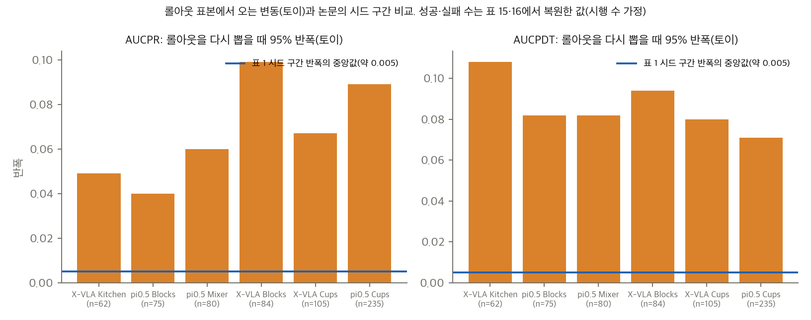
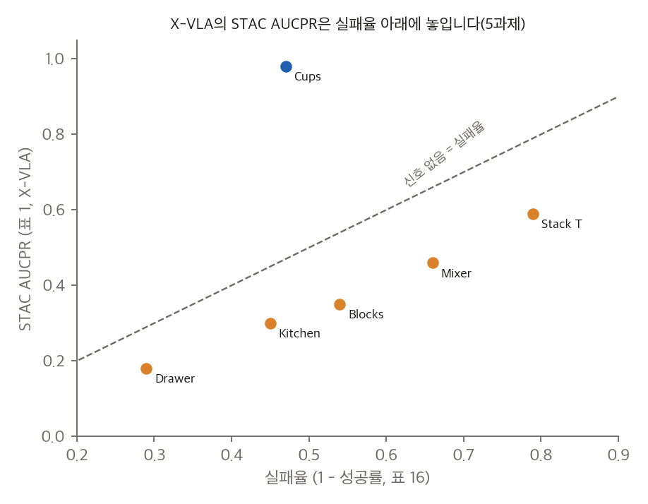
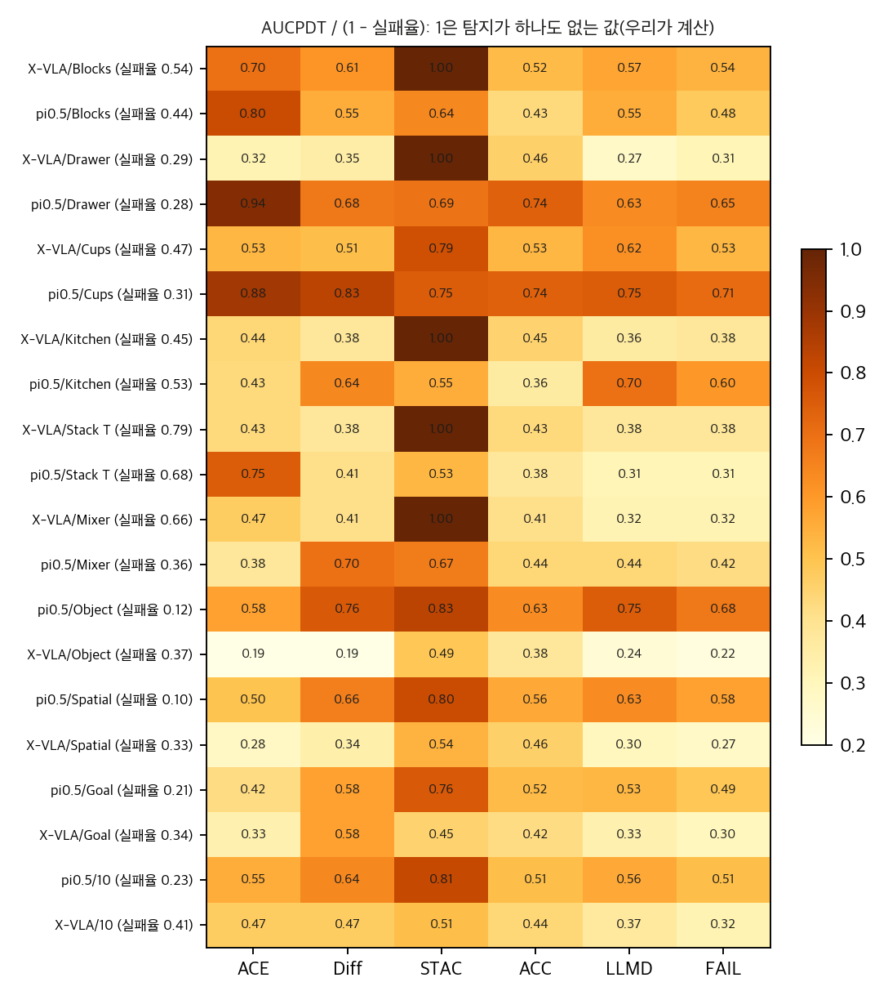
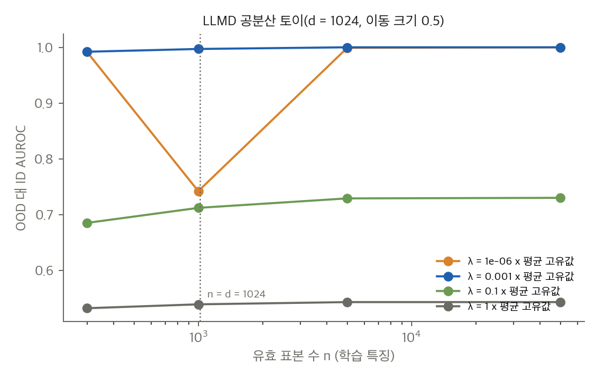

# 03. 수치 재계산, 일관성 검사, 토이

논문 값은 `paper/paper.pdf`(v2)의 표에서 글자 크기(평균 10pt, 구간 5pt)와 좌표로 읽어 `analysis/tables_raw.json`에 저장했습니다(`analysis/extract_tables.py`, v1 표 1·2는 `tables_raw_v1.json`). 원자료(에피소드별 점수)는 없으므로 모든 검사는 **보고된 값끼리** 맞는지를 봅니다. 재계산은 `analysis/recompute.py`(결과 `recompute_results.json`), 토이는 `analysis/toy_metrics.py`(토이 1·2), `analysis/toy_llmd_cov.py`(토이 3)입니다. 검사 이름은 V(재계산), K(표 사이 일관성), 토이 번호는 T입니다. "(시행 수 가정)"은 논문이 직접 적지 않은 시행 수를 표 15·16·17에서 복원했다는 뜻입니다.

## 0. 요약

- **상위 3위 서술은 대체로 맞습니다.** 평균 2자리 기준 공동 순위를 포함하면 FAIL은 실제 로봇 12칸 중 10칸, Libero-Plus 8칸 중 8칸에서 AUCPR와 AUCPDT가 모두 상위 3위입니다(ACC는 8칸, 4칸). 다만 Kitchen π0.5 AUCPR는 5위(0.74, 최고 0.99)입니다(V1).
- **표 1·2의 95% 구간은 롤아웃 변동을 담지 않습니다.** 시드 3개가 같은 롤아웃을 재사용하므로 120개 구간 중 60%가 폭 0.01 이하입니다. 같은 시험 크기의 합성 검출기에서 롤아웃을 다시 뽑으면 AUCPR 95% 반폭이 0.04–0.10, AUCPDT가 0.07–0.11입니다(토이 1, V8, 시행 수 가정). FAIL과 최고 기준선의 격차 대부분(0.01–0.05)은 이 범위 안입니다.
- **표 9의 Cups π0.5 블록 36개 값이 X-VLA 블록과 구간까지 같습니다.** 표 1의 같은 과제 값은 두 모델에서 다릅니다. 표 4의 Cups π0.5 행도 표 1과 다릅니다(AUCPR 0.78 대 0.58, AUCPDT 0.28 대 0.52)(K1, V6).
- **표 6(속도 정규화, Libero-Plus)의 값이 v2 표 2의 ACC와 맞지 않습니다.** 16칸 중 14칸이 다르고, 그 14칸은 v1의 표 2 ACC 값과 같습니다(K1).
- **STAC의 AUCPR가 신호 없는 기준선보다 낮습니다.** X-VLA 5과제에서 STAC AUCPR은 실패율의 0.62–0.75배이고, 그림 3a의 STAC 곡선(실패율 약 0.54에서 평평, 그림 판독 값)이 만드는 면적 약 0.54와 표 1의 0.35가 다릅니다. 반면 STAC의 AUCPDT에서 되읽은 실패율(1 − PDT)은 표 16의 성공률과 5과제 모두 맞습니다(V10).
- **임계값 의존 표는 정수 복원으로 상당 부분 뒷받침됩니다.** 표 9·10의 ACC 열(결정적)은 12행 중 9행이 (시험 = ID + OOD − 보정 20, 성공 수 = 성공률 × (ID + OOD)) 가정에서 정수 TP, TN으로 복원됩니다. 복원이 안 되는 행은 X-VLA Mixer(성공률 0.34가 n = 81로 불가능, 보정 포함 101이면 가능), π0.5 Drawer, π0.5 Cups입니다(V6).
- **conformal 임계값은 평균적으로 이론과 맞습니다.** 12행 평균 TNR이 ACC 0.931, LLMD 0.947, FAIL 0.906으로 이론(0.952, OR 약 0.907)과 같은 크기이고, 과제별로는 0.67–1.00입니다. X-VLA Stack T의 시험 성공 에피소드는 2개로 복원됩니다(V6, V11).
- **표 11(Libero-Plus)은 표 17과 내적으로 일관됩니다.** F1이 Prec, Rec에서 나온 값과 48칸 모두 ±0.005 안이고, WACC = (Rec + TNR)/2와 유병률로 계산한 정밀도가 보고값과 최대 0.02 차이입니다(V7).

## 1. 순위와 서술 재계산 (V1–V4)

표 1과 표 2의 평균값(2자리)으로 칸마다 방법의 공동 순위를 매겼습니다.

### 1.1 V1: 상위 3위 횟수 (§5 "FAIL is the only method to place within the top-three on nearly all")

| 방법 | 실제 12칸: AUCPR 상위 3 | AUCPDT 상위 3 | 둘 다 | Libero 8칸: AUCPR | AUCPDT | 둘 다 |
|---|---|---|---|---|---|---|
| ACE | 2 | 4 | 2 | 4 | 7 | 4 |
| Diff | 4 | 6 | 2 | 0 | 1 | 0 |
| STAC | 5 | 2 | 2 | 4 | 0 | 0 |
| ACC | 10 | 8 | 8 | 7 | 5 | 4 |
| LLMD | 6 | 10 | 6 | 1 | 3 | 0 |
| **FAIL** | **10** | **11** | **10** | **8** | **8** | **8** |

- FAIL의 3위 밖 칸은 Blocks π0.5 AUCPR(0.81, 4위, 최고 0.95), Kitchen π0.5 AUCPR(0.74, 5위, 최고 0.99), Kitchen π0.5 AUCPDT(0.28, 4위, 최고 0.17) 셋입니다. 서술은 "nearly all"로 정확합니다. 단 ACC도 실제 로봇에서 AUCPR 10칸이 상위 3위여서, 속도(PDT)와 함께 볼 때만 구별됩니다.
- 칸 안에서 2자리 동점이 많아(예: Stack T 두 모델에서 FAIL, LLMD, Diff가 PDT 0.08 동점) 순위는 반올림에 민감합니다.

### 1.2 V2: FAIL 대 ACC와 LLMD (§5 "only their combination is reliable")

- FAIL이 ACC와 LLMD **둘 다**보다 나은 칸은 실제 24개 중 5개, Libero-Plus 16개 중 6개입니다.
- 둘 중 나은 쪽에 가장 크게 뒤진 칸: 실제 로봇 Kitchen π0.5 AUCPR −0.25(FAIL 0.74, ACC 0.99), Blocks π0.5 AUCPR −0.14, Kitchen π0.5 AUCPDT −0.11; Libero-Plus 최대 −0.12(Object π0.5 AUCPR 0.54 대 0.66). 개별 검출기 중 하나가 약한 칸에서는 OR이 그 약점을 일부 물려받습니다(순위 최솟값 융합, §4.1).
- 해석: "견고하다"는 **둘 중 못한 쪽보다는 거의 항상 낫다**는 뜻으로 읽으면 표와 맞습니다. 둘 중 나은 쪽과 같거나 더 낫다는 뜻은 아닙니다.

### 1.3 V3: "FAIL이 가장 낮은 AUCPDT" (§5: Cups, Stack T, Mixer 특히 π0.5, Libero-Plus의 X-VLA)

해당 10칸 중 FAIL이 (공동 포함) 가장 낮은 칸은 7개입니다. Cups X-VLA는 Diff 0.27 대 FAIL 0.28, Mixer π0.5는 ACE 0.24 대 FAIL 0.27, Libero-Plus Object X-VLA는 ACE와 Diff 0.12 대 FAIL 0.14입니다. Mixer π0.5에서는 ACE가 AUCPR도 0.93 대 0.79로 앞섭니다.

### 1.4 V4: ACC 대 STAC (§5)

- 실제 로봇: ACC가 AUCPR에서 9/12칸, AUCPDT에서 11/12칸 앞섭니다("nearly all"과 맞음).
- Libero-Plus: "STAC이 AUCPR에서 더 낫다"는 **X-VLA 4/4칸**(STAC 0.99–1.00 대 ACC 0.94–0.97)에서만 성립하고 **π0.5는 0/4칸**(STAC 0.40–0.50 대 ACC 0.66–0.80)입니다. AUCPDT는 두 모델 8/8칸에서 ACC가 낮습니다. 서술이 모델을 가르지 않아 π0.5에서는 반대 방향입니다.

### 1.5 기준선 대비와 RAPT

- FAIL이 세 기준선(ACE, Diff, STAC)의 칸별 최고보다 나은 칸: 실제 24개 중 14개(동점 2), Libero-Plus 16개 중 6개(동점 0). 열세 칸은 대부분 π0.5이고 Libero-Plus π0.5에서는 ACE(32 샘플)가 AUCPDT 3/4 스위트(0.51, 0.45, 0.33)에서 가장 낮습니다.
- RAPT(표 8): FAIL이 20칸 중 9칸 우세, 3칸 동점, 4칸 열세(Drawer X-VLA AUCPR 0.93 대 0.91, Drawer π0.5 AUCPR 0.72 대 0.68·AUCPDT 0.39 대 0.47, Kitchen π0.5 AUCPR 0.78 대 0.74). 평균 행은 RAPT와 FAIL이 X-VLA 0.85/0.28 대 0.94/0.19, π0.5 0.71/0.38 대 0.77/0.31입니다. 표 8에는 구간이 없습니다.

## 2. 시행 수와 정수 가능성 (V5, 표 15–17)

| 모델/과제 | ID + OOD (+보정 20) | 성공률 | 성공 수 가능한 정수(ID+OOD만) | (보정 포함) |
|---|---|---|---|---|
| π0.5 Blocks | 40+35 = 75 (95) | 0.56 | 42 | 53 |
| π0.5 Drawer | 80+41 = 121 (141) | 0.72 | 87 | 101, 102 |
| π0.5 Cups | 181+54 = 235 (255) | 0.69 | 161–163 | 175–177 |
| π0.5 Kitchen | 41+31 = 72 (92) | 0.47 | 34 | 43 |
| π0.5 Stack T | 50+51 = 101 (121) | 0.32 | 32 | 39 |
| π0.5 Mixer | 50+30 = 80 (100) | 0.64 | 51 | 64 |
| X-VLA Blocks | 50+34 = 84 (104) | 0.46 | 39 | 48 |
| X-VLA Drawer | 49+38 = 87 (107) | 0.71 | 62 | 76 |
| X-VLA Cups | 65+40 = 105 (125) | 0.53 | 56 | 66 |
| X-VLA Kitchen | 41+21 = 62 (82) | 0.55 | 34 | 45 |
| X-VLA Stack T | 53+51 = 104 (124) | 0.21 | 22 | 26 |
| X-VLA Mixer | 51+30 = 81 (101) | 0.34 | **없음** | 34 |

- **"roughly 80 rollouts"(§4, 부록 G.2) 대 표 15·16.** ID + OOD 합은 π0.5가 72–235(평균 ID 73.7, OOD 40.3), X-VLA가 62–105(평균 51.5, 35.7)입니다. 부록 G.2의 "과제당 약 50 ID와 30 OOD"와 π0.5 Cups(181 + 54), Drawer(80 + 41)는 크기가 다릅니다.
- **X-VLA Mixer 성공률 0.34**는 n = 81에서 어떤 정수 성공 수로도 만들 수 없지만(27/81 = 0.333, 28/81 = 0.346) 보정 20개를 포함한 n = 101에서는 34/101 = 0.337로 가능합니다. 표 16의 성공률이 보정 롤아웃을 포함한 전체에서 계산되었을 가능성과 맞습니다(다른 11칸은 두 경우 모두 가능).
- Libero-Plus(표 17): 롤아웃 합 9,608개, 스위트별 가중 성공률 π0.5 0.834, X-VLA 0.637, 실패 수는 π0.5 230–559개, X-VLA 759–997개(성공률 반올림에 따른 반올림 값).

## 3. 표 9·10의 클래스 수 복원 (V6, 시행 수 가정)

임계값 의존 표의 ACC 열은 결정적이어서 Rec, Prec, Acc, TNR로부터 정수 TP, TN, 클래스 크기를 되찾을 수 있습니다. 가정: 시험 집합은 ID + OOD에서 성공 롤아웃 20개(보정)를 뺀 것이고, 성공 수는 성공률 × (ID + OOD)입니다(부록 D.1, G).

| 모델/과제 | 시험 성공 N | 시험 실패 P | TP | TN | Rec (Wilson 95%) | TNR (Wilson 95%) |
|---|---|---|---|---|---|---|
| X-VLA Blocks | 19 | 45 | 21 | 19 | 0.47 [0.33, 0.61] | 1.00 [0.83, 1.00] |
| π0.5 Blocks | 22 | 33 | 27 | 19 | 0.82 [0.66, 0.91] | 0.86 [0.67, 0.95] |
| X-VLA Drawer | 42 | 25 | 10 | 42 | 0.40 [0.23, 0.59] | 1.00 [0.92, 1.00] |
| X-VLA Cups | 36 | 49 | 46 | 35 | 0.94 [0.84, 0.98] | 0.97 [0.86, 0.995] |
| X-VLA Kitchen | 14 | 28 | 28 | 12 | 1.00 [0.88, 1.00] | 0.86 [0.60, 0.96] |
| π0.5 Kitchen | 14 | 38 | 34 | 13 | 0.89 [0.76, 0.96] | 0.93 [0.69, 0.99] |
| X-VLA Stack T | **2** | 82 | 73 | 2 | 0.89 [0.80, 0.94] | 1.00 [0.34, 1.00] |
| π0.5 Stack T | 12 | 69 | 24 | 12 | 0.35 [0.25, 0.47] | 1.00 [0.76, 1.00] |
| π0.5 Mixer | 31 | 29 | 5 | 31 | 0.17 [0.08, 0.35] | 1.00 [0.89, 1.00] |

- 9행이 정확히 복원되어 (Rec, Prec, Acc, TNR) 네 값이 한 정수 해와 모두 맞습니다. 표 9·10의 ACC 값은 이 시행 수 가정과 내적으로 일관됩니다.
- **복원되지 않는 행:** X-VLA Mixer(성공률 불가능, V5), π0.5 Drawer(성공 87이면 N = 67, P = 34에서 정밀도 17/34 = 0.50, 정확도 0.66이 나오는데 표는 0.52, 0.67), π0.5 Cups(아래).
- **X-VLA Stack T는 시험 성공 에피소드가 2개**라서 TNR과 정밀도는 사실상 두 에피소드로 계산됩니다(TNR Wilson 하한 0.34). 이 칸의 TNR 1.00과 정밀도 1.00은 모든 방법에서 같은 값으로 나오는 것이 이 때문입니다. 표 10 해석에는 N = 2임을 함께 봐야 합니다.
- **표 9의 Cups π0.5 블록은 X-VLA 블록과 36개 값이 모두 같습니다**(평균과 구간 포함). X-VLA Cups는 N = 36, P = 49(시험 85개)로 복원되고 이는 X-VLA의 ID 65 + OOD 40 − 20과 맞는데, π0.5 Cups의 ID 181 + OOD 54 − 20 = 215개로는 복원되지 않습니다. 다른 5개 과제에서는 두 모델 블록이 같은 값이 거의 없습니다(36개 중 0–6개). v1과 v2 모두 같습니다. 저자 확인이 필요합니다.

## 4. 표 11 (Libero-Plus 임계값 의존) 내적 일관성 (V7)

표 17의 롤아웃 수와 성공률로 시험 실패율 π를 복원하고(시험 성공 = 성공 수 − 보정 100, 시행 수 가정), 표 11의 WACC, Rec에서 TNR = 2·WACC − Rec(WACC가 균형 정확도라는 가정), 정밀도 = Rec·π/(Rec·π + (1−TNR)(1−π))를 계산했습니다.

- F1 = 2·Prec·Rec/(Prec + Rec): 48칸 모두 ±0.005 안. TNR이 1을 넘는 칸 없음.
- 보고된 정밀도와 유병률로 계산한 정밀도의 차이: 최대 0.02(예: X-VLA Spatial ACE 0.769 대 0.783). 표 17(시험 π 0.105–0.428)과 표 11이 같은 시험 집합에서 나왔다는 가정과 맞습니다.
- 임계값 의존 1위와 임계값 무관 1위가 다른 칸이 많습니다(예: X-VLA Object WACC 1위 LLMD 0.994, AUCPR 1위 STAC 1.00). 논문이 부록 D 서두에서 임계값 의존 결과를 덜 신뢰한다고 쓴 것과 같은 방향입니다.

## 5. 롤아웃 표본 변동과 시드 구간 (V8, 토이 1)

**V8: 표 1의 구간.** 표 1에서 구간이 있는 120개 칸(ACC 제외)의 구간 전체 폭 중앙값은 0.01이고 60%가 0.01 이하입니다. 가장 넓은 칸은 Kitchen π0.5 LLMD AUCPR 0.41(0.41–0.82), 같은 칸 AUCPDT 0.26입니다. 부록 G.2에 따르면 이 구간은 같은 롤아웃에 시드 3개(행동 샘플, a*₀)만 바꾼 값이고 ACC는 결정적이라 폭 0입니다. 구간이 서로 겹치지 않는 FAIL 대 기준선(ACE, Diff, STAC) 쌍은 72개 중 50개에서 FAIL이 낫고 7개에서 못합니다(시드 변동만 고려).

**토이 1 (롤아웃을 다시 뽑을 때).** `toy_metrics.py`는 부록 A의 정의대로 AUCPR와 AUCPDT를 구현한 뒤(T = 100, AR(1) 잡음, 실패 시작 U(0.2, 0.8), 평균 이동 δ), 표 15·16에서 복원한 실패·성공 수를 가진 합성 검출기를 롤아웃 단위 부트스트랩(60회)으로 평가합니다.

| 사례(시행 수 가정) | 실패 P / 성공 N | AUCPR 평균 (부트스트랩 SD) | 95% 반폭 | AUCPDT 평균 (SD) | 95% 반폭 |
|---|---|---|---|---|---|
| X-VLA Kitchen | 28 / 34 | 0.965 (0.025) | 0.049 | 0.305 (0.055) | 0.108 |
| π0.5 Blocks | 33 / 42 | 0.949 (0.020) | 0.040 | 0.283 (0.042) | 0.082 |
| π0.5 Mixer | 29 / 51 | 0.937 (0.031) | 0.060 | 0.343 (0.042) | 0.082 |
| X-VLA Blocks | 45 / 39 | 0.873 (0.051) | 0.099 | 0.303 (0.048) | 0.094 |
| X-VLA Cups | 49 / 56 | 0.916 (0.034) | 0.067 | 0.315 (0.041) | 0.080 |
| π0.5 Cups | 74 / 161 | 0.786 (0.045) | 0.089 | 0.449 (0.036) | 0.071 |

- 합성 검출기의 점수 모델은 가정이라 절대 크기는 참고용입니다. 방향은 분명합니다. 이 시험 크기에서는 롤아웃 표본 변동이 표 1의 시드 구간(반폭 약 0.005)보다 한 자릿수 이상 큽니다. FAIL과 최고 기준선의 AUCPR·AUCPDT 격차(실제 로봇의 이긴 칸 대부분 0.01–0.05)는 이 변동 안에 들어갑니다. 반대로 Kitchen π0.5의 −0.25나 STAC의 큰 열세 같은 격차는 이 범위 밖입니다.
- 시드 구간은 "이 롤아웃 집합에서 행동 샘플링 잡음의 영향"을 재는 값으로는 의미가 있습니다. 서로 다른 방법을 순위로 나누는 근거로 쓰려면 롤아웃 재표본 구간이 추가로 필요합니다.

## 6. 표 사이 일치와 절제 표 (K1–K4)

### K1: 같은 값을 가리키는 칸의 일치

| 비교 | 일치 / 칸 | 어긋난 칸 |
|---|---|---|
| 표 4 token-wise ↔ 표 1 LLMD | 22 / 24 | Cups π0.5: 표 4 0.78 / 0.28, 표 1 0.58 / 0.52 (AUCPR / AUCPDT) |
| 표 5 vel norm ↔ 표 1 ACC | 21 / 24 | Kitchen X-VLA AUCPDT 0.20 대 0.25, Mixer X-VLA AUCPR 0.98 대 0.97, AUCPDT 0.11 대 0.14 |
| 표 6 vel norm ↔ **표 2 ACC** | 2 / 16 | 14칸이 다르고, 그 14칸은 **v1 표 2의 ACC 값과 같음** (예: Object π0.5 AUCPDT 표 6 0.58 대 표 2 0.55, Spatial X-VLA 0.28 대 0.31) |
| 표 7 LLMD ↔ 표 1 LLMD | 24 / 24 | – |
| 표 8 FAIL ↔ 표 1 FAIL | 16 / 16 | – |

- 표 4의 Cups π0.5 global 행(0.67 / 0.42)과 token-wise AUCPR(0.78)은 같은 표의 X-VLA 행과 같은 값입니다(§3의 표 9와 같은 양상).
- 표 6은 v1에서 표 2의 값이었던 것이 그대로이고, v2 표 2는 시드 3개로 다시 계산되었습니다(§6 v1→v2). 결론의 방향(속도 정규화가 대체로 개선)은 두 쪽 값에서 같지만 표 6의 숫자는 표 2와 맞지 않습니다.

### K2: 평균 행

- 표 2 Average: 24개 평균 중 23개가 4스위트 평균과 ±0.005 안. X-VLA STAC AUCPDT만 평균 0.318 대 표 0.31(차 0.007).
- 표 7 Average: 12/12 일치.
- **표 8 Average**는 표에 실린 네 과제(Drawer, Kitchen, Stack T, Mixer) 평균이 아니라 **여섯 과제 FAIL 평균**과 같습니다(표 1에서 계산한 X-VLA 0.942 / 0.192, π0.5 0.768 / 0.313 = 표 8의 0.94 / 0.19, 0.77 / 0.31; 네 과제 평균은 0.965 / 0.155, 0.793 / 0.280). RAPT의 Blocks와 Cups 행은 표에 없고 평균은 여섯 과제로 보입니다.

### K3: 본문이 인용한 값

- "전역 통계를 쓰면 X-VLA Drawer AUCPDT가 0.19에서 0.24로 늘어난다"(§5): 표 4에서 token-wise 0.19, global 0.24로 일치.
- "X-VLA Spatial AUCPDT 0.38 → 0.28"(§5): 표 6에서 none 0.38, vel norm 0.28로 일치.
- App. C.1 "LL-RND의 π0.5 AUCPR 0.73 → 0.49, AUCPDT 0.35 → 0.51"(임의 잡음 특징): 0.73과 0.35는 표 7 LL-RND π0.5 평균과 같고 0.49, 0.51은 어느 표에도 없습니다.

### K4: 절제 방향

- 표 4: 12/12칸에서 token-wise가 낫습니다(AUCPR 평균 +0.143, 최소 +0.03, 최대 +0.33; AUCPDT 평균 −0.117).
- 표 5(실제 로봇): AUCPR 평균 +0.013(1칸 악화: Drawer X-VLA 0.90 → 0.83), AUCPDT 평균 −0.019(악화 0칸). §5의 "On real-world tasks ... consistent across tasks"는 AUCPDT에서 성립하고 AUCPR에서는 Drawer X-VLA가 예외입니다.
- 표 6(Libero-Plus): AUCPR 평균 +0.055(악화 1칸: Object π0.5 0.68 → 0.65), AUCPDT 평균 −0.037(악화 2칸: Object π0.5 0.52 → 0.58, Spatial π0.5 0.48 → 0.49). 개선이 큰 곳은 X-VLA(10 스위트 AUCPR 0.75 → 0.96)입니다.

## 7. 표 3 (V9)

- 지연: X-VLA 136 → 139 ms = +2.21%(보고 2.2), π0.5 77 → 78 ms = +1.30%(보고 1.3). 해상도가 1 ms라 π0.5는 [+0.65, +1.95]% 범위의 반올림 값입니다.
- 메모리: 3.717 → 3.721(+0.11%), 7.136 → 7.165(+0.41%). 단위가 **MB**로 적혀 있습니다. 0.9B와 3.6B 모델의 가중치만으로 수 GB이므로 GB이거나 다른 양(활성 메모리 등)일 수 있습니다. 단위 확인이 필요합니다.
- Table 2 캡션은 "no computational overhead", 본문은 "marginal", 표 3은 +1.3–2.2%입니다. 서술 수준이 서로 다릅니다.
- 전처리: π0.5 60분 + 3분, X-VLA 67분 + 3분(Stack T). 부록 C.1의 "LLMD 70분"은 X-VLA(67 + 3)와 맞고 π0.5(63분)와는 다릅니다.

## 8. AUCPDT와 AUCPR 정의 점검 (V10, 토이 2)

**신호 없는 검출기.** 부록 A에 따르면 탐지가 아예 없으면 PDT ≡ 1이므로 정밀도 구간 [π, 1]에서 AUCPDT = 1 − π입니다. 이 구현(토이 2)에서 점수가 에피소드와 무관한 검출기는 π = 0.29, 0.54, 0.79에서 AUCPDT 0.685, 0.436, 0.203으로 1 − π(0.71, 0.46, 0.21) 근처이고 AUCPR는 0.326, 0.576, 0.801로 π 근처입니다. 우연한 경보가 정밀도를 π 위로 조금 끌어올려 AUCPDT가 약간 낮게 나옵니다.

**표 1 STAC로 되읽은 실패율.** X-VLA에서 STAC은 5과제(Blocks, Drawer, Kitchen, Stack T, Mixer)에서 AUCPDT가 0.46, 0.71, 0.55, 0.21, 0.34이고 그림 3b의 STAC은 PDT = 1로 평평합니다. 1 − AUCPDT = 0.54, 0.29, 0.45, 0.79, 0.66은 표 16의 1 − 성공률과 5과제에서 모두 같습니다. 표 16의 성공률과 AUCPDT 정의가 내적으로 맞는다는 근거입니다. Cups X-VLA는 STAC이 신호가 있어(AUCPR 0.98) 해당하지 않습니다.

**그런데 STAC의 AUCPR.** 같은 5과제에서 STAC AUCPR은 0.35, 0.18, 0.30, 0.59, 0.46으로 실패율의 0.65, 0.62, 0.67, 0.75, 0.70배입니다. 신호가 없으면 AUCPR는 실패율 근처가 되는 것이 일반적인데(토이 2) 표 1은 그 아래입니다. 그림 3a(X-VLA Blocks)의 STAC 곡선은 재현율 0–1에서 정밀도가 약 0.54(그림 판독 값)로 평평하고 그 면적은 약 0.54입니다. 표 1의 0.35와 다르고, 같은 그림의 ACC 곡선 면적(약 0.92)은 표 1의 0.92와 맞습니다. AUCPR 계산 규칙(보간, 동점, 재현율 끝점)이 논문에 없어 STAC 칸의 원인은 확인하지 못했습니다.

**AUCPDT의 범위.** 값의 상한이 1 − π라서 실패율이 다른 과제 사이에서 AUCPDT를 직접 비교하거나 평균내면 실패율이 큰 과제(Libero-Plus π0.5, π = 0.10–0.23)는 상한이 0.77–0.90이고 Stack T X-VLA(π = 0.79)는 상한이 0.21입니다. 표 2 평균 행과 표 7·8 평균은 이 차이를 가리지 않습니다. 아래는 AUCPDT를 1 − π로 나눈 값입니다(표 15–17의 성공률 사용, 시행 수 가정). 1은 탐지가 없는 값입니다.

- Libero-Plus π0.5에서 모든 방법의 정규화 AUCPDT가 0.42–0.83입니다(ACE 0.42–0.58, FAIL 0.49–0.68). 상대적으로 실제 로봇 Stack T와 Mixer의 X-VLA는 FAIL 0.32–0.38입니다. "FAIL이 π0.5 Libero-Plus에서 AUCPDT 상위"라는 순위와 "탐지가 얼마나 빠른가"는 별개입니다.

## 9. 임계값 의존 결과 (V11, 표 9–10)

- **conformal 임계값.** 보정 n = 20, 유의수준 0.05의 시간 불변 임계값은 단일 검출기의 기대 거짓 경보율을 1/21 = 4.8% 이하로 둡니다(TNR 0.952 이상). 12행 평균 TNR: ACE 0.929, Diff 0.947, STAC 0.948, ACC 0.931, LLMD 0.947, FAIL 0.906. FAIL은 두 임계값의 OR이라 독립이면 (1 − 1/21)² = 0.907이고 평균이 이 값과 맞습니다. 0.95 아래인 행은 FAIL 8개, LLMD 6개, ACC 5개입니다. 가장 낮은 칸은 π0.5 Drawer FAIL 0.67(N = 67 가정), 보정 20개가 적어 한 보정 이상치가 임계값을 크게 올린다는 부록 D의 서술과 같은 방향입니다.
- **평균 성능(표 9·10, 6과제 평균).** F1: FAIL 0.902(X-VLA), 0.770(π0.5), ACC 0.837, 0.678, LLMD 0.747, 0.398. 재현율은 FAIL 0.875, 0.725로 가장 높고 정밀도는 FAIL 0.957(X-VLA), 0.885(π0.5)로 ACC(0.982, 0.895)보다 약간 낮습니다. OR 융합이 재현율을 올리고 정밀도를 조금 내립니다.
- **구간.** 3시드 구간이 [0, 1] 밖으로 나가는 칸이 11개 있습니다(예: π0.5 Kitchen Diff Prec 0.67 [0.01, 1.32], π0.5 Stack T STAC TNR 0.97 [0.92, 1.03]). t 구간을 유계 지표에 쓴 결과로 읽힙니다.
- **표 9, 10 해석의 단서.** 시험 성공 수가 14–42개(X-VLA Stack T는 2개)이고 표 9의 Cups π0.5는 X-VLA 값입니다(§3).

## 10. LLMD 공분산 토이 (토이 3)

부록 F는 λ = 10⁻⁶이 "역행렬이 존재하게 하려는 값이라 튜닝이 필요 없다"고 말합니다. `toy_llmd_cov.py`는 d = 1024(표 13), 신호 k = 32 방향 + 작은 등방 잡음(σ = 0.05)의 합성 특징으로 유효 표본 수 n과 λ(평균 고유값 대비 비율)에 따른 제곱 마할라노비스(식 3의 한 토큰)를 봅니다. OOD는 신호 방향과 수직으로 σ√d의 0.5배 이동한 특징입니다(가정).

| 유효 표본 수 n | λ = 1e-6 · 평균 고유값: ID 점수 중앙값 / d, AUROC | λ = 1e-3 | λ = 0.1 |
|---|---|---|---|
| 300 (< d) | 1984배, 0.992 | 2.1배, 0.992 | 0.06배, 0.685 |
| 1,000 (≈ d) | 91배, **0.742** | 1.2배, 0.997 | 0.06배, 0.712 |
| 5,000 | 1.26배, 0.999 | 0.81배, 1.000 | 0.05배, 0.729 |
| 50,000 | 1.02배, 1.000 | 0.73배, 1.000 | 0.05배, 0.730 |

- n이 d보다 충분히 크면 λ = 10⁻⁶(평균 고유값의 백만분의 1)도 안전하고 ID 점수가 약 d입니다. n이 d에 가까울 때(1,000)는 ID 점수가 d의 약 90배가 되고 분리(AUROC)가 0.74까지 떨어지며, 작지 않은 정규화(평균 고유값의 0.1%)에서 0.997로 회복됩니다.
- 논문은 π0.5와 X-VLA의 특징 크기, 미세조정 프레임 수(시연 100개)와 같은 롤아웃의 프레임 상관(유효 표본 수)을 적지 않았습니다. "λ를 튜닝할 필요가 없다"는 n ≫ d(또는 특징의 유효 차원이 작을 때)라는 조건 아래의 진술로 읽는 것이 안전합니다. 점수는 conformal 임계값이 규모를 흡수하므로 절대 크기보다 분리가 중요합니다.
- 이 토이는 합성 가우시안 특징이고 실제 VLA 특징의 스펙트럼을 대신하지 못합니다.

## 11. v1 ↔ v2 (V12)

- 표 1: 144개 평균 모두 동일(변화 0).
- 표 2: 96개 평균 중 58개가 바뀜. 최대 변화 0.14, 중앙값 0.01, 방법별 변화 칸 수 ACE 10, Diff 11, STAC 5, ACC 14, LLMD 6, FAIL 12. 칸별 1위가 바뀐 곳은 Object X-VLA AUCPDT(Diff → ACE)와 Goal π0.5 AUCPR(ACC → ACE) 둘입니다. FAIL의 상위 3위 칸 수는 v1과 v2에서 같습니다(8/8). v1 표 2에는 Average 행이 없습니다.
- 표 11과 표 9·10의 값은 v1과 v2에서 같습니다.

## 12. 판정 요약

| 번호 | 항목 | 판정 |
|---|---|---|
| V1 | FAIL의 상위 3위 서술 | 대체로 일치(10/12, 8/8), 반올림 동점 민감 |
| V2 | "결합이 견고하다" | 못한 쪽보다는 낫다. 나은 쪽과는 최대 −0.25 |
| V3 | "가장 낮은 AUCPDT" 예시 | 10칸 중 7칸 |
| V4 | ACC 대 STAC | 실제 일치, Libero-Plus AUCPR은 X-VLA만 STAC 우세 |
| V5 | 롤아웃 수·정수 | X-VLA Mixer 0.34는 n = 81이면 불가, "roughly 80"은 62–235 |
| V6 | 표 9·10 클래스 복원 | 12행 중 9행 복원, X-VLA Stack T는 N = 2 |
| V7 | 표 11 내적 일관성 | 일치(차이 ≤ 0.02) |
| V8 | 구간의 의미 | 시드 변동만, 롤아웃 변동은 한 자릿수 이상 큼(토이) |
| V9 | 표 3 산술 | 일치, 메모리 단위 확인 필요 |
| V10 | AUCPDT 정의와 STAC | AUCPDT는 일치, STAC AUCPR은 규칙 불명 |
| V11 | conformal TNR | 평균은 이론과 일치 |
| V12 | v1 ↔ v2 | 표 1 동일, 표 2 58/96 변경 |
| K1 | 표 사이 일치 | 표 6 ↔ 표 2 14/16 불일치, 표 4·9 Cups π0.5 |
| K2 | 평균 행 | 표 8은 6과제 평균 |
