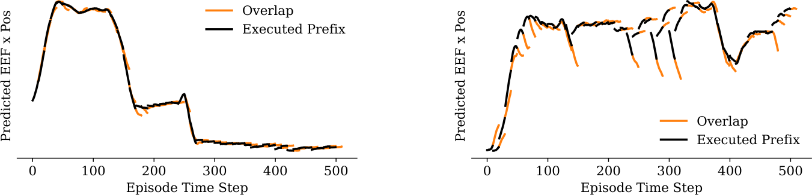
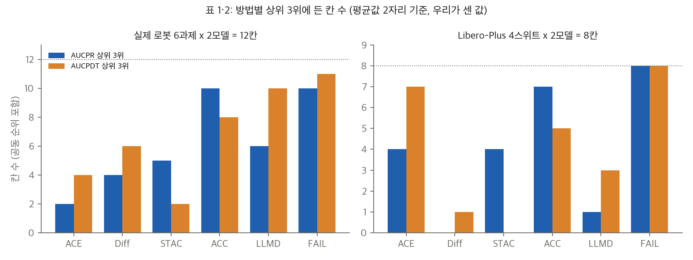
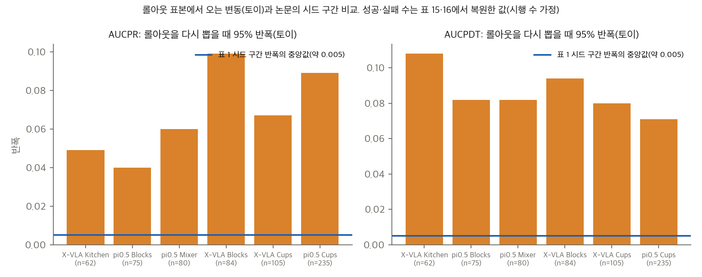
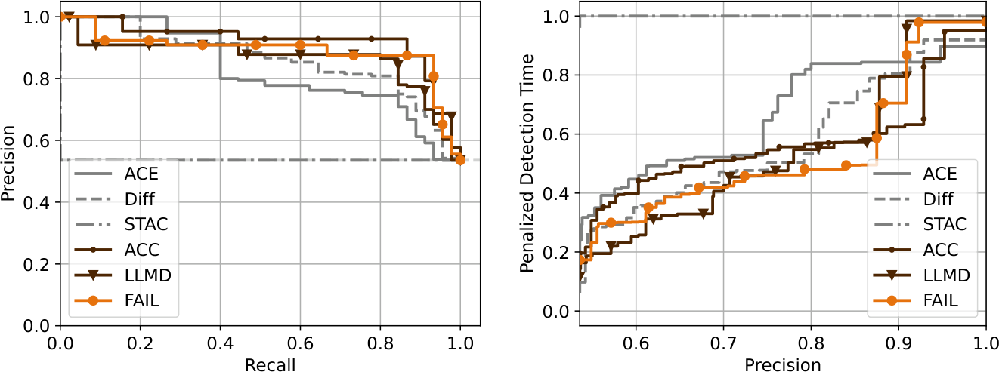
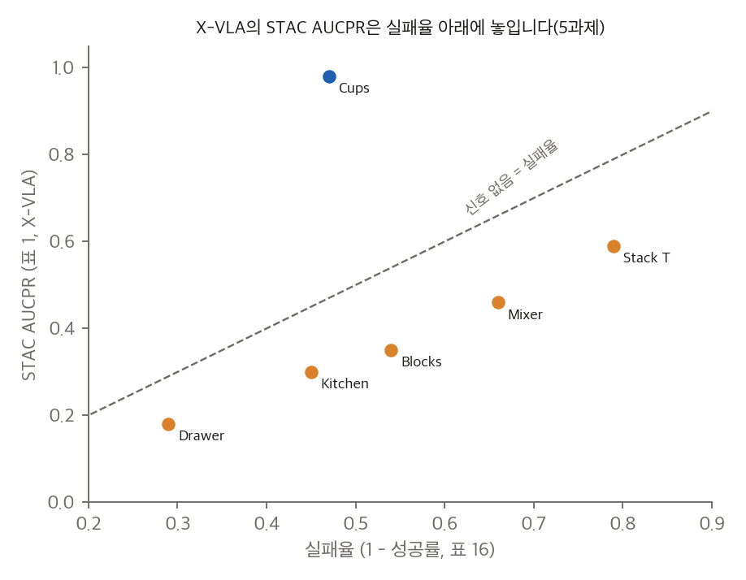
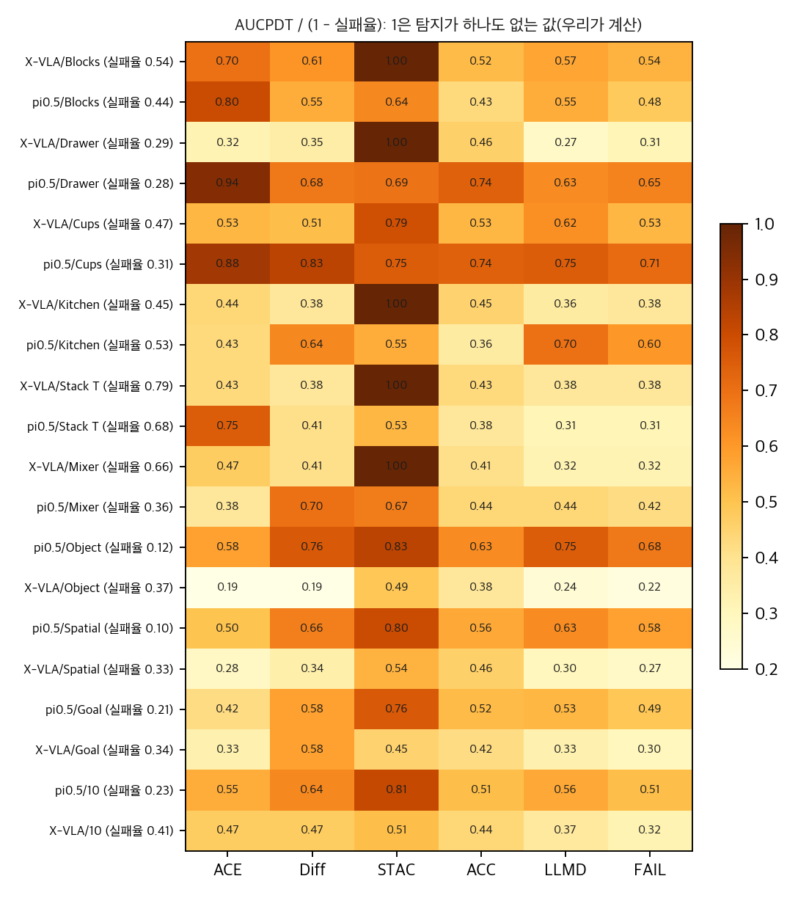
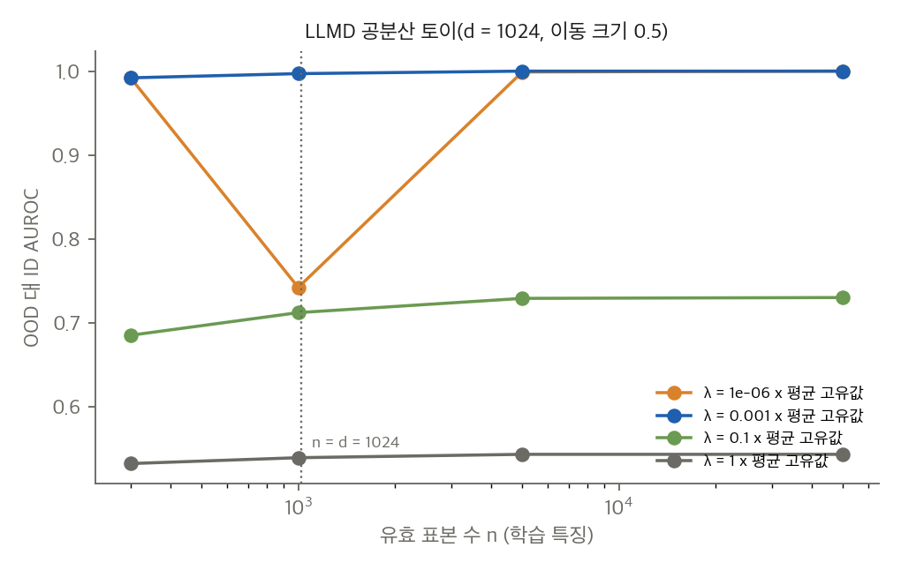

> **논문:** Florian Seligmann, Emiliyan Gospodinov, Enes Ulas Dincer, Gerhard Neumann. *VLA-FAIL: Efficient Task Failure Detection for Finetuned Vision-Language-Action Models.* CoRL 2026 포스터, arXiv:2606.21386 (v2, 2026-10-09).
> 공식 코드 저장소는 2026-11-26 기준 확인하지 못했습니다. 이 글의 그림은 논문 그림 두 장(출처 표기)과 우리가 그린 그래프 다섯 장입니다.

## 논문이 묻는 것

VLA는 미세조정을 마쳐도 분포 밖 상황에서 예측하기 어렵게 움직입니다. 배치 중에 실패를 일찍 알아야 사람이 개입하거나 안전한 폴백으로 넘어갈 수 있습니다. 그런데 기존 검출기는 행동을 여러 번 샘플링해야 하거나(FIPER, Sentinel, Diff-DAgger), 실패 롤아웃이 필요하거나(SAFE), 외부 VLM에 기댑니다. 논문의 조건은 **실패 데이터 없이, 추가 연산을 거의 들이지 않고, 최신 VLA 구조에 붙는 것**입니다.

VLA-FAIL은 두 신호의 OR입니다.

- **LLMD**: 행동 전문가(flow matching) 마지막 층의 토큰별 특징을 **고정된 prior 잡음 하나**(시각 t = 0)로 뽑고, 미세조정 데이터의 토큰별 평균·공분산에 대한 제곱 마할라노비스 거리의 최댓값을 점수로 씁니다. 추가 비용은 순전파 한 번입니다.
- **ACC**: 재계획 때 겹치는 두 행동 청크의 EEF 위치 차이를 속도로 나누고 지수이동평균으로 평활합니다. 이미 만든 청크만 쓰므로 비용이 없습니다.
- 임계값은 성공 롤아웃 20개(실제 로봇)나 100개(LIBERO-Plus)로 conformal 밴드를 맞추고, 둘 중 하나라도 넘으면 경고합니다.

평가 지표로는 정밀도 구간 [실패율, 1]에서 정밀도 대 "벌점 탐지 시각"(PDT) 곡선의 면적 **AUCPDT**를 새로 제안합니다. 실패를 못 잡으면 PDT를 1로 두어 정밀도와 속도를 한 숫자로 봅니다.

*그림 2 (논문 원문). 성공 에피소드에서는 실행하지 않은 예측이 다음 청크와 겹치고, 실패 에피소드에서는 청크 사이가 어긋납니다. © 저자, CC BY 4.0, 출처 arXiv:2606.21386.*

실험은 π0.5(3.6B)와 X-VLA(0.9B), 실제 로봇 6과제(과제당 시연 100개)와 LIBERO-Plus 4개 스위트(롤아웃 합 9,608개)이고, 기준선은 ACE, Diff, STAC입니다. 지연 증가는 RTX 5090에서 X-VLA +2.2%, π0.5 +1.3%로 보고됩니다.

## 이 글에서 확인한 것

표의 평균과 구간을 PDF에서 좌표로 읽어 다시 계산했습니다. 원자료(에피소드별 점수)는 없어서 모든 검사는 **보고된 값끼리** 맞는지를 봅니다. 시행 수는 논문 표 15–17에서 복원한 값입니다(시행 수 가정).

**1. 상위 3위 서술은 대체로 표와 맞습니다.** 평균 2자리 기준, 공동 순위를 포함하면 FAIL은 실제 로봇 12칸 중 10칸, LIBERO-Plus 8칸 중 8칸에서 AUCPR와 AUCPDT가 모두 상위 3위입니다. ACC는 8칸과 4칸, LLMD는 6칸과 0칸입니다. 상위 3위 밖은 Blocks π0.5 AUCPR(0.81), Kitchen π0.5 AUCPR(0.74, 최고 0.99)와 AUCPDT(0.28, 최고 0.17) 세 칸입니다. 다만 FAIL이 ACC와 LLMD 둘 다보다 나은 칸은 실제 24개 중 5개, LIBERO-Plus 16개 중 6개이고, 둘 중 나은 쪽에 가장 크게 뒤진 칸은 Kitchen π0.5 AUCPR로 0.25입니다. "결합이 견고하다"는 둘 중 못한 쪽보다는 거의 항상 낫다는 뜻으로 읽으면 표와 맞습니다.

*그래프: 방법별 상위 3위 칸 수(우리가 센 값). 우리가 그린 그래프입니다.*

**2. 95% 구간은 롤아웃 변동을 담지 않습니다.** 부록 G.2에 따르면 시드 3개는 같은 롤아웃을 재사용하고 행동 샘플과 고정 잡음만 바꿉니다. 표 1의 구간이 있는 120칸 중 60%가 구간 폭 0.01 이하입니다. 같은 시험 크기를 가진 합성 검출기(실패·성공 수는 표 15·16에서 복원, 시행 수 가정)에서 롤아웃을 다시 뽑으면 AUCPR의 95% 반폭이 0.04–0.10, AUCPDT가 0.07–0.11입니다. 표에서 FAIL이 기준선보다 낫거나 못한 칸의 큰 차이(Kitchen π0.5 −0.25 등)는 이 범위 밖이지만, 0.01–0.05 정도의 차이는 이 변동 안에 들어갑니다. 롤아웃 단위 부트스트랩 구간이 표에 있으면 판단하기 쉬워집니다.

*그래프: 합성 검출기의 롤아웃 재표본 95% 반폭(주황)과 표 1 시드 구간 반폭의 중앙값(파랑). 점수 모델은 가정이라 절대 크기는 참고용입니다. 우리가 그린 그래프입니다.*

**3. 표 몇 곳은 값끼리 확인이 필요합니다.** 표 9(임계값 의존, 실제 로봇)의 Cups π0.5 블록 36개 값이 X-VLA 블록과 구간까지 같습니다. 같은 과제의 표 1 값은 두 모델에서 다르고, 표 9의 ACC 열이 정수 TP, TN으로 복원되는 X-VLA Cups 크기(시험 85개)와 π0.5 Cups(ID 181 + OOD 54 − 보정 20 = 215개)의 크기가 다릅니다. 표 4의 Cups π0.5 행도 표 1의 LLMD 값과 다릅니다(AUCPR 0.78 대 0.58, AUCPDT 0.28 대 0.52). 표 6(속도 정규화, LIBERO-Plus)은 v2 표 2의 ACC와 16칸 중 14칸이 다르고, 그 14칸은 v1 표 2의 값과 같습니다. 표 8의 평균 행은 표에 실린 네 과제 평균이 아니라 표 1의 여섯 과제 FAIL 평균과 같습니다. 저자 확인이 필요한 부분입니다.

**4. STAC의 AUCPR가 신호 없는 기준선보다 낮습니다.** 부록 A에 따르면 탐지가 없을 때 PDT가 구간 전체에서 1이므로 AUCPDT는 1 − 실패율입니다. X-VLA에서 STAC의 AUCPDT로 되읽은 실패율(Blocks 0.54, Drawer 0.29, Kitchen 0.45, Stack T 0.79, Mixer 0.66)은 표 16의 1 − 성공률과 5과제에서 모두 같습니다. 그런데 같은 5과제에서 STAC의 AUCPR은 실패율의 0.62–0.75배(0.35, 0.18, 0.30, 0.59, 0.46)이고, 그림 3a의 STAC 곡선은 정밀도 약 0.54(그림 판독 값)로 평평해 면적이 약 0.54로 읽힙니다. 표 1의 0.35와 다릅니다. 같은 그림의 ACC 곡선 면적(약 0.92)은 표 1의 0.92와 맞습니다. AUCPR 계산 규칙(보간, 동점, 재현율 끝점)이 논문에 없어 원인은 확인하지 못했습니다.

*그림 3 (논문 원문). X-VLA Blocks의 PR 곡선(왼쪽)과 PDT 곡선(오른쪽). STAC 곡선은 평평합니다. © 저자, CC BY 4.0, 출처 arXiv:2606.21386.*

*그래프: 표 1의 X-VLA STAC AUCPR과 표 16에서 얻은 실패율(대각선이 신호 없음). Cups는 STAC에 신호가 있습니다. 우리가 그린 그래프입니다.*

**5. AUCPDT의 범위는 실패율에 따라 다릅니다.** 값의 상한이 1 − 실패율이라서, 실패율이 낮은 LIBERO-Plus π0.5(0.10–0.23)와 실패율이 높은 실제 로봇 Stack T X-VLA(0.79)의 AUCPDT를 직접 비교하거나 평균내면 두 상한이 섞입니다. 표 15–17의 성공률로 나눠 본 값(시행 수 가정)에서 LIBERO-Plus π0.5는 모든 방법이 0.42–0.83이라 탐지가 늦은 편이고, 실제 로봇 Stack T와 Mixer의 X-VLA에서는 FAIL이 0.32–0.38입니다.

*그래프: AUCPDT / (1 − 실패율). 1은 탐지가 하나도 없는 값입니다. 우리가 그린 그래프입니다.*

**6. 임계값 의존 표는 대부분 내적으로 일관됩니다.** 표 9·10의 ACC 열(결정적)은 12행 중 9행이 (시험 = ID + OOD − 보정 20, 성공 수 = 성공률 × (ID + OOD)) 가정에서 정수 TP, TN으로 복원됩니다(시행 수 가정). 이 복원에서 X-VLA Stack T의 시험 성공 에피소드는 2개이고, TNR과 정밀도가 모든 방법에서 1.00인 것은 이 크기 때문입니다. conformal 임계값(보정 20개, 유의수준 0.05)의 12행 평균 TNR은 ACC 0.931, LLMD 0.947, FAIL 0.906으로 이론(단일 0.952, OR 약 0.907)과 같은 크기입니다. LIBERO-Plus 표 11도 표 17과 일관됩니다(F1이 48칸 모두 정밀도·재현율에서 나온 값과 ±0.005 안, 유병률로 계산한 정밀도와 최대 0.02 차이).

**7. 서술이 어긋난 곳.** ACC의 평활 α는 본문과 표 13·14에서 0.9이고(식 6에서 α가 클수록 평활이 강함), 부록 B는 "α = 0.1을 모든 실험에 쓴다", "낮은 α가 더 많은 평활"이라고 적습니다. LIBERO-Plus 체크포인트는 본문(공식 체크포인트)과 부록 G.3(LIBERO-Plus 학습 데이터로 미세조정)에서 다르게 적혀 있습니다. 시행 수는 본문 "약 80"과 표 15·16의 72–235가 다릅니다. X-VLA Mixer 성공률 0.34는 n = 81이면 정수 성공 수로 만들 수 없고 보정 20개를 포함한 n = 101이면 34/101로 가능합니다.

## LLMD의 λ는 정말 튜닝이 필요 없을까

부록 F는 λ = 10⁻⁶을 "역행렬을 위한 값이라 튜닝이 필요 없다"고 권합니다. 합성 가우시안 특징(d = 1024, 신호 32방향 + 작은 등방 잡음)으로 유효 표본 수 n과 λ에 따른 분리를 보았습니다. n이 d보다 충분히 크면(5,000 이상) λ가 작아도 ID 점수가 약 d이고 OOD 분리(AUROC)가 0.999 이상입니다. n이 d에 가까우면(1,000) λ = 10⁻⁶에서 ID 점수가 d의 약 90배가 되고 AUROC가 0.74까지 떨어지며, 평균 고유값의 0.1%를 더하면 0.997로 돌아옵니다. 논문은 π0.5·X-VLA의 특징 규모, 공분산에 쓰는 프레임 수와 같은 롤아웃 안 프레임의 상관을 적지 않았습니다. 그래서 "튜닝 불필요"는 유효 표본 수가 차원보다 충분히 큰 조건의 진술로 읽는 것이 안전합니다. 이 토이는 합성 특징이고 실제 VLA 특징의 스펙트럼을 대신하지 못합니다.

*그래프: 유효 표본 수 n(가로)과 λ(선)에 따른 OOD 대 ID AUROC. 우리가 그린 그래프입니다.*

## 버전 사이 변화

v1과 v2에서 표 1(144개 평균)은 같고, 표 2(LIBERO-Plus)는 시드 1개에서 시드 3개와 구간 추가로 바뀌어 96개 평균 중 58개가 달라졌습니다(최대 0.14, 중앙값 0.01, 칸별 1위가 바뀐 곳은 2칸). v2에는 지연·메모리 표(표 3), α와 v_min 스윕, LL-RND·LL-logpZO·RAPT와의 비교(표 7, 8), 형식적 안전 보장이 없다는 한계 문장이 추가되었고, 본문에서 "현저히 빠르다"는 표현이 빠졌습니다.

## 한계와 읽는 법

논문이 직접 적은 한계는 이렇습니다. LLMD는 미세조정 데이터 재접근이 필요하고, ACC는 청크 겹침이 필요하며, 특징과 행동이 모두 일관된 실패(확신을 갖고 멈추기, 지시 무시)는 놓칠 수 있고 형식적 안전 보장이 없습니다. 이 글의 재계산이 더하는 점은 세 가지입니다. 같은 시험 크기에서 롤아웃 표본 변동은 표의 시드 구간보다 한 자릿수 이상 크다는 것, 표 9·6·8 몇 곳은 저자 확인이 필요하다는 것, ACC의 α 정의와 AUCPR 계산 규칙이 코드 없이는 확정되지 않는다는 것입니다. 공식 코드는 2026-11-26 기준 확인하지 못해 코드 대조는 하지 못했습니다. 그래서 위 판단은 모두 논문의 표, 본문, 부록 안에서의 일관성 검사입니다.

## 재현 가능성

이 맥(Apple M4 Pro, 약 24 GiB, CUDA 없음)에서 논문 수치의 재현은 불가능합니다. 실제 로봇 데이터와 미세조정 체크포인트가 없고 LIBERO-Plus 9,608 롤아웃 평가에는 GPU가 필요합니다. 방법 자체(LLMD, ACC, FAIL, AUCPDT)는 소형 정책에서 수십 줄로 구현할 수 있어서, 표 재계산과 토이 세 개는 numpy로 돌렸습니다(재계산과 토이 스크립트는 `analysis/`에 있습니다). 가중치와 데이터셋은 받지 않았습니다.

## 자료

- [통합 리포트 PDF](report/report_public.pdf)
- [01. 논문 분석: VLA-FAIL (arXiv:2606.21386 v2)](analysis/01_paper_analysis.md)
- [02. 선행연구와 계보](analysis/02_prior_work.md)
- [03. 수치 재계산, 일관성 검사, 토이](analysis/03_analysis.md)
- [04. 주장 대조 (공식 코드 없음)](analysis/04_claim_verification.md)
