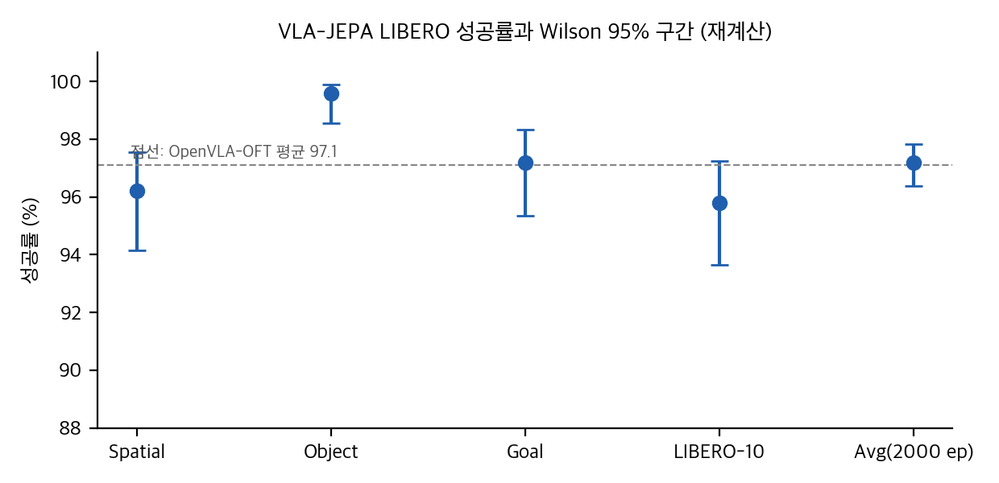
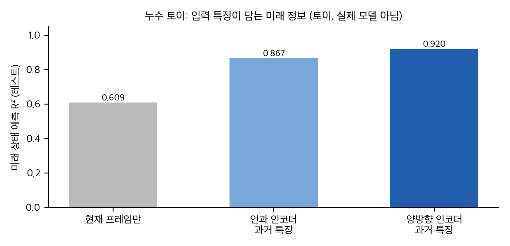

> **논문:** Jingwen Sun, Wenyao Zhang, Zekun Qi 외. *VLA-JEPA: Enhancing Vision-Language-Action Model with Latent World Model.* arXiv:2602.10098 (v2, 2026-02-14). 학회는 공식 저장소 설명에 ECCV 2026으로 적혀 있지만 공식 채택 목록에서는 확인하지 못했습니다.
> 공식 코드(Apache-2.0)는 정적으로만 읽었고 실행하지 않았습니다. 논문 그림은 싣지 않았고, 우리가 만든 그래프만 씁니다.

## 논문이 묻는 것

로봇 파운데이션 모델(VLA)은 행동 데이터가 비싸고 좁아서 확장이 어렵습니다. 그래서 라벨 없는 영상에서 잠재 행동을 먼저 배우는 연구가 많습니다. 이 논문은 그 잠재 행동이 **행동이 아니라 픽셀 변화**를 배우고 있다고 주장합니다. 외형 편향, 카메라 움직임 같은 노이즈, 미래 정보의 누수, 여러 단계 학습의 복잡성이 그 증거입니다.

제안은 JEPA 방식입니다. 동결된 V-JEPA 2 인코더가 미래 클립에서 타깃 잠재 상태를 만들고, 학생 경로(Qwen3-VL-2B)는 현재 관측만 봅니다. 미래 프레임은 타깃으로만 쓰입니다. 그 위에 잠재 행동 토큰과 흐름 매칭 행동 헤드를 얹습니다.

## 실험에서 확인된 것

**LIBERO 평균은 거의 같습니다.** VLA-JEPA는 97.2%, OpenVLA-OFT는 97.1%입니다. 스위트당 500 에피소드라 평균 차이 0.1 pp는 우연과 구별되지 않습니다. 같은 조건에서 0.1 pp 이상의 차이가 날 확률은 시뮬레이션상 0.84입니다. 스위트별로 보면 π0.5보다 Spatial은 낮고 LIBERO-10은 높습니다(p = 0.008과 0.02, 다중 비교 보정 없음).

*그림 1. LIBERO 네 스위트와 평균의 성공률, Wilson 95% 구간(표 1 재계산). 점선은 OpenVLA-OFT 평균입니다. 우리가 그린 그래프입니다.*

**LIBERO-Plus 강건성이 가장 강한 근거입니다.** 사람 영상을 뺀 모델은 79.5%에서 62.9%로 떨어집니다. 7개 교란 차원 중 5개에서 최고입니다. 다만 단순 평균이 표와 맞지 않고, 차원별 샘플 수가 없어 가중치를 확인할 수 없습니다. "Background에서 유의한 우위"라는 표현도 차이가 0.3 pp라서 과장입니다.

**SimplerEnv 표에 불일치가 있습니다.** WidowX의 π0-Fast 평균 48.3%는 같은 행의 과제 값 네 개를 평균하면 32.1%가 됩니다. VLA-JEPA의 WidowX 평균 57.3%는 LAPA와 같습니다. 그런데 본문은 "두 번째로 높다"고 씁니다. 또 사람 영상을 뺀 모델이 Google 로봇에서 더 높습니다(78.4 대 65.2). 논문도 이를 인정합니다.

## 코드와 논문이 다른 곳

공식 저장소를 정적으로 읽어 보니 두 가지가 눈에 띕니다.

1. **예측기 입력의 누수 경로.** 논문은 미래 프레임이 학생 경로에 들어가지 않는다고 합니다. VLM 입력은 맞습니다. 그런데 예측기의 과거 상태 입력은 같은 인코더를 **T 프레임 전체 클립**에 적용한 뒤 앞 T−1 스텝을 씁니다. 인코더가 프레임 사이에 양방향 어텐션을 쓰면 과거 특징에 미래 정보가 섞입니다. 이 인코더의 어텐션 구조는 이 저장소에 없어서 확인하지 못했습니다. 토이에서는 양방향 특징이 미래 상태 예측 R²를 0.87에서 0.92로 올렸습니다. 실제 모델에서 얼마나 큰지는 측정하지 않았습니다.

*그림 2. 토이(numpy)에서 세 가지 입력이 미래 상태를 예측하는 R²입니다. 실제 모델이 아니라 메커니즘을 보여 주는 토이입니다. 우리가 그린 그래프입니다.*

2. **설정 불일치.** 논문의 잠재 행동 토큰 수는 3(K = 24/T)인데 저장소 설정은 8입니다. 세계모델 손실 가중치 β는 논문에 값이 없고 저장소는 0.1로 고정합니다. 세계모델 학습률과 LIBERO 미세조정 스텝(30K 대 120K)도 다릅니다. 재현 스크립트 하나는 저장소에 없는 설정 파일을 가리킵니다.

## 구현 가능성

이 맥(Apple M4 Pro, 24 GiB, CUDA 없음)에서 논문 학습과 평가를 재현하는 것은 **불가능합니다.** 사전학습에는 A100 8장과 SSv2 22만 클립, DROID 7만 6천 궤적이 필요하고, 평가에는 시뮬레이터와 GPU가 필요합니다.

가능한 것은 두 가지입니다. 하나는 공개된 가중치로 추론을 확인하는 것입니다(가중치 수 GB, 승인 필요). 다른 하나는 잠재 세계모델의 축소판을 직접 짜서 MPS에서 돌려 보는 것입니다. 노력은 1–2주로 추정합니다.

## 한 줄 평

**이 논문의 핵심 아이디어(미래는 타깃으로만 쓰고, 예측은 잠재 공간에서)는 설득력 있습니다.** 다만 LIBERO 평균 우위는 근거가 약하고, 누수 방지가 실제로 지켜지는지는 코드 쪽에서 더 확인이 필요합니다.

*재계산 스크립트와 토이 코드, 결과 파일은 `analysis/`에 있습니다. 공개용 정리본은 `publish/git/`에 있습니다.*

## 자료

- [통합 리포트 PDF](report/report_public.pdf)
- [01. 논문 분석: VLA-JEPA (arXiv:2602.10098)](analysis/01_paper_analysis.md)
- [02. 선행연구, 대안, 구성 요소, 이 저장소의 관련 분석 (VLA-JEPA)](analysis/02_prior_work.md)
- [03. 수치 재계산, 통계 검정, 표·본문 일관성 (VLA-JEPA)](analysis/03_analysis.md)
- [04. 논문 ↔ 공식 코드 대조 (VLA-JEPA)](analysis/04_code_verification.md)
