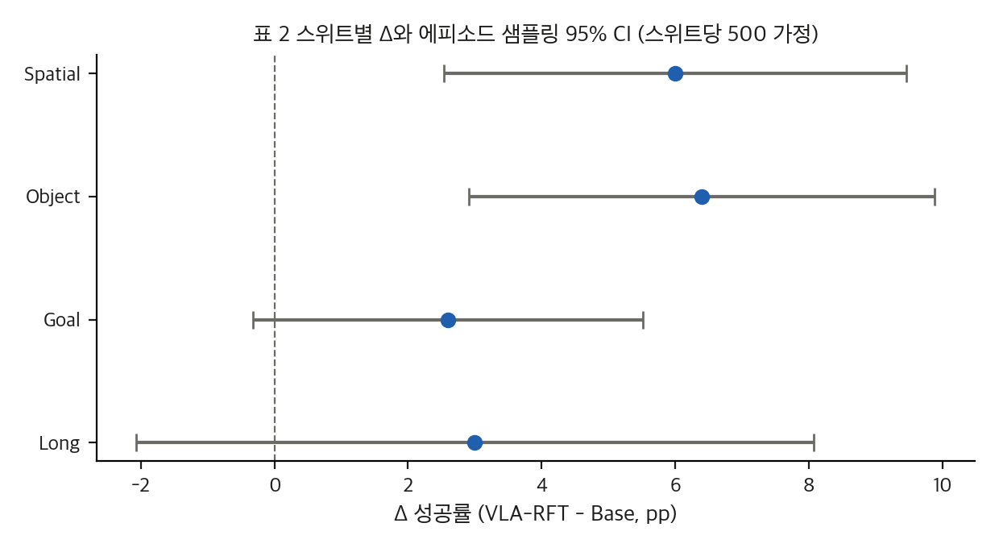
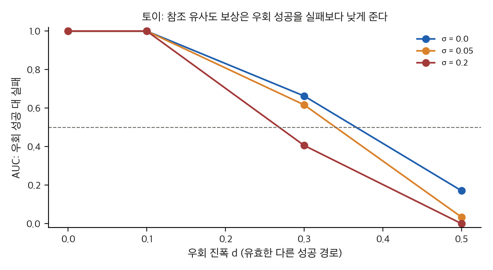
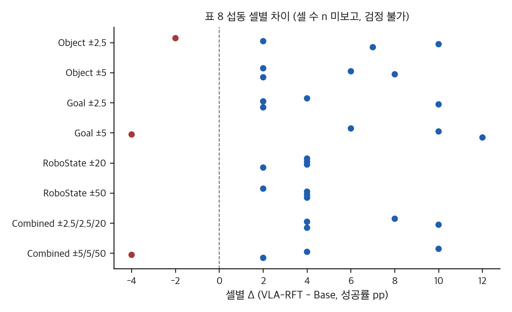

> **논문:** Hengtao Li, Pengxiang Ding 외. *VLA-RFT: Vision-Language-Action Reinforcement Fine-tuning with Verified Rewards in World Simulators.* arXiv:2510.00406 (v1, 2025-10-01). 학회 표기는 확인되지 않았습니다.
> 공식 코드(MIT, OpenHelix-Team/VLA-RFT)는 정적으로만 읽었고 실행하지 않았습니다. 이 글에는 논문 그림을 싣지 않고, 우리가 만든 그래프만 씁니다.

## 한 문장 요약

정책이 낸 행동 청크를 세계모델에 넣어 미래 영상을 만들고, 그 영상을 정답 궤적의 영상과 비교한 점수를 보상으로 써서 VLA를 GRPO로 고칩니다. 400 반복으로 LIBERO 평균이 86.6%에서 91.1%로 오릅니다.

## 방법을 세 단계로

1. **세계모델 사전학습.** 행동을 토큰으로 바꾸고 영상을 압축 토큰으로 만든 뒤, 138M 자기회귀 모델을 최대우도로 학습합니다.
2. **정책 사전학습.** VLA-Adapter의 경량판(Qwen2.5-0.5B 기반)에 흐름 정합 행동 헤드를 붙여 시연 데이터로 학습합니다.
3. **세계모델 안에서 강화 미세조정.** 정책이 같은 초기 상태에서 16개의 행동 청크를 샘플링하고, 세계모델이 각 궤적의 영상을 만듭니다. 보상은 정책 궤적과 정답 행동 궤적을 **같은 세계모델**로 굴린 두 영상의 차이(LPIPS와 MAE)에서 옵니다. 그룹 평균을 기준선으로 GRPO로 갱신합니다.

## 결과: 개선은 있지만 잡음과 구분해서 봐야 합니다

| 정책 | Spatial | Object | Goal | Long | 평균 |
|---|---|---|---|---|---|
| Base (150k) | 88.4 | 88.0 | 92.8 | 77.2 | 86.6 |
| VLA-RFT (400) | 94.4 | 94.4 | 95.4 | 80.2 | 91.1 |

그림 1. 스위트별 Δ와 95% 신뢰구간. 논문은 에피소드 수를 보고하지 않아, 스위트당 500 에피소드로 가정했습니다. 이 구간은 에피소드 샘플링만 반영하고 학습 시드 차이는 반영하지 않습니다.

- 평균 개선 +4.5 pp는 에피소드 잡음으로 보면 유의합니다(풀링 z ≈ 4.5).
- 하지만 Goal과 Long은 잡음 수준이고, 논문에는 학습 실행을 여러 번 한 결과가 없습니다.
- 본문 한 곳에 "91.3 (+4.7)"이라고 적혀 있지만 표는 91.1(+4.5)입니다. 이 밖에도 섭동 표와 CoT-VLA 평균 등 내부 불일치가 네 군데 있습니다. 결론은 바뀌지 않지만, 인용할 때는 표 값을 쓰는 것이 안전합니다.

## 보상이 재는 것: 성공인가, 정답과의 닮음인가

이 보상은 참조 궤적과 닮았는지를 잽니다. 그래서 목표를 달성하는 다른 경로가 있으면 불리합니다. 우리가 만든 2D 토이로 확인했습니다.

그림 2. 우리가 만든 2D 토이의 결과. 우회 경로를 따라 목표에 도달한 성공이 우회가 커질수록 실패보다 낮게 채점됩니다. 논문 과제의 수치가 아닙니다.

토이에서 우회 진폭이 0.3–0.5일 때, 유효한 우회 성공의 96–100%가 실패의 중앙값보다 낮게 채점되었습니다. 논문은 한계로 "정책이 전문가 데이터에 묶인다"고 인정하는데, 같은 이야기입니다.

## 섭동 실험

논문은 물체 위치, 목표 위치, 로봇 초기 상태, 결합 섭동에서 평균 2.5–6.7 pp의 개선을 보고합니다. 셀별로 보면 32개 중 29개에서 개선이 있습니다.

그림 3. 섭동 셀별 차이(VLA-RFT − Base). 셀 수가 보고되지 않아 통계 검정은 하지 않았습니다. 방향만 보여 줍니다.

## 공식 코드를 읽어 보니

- 학습 설정(400 스텝, 배치 16, 롤아웃 16, 학습률, 보조 항 계수)은 논문 표 7과 맞습니다.
- 보상의 프레임 집계는 논문의 합이 아니라 평균이고, GRPO 이점은 그룹 표준편차로 나눕니다. 논문 식과 다릅니다.
- 세계모델과 정책 가중치는 공개되지 않았고, 사전학습 스크립트도 없습니다. 저장소로는 RFT 단계만 볼 수 있습니다.

## 이 맥에서 재현할 수 있을까

**공식 파이프라인은 재현할 수 없습니다.** CUDA 전제(flash-attn, vLLM, FSDP)가 있고, 사전학습 스크립트와 가중치가 없습니다. 축소판(LIBERO 한 스위트, 소형 세계모델)은 조건부로 가능합니다. 데이터 약 2.5 GB 다운로드와 MPS 학습 시간을 확인한 뒤 진행해야 합니다.

## 정리

세계모델을 시뮬레이터로 쓰는 아이디어는 설득력이 있습니다. 다만 보상이 "정답과 얼마나 닮았나"를 재는 설계라서, 목표 달성 판정과 어떻게 결합할지가 다음 질문입니다. 평가 에피소드 수와 시드 분산을 함께 보고하면 개선의 크기를 더 정확히 말할 수 있습니다.

## 자료

- [통합 리포트 PDF](report/report_public.pdf)
- [01. 논문 분석: VLA-RFT](analysis/01_paper_analysis.md)
- [02. 선행연구와 관련 분석](analysis/02_prior_work.md)
- [03. 수치 재계산, 일관성 검사, CPU 토이](analysis/03_analysis.md)
- [04. 논문 ↔ 공식 코드 대조 (정적 읽기)](analysis/04_code_verification.md)
