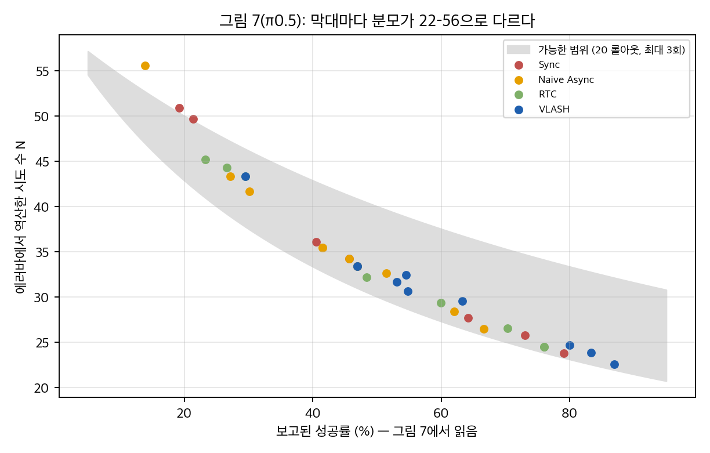
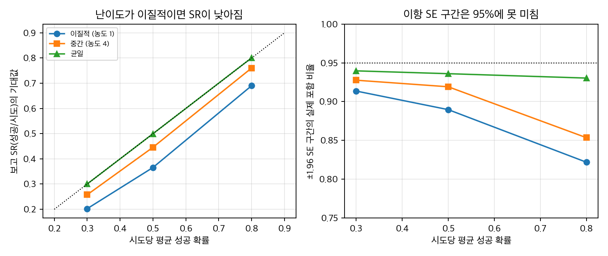
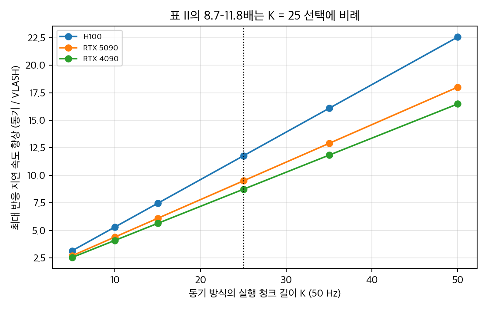
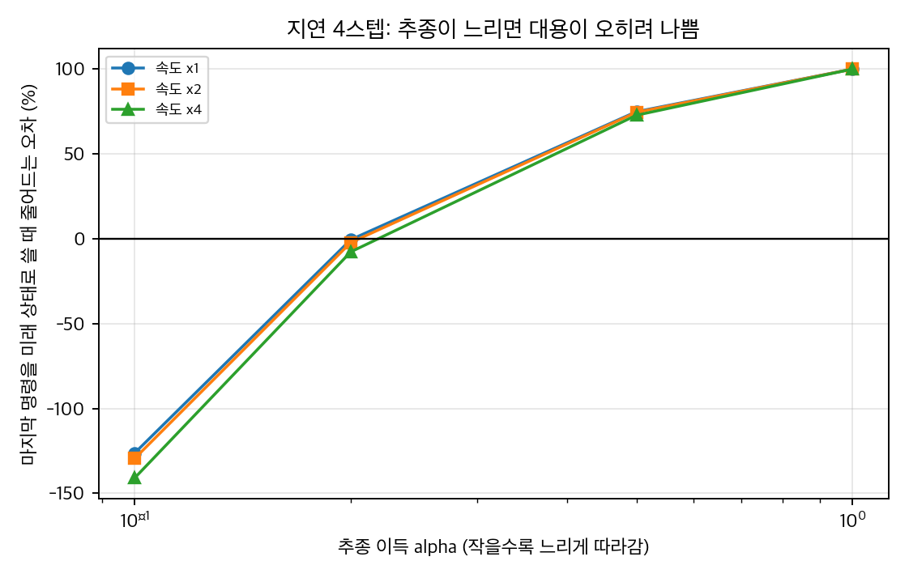

> **논문:** Jiaming Tang, Yufei Sun 외. *VLASH: Real-Time VLAs via Future-State-Aware Asynchronous Inference.* arXiv:2512.01031 (v2, 2026-07-26).
> 공식 코드(Apache-2.0, mit-han-lab/vlash)는 정적으로만 읽었고 실행하지 않았습니다. 논문 그림은 싣지 않고 우리가 만든 그래프만 씁니다.

## 논문이 묻는 것

VLA는 보통 동기 방식으로 돌립니다. 추론이 끝날 때까지 로봇이 멈추고, 추론 중에는 환경 변화에 반응하지 못합니다. 추론하는 동안 이전 청크를 계속 실행하는 비동기 방식은 정지를 없애지만, 모델이 예측한 구간과 실제로 실행되는 구간이 지연 Δ만큼 어긋납니다.

VLASH의 해법은 입력 하나를 바꾸는 것입니다. 추론을 시작할 때의 로봇 상태 대신, 이미 실행이 확정된 행동으로 굴린 **실행 시작 시점의 상태**를 넣습니다. 영상은 과거 그대로입니다. 학습에서는 같은 영상에 상태와 행동을 δ스텝씩 민 샘플을 만들어 모델이 상태 입력을 쓰도록 하고, 한 영상에 여러 오프셋을 묶어 관측 토큰을 한 번만 인코딩하는 공유 관측 학습으로 비용을 줄입니다.

## 표를 다시 계산하면

### LIBERO 표 I은 어떤 실험인가

표 I은 π0.5와 SmolVLA를 지연 0–3스텝에서 비교합니다. 에피소드 수는 본문에 없습니다. 32개 값(네 스위트 × 8행)이 스위트당 N 에피소드의 정수 개수로 가능한지 보면, N = 500에서는 17개가 불가능하고 **N = 480에서는 모두 가능**하며 평균 열도 모두 맞습니다. 공식 평가 스크립트를 읽으면 500 에피소드를 8 GPU에 나눌 때 GPU당 과제당 6개씩, 스위트당 480개가 됩니다(정적 산술).

더 중요한 것은 지연의 구현입니다. 공식 평가 스크립트는 지연된 영상에 **현재의 진짜 상태**를 넣습니다. 방법의 핵심은 "행동으로 굴린 상태를 쓴다"인데, 이 실험은 굴림의 오차를 시험하지 않습니다. 본문은 이 설정을 설명하지 않습니다. 또 π0.5 지연 3은 동기 대비 −2.2 %p로, 한 시드 가정에서도 유의합니다(Fisher p = 0.0008).

### 실로봇: 분모가 막대마다 다르다

실로봇 성공률(그림 7, 8)은 수치 표 없이 막대만 있습니다. 막대의 픽셀을 읽어 에러바(이항 표준오차)에서 분모를 역산하면 막대마다 22–56입니다. 논문의 프로토콜(방법당 20 롤아웃, 롤아웃당 최대 3회 시도, 성공/전체 시도)에서 가능한 범위 안에 36개 막대가 모두 들어갑니다.

*우리가 그린 그래프. 그림 7의 막대에서 에러바로 역산한 시도 수. 회색은 20 롤아웃·최대 3회 시도에서 가능한 범위입니다.*

VLASH는 π0.5 9개 설정 모두에서 동기 방식보다 높습니다(부호 검정 p = 0.004). 그러나 시도를 단위로 한 z 검정에서 동기 대비 2를 넘는 것은 Stacking q = 1.5(z = 2.45) 하나이고, 최대 경쟁 기준선과의 비교는 9개 모두 |z| ≤ 1.5입니다. 같은 롤아웃의 시도는 독립이 아니라서 실제 불확실성은 더 큽니다.

이 지표 자체의 성질도 봤습니다. 롤아웃마다 난이도가 다르다고 가정한 작은 시뮬레이션에서, 성공/시도 비율은 시도당 평균 성공 확률보다 낮게 나오고 ±1.96 SE 구간이 실제로 82–89%만 포함했습니다.

*우리가 그린 그래프. 롤아웃 난이도가 이질적이면 성공/시도 지표가 낮게 나오고 이항 SE 구간이 95%에 못 미칩니다(난이도 분포는 가정).*

반면 핑퐁 11/20 대 0/20은 확실합니다(Fisher p = 1.5 × 10⁻⁴, Wilson 95% 구간 [34%, 74%]).

### 속도 주장은 식의 값

반응 지연 표(표 II)의 산술은 모두 맞습니다. 다만 값은 최대 반응 지연을 동기 D + 2L, 비동기 2L로 둔 식의 계산입니다. D는 동기 방식이 실행하는 청크 길이(K = 25, 50 Hz)로 정해져서, 같은 하드웨어에서도 동기 쪽 K를 줄이면 향상 배수가 크게 줄어듭니다(K = 5이면 2.7배). 초록의 "11.8배"는 H100 값이고 RTX 5090은 9.5배입니다. 완료 시간 1.5–2.0배는 v2에 측정이 없고, v1의 실측처럼 보이던 값도 식으로 재현됩니다.

*우리가 그린 그래프. 표 II의 반응 지연 속도 향상은 동기 쪽 청크 길이 K에 비례합니다.*

파인튜닝 효율(표 IV)의 3.26배는 스텝당 토큰 수비(16 × 650 대 4 × 800 = 3.25)와 같고, 스텝당 고유 관측이 4배 적어 수렴은 더 느립니다. 정확도 기준 시간 이득은 약 2.2배입니다.

## 코드와 논문

공식 코드의 핵심 경로(이전 청크의 마지막 행동을 상태로 사용, 오프셋 증강, 오프셋 분기 간 어텐션 차단)는 논문과 맞습니다. 차이는 다음과 같습니다.

- 공유 관측 학습은 상태 투영(`state_cond=True`)을 요구해, "구조 변경 없음"과 다릅니다. 공개된 LIBERO 학습 YAML(`libero.yaml`)은 `state_cond: false`입니다.
- 오프셋 상태는 기본적으로 이전 행동을 상태로 대용합니다. 델타 행동 누적과 비정수 q의 선형 보간은 공개 코드에 없습니다.
- 비동기 추론은 별도 스레드 없이 CUDA 큐 비동기에 기대고, 지연 Δ는 사용자가 정합니다.
- 예제 학습 설정(배치 16, 50,000 스텝, Δmax 8)은 부록 표 V(배치 32, 30,000 스텝)와 다릅니다.
- main 가지는 π0와 π0.5만 지원하고, LIBERO와 Kinetix 평가는 별도 가지, 실로봇의 RTC 기준선, 핑퐁, SmolVLA와 GR00T는 공개되지 않았거나 읽지 않았습니다.

마지막 행동을 미래 상태로 쓰는 가정은 로봇이 명령을 빨리 따라갈 때만 좋습니다. 1차 지연 추종을 가정한 토이에서는 추종이 느릴수록(지연과 비슷한 시간 상수) 이 대용이 오래된 상태보다 나빠졌습니다. 학습도 같은 대용을 쓰므로 일부는 흡수될 수 있고, 실제 로봇의 추종은 측정하지 않았습니다.

*우리가 그린 그래프. 지연 4스텝에서 마지막 명령을 미래 상태로 쓸 때 줄어드는 오차(1차 지연 추종 가정).*

## 정리

- 아이디어(실행 시점 상태 + 오프셋 학습)는 단순하고 코드도 이를 따릅니다. 핑퐁 결과는 통계적으로 분명합니다.
- LIBERO 표는 오라클 상태 시뮬레이션이고, 실로봇 표는 분모가 다른 시도 가중 비율이며, 속도 배수는 설정 의존적인 식의 값입니다.
- 논문 수치의 재현은 CUDA GPU와 하드웨어가 필요합니다. 새로 시험하려면 작은 시뮬레이션에서 {지연 무시, 오라클 상태, 행동 대용, 오프셋 학습}을 비교하는 정도가 현실적입니다.

(근거: 표 재계산 `analysis/03_analysis.md`, 코드 대조 `analysis/04_code_verification.md`.)

## 자료

- [통합 리포트 PDF](report/report_public.pdf)
- [01. 논문 분석: VLASH (arXiv:2512.01031 v2)](analysis/01_paper_analysis.md)
- [02. 선행연구와 관련 자료: VLASH](analysis/02_prior_work.md)
- [03. 수치 재계산과 해석: VLASH (v2)](analysis/03_analysis.md)
- [04. 논문 ↔ 공식 코드 대조: VLASH](analysis/04_code_verification.md)
