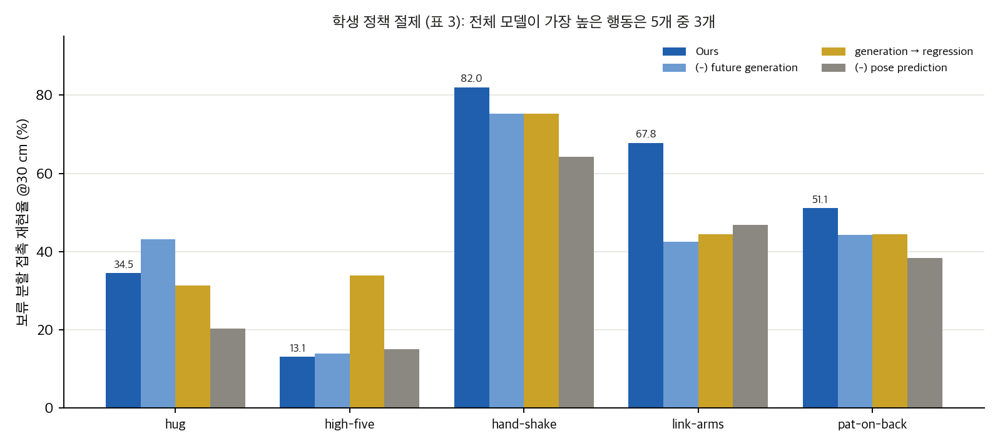
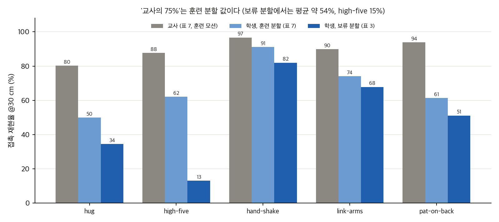
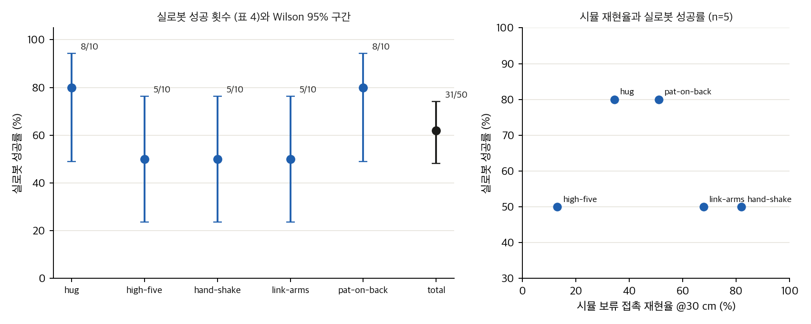
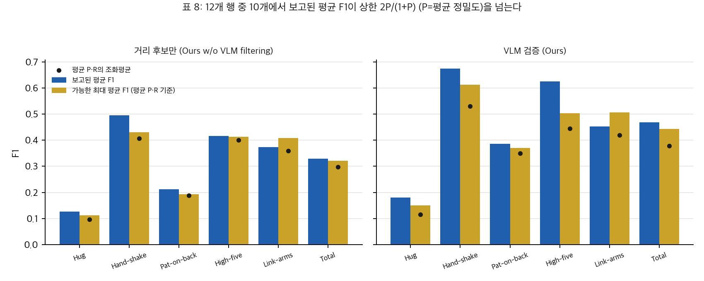

# REACT 보고 수치 재계산과 일관성 검사

원문 v1의 표와 본문 수치를 `analysis/recompute.py`로 다시 계산했습니다(표는 `paper/paper.txt`에서 읽음, 수 초, numpy와 scipy). 재현(학습, 실행)은 하지 않았습니다. 결과는 `analysis/recompute_results.json`입니다. 검사 번호는 V1–V16입니다.

**먼저 데이터의 한계.** 클립별, 시드별, 시행별 원자료는 공개되어 있지 않습니다. 표 2와 표 6(부록)만 시드 값을 줍니다. 그래서 검정은 표의 평균과 표준편차에서 복원한 근사(Welch)이거나, 성공 횟수에서의 정확 검정입니다. 어떤 검정이 학습 변동을 담는지 아래에서 구분합니다.

## 0. 요약표

| 번호 | 검사 | 결과 |
|---|---|---|
| V1 | 표 1, 9, 10의 같은 값 일치 | 일치 (반올림 범위). 단 표 10 재현율의 총합이 행동 평균과 0.2–0.35 어긋남 |
| V2 | 본문 문장 대 표 1 | 모두 일치 (13.4→58.0, 11.6→14.2, 사용자 순위 0.30, OmniRetarget 비실현 약 30%) |
| V3 | 사용자 연구 (표 11) | 순위 합이 모두 10.00, 표 1 사용자 열과 표 11 Q3 일치, 최소 간격 0.26 |
| V4 | 표 1 요약통계 검정 | VLM 필터의 재현율 +1.4%p와 정밀도 +2.6%p는 구분 안 됨. OmniRetarget 대비 재현율은 확실 |
| V5 | 교사 표 2 | 본문 차이값 5개 모두 일치. ±는 평가 시드만, 학습 변동 없음 |
| V6 | 학생 표 3 | 본문 차이값 모두 일치. 전체 모델이 최고인 행동은 5개 중 3개 |
| V7 | 표 6 짝 t 검정 | t(2) 3.0, 2.4, 5.6 재현. p < 0.05는 link-arms 하나 |
| V8 | 교사 대비 학생 75% | 산술은 맞으나 **훈련 분할 값**. 보류 분할 기준 약 54% |
| V9 | 표 5 (HMR2.0 대 E2E) | 이전 설정이라 표 3과 직접 비교 불가. pat, link-arms 값이 크게 다름 |
| V10 | 실로봇 표 4 | 합 31/50 일치. 구간이 넓고 행동 간 차이는 구분 안 됨 |
| V11 | 표 8 F1 | **12개 행 중 10개가 가능한 상한을 넘음** |
| V12 | 데이터 산술 | 1,355, 1,100, 255(18.8%) 모두 일치 |
| V13 | 보상 형태 (식 5–7) | 거리 보상은 30 cm에서 0.011, 힘 게이트는 0 N에서도 0.37 |
| V14 | 학습 설정 산술 | λ 해석에 모호함, 게이트와 점유율 정의가 다름 |
| V15 | 그림 3 대 표 6 | 값 일치 |
| V16 | 임계값 민감도 (표 9) | VLM 필터의 재현율 이득은 임계값에 따라 -1.3~+4.8%p |

## 1. 표와 본문의 일관성

### 1.1 표 1, 9, 10 (V1, V2)

- 표 9의 ε=10 cm 열은 표 1의 재현율 열과 같고(GMR 0.4 대 0.42, OmniRetarget 22.1 대 22.13, Ours 59.4 대 59.43 등), 표 10의 Total 열도 표 1의 재현율과 정밀도와 같습니다.
- **표 10의 재현율 총합 대 행동 평균.** 재현율은 행동당 정답 클립이 16개로 같으므로 총합은 행동별 평균과 같아야 합니다. Ours는 (31.7+81.2+42.9+70.8+68.8)/5 = 59.08이고 표는 59.4입니다. Ours w/o VLM filtering은 57.78 대 58.0입니다. 0.2–0.35의 어긋남이라 반올림으로 설명되지 않습니다(각 값은 0.1 단위). 정답 이벤트가 없는 클립을 제외했거나 클립 수가 정확히 16개가 아니었을 수 있으나 본문은 설명하지 않습니다. 결론에는 영향이 없습니다.
- 정밀도는 "예측 이벤트가 있는 클립만 평균"이므로 총합과 행동 평균이 달라도 됩니다 (Ours w/o Stage 2: 13.36 대 11.8).
- 예측 이벤트 1,740개 대 정답 203개로 약 8.6배이고 본문의 "≈9×"와 맞습니다. 정답은 클립당 2.54개라 클립별 재현율이 {0, ½, ⅔, 1}처럼 거칠게 나옵니다. 그래서 표준편차가 평균 근처(59.43 ± 38.91)입니다.
- 사용자 순위 개선 2.06 → 1.76 = 0.30으로 본문과 같습니다. OmniRetarget이 비실현으로 버리는 클립은 1,100개 중 334개(30.4%), 정답 80개 중 22개(27.5%)입니다.
- 1단계 변형은 관통 1.31(OmniRetarget과 같음), 정밀도 11.79 대 12.51로 "일치"라고 쓴 문장과 맞고, 지터 153.7은 GMR 134.1보다 15% 큽니다. "GMR 수준으로 줄었다"는 OmniRetarget(560.4)과 비교하면 맞는 표현입니다.

### 1.2 사용자 연구 (V3)

- 4개 방법의 평균 순위 합이 Q1 10.00, Q2 10.00, Q3 10.00입니다(4명 순위의 평균은 항상 2.5이므로 합 10). 표가 내부적으로 일관됩니다.
- 표 1 사용자 열(3.61, 2.57, 2.06, 1.76)은 표 11 Q3와 소수점까지 같습니다.
- ± 는 참가자 28명의 **SEM**입니다. 표 11에서 환산한 참가자 간 표준편차는 0.16–0.37입니다. **표 1은 같은 표 안에서 ±의 의미가 열마다 다릅니다.** 지터, 관통, 재현율, 정밀도는 클립 간 표준편차이고, 사용자 순위는 SEM입니다. 표 1 캡션은 이를 밝히지 않고 부록 E.5에서만 설명합니다.
- 인접 방법 사이 최소 간격은 0.26(Q1, w/o VLM 대 Ours)이고, 독립 가정으로 환산한 z는 4.2–18입니다. 한 참가자의 순위는 합이 고정이라 방법 사이 상관이 음이므로 이 z는 대략치입니다. **방향은 모든 질문과 인접 쌍에서 같습니다.**
- 참가자 40명 중 80시행을 모두 끝낸 28명(70%)만 분석했습니다 (E.5). 중도 이탈 기준이 방법과 무관하다고 가정한 것입니다.

## 2. 통계적 확실성

### 2.1 리타게팅 표 1 (V4)

클립별 값이 없어 표의 평균 ± 표준편차에서 Welch 검정으로 근사했습니다(같은 클립을 같은 정답으로 비교하므로 짝 검정이 더 강하지만 불가능). 정밀도의 n은 상한(예측 없는 클립 제외)입니다.

| 비교 | 차이 | t | p |
|---|---|---|---|
| 재현율 Ours 대 w/o VLM (n 80, 80) | +1.4%p | 0.22 | 0.83 |
| 정밀도 Ours 대 w/o VLM (n ≤ 80) | +2.6%p | 1.09 | 0.28 |
| 재현율 Ours 대 OmniRetarget (n 80, 58) | +37.3%p | 5.96 | 2e-8 |
| 정밀도 Ours 대 OmniRetarget (n ≤ 58) | +1.7%p | 0.52 | 0.60 |
| 지터 Ours 대 w/o VLM (n 1,100) | −6.3 | −2.01 | 0.045 |
| 관통 Ours 대 w/o VLM (n 1,100) | −0.08 cm | −1.70 | 0.09 |
| 지터 Ours 대 OmniRetarget (n 1,100, 766) | −405 | −32.4 | 약 0 |
| 관통 Ours 대 OmniRetarget (n 1,100, 766) | −0.35 cm | −4.69 | 3e-6 |

- **Stage 2(co-optimization)의 효과(재현율 13.4 → 58.0)는 매우 큽니다.** 비교 구성(w/o Stage 2 대 w/o VLM)에서 두 표준편차(26.6, 41.7)를 써도 차이 44.6%p는 t = 8.1입니다.
- **VLM 필터의 점 추정치는 재현율 +1.4%p, 정밀도 +2.6%p로 작고**, 클립 80개 요약통계로는 구분되지 않습니다. 논문이 근거로 드는 것은 사용자 연구의 0.30 순위 개선(V3)입니다. 본문의 "VLM verifier further lifts Precision ... and Recall"은 점 추정치 방향이고 검정되지 않았습니다.
- **정밀도는 방법 간 차이가 작습니다.** Ours 14.17 대 OmniRetarget 12.51도 구분되지 않습니다. 본문 "Ours leads on both axes"는 점 추정치이고, 재현율에서만 확실합니다.
- 클립 간 표준편차가 평균보다 큰 행이 많습니다(GMR 재현율 0.42 ± 3.70, 정밀도 2.26 ± 9.72). 값이 [0,100] 범위의 비대칭 분포이므로 ± 구간이 음수까지 갑니다.

### 2.2 교사 표 2 (V5)

본문의 차이값(링크 팔 메시 접촉 보상 +34.3, hug +21.7, VLM 필터 +7.0, +3.2, +1.4)은 모두 표에서 정확히 나옵니다. **그러나 ±는 "3 seeds"이고 부록 C.5에 따르면 교사 체크포인트는 하나입니다.** 그래서 0.1–0.5%p의 표준편차는 평가 시드 변동이고 PPO 학습 시드 변동은 아닙니다. VLM 필터 제거 시 link-arms 차이 1.4%p(표준편차 0.1과 0.4 기준 t = 3.4)는 이 평가 변동에서만 의미가 있고, 학습 시드가 달라지면 이 정도 차이는 쉽게 뒤집힙니다. 메시 접촉 보상의 효과(+22–34%p)는 학습 변동을 고려해도 클 가능성이 높습니다. MPJPE는 변동이 없습니다. VLM 필터를 빼면 hug의 MPJPE가 오히려 0.2 cm 좋아집니다(8.1 대 8.3).

### 2.3 학생 표 3 (V6)

본문의 차이값은 모두 일치합니다. (−) pose prediction 대비 hug +14.1, hand-shake +17.7, link-arms +20.9, pat-on-back +12.7. 미래 생성이 더하는 값은 hand-shake +6.8, link-arms +25.3, pat-on-back +6.9("6.8 to 25.3 pt")입니다.

다만 **"5개 중 4개에서 개선"은 어느 변형과 비교하느냐에 달려 있습니다.**

| 비교 대상 | 전체 모델이 앞선 행동 수 | 뒤진 행동 |
|---|---|---|
| (−) pose prediction | 4 | high-five (−1.9) |
| generation → regression | 4 | high-five (−20.8) |
| (−) future generation | 3 | hug (−8.7), high-five (−0.9) |

- 변형이 누적 제거이므로 (−) future generation이 가장 가까운 비교인데 여기서 hug는 전체 모델이 8.7%p 뒤집니다. **hug에서는 미래 생성이 오히려 해롭고**, 이득은 현재와 과거 생성(43.2 대 31.3, +11.9)에서 옵니다.
- 전체 모델이 최고인 행동은 hand-shake, link-arms, pat-on-back 3개입니다. hug는 (−) future generation, high-five는 generation → regression이 최고입니다.
- 이 표에는 ±가 없고, 체크포인트가 변형당 하나이며, "방 배치 5개 평균"이 유일한 평균입니다. 학습 시드 간 변동은 보고되지 않았습니다. 15–25%p 차이(link-arms)는 크지만, 6.8%p(hand-shake)와 6.9%p(pat-on-back)는 학습 시드 변동 없이는 판단할 수 없습니다.

### 2.4 부분 관측에서의 이득: 표 6과 그림 3 (V7, V15)

그림 3의 값(hug 6.9와 2.7, pat-on-back 10.2와 1.0, link-arms 33.8과 4.1)은 부록 표 6의 평균과 같습니다. 시드별 구간 차이로 짝 t 검정을 다시 했습니다.

| 행동 | 시드별 (PO − 기타) | t(2) | 양측 p | 논문 |
|---|---|---|---|---|
| hug | +5.1, +1.5, +6.1 | 3.03 | 0.094 | 3.1 |
| pat-on-back | +12.3, +13.7, +1.6 | 2.41 | 0.138 | 2.4 |
| link-arms | +25.0, +40.2, +23.8 | 5.62 | 0.030 | 5.6, p < 0.05 |

- 논문의 t 값은 재계산과 일치합니다(3.1, 2.4, 5.6).
- 검정은 평가 시드 3개이고 체크포인트가 변형당 하나이므로 **학습 변동이 없습니다.** 논문도 이 점을 단서로 적습니다(C.4의 세 가지 단서). 임계값(0.8, 0.4)은 점유율 분포를 본 뒤 정했다고 밝혔습니다.
- 점유율은 로봇 자기 몸을 포함하므로 "파트너가 보이지 않음"과 같지 않고, 정책 자신의 움직임에서 나온 양이라 상관 분석입니다(논문 단서).
- 표 3의 이득(hug +3.2, pat-on-back +6.7, link-arms +23.3, 장면 무작위화 켬)과 표 6 구간 비중 가중 이득(+3.8, +3.1, +24.9, 장면 무작위화 끔)은 hug와 link-arms에서 대체로 맞고, pat-on-back은 6.7 대 3.1로 다릅니다. 서로 다른 평가 설정이라 엄밀한 일치를 기대할 수는 없습니다.
- **결론:** 방향(PO에서 이득이 큼)은 3개 행동 모두 모든 시드에서 같습니다. 유의성은 link-arms만 주장할 수 있고, 한 행동의 한 체크포인트입니다.

## 3. 교사-학생 관계와 실로봇

### 3.1 "교사의 75%" (V8)

- 표 7의 산술은 맞습니다. 평균 T 75.0/89.7, S 40.6/67.7이고(열 평균 재계산 75.04, 40.62, 89.68, 67.72), 행동별 비율의 평균은 15 cm에서 51.5%(보고 52%), 30 cm에서 75.0%(보고 75%)입니다. 평균의 비율은 54.1%와 75.5%입니다.
- **그러나 표 7은 "학생의 훈련 분할"입니다**(부록 C.5: "the student's training split, since the teacher is trained on all motions"). 서론의 "depth-based policies recover most of the contact recall of privileged teachers (75% at a 30 cm tolerance)"와 §4.3의 Q4 문단은 보류 분할(표 3)을 읽은 직후 이 75%를 인용합니다.
- 학생의 같은 지표(30 cm)는 훈련 분할(표 7)과 보류 분할(표 3)이 크게 다릅니다.

| 행동 | 학생 훈련 분할 (표 7) | 학생 보류 분할 (표 3) | 격차 | 보류/교사 |
|---|---|---|---|---|
| hug | 49.9 | 34.5 | 15.4 | 43% |
| high-five | 62.1 | 13.1 | **49.0** | 15% |
| hand-shake | 91.1 | 82.0 | 9.1 | 85% |
| link-arms | 74.1 | 67.8 | 6.3 | 75% |
| pat-on-back | 61.4 | 51.1 | 10.3 | 54% |

- 보류 분할 학생을 같은 교사 값(훈련 모션, 표 7)으로 나눈 평균은 약 **54%**입니다. 교사도 보류 모션을 학습했으므로 완전히 같은 조건은 아니고 근사치입니다. 보류 교사 값이 있어야 정확한 비율이 됩니다.
- high-five의 보류 재현율 13.1%는 훈련 분할 62.1%와 49%p 차이입니다. **high-five 학생은 훈련 모션에는 맞지만 새 모션에 일반화하지 못하는 것으로 읽힙니다**(구체적 원인은 보고되지 않음). 실로봇 high-five 5/10(V10)이 이 학생의 일반화를 시험한 것인지도 알 수 없습니다.

### 3.2 실로봇 표 4 (V10)

- 합 5+8+5+5+8 = 31, 보고 31/50과 일치합니다. 전체 성공률 62%, Wilson 95% 구간 48.2–74.1%입니다.
- 행동별 Wilson 구간: 5/10는 23.7–76.3%, 8/10는 49.0–94.3%로 서로 겹칩니다. 8/10 대 5/10의 Fisher 정확 검정 p = 0.35입니다. "hug와 pat-on-back이 가장 믿을 만하다"는 서술은 점 추정치입니다. hug와 pat 16/20과 나머지 15/30으로 사후에 묶으면 p = 0.04이나 묶음 자체가 결과를 본 뒤 정한 것입니다.
- **성공 기준이 행동마다 다릅니다**(부록 A.2). hand-shake, high-five는 손이 파트너 손의 약 15 cm 안에 오면 성공이고, 파트너가 정지한 hug, pat-on-back, link-arms는 "접근하고 상호작용을 완료"입니다. 행동 사이 비교는 같은 척도가 아닙니다.
- 실로봇 정책은 **이전 설정(3층 CNN 깊이 인코더)**이고(부록 A 첫 문장), 본문의 모든 시뮬 결과는 ResNet-18입니다. 깊이 입력도 시뮬 학습은 렌더 깊이, 실배포는 DepthAnything 3 추정 깊이이며, 프로젝트 페이지 시연은 Fast-FoundationStereo입니다.
- 시뮬 보류 재현율(표 3)과 실로봇 성공률의 순위상관은 5점에서 ρ = −0.29(p = 0.64)로 의미가 없고, 시뮬에서 가장 낮은 high-five(13.1%)와 가장 높은 hand-shake(82.0%)가 모두 5/10입니다. 시뮬 지표가 실로봇 성공을 예측한다는 근거는 이 표에서 나오지 않습니다.
- 시험 조건(파트너 위치, 시험 순서, 실패 원인)은 부록 A에 없습니다. 모든 시험이 한 사람 파트너인지도 알 수 없습니다.

### 3.3 표 5 (HMR2.0 대 E2E) (V9)

- HMR2.0은 hug 5.7, hand-shake 8.2, pat-on-back 1.3, link-arms 3.9, high-five 5.4%로, 같은 "이전 설정" E2E(38.0, 78.6, 23.8, 30.1, 15.3%)보다 모두 낮습니다. 본문 "falling from 78.6 to 8.2 on hand-shake and from 15.3 to 5.4 on high-five"와 맞습니다.
- 이전 설정의 E2E 값은 현재 모델(표 3)과 pat-on-back 23.8 대 51.1, link-arms 30.1 대 67.8로 크게 다릅니다. 이 기준선 비교가 현재 모델의 성능 차이가 아니라 **이전 설정 기준의 비교**라는 점을 읽을 때 유의해야 합니다.
- 표 5의 hand-shake E2E 78.6은 표 7의 hand-shake 학생 15 cm 값 78.6과 같습니다(임계값과 분할이 다른 두 값). 우연일 수 있으나 복사 오류 가능성은 확인 못 했습니다.
- 외부 추정기 기준선은 "인체 자세를 입력으로 주는 정책"이고, 추정기와 정책의 결합에서 정책이 추정기 잡음에 맞게 학습되었는지는 서술되어 있지 않습니다(정책은 정답 파트너 상태로 학습하고 HMR2.0 자세로 평가했는지 불명).

## 4. 라벨 품질 표 8 (V11)

- 표 8의 평균 행은 행동별 값과 맞습니다(정밀도 0.192와 0.285는 행동별 평균과 같음, 재현율 0.663과 0.566/0.567).
- 정밀도 상대 개선 +48.4%(0.192 → 0.285)와 F1 +41.8%(0.330 → 0.468), 재현율 −0.096은 본문과 같습니다. 행동별 정밀도 이득 1.29–2.12배("1.3–2.1×"), 재현율 감소 4개 행동 0.051–0.206("0.05–0.21")도 맞습니다.
- **F1 열의 일관성.** 클립별 F1 = 2PR/(P+R)이고 P, R ∈ [0,1]이면, 클립 평균 F1은 평균 정밀도 P로 2P/(1+P)(R=1일 때), 평균 재현율 R로 2R/(1+R)를 넘을 수 없습니다(2x/(1+x)가 오목함수라 옌센 부등식). 표 8의 12개 행 중 **10개가 이 상한을 넘습니다.** 예: 총 VLM 0.468 > 0.444, high-five VLM 0.626 > 0.503, hand-shake VLM 0.674 > 0.613. 상한을 넘지 않는 것은 link-arms 두 행뿐입니다.

- 가능한 설명: F1을 클립 평균이 아니라 사건(이벤트) 수준으로 계산했거나, 정밀도를 예측이 있는 클립만 평균하면서 F1은 다른 클립 집합으로 평균했을 수 있습니다(표 10은 "clips with no predicted events are excluded"라고 밝히지만 표 8은 말하지 않음). 어느 쪽이든 **본문의 F1 정의와 표의 P, R 열로는 재구성되지 않으므로**, "+42% F1" 같은 F1 기준 주장은 정밀도와 재현율 열로 대체해서 읽는 편이 안전합니다. 정밀도와 재현율 자체의 결론("정밀도 이득이고 재현율은 보존 또는 소폭 감소")은 영향을 받지 않습니다.
- hug의 구조적 한계는 33% 정답 접촉이 몸통/골반이라는 본문 설명(D.1)대로 6개 팔 영역 후보 생성기로는 불가능한 접촉입니다. 이 한계가 라벨과 정책 모두에 들어갑니다.
- 이 표의 정답은 한 명의 전문가가 주석했습니다(D.1 마지막 문장). 평가자 간 일치도는 없습니다.

## 5. 임계값, 데이터, 설정 (V12–V16)

### 5.1 임계값 민감도 (V16)

| ε (cm) | 3 | 5 | 10 | 15 | 20 | 25 | 30 |
|---|---|---|---|---|---|---|---|
| Ours − w/o VLM filtering (재현율, %p) | 0.0 | +4.0 | +1.4 | +0.7 | +4.8 | +3.0 | −1.3 |
| Ours − OmniRetarget (재현율, %p) | +9.4 | +22.2 | +37.3 | +36.7 | +33.6 | +17.0 | +9.7 |

- VLM 필터의 재현율 이득은 임계값마다 −1.3 ~ +4.8%p로 방향이 일정하지 않습니다. 논문 결론("preserves contact")은 필터가 재현율이 아니라 정밀도와 사용자 선호를 개선했다는 쪽입니다(V4).
- OmniRetarget은 가능한 클립만 채점되어 큰 ε에서 유리하다고 논문이 인정합니다(E.4). 그럼에도 ε = 3–30 cm 모든 구간에서 Ours가 앞섭니다.
- 두 방법의 재현율이 10 cm에서 59.4%이고 15 cm에서 80%, 20 cm에서 92%로 오르는 것은 "접촉은 있으나 조금 어긋난다"로 해석되고(표 9 캡션), 이는 임계값 선택이 결과에 큰 영향을 준다는 뜻이기도 합니다.

### 5.2 데이터 산술 (V12)

1,355(282+278+275+252+268)와 1,100(244+233+196+205+222)은 합이 맞고, 255개 제거는 18.8%(255/1,355 = 0.1882)와 같습니다. 행동별 제거는 hug 38, high-five 45, hand-shake 79, link-arms 47, pat-on-back 46개로 **hand-shake가 28%**를 잃습니다(278 중 79). 80개 정답 클립은 교사 풀의 7.3%입니다. **학생 풀의 클립 수(두 평가자 3점, 시야 필터)는 어디에도 숫자로 없고**, 보류 분할의 모션 수도 없습니다. 표 3의 점 추정치가 몇 개 모션에서 나온 것인지 알 수 없습니다.

### 5.3 보상 형태 (V13)

식 5–7의 함수 값을 계산했습니다(σ_d = 50 m⁻², ε = 0.02 m, F_min = 5, F_max = 50 N, c_u = 0.5, c_o = 0.05, c_w = 0.005).

| 양 | 값 |
|---|---|
| 거리 보상 exp(−50 d²), d = 0 / 5 / 10 / 15 / 20 / 30 cm | 1.00 / 0.88 / 0.61 / 0.32 / 0.14 / **0.011** |
| 힘 게이트 φ(F), F = 0 / 0.5 / 1 / 2 N | 0.37 / 0.61 / 1.0 / 1.0 |
| 힘 밴드 보상 (접촉 라벨 1), F = 0 / 2.5 / 5 / 50 / 80 / 120 N | 0.08 / 0.29 / 1.0 / 1.0 / 0.22 / 0.03 |
| 비접촉 힘 벌칙 (라벨 0), F = 20 / 50 / 100 N | −0.10 / −0.25 / −0.50 |

- **30 cm 평가는 보상이 사실상 0인 거리를 접촉으로 셉니다.** 학생의 접촉 재현율을 30 cm로 정의하면(부록 F), 교사 평가 임계값(15 cm)의 2배입니다. 학생 표의 값(표 3)은 "접촉"이 아니라 "접촉 근처"의 비율입니다. 30 cm에서 교사의 평균은 89.7%이고, 15 cm에서는 75.0%입니다(표 7).
- 힘 게이트 φ는 접촉력 0 N에서도 0.37이므로 **접촉력이 0 N이어도 거리 보상의 37%가 지급됩니다.** "force-gated"라는 서술은 부드러운 게이트입니다. 식 5의 exp(F−τ)는 N 단위 값의 지수인데 단위 처리는 설명되지 않았습니다.
- 힘 보상의 5–50 N 밴드는 시뮬 접촉력 기준입니다. 부록 A.4는 학생이 "gentle, bounded contact"를 증류로 물려받는다고 쓰지만, **실로봇에서 힘을 측정하지 않았고**(실로봇 표 4는 성공 횟수만), 사용자 편안함 평가도 없습니다.

### 5.4 학습 설정 산술 (V14)

- 깊이 해상도 192 × 108 = 20,736 픽셀이고 "파트너가 15% 이하"의 임계는 약 3,110 픽셀입니다.
- 학생 입력: 깊이 5프레임, 단기 고유수용 5 × 108 = 540, 장기 100스텝(50 Hz, 2초). 행동 18 = 4(HOMIE 명령) + 14(상체 잔차).
- 교사 PPO 배치 8,192 × 24 = 196,608 샘플/반복, 학생 128 환경.
- **λ_gen과 λ_pose의 해석.** C.3은 "DDIM 예측 손실과 단일 단계 손실을 같은 비율로 합하고, 합친 포즈 손실이 총 손실에 가중 0.5로 들어간다, 즉 λ_gen = λ_pose = 0.5"라고 씁니다. 합친 가중이 0.5이면 각 0.25이고 각각 0.5이면 합 1.0입니다. 이 문장으로는 정할 수 없습니다.
- **게이트와 점유율.** 파트너 픽셀이 15% 이하인 프레임은 포즈 손실에서 기울기가 꺼집니다. 한편 link-arms의 "부분 관측" 구간은 점유율 0.4 미만(파트너가 시야를 벗어남)이고 이 이득이 논문의 가장 큰 이득(+33.8%p)입니다. 점유율은 로봇 몸 픽셀을 포함하므로 두 양이 같지 않고, 점유율 0.4 미만에서 파트너 픽셀 15% 이하의 비율은 보고되지 않았습니다. 파트너가 거의 안 보이는 프레임에서는 보조 손실이 꺼지므로 "가려진 파트너를 예측하게 학습한다"는 설명이 어느 정도까지 맞는지 확인이 필요합니다.
- λ_KL은 epoch 500–2000에서 1e-4 → 1e-2로 증가합니다. 교사 PPO 학습률 1e-5는 작은 값이고 총 학습 스텝(반복 수)은 부록에 없습니다.

## 6. 그래프 (우리가 그린 것)

- `report/figures/own_student_ablation.png`: 표 3의 4개 변형 막대 (§2.3).
- `report/figures/own_teacher_student_split.png`: 교사(표 7), 학생 훈련 분할(표 7), 학생 보류 분할(표 3) (§3.1).
- `report/figures/own_real_robot_wilson.png`: 표 4와 Wilson 구간, 시뮬 보류 재현율과 실로봇 성공률 산점도 (§3.2).
- `report/figures/own_f1_bound.png`: 표 8의 F1 대 옌센 상한 (§4).

논문 그림은 쓰지 않았습니다.
