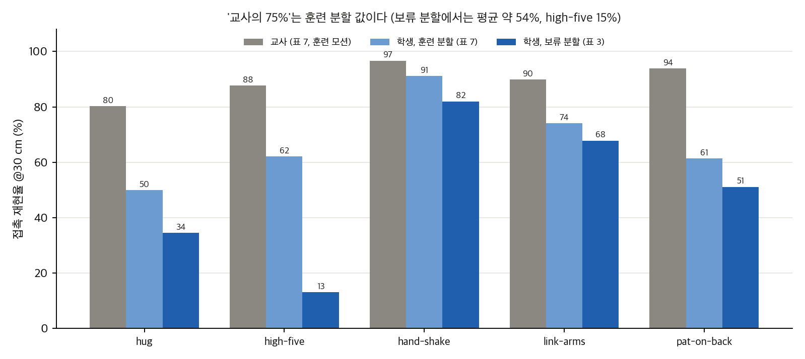
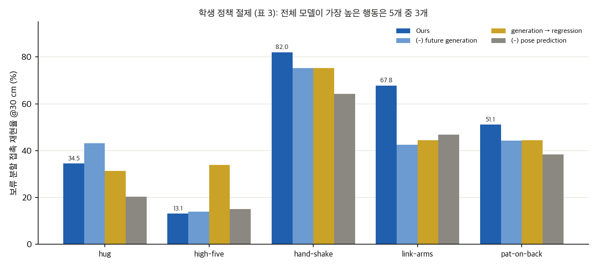
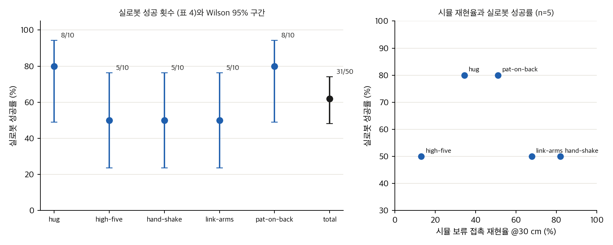
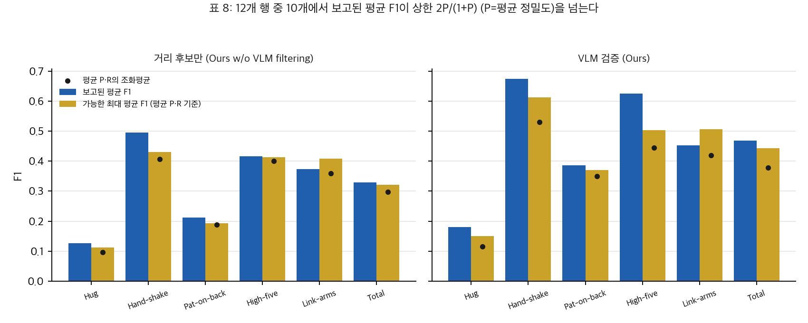

> **논문:** Yuto Shibata, Kotaro Amaya, Kashu Yamazaki, Lalit Jayanti, Yoshimitsu Aoki, Mariko Isogawa, Katerina Fragkiadaki. *VLM-Guided Contact Retargeting and Generative Partner Modeling for Humanoid-Human Interaction.* arXiv:2610.28523 (v1, 2026-10-20). CoRL 2026 포스터.
> 논문 라이선스는 CC BY 4.0입니다. 이 글은 논문 그림을 쓰지 않고, 논문 표의 숫자를 인용하며 우리가 그린 그래프 네 장을 넣었습니다.

## 논문이 묻는 것

사람 둘이 안거나 손뼉 치는 모션 캡처를 휴머노이드(Unitree G1)와 사람의 상호작용으로 옮기려면, 몸 비율이 달라서 "어디가 닿아야 하는지"가 쉽게 사라집니다. REACT는 "누가 누구를 어디서 언제 만지는가"라는 의미 접촉을 핵심 신호로 삼습니다. 거리로 접촉 후보를 뽑고, Gemini 2.0 Flash가 행동에 맞지 않는 후보를 걸러 내며, 남은 접촉을 보존하는 리타게팅과 접촉 보상으로 교사 정책을 학습합니다. 이를 깊이 영상만 보는 학생 정책으로 증류하고, 가려진 파트너의 과거, 현재, 미래 동작을 확산 모델로 예측하는 보조 손실을 줍니다. 실로봇에서는 5개 상호작용을 50회 중 31회 성공했다고 보고합니다.

## 이 글에서 확인한 것

**1. 리타게팅의 큰 이득은 VLM이 아니라 접촉 공동 최적화에서 나옵니다.** 정답 80개 클립에서 재현율은 OmniRetarget 22.1%, 2단계 공동 최적화 없는 변형 13.4%, VLM 필터 없는 변형 58.0%, 전체 59.4%입니다. 공동 최적화의 효과(13.4 → 58.0)는 매우 확실하지만(t ≈ 8), VLM 필터의 재현율 이득 +1.4%p와 정밀도 이득 +2.6%p는 요약통계로 구분되지 않습니다. 필터를 지지하는 증거는 28명 사용자 연구의 0.30 순위 개선입니다. 순위 합이 모두 10.00이라 표는 내부적으로 일관됩니다.

**2. "교사의 75%"는 훈련 분할 값입니다.** 서론은 깊이 학생이 특권 교사 접촉 재현율의 75%(30 cm)를 회복한다고 씁니다. 이 값은 부록 표 7에서 나오는데, 학생의 훈련 모션에서 계산한 것입니다. 보류 분할(표 3)을 같은 교사 값으로 나누면 평균 약 54%이고, high-five는 훈련 62.1%에서 보류 13.1%로 떨어집니다.

*그림 1. 표 7과 표 3의 값으로 우리가 그린 그래프. 교사와 학생(훈련 분할)은 표 7, 학생(보류 분할)은 표 3입니다. 논문 그림이 아닙니다.*

**3. 생성형 파트너 모델링의 이득은 행동과 비교 변형에 따라 다릅니다.** 초록은 5개 중 4개 상호작용에서 접촉 재현율이 오른다고 씁니다. 파트너 예측을 통째로 뺀 변형과는 4개, 결정적 회귀 변형과도 4개지만, 미래 생성만 뺀 변형과 비교하면 3개이고 hug에서는 전체 모델이 8.7%p 낮습니다. 표 3에는 ±가 없고 변형당 체크포인트가 하나입니다.

*그림 2. 표 3의 네 변형을 행동별로 그린 그래프(우리가 그림). 전체 모델이 가장 높은 행동은 5개 중 3개입니다.*

가려진 구간에서 이득이 크다는 분석(부록 표 6)은 3개 행동 모든 시드에서 방향이 같습니다. 시드별 짝 t 검정을 다시 하면 t(2)는 3.03, 2.41, 5.62로 논문과 같고, p < 0.05는 link-arms(p = 0.030) 하나입니다. 시드 3개는 평가 시드이고 체크포인트는 하나라서 학습 변동은 들어 있지 않습니다.

**4. 실로봇 31/50은 현재 모델이 아닌 이전 설정의 결과이고 행동 간 우열은 구분되지 않습니다.** 성공 횟수의 합은 31/50으로 맞고 전체 Wilson 95% 구간은 48–74%입니다. hug와 pat-on-back 8/10 대 나머지 5/10는 Fisher p = 0.35입니다. 성공 기준도 행동마다 다르고(손이 약 15 cm 안이면 성공 대 접근과 완료), 정책은 3층 CNN 이전 설정입니다. 시뮬 보류 재현율과 실로봇 성공률 사이에는 5점에서 의미 있는 순위 관계가 없습니다.

*그림 3. 표 4의 성공 횟수와 Wilson 95% 구간(왼쪽), 시뮬 보류 재현율과 실로봇 성공률(오른쪽). 우리가 그린 그래프입니다.*

**5. 표 8의 F1 열이 같은 표의 정밀도, 재현율과 맞지 않습니다.** 클립별 F1은 2PR/(P+R)이고 P, R이 [0, 1]이면 클립 평균 F1은 평균 정밀도 P로 2P/(1+P)를 넘을 수 없습니다(2x/(1+x)가 오목하다는 옌센 부등식). 12개 행 중 10개가 이 상한을 넘습니다. 예: 총합 VLM 행은 상한 0.444인데 보고값이 0.468이고, high-five VLM 행은 0.503인데 0.626입니다. F1을 사건 단위로 계산했거나 평균 대상 클립이 달랐을 수 있으나 본문은 설명하지 않습니다. 정밀도와 재현율 열 자체의 결론(정밀도 이득, 재현율은 소폭 감소 또는 보존)은 영향받지 않습니다.

*그림 4. 표 8의 보고된 평균 F1(파랑)과 평균 P, R에서 가능한 최대 평균 F1(노랑). 우리가 그린 그래프입니다.*

**6. 30 cm "접촉 재현율"은 보상이 사실상 0인 거리를 셉니다.** 거리 보상 exp(−50 d²)는 15 cm에서 0.32, 30 cm에서 0.011이고, 힘 게이트는 접촉력 0 N에서도 0.37입니다. 학생 표의 값은 "접촉"보다 "접촉 근처"의 비율로 읽는 편이 맞습니다.

## 산술이 맞는 것

표 9의 10 cm 열과 표 1, 표 10의 합계, 데이터 풀 1,355 → 1,100(255개, 18.8%), 표 7의 평균, 표 6의 t 값은 모두 재계산과 일치합니다. OmniRetarget이 비실현으로 버리는 클립 비율(1,100개 중 334개, 30.4%)도 본문의 "약 30%"와 맞습니다.

## 공식 코드

논문과 프로젝트 페이지가 가리키는 저장소(`YutoShibata07/REACT-HHI`)에는 README와 GIF만 있습니다. README는 학습 코드를 2026년 11월 초 공개한다고 적었지만 2026-11-23에도 공개되지 않았습니다. 그래서 코드 대조 대신 논문 주장을 표와 부록 수치에 대조했습니다. 학습은 Isaac Sim(NVIDIA GPU), 접촉 주석에는 Inter-X, SMPL-X, Gemini API가 필요해 일반 노트북에서는 재현할 수 없습니다. 이 글의 모든 계산은 논문 표의 숫자만으로 했습니다.

## 한계

원자료(클립별, 시드별, 시행별 값)가 없어서 검정은 표의 평균과 표준편차에서 복원한 근사(Welch)이거나 성공 횟수에서의 정확 검정입니다. 정책 평가 정답이 VLM 검증 주석이라는 설계(부록 F)와 정책 평가에서 학습 시드 변동이 없다는 점은 결과 해석에 단서를 답니다. 코드가 공개되면 보상 계수, 증류 손실 가중치(λ_gen과 λ_pose의 해석), 평가 프로토콜을 다시 대조해야 합니다.

## 자료

- [통합 리포트 PDF](report/report_public.pdf)
- [REACT (arXiv:2610.28523) 논문 분석](analysis/01_paper_analysis.md)
- [REACT 선행연구와 공개 자료](analysis/02_prior_work.md)
- [REACT 보고 수치 재계산과 일관성 검사](analysis/03_analysis.md)
- [REACT 주장 검증 (공식 코드 없음)](analysis/04_claim_verification.md)
