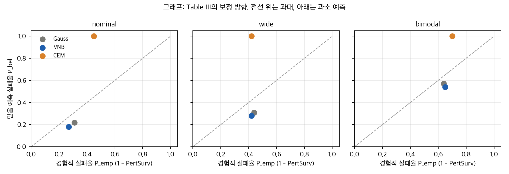
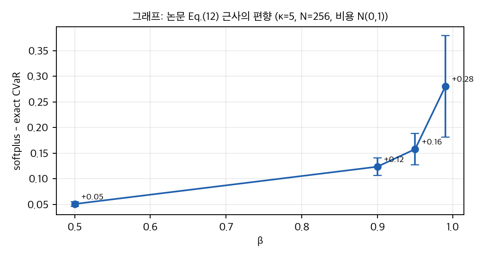
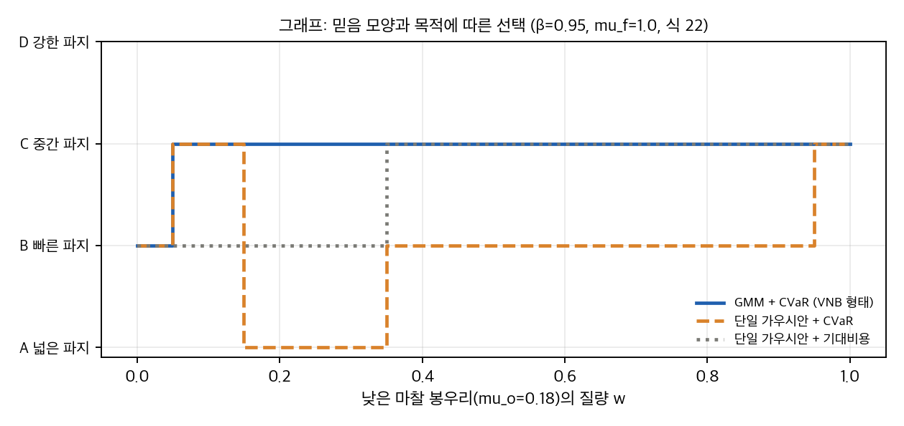

# 03. 표 재계산, 유의성, 유도, toy

대상: arXiv:2604.25897v2 (IROS 2026 채택). 원자료는 논문 Table III·IV·I와 Table V뿐입니다. 재계산은 `table_check.py`, toy는 `cvar_toy.py`가 합니다. 결과는 `table_check_results.json`, `cvar_toy_results.json`에 있습니다.

## 1. Table III 재계산

**에피소드 수 추정.** 논문은 Table III를 "객체, β, 시드 평균"이라고만 씁니다. REPRODUCE.md의 스윕(객체 2 × β 4 × 시드 3)에서 체제당 방법당 **24 에피소드**가 나옵니다. 이 가정으로 보고된 SR과 Robust 백분율을 다시 맞춰 보면 다음과 같습니다.

- 20–30 범위의 n 중 n = 24만 24개 칸 중 4칸(모두 Pf)을 제외한 전부를 설명합니다(`n_fit_bad_cells_by_n`).
- 설명되지 않는 칸은 Pf의 SR wide 44, bimodal 56, Robust wide 39, bimodal 28입니다. 24로 나누면 10.6/24, 13.4/24, 9.4/24, 6.7/24가 되어 정수가 아닙니다.
- 따라서 Pf 행은 다른 분모(시간 초과나 오류 에피소드 제외 여부)를 썼을 가능성이 큽니다. 코드는 시간 초과와 오류를 실패(SR 0, 실패확률 1.0)로 기록하므로(`run_variational_belief_experiments.py`, 2640–2680행 부근), 분모는 24로 유지되어야 합니다. 이 불일치는 **확인하지 못한 항목**입니다.

**P̂emp 와 PertSurv.** 모든 칸에서 P̂emp = 1 − PertSurv입니다. 예외는 CEM wide 한 칸(0.41 대신 0.42)입니다. 논문 Eq. (24)는 "모든 교란을 통과한 에피소드 수"를 쓰지만, 표와 코드(`failure_prob_empirical = 1.0 - pert_rate`)는 **교란 시험 단위의 평균 실패율**입니다. 두 정의는 다릅니다. 예를 들어 27/28을 통과한 에피소드는 Eq. (24)에서는 실패, 표에서는 3.6%만 실패입니다.

## 2. 유의성 검정 (n = 24 가정)

Fisher 정확 검정(양측), Holm 보정은 체제 3 × 비교 3 = 9개 검정에 대해 적용했습니다.

| 비교 | 체제 | SR (24 중) | p (Fisher) | p (Holm) |
|---|---|---|---|---|
| VNB 대 Gauss | nominal | 24 대 24 | 1.00 | 1.00 |
| VNB 대 Gauss | wide | 19 대 17 | 0.74 | 1.00 |
| VNB 대 Gauss | bimodal | 13 대 13 | 1.00 | 1.00 |
| VNB 대 CEM | nominal | 24 대 24 | 1.00 | 1.00 |
| VNB 대 CEM | wide | 19 대 19 | 1.00 | 1.00 |
| VNB 대 CEM | bimodal | 13 대 10 | 0.56 | 1.00 |
| VNB 대 Pf | nominal | 24 대 20 | 0.11 | 0.87 |
| VNB 대 Pf | wide | 19 대 11 | 0.036 | 0.32 |
| VNB 대 Pf | bimodal | 13 대 13 | 1.00 | 1.00 |

- **Gauss, CEM 대비 SR 차이는 통계적으로 구분되지 않습니다.** 가장 큰 차이(wide, VNB 대 Gauss 19 대 17, bimodal, VNB 대 CEM 13 대 10)도 p가 0.5 이상입니다.
- Pf 대비 wide 차이(p = 0.036)는 보정 후 0.32입니다.
- Wilson 95% 구간: VNB bimodal SR 54%는 [0.35, 0.72]이고, CEM bimodal 42%는 [0.25, 0.61]입니다. 두 구간이 크게 겹칩니다.
- Robust 지표(VNB 대 Gauss, bimodal 38 대 42)는 9/24 대 10/24 수준이라 검정에 의미가 없습니다.
- **검정력:** 24 대 24에서 80% 검정력을 얻으려면 차이가 약 35–40 pp 이상이어야 합니다. 논문이 주장하는 8–12 pp 차이는 이 설계로 잡을 수 없습니다.

## 3. 보정 오차 (|ΔP̂|)

| 방법 | 체제별 P̂bel | 체제별 P̂emp | 부호(P̂bel − P̂emp) | 평균 \|ΔP̂\| | 최댓값 |
|---|---|---|---|---|---|
| Gauss | 0.22, 0.31, 0.57 | 0.31, 0.44, 0.64 | −0.09, −0.13, −0.07 | 0.097 | 0.13 |
| CEM | 1.00, 1.00, 1.00 | 0.45, 0.42, 0.70 | +0.55, +0.58, +0.30 | 0.473 | 0.58 |
| VNB | 0.18, 0.28, 0.54 | 0.27, 0.42, 0.65 | −0.09, −0.14, −0.11 | 0.113 | 0.14 |

관찰은 세 가지입니다.

1. **초록의 "mean absolute calibration error below 0.14"는 잘못된 표현입니다.** 0.14는 VNB의 **최댓값**입니다. 평균은 0.113입니다. CEM의 "0.58"도 최댓값입니다.
2. **부호가 체제마다 같습니다.** VNB와 Gauss는 세 체제 모두 P̂bel < P̂emp입니다. 즉 실패를 **과소 예측**합니다. 논문의 §VII는 "과소 예측하는 믿음은 과신(overconfident)"이라고 쓰는데, 이 기준으로는 VNB와 Gauss 모두 과신합니다. CEM은 반대로 P̂bel = 1.00(실패를 과대 예측)입니다. |ΔP̂|는 방향을 버리므로, "보정이 더 좋다"는 주장은 크기로만 가능하고 방향 문제는 가려집니다.
3. **통계적 근거는 약합니다.** 세 체제 값은 서로 독립이 아닙니다. Welch 검정(VNB 대 CEM, 3 대 3)은 t = −3.86, p = 0.056입니다. VNB 대 Gauss는 p = 0.51입니다. 부호 패턴(VNB 세 체제 모두 CEM보다 작음)은 맞지만 n = 3입니다.

그래프: Table III의 체제별 P̂bel 대 P̂emp. 위 대각선은 과대 예측, 아래는 과소 예측입니다. VNB와 Gauss는 모두 아래쪽에 있습니다.

## 4. 계획 시간

| 비교 | nominal | wide | bimodal | 출처 |
|---|---|---|---|---|
| Pf / VNB | 5.84 | 4.59 | 6.13 | Table III (범위 4.6–6.1) |
| VNB / CEM | 1.55 | 1.31 | 1.33 | Table III |
| VNB / Gauss | 2.66 | 2.09 | 1.58 | Table III |
| Pf / VNB (에피소드당) | 10.8–18.0 | | | 부록 Table V: Pf 65–72 s, VNB 4–6 s |

- 초록은 "roughly an order of magnitude"라고 쓰고, 결론은 "5–7배"라고 씁니다. 표 III는 4.6–6.1배, 부록 Table V는 약 11–18배입니다. **세 값이 모두 다릅니다.** 측정 기준(에피소드 시간 대 벽시계 시간의 평균)을 밝히지 않았습니다.
- VNB는 CEM보다 **1.3–1.6배 느립니다**. 논문 본문은 CEM과의 시간 비교를 하지 않습니다.
- Table III의 시간은 "wall-clock seconds per episode"입니다. 부록 Table V의 GPU(RTX 4070) 설정이 Table III에도 적용되었는지는 논문에 없습니다.

## 5. 실물 실험 (Table IV)

- 12 대 12, 두 방법 모두 100%입니다. 정확 이항 95% 신뢰구간 하한은 **0.735**(양측)와 **0.779**(단측)입니다. 두 방법 차이의 Fisher p는 1.0입니다.
- 중앙값 차이(단계 6 대 7, 시간 11.5 대 14.2 s, ε̂ 1.6 대 0.9 ×10⁻³)는 원자료가 없어서 검정하지 못했습니다. 논문도 "execution and convergence check"라고 적었습니다.
- ε̂는 촉각 압력 합에서 만든 대리 지표이고(부록 D, 식 32–34), 파지 품질의 직접 측정이 아닙니다.

## 6. 유도 메모

**(a) 혼합 마찰 규칙과 µ_eff.** 논문 식 (22): µ_eff = √(µ_f · µ_o). 이 식이 Table I과 §V-D 범위를 설명하는지 검산했습니다.

| 항목 | 보고값 | µ_f = 0.35 | µ_f = 1.0 |
|---|---|---|---|
| PLA (µ_o 0.30–0.50) | 0.32–0.42 | 0.32–0.42 | 0.55–0.71 |
| LDPE (0.25–0.45) | 0.30–0.40 | 0.30–0.40 | 0.50–0.67 |
| Alum./steel (0.20–0.35) | 0.26–0.35 | 0.26–0.35 | 0.45–0.59 |
| Tennis (0.50–0.80) | 0.42–0.53 | 0.42–0.53 | 0.71–0.89 |
| Nominal U[0.4, 1.0] | 0.37–0.59 | 0.37–0.59 | 0.63–1.00 |
| Wide U[0.15, 1.2] | 0.23–0.65 | 0.23–0.65 | 0.39–1.10 |

**모든 행이 µ_f = 0.35와 일치합니다.** 그런데 논문 각주 2는 시뮬레이션에 µ_f = 1.0을 썼다고 합니다(코드도 그렇습니다, `04` D1). 따라서 표에 적힌 µ_eff 범위는 실제 시뮬레이션의 마찰이 아닙니다.

**(b) 혼합 규칙에 따라 달라지는 실효 마찰.** MuJoCo 공식 문서(modeling, Contact parameters, friction 항목)는 우선순위가 같을 때 두 geom의 마찰 계수를 **원소별 최댓값**으로 합친다고 적고 있습니다(2026-11-11 확인). 아레나 XML 주석의 "geometric mean"은 이 문서와 다릅니다. 두 규칙의 결과는 다음과 같습니다.

- 기하평균, µ_f = 1.0: µ_eff = √µ_o. nominal은 0.63–1.00, 낮은 봉우리(0.18)는 0.42가 됩니다.
- 최댓값, µ_f = 1.0: µ_eff = max(1, µ_o). µ_o가 1 이하인 모든 체제에서 **1.0**입니다. 마찰 불확실성이 실효적으로 사라집니다. 물체 마찰을 0.05–0.15로 낮추는 교란(friction drop)도 효과가 없습니다.

이 결과는 정적 추론입니다. 실제 MuJoCo 실행으로 확인하지 못했습니다(설치 금지). `cvar_toy.py`의 part2가 이 두 경우의 선택 차이를 보여 줍니다.

**(c) CVaR 근사와 softplus 편향.** 논문 식 (12): CVaR̂ = η̂ + (1/((1−β)N)) Σ softplus(C_i − η̂; κ). 편향은 항별로 최대 log2/κ이고, 꼬리 평균에서 1/(1−β)로 커집니다. 최악의 경우 상한은 log2/(κ(1−β))입니다. κ = 5에서 β = 0.99이면 13.9입니다(실제 편향은 훨씬 작음). 표본 편향(N = 256, 비용 N(0,1), 400회):

| β | 정확 CVaR 평균 | softplus − 정확 (평균 ± sd) |
|---|---|---|
| 0.50 | 0.79 | +0.051 ± 0.005 |
| 0.90 | 1.74 | +0.124 ± 0.018 |
| 0.95 | 2.05 | +0.156 ± 0.028 |
| 0.99 | 2.60 | +0.281 ± 0.099 |

편향은 항상 양수이고 β가 커질수록 커집니다. β = 0.99에서 N = 256이면 꼬리 표본이 약 2.6개뿐이라 분산도 큽니다. 논문 Remark 1은 κ = 5의 편향을 "negligible"이라고 하지만, 이것은 힌지 근사의 상한입니다. 꼬리 평균에 대한 편향은 1/(1−β) 배로 커집니다.

그래프: softplus 근사 CVaR와 정확 CVaR의 차이(토이, 비용 N(0,1), N = 256). 오차 막대는 표준편차입니다.

**(d) 샘플이 혼합분포를 따르는가 (Eq. 8–9).** 식 (8)은 샘플을 Gumbel 가중치 ζ로 구성 성분 샘플을 **합한 값**으로 만듭니다. 혼합에서 성분 하나를 뽑은 것이 아닙니다. 두 봉우리(0.18, 1.0)에 대해 간격 [0.4, 0.8]의 질량을 계산하면 다음과 같습니다(`part4_eq8_gap_mass`).

| 샘플링 | τ | 간격 질량 |
|---|---|---|
| 식 (8)–(9), 균일 로짓 | 1.0 | 0.49 |
| 식 (8)–(9), 코드 rsample | 0.5 | **0.27** |
| 식 (8)–(9) | 0.1 | 0.054 |
| 실제 혼합 | – | **0.000** |

코드의 `rsample`(`variational_belief.py`, 152–180행)은 τ = 0.5로 고정되어 있고, 식 (8)과 같은 가중합을 씁니다. 따라서 **학습되지 않은 상태에서 샘플링된 믿음은 두 봉우리 사이를 메웁니다.** Table V의 τ 어닐링(1.0 → 0.1)을 쓰면 간격 질량은 줄지만 0이 되지는 않습니다. 이는 "다중모드 믿음"이라는 주장의 핵심 전제와 맞닿아 있습니다.

## 7. toy 결과 (cvar_toy.py)

설정은 다음과 같습니다. 믿음은 µ_o의 두 봉우리 혼합(0.5 N(0.18, 0.03²) + 0.5 N(1.0, 0.05²))입니다. 파지 후보는 A(필요 마찰 0.15, 비용 1.0), B(0.50, 0.2), C(0.30, 0.5), D(0.90, 0.7)입니다. 실패 벌점은 5입니다. 선택은 CVaR_β 최소입니다. 단일 가우시안은 같은 평균과 분산으로 적합합니다. 이 toy는 논문의 시뮬레이터가 아니고, 파지 모델은 단순화한 것입니다.

**(i) 믿음 모양과 목적.** µ_f = 1.0, 식 (22) 기하평균, w = 0.5일 때:

- GMM + CVaR: β에 관계없이 C(중간 파지)를 고릅니다. C는 실제로 실패하지 않습니다.
- 단일 가우시안 + CVaR: β = 0.9–0.99에서 B(빠른 파지)를 고릅니다. B의 실제 실패율은 **0.50**입니다.
- 단일 가우시안 + 기대비용: C를 고릅니다.

**(ii) 낮은 봉우리 질량 w에 따른 선택 (β = 0.95, 10 시드 최빈값, 그래프).** 단일 가우시안 + CVaR는 w = 0.2–0.3에서 A, w ≥ 0.4에서 B를 고릅니다. GMM은 w = 0.1–0.9 전 구간에서 C입니다. 즉 "믿음 모양이 선택을 바꾸는" 영역은 w ∈ [0.2, 0.9]이고, 그 안에서 단일 가우시안은 실제 실패율이 w인 B를 고릅니다.

그래프: 낮은 마찰 봉우리 질량 w에 따른 선택(토이, β = 0.95, 10 시드 최빈값). 파랑은 GMM+CVaR, 주황은 단일 가우시안+CVaR, 회색 점선은 단일 가우시안+기대비용입니다.

**(iii) µ_f와 혼합 규칙 민감도.** 같은 믿음(w = 0.5, β = 0.95):

| 규칙 | µ_f | µ_eff 5–95% | 선택 | 실패율 A/B/C/D |
|---|---|---|---|---|
| 기하평균 (표 I 범위와 일치) | 0.35 | 0.22–0.61 | A | 0.00 / 0.50 / 0.50 / 1.00 |
| 기하평균 (각주 2) | 1.0 | 0.38–1.03 | C | 0.00 / 0.50 / 0.00 / 0.50 |
| 최댓값 (MuJoCo 문서) | 1.0 | 1.00–1.06 | B | 0 / 0 / 0 / 0 |

µ_f 값 하나로 선택이 A에서 C로, 다시 최댓값 규칙에서 B로 바뀝니다. 마찰 교란(µ_o → 0.05–0.15)도 최댓값 규칙에서는 µ_eff = 1.0으로 전부 무시됩니다.

## 8. 요약

1. Table III는 n = 24 가정으로 4개 칸(Pf) 외에 재현됩니다. Pf 행의 분모는 다릅니다.
2. Gauss·CEM 대비 SR 차이는 통계적으로 구분되지 않습니다(모든 Holm p = 1.0, Pf wide p_Holm = 0.32).
3. 보정 오차는 크기만 보면 CEM보다 낫지만, VNB와 Gauss는 세 체제 모두 실패를 과소 예측합니다.
4. µ_eff 표는 µ_f = 0.35와 일치하고, 시뮬레이션은 µ_f = 1.0입니다. MuJoCo 문서의 최댓값 규칙이 적용되면 마찰 체제가 사라집니다(정적 추론, 실행 미확인).
5. Eq. (8) 샘플은 혼합 분포의 표본이 아니고, τ = 0.5에서 간격 질량 27%입니다.
