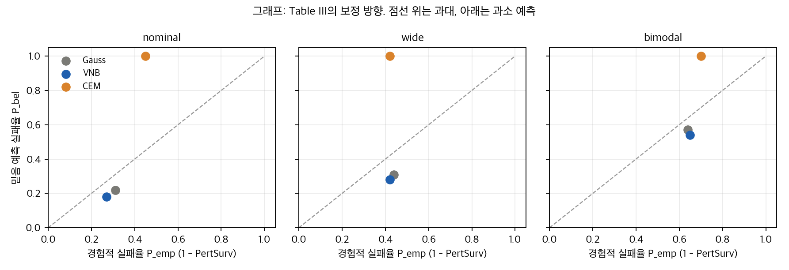
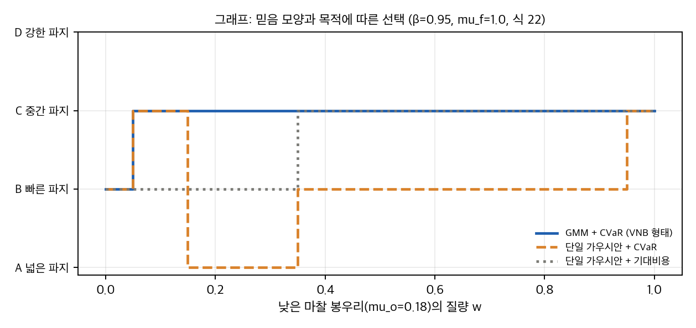
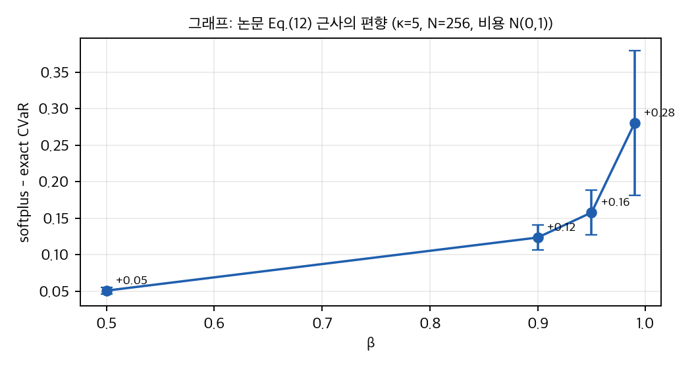

# VNB: 불확실성 하의 파지 분석

접촉 마찰이 불확실할 때 파지를 고르는 방법을 다룬 논문입니다. 믿음을 미분 가능한 가우시안 혼합으로 두고, 그 위에서 CVaR를 행동에 대해 미분합니다. 아래는 논문의 표를 다시 계산하고, 공식 저장소를 읽어 대조한 결과입니다. 논문 그림은 IEEE 고지 때문에 싣지 않았고, 그래프는 우리가 그렸습니다.

## 구현할 수 있는지

- **공식 시뮬레이션 재현은 조건부로 가능합니다.** MuJoCo, PyTorch, NumPy가 필요하고, 샘플 1 에피소드는 약 6분, 전체 480 에피소드는 4–8시간으로 저장소가 추정합니다.
- **지금 상태로 논문 표를 재현하는 것은 어렵습니다.** 마찰 혼합 규칙, 위험 가중치, 접촉 강성, 성공 기준이 논문과 코드에서 서로 다릅니다.
- **실물 재현은 불가능합니다.** 실물 장비와 실물 코드가 없습니다.

## 표는 얼마나 맞는가

논문 Table III는 방법당 체제당 24 에피소드(객체 2 × β 4 × 시드 3)로 다시 맞습니다. 다만 Pf 행의 네 칸은 맞지 않습니다. 그 상태에서 VNB와 Gauss, CEM의 성공률 차이는 통계적으로 구분되지 않습니다. 가장 큰 차이(19/24 대 17/24)도 Fisher p = 0.74이고, Holm 보정 후에는 1.0입니다.

## 보정 오차는 방향을 가린다

논문은 보정 오차 |ΔP̂|로 VNB가 CEM보다 낫다고 말합니다. 크기만 보면 맞습니다. 그러나 방향을 보면 VNB와 Gauss는 세 체제 모두 실패를 과소 예측합니다. CEM은 반대로 과대 예측합니다.

그래프: Table III의 체제별 예측 실패율 대 경험적 실패율. 점선 위는 과대, 아래는 과소 예측입니다. 그림은 논문 Table III 수치로 그렸습니다.

또 초록의 "평균 보정 오차 0.14 이하"는 최댓값입니다. 평균은 0.113입니다.

## 마찰 규칙에서 생기는 문제

논문의 표 I과 마찰 범위는 µ_f = 0.35로 계산한 값과 일치합니다. 그런데 논문 각주와 코드는 시뮬레이션에 µ_f = 1.0을 씁니다. MuJoCo 공식 문서는 두 geom의 마찰을 **원소별 최댓값**으로 합친다고 적고 있습니다. 논문과 아레나 주석은 기하평균이라고 합니다. MuJoCo 4.0.0에서 판을 실제로 미끄러뜨려 재 보니 최댓값 규칙이 맞았습니다. µ_f = 1.0일 때 µ_o를 0.4로 두든 0.9로 두든 실효 마찰은 약 1.0이었습니다. 정적으로 보면 최댓값 규칙에서는 실효 마찰이 1.0으로 고정되어 마찰 체제가 사라집니다.

## 샘플은 혼합분포가 아닐 수 있다

논문의 식 (8)은 샘플을 Gumbel 가중치로 성분 샘플들을 합한 값으로 만듭니다. 두 봉우리 사이의 간격에 떨어지는 샘플 비율을 보면, 실제 혼합에서는 0%인데 코드가 쓰는 τ = 0.5에서는 27%입니다. τ를 1.0에서 0.1까지 낮추는 어닐링을 따라도 간격 질량은 약 5%가 남습니다. τ = 0.5에서는 샘플의 가중도 0.5 쪽으로 끌려갑니다. 낮은 봉우리 질량이 0.1이면 평균으로 역산한 값이 약 0.13입니다.

## 다중모드가 선택을 바꾸는 영역

간단한 토이로 파지 네 개를 비교했습니다. 믿음의 낮은 봉우리 질량이 0.2–0.9 사이이면 단일 가우시안과 혼합의 CVaR 선택이 달라집니다. 중간 질량(0.5)에서 단일 가우시안은 실제 실패율이 50%인 빠른 파지를 고릅니다. 이 토이는 논문의 시뮬레이터가 아닙니다.

그래프: 낮은 마찰 봉우리 질량에 따른 파지 선택(토이, β = 0.95, 10 시드 최빈값). 파랑은 혼합 + CVaR, 주황은 단일 가우시안 + CVaR입니다.

## softplus 근사의 편향

CVaR의 softplus 근사는 항상 위쪽으로 치우칩니다. 그 크기는 β가 커질수록 커지고, β = 0.99에서 N = 256일 때 평균 +0.28입니다. 논문은 이를 "negligible"이라고 적었습니다.

그래프: softplus 근사 CVaR와 정확 CVaR의 차이(토이, 비용 N(0,1), N = 256). 막대는 표준편차입니다.

## 계획 시간 주장은 세 가지다

표 III는 Pf 대비 4.6–6.1배, 부록 표는 11–18배, 결론은 5–7배라고 합니다. 측정 조건을 밝히지 않았습니다. VNB는 CEM보다 1.3–1.6배 느립니다.

## 판단

이 논문은 방향이 일관된 아이디어를 제시하지만, 주장의 크기와 실험 설계가 표 안에서도 서로 맞지 않습니다. 재현의 첫 단계는 마찰 혼합 규칙과 위험 가중치 연결을 확인하는 것입니다. 이 두 가지가 확인되기 전에는 나머지 비교의 해석이 어렵습니다.

자세한 근거는 분석 노트(`analysis/01`–`04`)와 결과 파일에 있습니다.

## 자료

- [통합 리포트 PDF](report/report_public.pdf)
- [01. 논문 분석](analysis/01_paper_analysis.md)
- [02. 선행연구, 가까운 대안, GitHub 저장소](analysis/02_prior_work.md)
- [03. 표 재계산, 유의성, 유도, toy](analysis/03_analysis.md)
- [04. 코드 검증: 논문 대 공식 저장소](analysis/04_code_verification.md)
