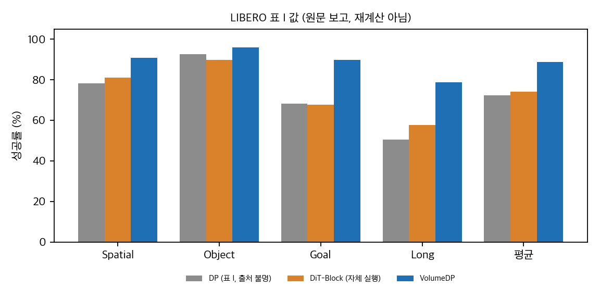
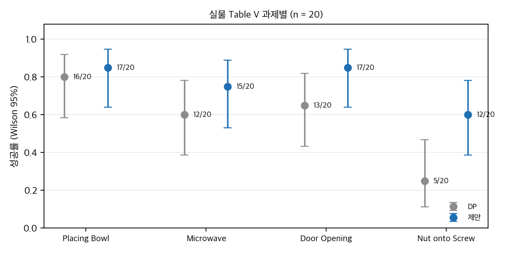
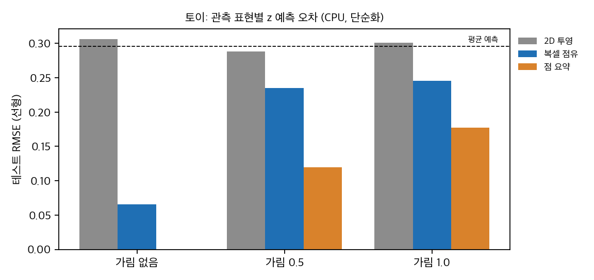

# VolumeDP: RGB 이미지를 3D 복셀 볼륨으로 올리면 정책이 나아지나

VolumeDP(Zhou 외, IROS 2026 채택)는 깊이 센서 없이 RGB 카메라만으로 3D 공간 추론을 하려는 모방 학습 정책입니다. 이미지 특징을 40×40×40 복셀 볼륨으로 올리고, 학습된 가중치로 200개 공간 토큰을 고른 뒤, DiT 블록 기반 디퓨전 디코더에 넣습니다. 논문은 LIBERO 평균 88.8%(확산 정책 72.4%), ManiSkill 68.9%, LIBERO-Plus 53.0%, 실물 4과제 61/80(확산 정책 46/80)을 보고합니다.

이 글은 논문 원문(v1과 v2 비교 포함), 표 재계산, 통계 검정, 공개 코드 대조, CPU 토이 실험을 정리한 결과입니다. 재현 실험은 하지 않았습니다.

## 1. 방법의 핵심

1. 현재 프레임과 과거 한 프레임의 이미지 특징을 만듭니다.
2. 복셀마다 카메라 행렬로 이미지 위치를 구하고, deformable attention으로 특징을 샘플링합니다(식 1–3).
3. 텍스트 토큰을 붙인 볼륨에서 TokenLearner식 softmax 가중치로 200개 토큰을 만듭니다. 말단 위치와 그리퍼 개폐 시점 주변을 보조 감독합니다.
4. 토큰 전체(200 + 언어 + proprio)를 adaLN-Zero 블록으로 조건화하는 DDPM으로 행동을 예측합니다.

새로운 기법 조합이라기보다, 기존 요소(deformable attention, TokenLearner, DiT 블록)를 3D 볼륨에서 잇는 설계입니다.

## 2. 공개 코드에는 방법이 없습니다

프로젝트 페이지의 코드 버튼은 "Coming soon"이며 LIBERO 코드 저장소를 가리키는데, 그 주소는 404입니다. 논문 초록에 적힌 `yzc0731/volumedp_maniskill`(Apache-2.0)은 ManiSkill 3.0.0b19 구조의 저장소입니다. 볼륨, 토큰, 디코더 구현을 찾지 못했습니다. 들어 있는 것은 상류 확산 정책 기준선과 다른 기준선 예제입니다.

이 기준선의 RGB-D 설정은 기본값이 `rgb+depth`입니다. 논문이 주장하는 "RGB만 사용"과 맞는지 확인되지 않았습니다. 실험에 쓴 DP 설정도 논문에 나와 있지 않습니다.

## 3. 기준선이 같은 레시피인가 (LIBERO)

LIBERO 표에서 확산 정책 행에는 자체 실행 표시(*)가 없습니다. 같은 표의 BC 행은 인용한 IB-BC 논문의 표와 소수점 한 자리까지 일치합니다. 그런데 확산 정책의 suite별 수치(78.3, 92.5, 68.3, 50.5)는 그 논문에 나오지 않았습니다. 인용 논문의 확산 정책 실험은 LIBERO-Long 한 셀(78.0, 50 epoch)뿐입니다.

결론: **LIBERO에서 +16.4%p 개선은 같은 조건으로 재학습한 비교로 보기 어렵습니다.** 확산 정책 행의 출처가 원문으로는 확정되지 않습니다. ManiSkill(자체 실행, +19.3%p)과 LIBERO-Plus(자체 실행, +21.3%p) 비교가 더 믿을 만합니다.

*직접 만든 그래프: 논문 Table I의 값을 옮긴 것입니다(재계산 아님). 확산 정책 행은 출처가 불명확합니다.*

## 4. 실물 비교는 검정 방법에 따라 달라집니다

과제별 20회 시험에서 확산 정책 대비 제안 방법은 Placing Bowl +1, Microwave +3, Door Opening +4, Nut onto Screw +7회 성공을 더했습니다. 합산 Fisher 검정은 p = 0.018입니다. 그러나 과제를 층으로 둔 Mantel-Haenszel 검정은 p = 0.060이고, 과제별 검정은 Holm 보정 후 모두 유의하지 않습니다.

과제당 20회는 차이를 찾기에 부족합니다. 관측된 차이가 실제라고 가정해도 팔당 약 98회가 필요합니다. 실험 계획에서 검정력을 먼저 계산하는 것이 좋습니다.

*직접 계산: 논문 Table V의 과제별 성공률(n = 20)과 Wilson 95% 구간입니다.*

## 5. 토이: 어떤 표현이 깊이를 담는가

깊이가 없는 2D 투영으로는 목표의 높이를 맞힐 수 없었습니다. 복셀 점유와 점 집합처럼 깊이를 담는 표현은 가림이 없을 때 높이를 맞혔습니다. 가림이 있으면 어떤 표현에서도 가려진 면의 높이는 알 수 없습니다. 이 토이는 "깊이가 관측에 들어가면 3D 표현이 도움이 된다"는 방향만 보여 줍니다. 실제 RGB에서 깊이를 복원하는 품질은 이 토이로 판단할 수 없습니다.

*직접 만든 토이(CPU, numpy, 단순화된 장면): 관측 표현별 테스트 RMSE. 점 요약의 0.000은 구성상의 누출입니다.*

## 6. 구현 가능성과 남은 질문

- **공식 재현:** LIBERO 코드는 없고, 실물 로봇은 공개되지 않았습니다. ManiSkill 시뮬레이터는 macOS를 지원하지 않습니다. 방법을 직접 구현해야 합니다.
- **계산 비용:** 논문은 파라미터 수, FLOPs, 지연을 보고하지 않았습니다. 40³×32 볼륨은 샘플당 약 2백만 값입니다.
- **질문:** 확산 정책 기준선의 학습 조건, 깊이 사용 여부, 실물 시험의 초기 배치 방식은 원문에 없습니다.

## 자료

- 논문: arXiv:2603.17720v2 (arXiv 비독점 배포 라이선스, CC BY 아님). 이 글에 논문 그림은 넣지 않았습니다.
- 공개 코드: `yzc0731/volumedp_maniskill` (Apache-2.0, 커밋 d2ec13a). 클론만 했고 재배포하지 않습니다.
- 분석 문서와 스크립트, 공개 리포트는 `git/` 폴더에 있습니다.

## 자료

- [통합 리포트 PDF](report/report_public.pdf)
- [01. 논문 분석: VolumeDP (arXiv:2603.17720v2)](analysis/01_paper_analysis.md)
- [02. 선행연구와 비교 대상](analysis/02_prior_work.md)
- [03. 수치 재계산, 유의성, 토이 검증](analysis/03_analysis.md)
- [04. 코드 검증: 논문 ↔ 공개 저장소](analysis/04_code_verification.md)
