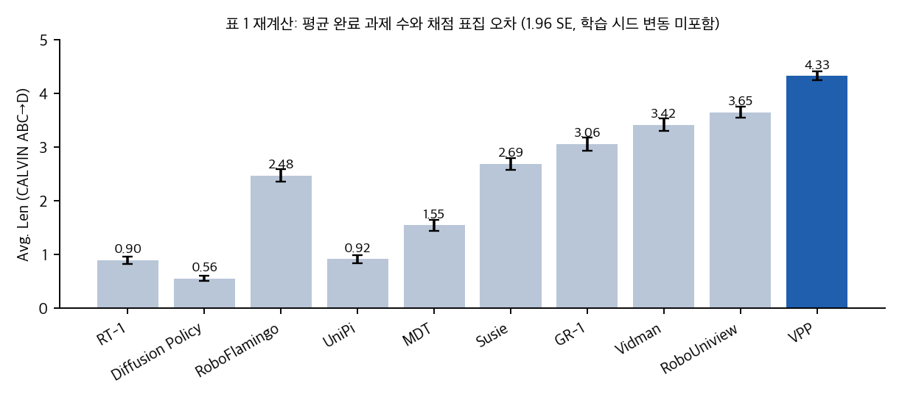
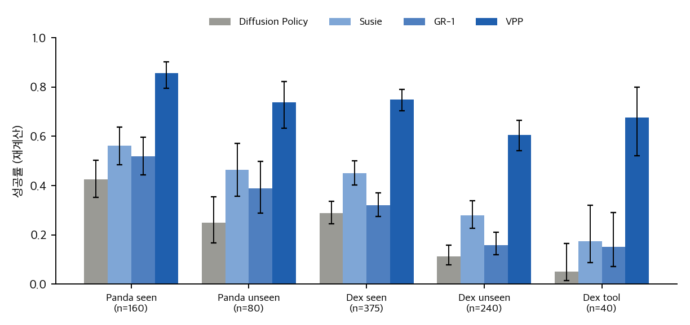
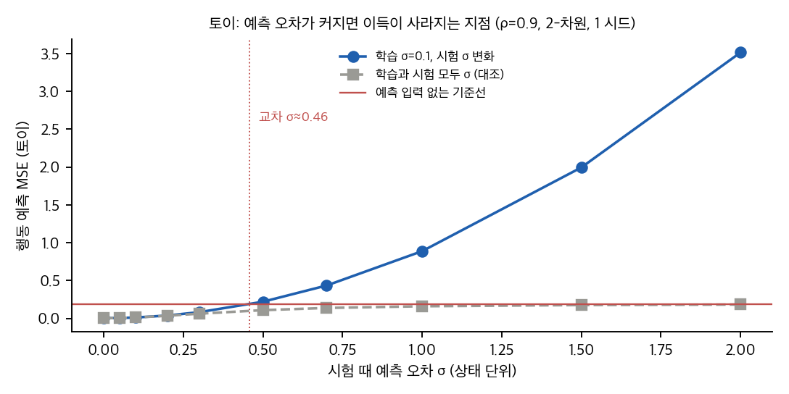

> **논문:** Yucheng Hu, Yanjiang Guo 외. *Video Prediction Policy: A Generalist Robot Policy with Predictive Visual Representations.* ICML 2025 (Spotlight), arXiv:2412.14803 (v2, 2025-05-04).
> 공식 코드는 GitHub roboterax/video-prediction-policy(MIT)에 있습니다. 이 글의 그래프는 저희가 표 값에서 다시 그린 것입니다. 논문 그림은 arXiv 비독점 배포 라이선스라서 싣지 않았습니다.

## 논문이 묻는 것

로봇 정책의 시각 표현은 대개 현재 장면만 담습니다. 한 장을 재구성하거나 두 장을 대조해서 배우기 때문입니다. 이 논문은 다른 재료를 씁니다. 영상 확산 모델은 다음 프레임을 만들 때 **현재와 미래를 함께 담은 중간 표현**을 가진다고 봅니다.

VPP는 두 단계입니다. 먼저 SVD 1.5B를 로봇과 사람 조작 영상 약 37만 궤적으로 미세조정합니다. 그다음 이 모델의 업샘플링 층 특징을 **한 번의 전방 계산**으로 뽑고, 학습 가능한 Video Former와 확산 트랜스포머 헤드로 행동 청크를 냅니다. 확산을 여러 번 돌리지 않아서 제어 주파수를 확보하는 것이 목적입니다.

## 이 글에서 확인한 것

**1. CALVIN ABC→D 표는 내부적으로 맞습니다.** 표 1의 과제별 누적 성공률을 더하면 VPP 4.33, RoboUniview 3.65, GR-1 3.06이 나옵니다. 초록의 18.6%는 RoboUniview 대비이고, 서론과 프로젝트 페이지의 41.5%는 GR-1 대비입니다. 기준선을 바꾸면 주장의 크기가 달라지므로 어느 쪽을 기준으로 하는지 미리 정해야 합니다.

*그래프: 표 1의 행 합계를 다시 계산했습니다. 오차막대는 채점 1000 체인 가정의 1.96 표준오차이며, 학습 시드 변동은 논문에 없어 반영하지 않았습니다.*

**2. 실로봇 우위의 방향은 분명하지만 크기는 분모에 따라 다릅니다.** 표 6과 7에 적힌 범주별 시도 수를 합산하면 다섯 설정 모두에서 VPP가 가장 강한 기준선보다 높습니다. 피셔 검정으로는 p < 0.001입니다. 다만 정책 하나와 독립 롤아웃을 가정한 결과입니다. 초록의 31.6%는 표에서 계산되지 않았고, 설정별 상대 향상은 52%에서 286%까지 흩어져 있습니다.

*그래프: 범주 시도 수를 합산한 성공률입니다. Dex 도구 과제의 Susie 값은 표 7의 행 평균에서 다시 계산한 0.175를 썼습니다.*

**3. 숫자와 문장이 어긋나는 곳이 있습니다.**

- v2 본문은 "3.35에서 4.33으로" 향상했다고 쓰지만, v2 표 1에는 3.35 행이 없습니다. v1에서 3.35였던 3D Diffuser Actor 행이 빠졌는데 본문은 그대로입니다.
- 표 7의 Susie 새 과제 평균 0.328은 같은 표의 범주 값으로 계산하면 0.279입니다. 표 5의 0.28과 맞습니다.
- Xhand 궤적 수가 논문 안에서 2.5k(부록)와 4,000(본문)으로 다릅니다. 표 8은 2,476입니다.
- 부록의 "Task 5 reaches 3.58"은 3.58이 평균 완료 과제 수이므로 잘못 쓴 문장입니다.

**4. 공식 코드는 공개되어 있지만 논문 설정과 다릅니다.** 정적으로 읽어 보면 한 번 계산하는 설계와 시간 어텐션은 논문과 같습니다. 다음은 다릅니다.

- 1단계 영상 학습은 논문 표 8의 열 개 데이터셋 대신 네 개를 씁니다.
- 특징 추출의 fps 조건은 4로 고정되어 있고, 1단계 학습 설정은 7입니다.
- 다층 특징은 두 층만 쓰는 것으로 보입니다. 논문 설명은 여러 업샘플링 층을 쓴다고 읽힙니다.
- 정책 배치와 에폭이 표 13과 다릅니다.
- Panda와 MetaWorld의 학습 코드는 저장소에 없습니다.

**5. 시드 변동이 없습니다.** 절제 실험의 차이 대부분은 한 번 학습한 결과입니다. 시간 어텐션을 뺀 경우(4.18)와의 차이는 채점 표집만 보면 z ≈ 2.3입니다. 학습 시드를 여러 번 돌리지 않으면 이 차이를 단정하기 어렵습니다.

## 간단한 토이: 예측이 나빠지면 어디까지 버티나

논문은 영상 예측의 품질을 Bridge FVD(41.4)로만 재고, 그 품질이 정책 성공으로 이어지는 관계는 보여 주지 않습니다. 그래서 2차원 점 질량과 선형 정책으로 작은 실험을 했습니다. 학습 때는 예측이 대략 맞고, 시험 때 예측 오차를 키웁니다.

*그래프: 현재 위치와 직전 위치, 그리고 예측된 다음 위치를 입력으로 준 선형 회귀입니다. 행동이 현재 관측으로 덜 설명될수록 예측 입력의 이득은 더 큰 예측 오차까지 남습니다. 토이이므로 논문의 결론을 검증하지 않습니다.*

## 구현 가능성

- **학습과 CALVIN 평가는 이 맥에서 불가능합니다.** 영상 모델 미세조정은 A100 8장으로 2–3일, 행동 학습은 4장으로 6–12시간이 걸립니다. 평가에는 Linux, 렌더링 환경, 약 500 GB의 데이터가 필요합니다.
- **특징 추출 한 번의 시간 측정은 조건부로 가능합니다.** 설치, 약 8 GB의 가중치 다운로드, `.cuda()` 호출 제거가 필요합니다. 논문은 관측 한 번의 TVP 계산이 160 ms 미만이고, 전체 정책이 RTX 4090에서 7–10 Hz라고 씁니다. 맥에서는 아직 재지 않았습니다.

## 한계

- 표에서 읽은 값으로 다시 계산했습니다. 체인별 평가 로그가 없습니다.
- 학습 시드 변동, 롤아웃 독립 가정, 기준선 구현의 차이는 정량화하지 못했습니다.
- 토이는 선형 모델과 시드 하나입니다.

## 출처와 라이선스

- 논문: arXiv:2412.14803 (v2). arXiv 페이지의 "view license" 링크는 arXiv non-exclusive distribution license 1.0을 가리킵니다. 논문 그림은 싣지 않았습니다.
- 공식 코드: GitHub roboterax/video-prediction-policy, MIT. 코드는 싣지 않았고 정적으로만 읽었습니다.
- 이 글의 그래프와 재계산 스크립트는 저희가 만들었습니다. 원문 PDF는 저장소에 두지 않았습니다. 받는 명령은 저장소 README에 있습니다.

## 자료

- [통합 리포트 PDF](report/report_public.pdf)
- [01. 논문 분석: Video Prediction Policy (arXiv:2412.14803)](analysis/01_paper_analysis.md)
- [02. 선행연구와 관련 자료](analysis/02_prior_work.md)
- [03. 재계산, 일관성 검사, 토이와 주장 판정](analysis/03_analysis.md)
- [04. 공식 코드 대조와 구현 가능성](analysis/04_code_verification.md)
