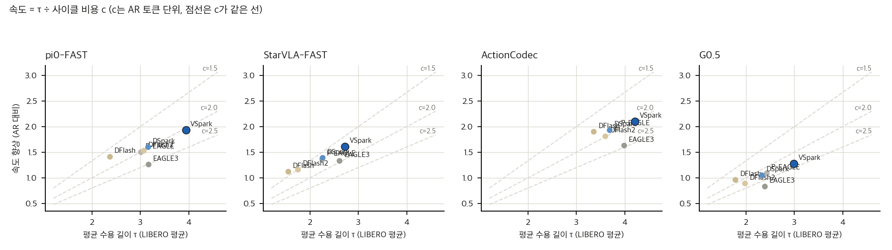
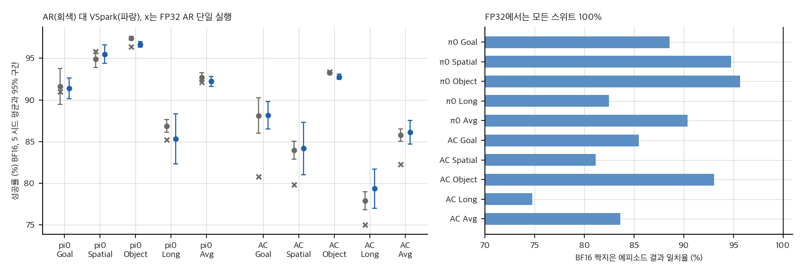
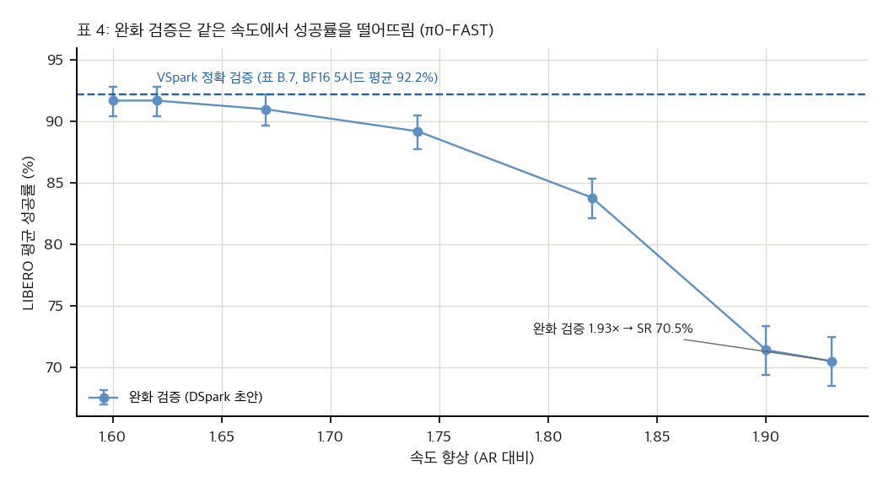

> **논문:** Suho Yoo, Youngjoon Jang, Hyebin Cho, Taeyeop Lee, Jaewook Jeong, Joon Son Chung (KAIST, VGG Oxford). *VSpark: Speculative Decoding for Autoregressive Vision-Language-Action Models.* arXiv:2611.22666 (v1, 2026-11-17). 학회 표기는 없습니다.
> 공식 코드(Apache-2.0, suho-yoo/VSpark)는 정적으로만 읽었고 실행하지 않았습니다. 논문 그림은 싣지 않았습니다(arXiv non-exclusive 라이선스). 아래 그래프는 표 값으로 우리가 그린 것입니다.

## 질문

자기회귀 VLA는 행동을 토큰 하나씩 만듭니다. 큰 모델이 토큰마다 한 번씩 돌기 때문에 제어 주파수가 낮습니다. 투기적 디코딩은 작은 드래프트가 여러 토큰을 미리 내고, 큰 모델이 한 번에 검증하는 방법입니다. 검증에서 맞는 토큰만 받으니 결과는 원래 디코딩과 같습니다.

문제는 로봇에서 "거의 같은 동작인 다른 토큰"이 많다는 점입니다. 드래프트가 조금 달라도 거부되어 속도가 잘 나지 않습니다. 기존 방법은 검증을 느슨하게 해서 이 문제를 풉니다. 그런데 FAST처럼 청크 전체를 압축하는 토크나이저에서는 토큰 거리가 행동 거리와 잘 맞지 않습니다.

VSpark는 검증은 정확하게 두고 드래프트를 고칩니다. 세 가지입니다.

1. **보정된 잡음 롤아웃.** 드래프트가 타깃과 다른 행동 차이를 공분산으로 재서, 그 크기의 잡음을 시뮬레이터 롤아웃에 넣습니다.
2. **특징 정렬.** 토큰 라벨만 맞추지 않고, 타깃의 은닉 상태를 회귀합니다.
3. **연속 재사용.** 검증에서 거부된 가지 아래에서 타깃이 이미 계산한 예측을 다음 트리의 후보로 씁니다. 추가 비용이 없습니다.

## 결과와 확인

표 값은 서로 맞습니다. 평균, 본문 수치, 절제 표가 모두 맞고, 표 2의 평균 τ만 0.0075 어긋납니다. LIBERO 평균 속도는 π0-FAST 1.93×, StarVLA-FAST 1.61×, ActionCodec 2.10×, G0.5 1.28×입니다. 모든 suite에서 2위보다 빠릅니다.

그래프: 표 1의 LIBERO 평균 τ와 속도. 점선은 사이클 비용 c가 같은 선입니다. 우리가 그린 그래프입니다.

속도 이득은 주로 τ에서 나옵니다. π0-FAST에서 DSpark 대비 τ는 +24.7%이고 사이클 비용은 +3.4%입니다. 드래프트를 고친 효과가 검증 비용 증가보다 훨씬 큽니다.

**무손실은 조심해서 읽어야 합니다.** FP32에서는 AR과 VSpark의 토큰과 결과가 100% 같습니다. 그러나 BF16에서는 짝지은 에피소드 결과 일치율이 π0 82.5–95.7%, ActionCodec 74.8–93.0%입니다.

그래프: 표 B.7의 BF16 5시드 구간(AR 회색, VSpark 파랑), FP32 단일 실행(x), 짝지은 결과 일치율. 우리가 그린 그래프입니다.

ActionCodec에서 BF16 AR의 평균과 FP32 AR의 한 번 실행 값은 3.55 %p 차이가 납니다. 이는 VSpark와 AR의 차이(0.3–0.5 %p)보다 큽니다. 정밀도가 방법의 차이보다 큰 셈입니다.

## 완화 검증과 대조

논문은 완화 검증이 속도를 올리지만 성공률을 떨어뜨린다는 점을 표로 보여 줍니다. π0-FAST에서 같은 드래프트로 속도를 1.60×에서 1.93×까지 올리면 성공률은 91.7%에서 70.5%로 떨어집니다. 이 하락은 표본 2000 에피소드 가정에서 유의합니다.

그래프: 표 4의 완화 검증 성공률과 Wilson 95% 구간(n = 2000 가정). 참조선은 VSpark 정확 검증의 BF16 5시드 평균입니다. 우리가 그린 그래프입니다.

## 빠진 것

- **불확실성 보고가 없습니다.** 주 결과 표의 τ와 속도는 시드 7 한 번의 점 추정입니다. SimplerEnv 표에는 성공률이 없습니다.
- **G0.5 결과를 확인할 수 없습니다.** 공식 저장소에 G0.5 코드와 드래프트가 없습니다. 표 1과 3의 G0.5 행이 그렇습니다.
- **기준선 구현을 확인할 수 없습니다.** 기준선은 저자가 트리 검증으로 확장했습니다.
- **논문 안의 불일치가 있습니다.** 생성 오류 에피소드를 "모든 결과에서 제외"한다는 문장과 "성공률에서는 실패로 센다"는 문장이 함께 있습니다.

## 구현할 수 있는가

공식 코드는 CUDA를 전제합니다. 학습 롤아웃은 π0 한 타깃만으로 약 551 GB입니다. 이 맥에서 논문 표를 재현하는 것은 불가능합니다. 트리 초안, 연속 재사용, 정확 검증의 **아이디어**는 CPU에서 작은 자기회귀 모델로 구현해 볼 수 있습니다. 공식 파이프라인과 같은 결과를 기대하면 안 되고, 무손실은 자작 토이에서 따로 확인해야 합니다.

## 정리

VSpark는 "검증은 정확하게, 드래프트는 더 똑똑하게"라는 설계로 로봇 VLA의 투기 디코딩을 한 단계 밀었습니다. 속도 이득은 τ의 증가에서 나옵니다. 다만 무손실의 실험 증거가 FP32에 머물고, 불확실성 보고가 얇으며, 공개 코드가 G0.5를 빠뜨렸다는 점은 읽는 사람이 알고 있어야 합니다.

## 자료

- [통합 리포트 PDF](report/report_public.pdf)
- [01. 논문 분석: VSpark (arXiv:2611.22666)](analysis/01_paper_analysis.md)
- [02. 선행연구와 자료](analysis/02_prior_work.md)
- [03. 표 재계산, 통계 검정, 속도 분해](analysis/03_analysis.md)
- [04. 논문 ↔ 공식 코드 대조 (정적 읽기)](analysis/04_code_verification.md)
