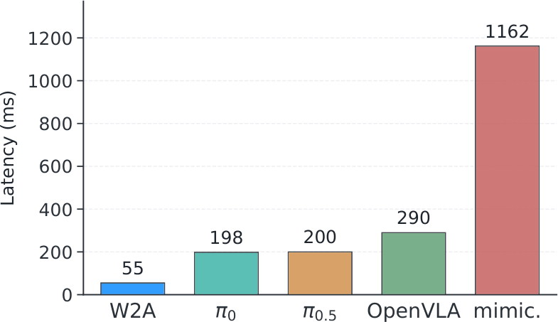
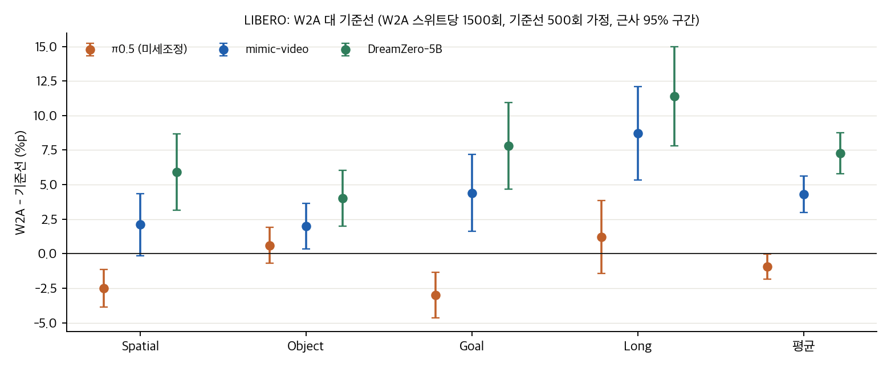
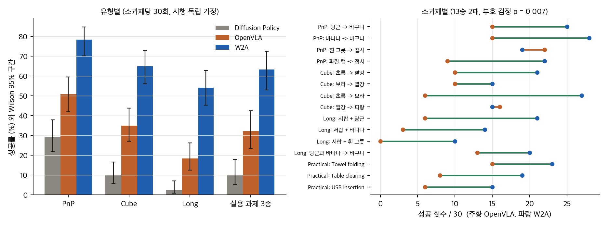
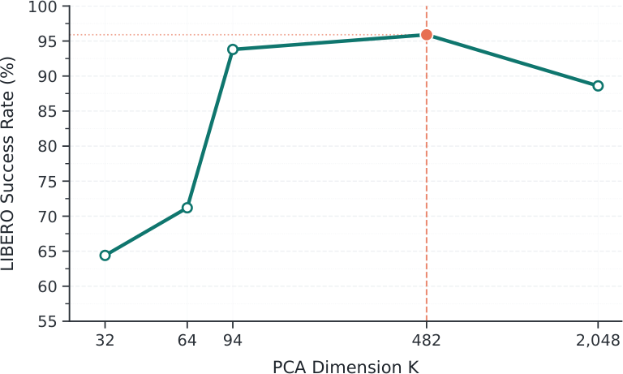
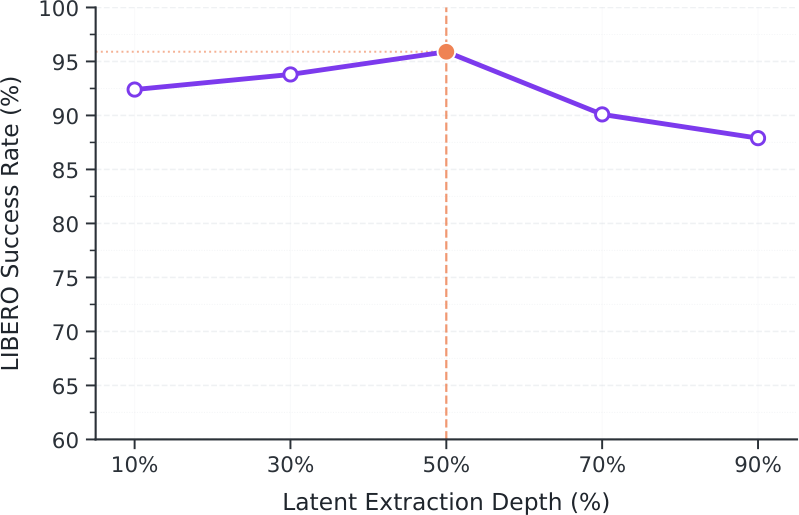
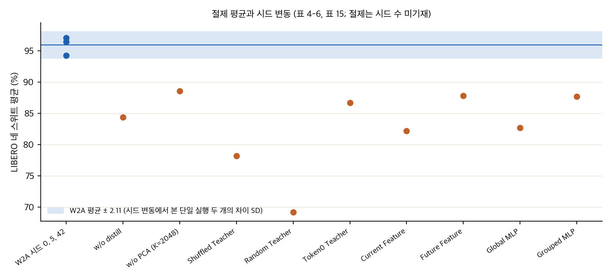
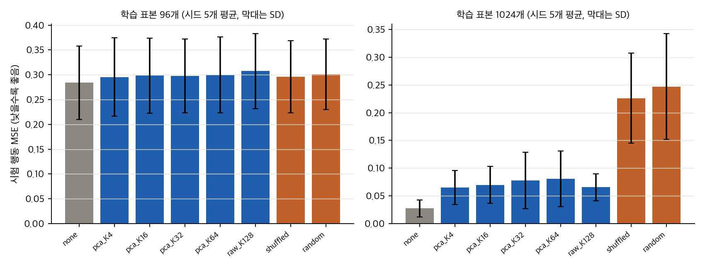

> **논문:** Xiaopeng Zhang, Yongjin Mu, Yueyang Weng, Chengzhi Zhao, Yanjie Li. *W2A: Distilling World Priors into Action Models for Real-Time Robotic Control.* arXiv:2611.02600 (v1, 2026-11-02). CoRL 2026 포스터.
> 공식 코드 저장소(`W2A_code`)는 있지만 README에 "coming soon..."만 있습니다. 논문 그림 세 장(그래프)은 출처를 적어 실었고, 나머지는 우리가 그린 그래프입니다.

## 논문이 묻는 것

월드 액션 모델(WAM)은 미래 영상을 상상하는 비디오 확산 모델을 정책에 붙여 쓰므로 추론이 느립니다. W2A는 비디오 DiT(Cosmos-Predict2)를 **학습 때만** 교사로 쓰고, 교사의 중간 잠재(14번째 블록, 디노이징 시간 0.5)를 PCA로 482차원으로 줄여 행동 DiT의 중간 표현에 코사인 손실로 맞춥니다. 추론 때는 교사와 정렬 모듈(Q-Former)을 버립니다.

*그림 6 (논문 원문). © 저자, CC BY 4.0, 출처 arXiv:2611.02600 (v1).*

## 이 글에서 확인한 것

**1. 표 산술은 맞습니다.** 표 1–6, 15, 16의 평균과 하락 폭, 실로봇 성공 횟수의 합이 모두 일치합니다. π0.5 평균 96.85가 96.9로 적힌 반올림 차이만 있습니다.

**2. LIBERO에서 π0.5와의 차이는 구분되지 않습니다.** W2A는 세 시드 평균이라 스위트당 1500회, 기준선은 500회로 가정하면 평균 차이는 -0.9 포인트(p = 0.06)입니다. 본문의 "Long에서 π0.5를 넘는다"는 +1.2 포인트(p = 0.35)이고, Spatial(-2.5)과 Goal(-3.0)은 π0.5가 높습니다. mimic-video(+4.3)와 DreamZero-5B(+7.3) 대비 격차는 큽니다.

*그림: 시행 수를 가정한 근사 구간입니다(W2A 스위트당 1500회, 기준선 500회). 우리가 그린 그래프입니다.*

**3. 표 1의 기준선 두 행은 원 논문 표로 대조되지 않습니다.** mimic-video 원 논문(v2) 표 II는 Spatial, Object, Goal 세 스위트만 보고하고 평균이 93.9입니다. 표 1의 Long 84.9와 평균 91.6은 그 논문에서 찾지 못했습니다. DreamZero 논문 PDF에서는 LIBERO 결과를 찾지 못했습니다. 직접 학습한 값일 수 있으나 논문에 적혀 있지 않아 평가 횟수와 시드를 알 수 없습니다. 저자 확인이 필요합니다.

**4. 실로봇 우위는 유형 수준에서 확실하고, 소과제는 일부만 확정됩니다.** 소과제당 30회(독립 가정)로 전체 294/450 대 154/450(OpenVLA), 차이 +31.1 포인트(95% 구간 24.7–37.1)입니다. 15개 소과제 중 13개에서 W2A가 높고 2개에서 낮으며, 개별 Fisher 검정은 Holm 보정 후 6개만 유의합니다. 실로봇 기준선은 OpenVLA와 Diffusion Policy 두 개입니다.

*그림: 표 16의 성공 횟수로 그렸습니다(소과제당 30회, 시행 독립 가정). 우리가 그린 그래프입니다.*

**5. 증류 제거 효과는 시드 변동보다 훨씬 큽니다. 최적 K와 깊이의 차이는 시드 변동과 같은 크기입니다.** 표 15의 세 시드에서 LIBERO 평균의 SD는 1.49이고(시드 0 94.25, 시드 5 97.10, 시드 42 96.45), 단일 실행 두 개의 차이 SD는 약 2.1입니다. 증류 제거(-11.5)와 PCA 제거(-7.3), 섞은·무작위 교사(-17.7, -26.7)는 이를 크게 넘습니다. 그림 9에서 읽은 값(그림 판독)으로 K = 94(분산 95%)는 약 93.7, K = 482는 약 95.8이어서 "저차원이면 충분하다"는 곡선은 가설과 맞지만, 최적점 482가 이웃보다 약 2 포인트 높은 정도는 시드 변동 안입니다. K와 깊이를 시험용 LIBERO 성공률로 골랐는지 별도 검증 분할이 있었는지는 적혀 있지 않습니다.

*그림 9 (논문 원문). © 저자, CC BY 4.0, 출처 arXiv:2611.02600 (v1).*

*그림 10 (논문 원문). © 저자, CC BY 4.0, 출처 arXiv:2611.02600 (v1).*

*그림: 표 4–6의 절제 평균과 표 15의 시드 변동입니다. 절제의 시드 수는 논문에 없습니다. 우리가 그린 그래프입니다.*

**6. "21배"는 mimic-video 한 개 대비의 산술 값입니다.** 1162/55 = 21.1이고 맞습니다. 다만 지연은 CLIP 텍스트 인코더 변형으로 쟀고, 기준선의 측정 조건과 순전파 횟수(20스텝, 웜스타트 0.5)가 적혀 있지 않습니다. 구성표(표 7)에서 어림한 학생 크기는 약 150 M으로 비교 대상보다 훨씬 작아서, 증류의 이점과 모델 크기의 이점이 섞여 있습니다. 가장 가까운 효율 WAM(Fast-WAM)과의 지연 비교는 없습니다.

**7. 교사 잠재를 무엇에서 뽑는지 본문에 적혀 있지 않습니다.** 현재 관측과 언어로 생성한 미래를 중간 시간까지 디노이징한 잠재인지, 정답 미래 영상에 잡음을 섞은 잠재인지에 따라 "상상 없이 세계 선험을 준다"는 서술의 의미가 달라집니다. 표 5의 Future Feature(정답 미래 프레임의 ResNet 특징)는 W2A보다 8.1 포인트 낮아 이 쟁점에 가까운 대조군이지만, 모델 크기와 사전학습이 다른 표현을 비교한 것이라 원인을 하나로 가르지는 못합니다.

## 작은 토이로 본 구조

합성 문제(과제 요인 4차원 + 방해 요인 20차원, 학습 표본 96개와 1024개, 시드 5개)에서 PCA로 줄인 교사 잠재를 코사인 손실로 증류해 봤습니다. 교사가 학생 입력 이상의 정보를 갖지 않도록 설계했기 때문에 증류는 무증류보다 낫지 않았고, 섞은·무작위 교사는 훨씬 나빴습니다(1024개 설정에서 무증류의 8–9배 오차). 논문의 주장을 지지하거나 반박하는 실험은 아니고, 보조 증류 손실이 자동으로 이득이 되지는 않으며 틀린 교사는 크게 해롭다는 구조만 확인합니다.

*그림: 시드 5개 평균과 SD입니다. 우리가 설계한 합성 문제이며 논문 수치의 재현이 아닙니다.*

## 정리

- 증류가 성능을 올린다는 핵심 증거(표 4, 표 5)는 크고 시드 변동 대비 확실합니다.
- 기준선과의 비교(표 1의 두 행, 지연 비교)는 조건이 적혀 있지 않아 저자의 설명이 있어야 확정됩니다.
- 구현 측면에서 공식 코드는 아직 없습니다. 학생 모델은 약 150 M으로 작아 소형 재구현이 가능하지만, 교사 적응과 증류는 CUDA GPU가 필요합니다.

재계산 스크립트와 결과, 전체 분석은 함께 올린 저장소 자료에 있습니다.

## 자료

- [통합 리포트 PDF](report/report_public.pdf)
- [01. 논문 분석](analysis/01_paper_analysis.md)
- [02. 선행연구와 관련 저장소](analysis/02_prior_work.md)
- [03. 수치 재계산, 일관성 검사, 토이](analysis/03_analysis.md)
- [04. 주장 대조와 구현 가능성](analysis/04_claim_verification.md)
