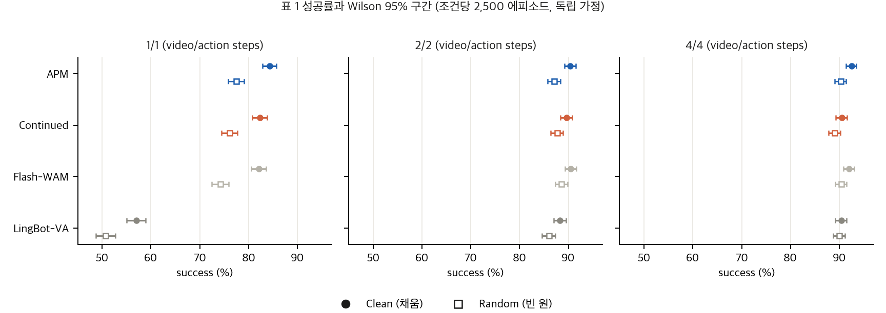
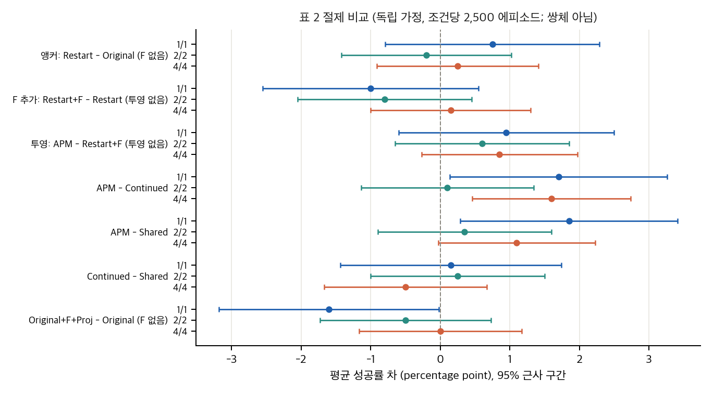
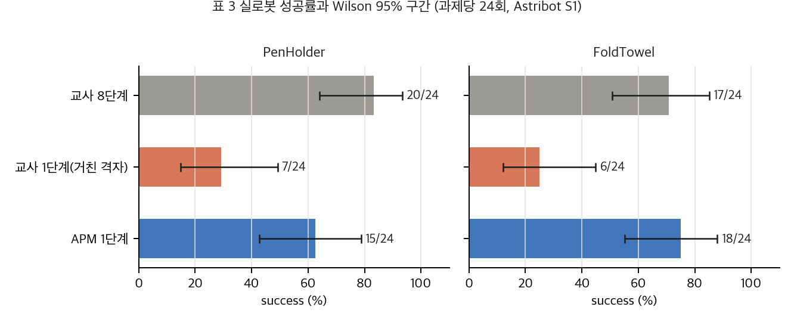

# APM: 학생이 가는 곳에서 교사를 묻는 WAM 증류

*Distilling World Action Models for Efficient Bimanual Manipulation via Anchored Path Matching* (arXiv:2611.22592, v1, 2026-11-17)를 읽고 정리했습니다. 원문과 공식 코드를 직접 확인했고, 표 수치는 다시 계산했습니다. 재현은 하지 않았습니다.

## 한 줄 요약

세계 행동 모델(WAM)은 한 번의 디노이징으로 영상과 행동을 함께 만듭니다. 단계를 줄이면 빨라지지만, 거친 갱신이 학생을 교사 궤적에서 떼어 놓습니다. APM은 **학생이 실제로 도달한 상태**에서 교사를 잡음 0까지 이어 가 끝점 목표를 만들고, 같은 상태에서 짧은 전이 목표도 만듭니다. 두 기울기가 충돌하면 끝점 방향을 우선합니다.

## 방법을 세 문장으로

1. 기반 WAM(LingBot-VA)을 AnyFlow 방식으로 유한 구간 전이 맵으로 증류합니다(단계 I).
2. 동결한 기반 위에 모달리티별 어댑터를 얹고, 학생 롤아웃의 중간 상태 하나를 골라 교사를 한 번 이어 갑니다. 그 한 번의 연속에서 끝점과 첫 중간 상태를 얻습니다.
3. 충돌하는 지역 기울기의 성분만 제거하는 한쪽 투영으로 두 목표를 합칩니다.

한 체크포인트가 1, 2, 4 단계를 모두 지원하고, 배포 때 교사는 필요 없습니다.

## 주장한 결과

| 설정 | 결과 (논문 값) |
|---|---|
| RoboTwin 2.0, 1단계 평균 (Clean/Random) | 80.9% (84.3 / 77.5), 지속 증류 대비 +1.7 |
| 4단계 평균 | 91.4%, 지속 증류 대비 +1.6 |
| 영상 PSNR, 1단계 | 30.169 → 32.317 dB |
| 실로봇, 코스 교사 대비 (두 과제) | 29.2 → 62.5%, 25.0 → 75.0% |
| 제어 주기 지연 (교사 8단계 대비) | 4323.6 → 203.1 ms (21.3×) |

## 재계산과 검정으로 본 강도

그림: 표 1의 조건별 성공률과 Wilson 95% 구간(조건당 2,500 에피소드). 우리가 그렸고 논문 값을 옮겼습니다.

- **1단계 평균 +1.7은 약한 증거입니다.** 독립 근사 검정으로 p ≈ 0.03이지만, Clean만 보면 p ≈ 0.06이고 Random은 p ≈ 0.24입니다. 논문 설정으로 1.7포인트를 80% 검정력으로 찾으려면 조건당 약 8,700 에피소드가 필요합니다. 논문은 2,500입니다.
- **4단계 +1.6은 근사적으로 유의합니다(p ≈ 0.006).** 2단계 차이는 0.1이고 0과 구별되지 않습니다.
- 과제 간 차이와 쌍체 구조는 공개되지 않아 반영하지 못했습니다. 따라서 실제 불확실성은 이보다 클 수 있습니다.

그림: 표 2 절제 쌍의 평균 차와 독립 근사 95% 구간. 쌍체 분석이 아니므로 구간을 보수적으로 읽어야 합니다.

절제 결과도 약합니다. "투영이 이득을 준다"는 +0.6–0.95 포인트는 모두 0을 포함합니다. 원래 앵커에 지역 목표와 투영을 더하면 1단계에서 낮아지는데(−1.6, p ≈ 0.047), 이것이 가장 분명한 차이입니다.

## 실로봇: 코스 교사 대비는 확실, 교사 대비는 판정 불가

그림: 실로봇 성공률과 Wilson 95% 구간(과제당 24회). 우리가 그렸고 논문 표 3 값을 옮겼습니다.

- 코스 교사 대비 개선은 두 과제 모두에서 Fisher 검정으로 유의합니다(p = 0.04, 0.001).
- 교사(8단계) 대비는 차이가 없다고 보는 것이 맞습니다(p = 0.19, 1.0). 저자도 교사보다 낫다고 주장하지 않습니다.
- 지연 21.3배 감소는 계산과 일치합니다. 다만 측정은 A800 GPU의 추론 시간이고, 로봇 쪽 제어 루프 전체 지연은 아닙니다.

## 공식 코드와 논문이 다른 지점

공식 저장소(Apache-2.0)를 정적으로 읽었습니다. 실행은 하지 않았습니다.

- **두 번째 목표의 형태가 다릅니다.** 논문 식 (7)–(8)은 교사 첫 단계의 **짧은 전이**를 맞추는데, 공식 코드는 같은 시각의 **순간 방향장**을 맞춥니다. 저장소 README가 이를 "not the finite-interval paper target"이라고 밝힙니다.
- **재현 정보가 빠져 있습니다.** 옵티마이저, 학습률, λ_a, 학습 자원이 본문과 공개 설정에 없습니다. 텍스트 드롭아웃 0.1은 설정 파일에만 있습니다.
- **스텝 수 표기가 어긋납니다.** 프로젝트 페이지 그림의 "step10000 EMA"는 본문의 총 9,000 스텝과 다릅니다.
- **본문과 표가 어긋나는 곳이 한 군데 있습니다.** 절제 표의 4단계 Clean 지역 목표 효과는 표에서 −0.4인데 본문은 +0.4라고 씁니다.

## 구현할 수 있는가

이 맥(Apple M4 Pro, CUDA 없음)에서는 **논문 결과 재현은 불가능합니다.** 학습은 GPU와 백본, 시뮬레이터, 데이터가 필요하고, 실로봇은 로봇이 필요합니다. 할 수 있는 것은 두 가지입니다. 투영 수식을 임의 벡터로 확인하는 것, 그리고 두 목표 형태(순간 방향장 대 짧은 전이)를 2차원 흐름 모델 토이에서 비교하는 것입니다. 이 둘은 CPU에서 되지만 패키지 설치 승인이 먼저 필요합니다.

## 정리

APM의 생각은 설득력 있습니다. 학생이 간 상태에서 감독하고, 끝점을 우선한다는 원칙은 증류 설계에 쓸 만합니다. 하지만 수치 이득은 작고, 통계적 근거는 약하며, 공식 구현은 논문 식과 다릅니다. 이 세 가지를 같이 보면 "APM이 낫다"보다 "이 설계 원칙은 쓸 만하지만 이득의 크기는 더 많은 에피소드와 저자 설정으로 확인해야 한다"가 정확한 결론입니다.

*분석 상세는 analysis 문서 다섯 편과 리포트 PDF(`git` 폴더)에 있습니다. 논문 그림은 arXiv 라이선스(비독점)에 따라 싣지 않았습니다.*

## 자료

- [통합 리포트 PDF](report/report_public.pdf)
- [01. 논문 분석](analysis/01_paper_analysis.md)
- [02. 선행연구](analysis/02_prior_work.md)
- [03. 재계산, 통계 검정, 일관성 검사](analysis/03_analysis.md)
- [04. 공식 코드 대조 (논문 ↔ 코드, 차이 D1–Dn)](analysis/04_code_verification.md)
