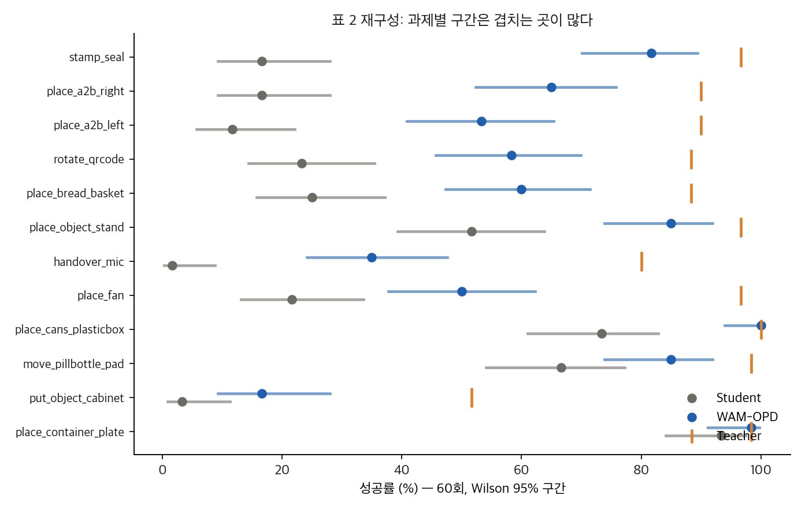
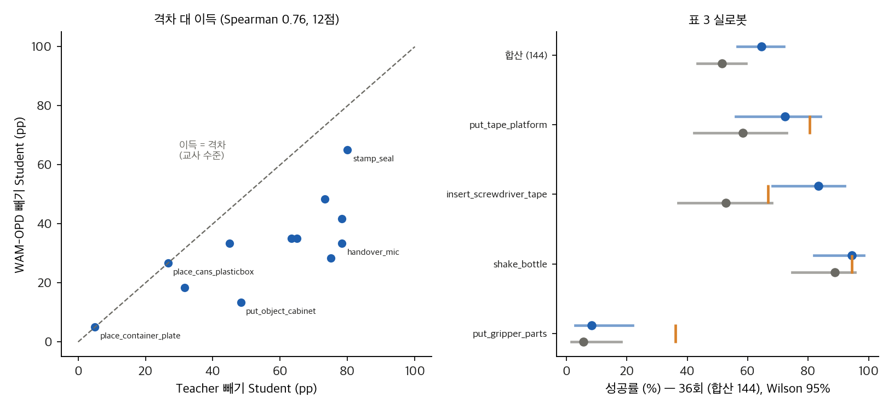
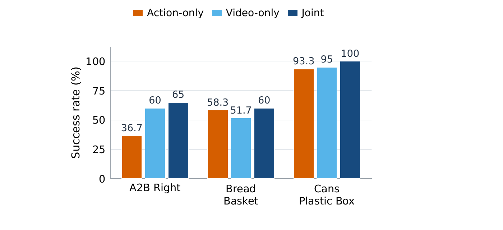
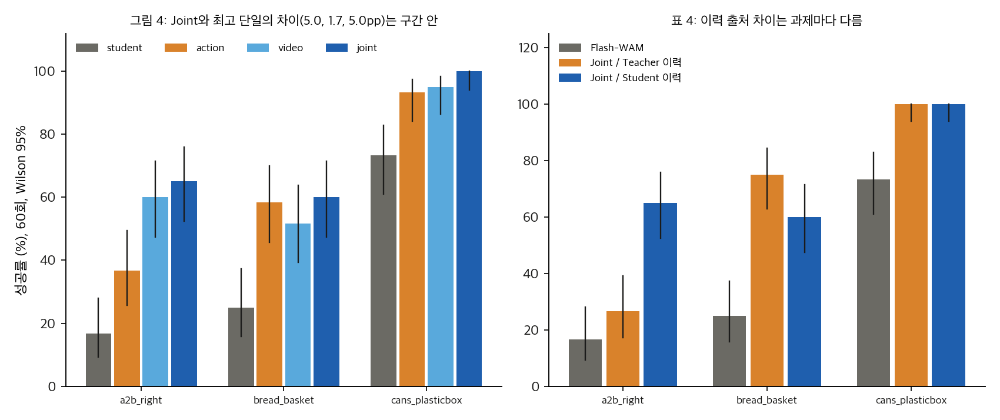

> **논문:** Liuhaichen Yang 외 15명. *WAM-OPD: Joint Video-Action Supervision for World Action Model Post-Training with On-Policy Distillation.* arXiv:2608.22364 (v2, 2026-10-01), 학회 표기 없음. 공식 코드(Apache-2.0)는 정적으로만 읽었고 실행하지 않았습니다.
> 논문은 arXiv에서 CC BY 4.0으로 공개되어 있습니다. 이 글은 저자의 막대그래프(Fig. 4) 한 장만 출처를 달아 싣고, 나머지 그래프는 우리가 그렸습니다.

## 논문이 묻는 것

월드 액션 모델(WAM)은 미래 영상과 행동을 함께 만듭니다. 사전학습한 WAM을 새 과제에 맞출 때, 데모 대신 **자기가 실제로 굴린 이력**에서 더 강한 Teacher에게 배울 수 있을까요?

방법은 단순합니다. Student(Flash-WAM, 영상 1스텝·행동 1스텝)가 RoboTwin 2.0에서 궤적 36개를 굴립니다. Teacher(LingBot-VA, 25/50스텝)는 그 이력마다 영상 목표와 행동 목표를 한 쌍으로 붙입니다. Student는 자기 영상 예측을 stop-gradient로 행동 가지에 넣는 배포 계산 그대로 두 목표를 맞춥니다. rank-8 LoRA, 3 에폭, 학습률 2e-5입니다. 수집은 한 번이고 이후는 고정 데이터로 오프라인 학습합니다.

보고 결과는 RoboTwin 12과제 평균 33.8% → 65.7%, 실로봇 4과제 평균 51.4% → 64.6%입니다.

## 이 글에서 확인한 것

**표의 산술은 모두 맞습니다.** 표 2의 36개 값과 표 3의 12개 값이 각각 60회, 36회의 정수 성공 횟수로 하나씩 복원되고, 평균과 Δ 열도 일치합니다. 그림 4의 막대와 본문 증가폭도 맞습니다.

**시뮬레이션의 평균 향상은 확실합니다.** 합산 243/720 대 473/720, 12과제 모두 증가했고 과제 단위 평균 이득 +31.9 pp의 95% 구간은 약 24–41 pp입니다. 다만 place_container_plate(+5.0 pp, 3회 차이)는 어떤 가정에서도 유의하지 않습니다.

**이득은 Teacher와의 격차와 함께 커지지만 상한이 있습니다.** 격차와 이득의 Spearman 상관은 0.76입니다. 그러나 격차가 이득의 상한이라 기계적으로 따라오는 면이 있고, Teacher를 넘은 과제는 없습니다. 격차를 닫은 비율은 과제마다 0.28–1.0(평균 0.62)입니다. 실로봇은 합산 p = 0.031이지만 과제별로는 Insert Screw Driver Tape 하나만 확실하고, Put Gripper Parts는 3/36 대 2/36입니다.

**절제 결론은 검정력이 없습니다.** 영상·행동 결합이 최고 단일 설정을 앞선 폭은 5.0, 1.7, 5.0 pp이고 모두 p ≥ 0.24입니다. 60회로 검출할 수 있는 차이는 약 23 pp입니다. 5 pp 차이를 80% 검정력으로 보려면 조건당 약 1,470회가 필요합니다. 반면 영상 전용이나 행동 전용이 Flash-WAM을 넘는다는 결론은 확실합니다. 특히 행동 손실을 끈 영상 전용도 향상을 얻습니다. 이력 출처는 A2B Right에서 Student 이력이 확실히 우세하고(p = 5e-5), Bread Basket의 Teacher 우세는 불확실합니다(p = 0.12).

**Teacher 참조가 공개된 LingBot-VA 수치보다 낮습니다.** 12과제 평균 89.6%이고 같은 과제의 공개 Easy 평균은 96.5%입니다. 10과제에서 낮고 6과제는 단측 p < 0.01입니다(put_object_cabinet 51.7% 대 85%). 또 v1(학습 궤적 8+4)에서 v2(24+12)로 가며 handover_mic 58.3% → 35.0%, put_object_cabinet 33.3% → 16.7%로 낮아졌습니다. 통계적으로 구별되지는 않지만(p = 0.19, 0.23) 평가 집합과 어댑터가 함께 바뀌어 원인을 분리할 수 없습니다.

## 공식 코드와의 대조

하이퍼파라미터, 손실, 배치 구성, stop-gradient, Teacher 표지 방식(K1–K16)은 논문과 코드가 맞습니다. 그러나 결과를 재생하는 데 필요한 입력은 공개되지 않았습니다.

- **에폭 선택(D1):** 코드는 에폭 1–3을 선별 분할에서 평가해 하나를 고릅니다. 논문은 "3 에폭"이라고만 씁니다.
- **과제 선정(D2, D3):** 코드는 Teacher-Student 격차 판정을 통과한 과제만 받습니다. 논문 12과제 중 세 과제는 과제 지원 목록에 없어서 바인더가 거절합니다.
- **평가 규모(D4):** 공개 파이프라인의 held-out은 12쌍이고, 논문의 60쌍에는 공개되지 않은 48쌍이 필요합니다.
- **절제와 Teacher 이력(D5, D6):** 공개 학습기는 영상·행동 가중치가 모두 양수일 것을 요구하므로 행동 전용·영상 전용 모드를 만들 수 없고, Teacher 이력 경로는 서버 학습기에만 있다고 문서가 인정합니다.
- **속도 항(D10):** 1스텝 Student에서 σ = 1의 속도 항은 행동 끝점 항과 같은 양(MSE 가중 0.2)으로 보입니다. 논문은 별도 신호처럼 설명합니다(정적 추론, 실행 확인 아님).
- **실로봇(D7):** 데이터 수집, 적응, 증류, 배포 코드가 없습니다. 저장소 문서가 "검증된 하드웨어 어댑터, 보정, 충돌 감독, E-stop이 없음"이라고 적습니다.

저장소 자체가 릴리스 상태를 HOLD로 적고 "서버 스냅샷이 정본일 수 있다"고 밝힙니다.

## 이 맥에서 구현할 수 있는가

**논문 수치의 재현은 이 맥(Apple M4 Pro, 24 GiB, CUDA 없음)에서 불가능합니다.** 공식 파이프라인은 수집 GPU에 65 GB 이상 여유 메모리를 요구하고, 절제·Teacher 이력·실로봇 경로는 공개 코드에 없습니다. 표 재계산과 정적 대조는 끝냈습니다. 장난감 흐름 매칭 WAM에서 이력 출처와 감독 구성을 비교하는 축소판은 새 설치 없이 조건부로 가능하며 노력은 1–2주로 봅니다(추정).

## 읽을 때 조심할 것

- 절제 3과제와 표 4는 60회 한 번의 평가입니다. "최고 단일"은 과제마다 사후에 고른 값이라 결합에 유리한 편향이 있습니다.
- 시뮬레이션과 달리 실로봇은 짝 시드가 없는 독립 36회입니다.
- 공개 LingBot-VA 값과의 비교는 평가 횟수 차이를 무시한 근사입니다. 저장소 문서의 12쌍이 논문의 60쌍에 포함된다는 가정(place_a2b_left 비교)은 문서에 기댄 추정입니다.

## 정리

WAM-OPD는 "Student가 간 곳에서 Teacher가 영상과 행동을 함께 가르친다"는 단순한 조합으로 낮은 출발점의 WAM을 크게 끌어올립니다. 평균 향상은 믿을 만합니다. 그러나 영상과 행동을 함께 쓰는 것이 낫다는 절제 결론, 이력 출처의 우열, 실로봇 향상은 표본이 작고, 에폭 선택·과제 선정·60쌍 구성 같은 선택이 서술에 없습니다. 비교할 때는 시도 단위 기록과 선택 규칙을 함께 보고하는 것이 안전합니다.

## 자료

- [통합 리포트 PDF](report/report_public.pdf)
- [01. 논문 분석: WAM-OPD](analysis/01_paper_analysis.md)
- [02. 선행연구와 계보](analysis/02_prior_work.md)
- [03. 수치 재계산과 일관성 검사](analysis/03_analysis.md)
- [04. 논문 ↔ 공식 코드 정적 대조와 구현 가능성](analysis/04_code_verification.md)
