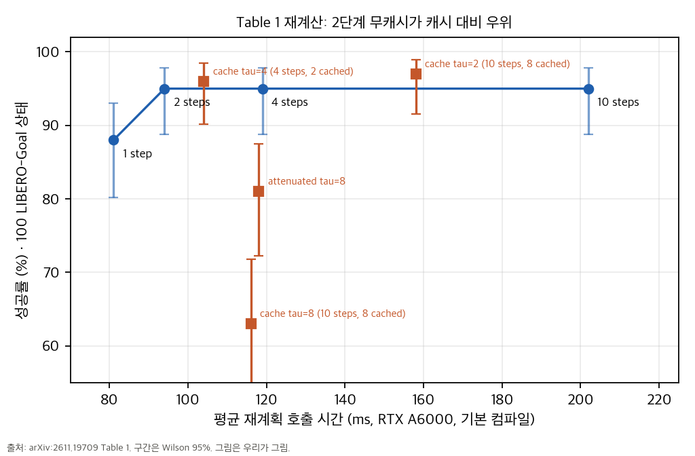
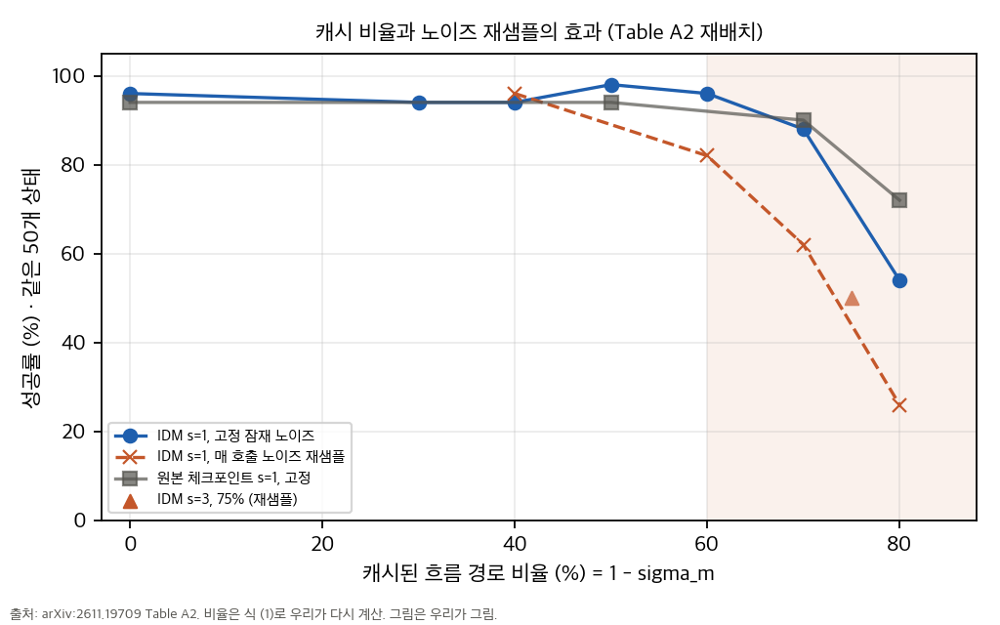

> **논문:** Abhinav Gupta, Nissan Pow. *Cache or Denoise Less? Residual Reuse in a Flow-Matching World Action Model.* arXiv:2611.19709 (v1, 2026-11-15). CoRL 2026 EEAI 워크숍 honorable mention(arXiv 댓글 기준, 공식 목록에서는 확인하지 못함).
> 공식 코드는 GitHub에 있으나 라이선스 파일이 없습니다. 이 글은 코드를 복사하지 않고 읽기만 했습니다. 모델은 실행하지 않았습니다.

## 논문이 묻는 것

흐름 매칭 정책은 행동 한 덩어리를 만들 때 노이즈에서 행동까지 K번의 네트워크 호출을 합니다. 6B 세계 행동 모델 Fast-WAM은 K=10에서 재계획 한 번에 약 200 ms가 걸립니다. 빠르게 하는 길은 두 가지입니다. 스텝 수를 줄이거나, 재계획 사이에 계산을 재사용하는 캐시(C³ache)를 씁니다.

저자들은 여기서 단순한 질문을 던집니다. **캐시가 그냥 스텝을 줄이는 것보다 나은가?**

## 이 글에서 확인한 것

**1. 2스텝 무캐시는 10스텝과 같습니다.** LIBERO-Goal 100상태에서 성공률은 95 대 95입니다. 쌍체 불일치는 2 대 2라서 정확 McNemar 검정은 p = 1.00입니다. 호출 시간은 94 ms 대 202 ms입니다.

*그림 1. 출처: arXiv:2611.19709 Table 1. 그림은 우리가 그렸습니다. 구간은 Wilson 95%입니다.*

**2. 8스텝 캐시는 2스텝보다 32점 낮습니다.** 같은 상태에서 2스텝만 성공한 경우가 35번, 캐시만 성공한 경우가 3번입니다. 정확 p는 6.7 × 10⁻⁸이고, 논문이 쓴 값과 같습니다.

**3. 캐시 비율은 샘플러에 따라 달라집니다.** 흐름 스케줄 식 `σ_k = s·u/(1+(s−1)·u)`로 같은 8개 스텝의 캐시 비율을 다시 계산하면, s=1에서 80%, s=5에서 44%입니다. 같은 스텝 수가 전혀 다른 양의 경로를 덮습니다. 논문 표와 모든 행이 맞습니다.

**4. 노이즈를 매 호출마다 바꾸면 큰 캐시가 무너집니다.** 같은 50상태에서 고정 노이즈와 짝지으면, 60% 캐시는 14점, 70%는 26점, 80%는 28점 떨어집니다. 한 설정(IDM s=3, 75%)은 40점입니다.

*그림 2. 출처: arXiv:2611.19709 Table A2 (같은 50상태). 그림은 우리가 그렸습니다.*

**5. 복합 캐시의 절감은 작습니다.** 2스텝 호출의 70.8%는 캐시로 줄일 수 없는 고정 비용입니다. 스텝 하나만 캐시하면 절감 상한은 10.9%입니다. 다른 기기에서는 13.9%, CUDA 그래프에서는 6.2%입니다.

## 주의할 점

- 초록의 "14–40점" 범위에서 **40점은 IDM s=3 값**입니다. 원본 체크포인트 80%의 재샘플 값 20%는 보류 상태(다른 50상태)에서 나온 것이라, 고정 노이즈 값 72%와 짝지을 수 없습니다. 그래서 원본 쪽 격차는 52점으로 더 크지만, 초록은 이를 드러내지 않습니다.
- 같은 캐시 비율에서도 체크포인트마다 손실이 다릅니다(80%: IDM 54, 원본 72). "비율이 손실을 설명한다"는 말은 상관 수준으로 읽어야 합니다.
- 지연 실험은 50상태입니다. 2스텝 지연 2와 10스텝 지연 5를 비교한 값은 p = 0.12입니다. 방향은 맞지만 결론을 내기엔 부족합니다.
- 모든 실험은 시뮬레이션이고, 노이즈 시드는 하나이고, 아키텍처도 하나입니다.

## 재현 가능성

GPU 재현은 저장소 README 기준 48 GB 이상 VRAM과 CUDA 12.8이 필요합니다. 맥(M4 Pro 24 GiB, CUDA 없음)에서는 할 수 없었습니다. 대신 논문 표의 쌍체 불일치 개수로 통계를 다시 계산했고, 공식 코드는 식과 규칙만 정적으로 대조했습니다. 대조는 대부분 일치했고, 차이는 K=2 캐시 규칙을 본문에 쓰지 않은 점 하나입니다.

## 확인하지 못한 것

- Tango 90% 구간은 다시 계산하지 못했습니다. 우리 구현이 저장소 값과 맞지 않았습니다.
- 500상태 결과(96.6 대 96.4)와 잔차 드리프트 수치는 원자료가 없어 확인하지 못했습니다.

## 게시 범위

이 글의 그림은 논문 그림이 아니라 우리가 논문 표 수치로 그린 그래프입니다. 논문 라이선스는 CC BY 4.0이지만, 출처 표기 부담을 줄이려고 논문 그림은 넣지 않았습니다.

## 자료

- [통합 리포트 PDF](report/report_public.pdf)
- [01. 논문 분석: Cache or Denoise Less? Residual Reuse in a Flow-Matching World Action Model](analysis/01_paper_analysis.md)
- [02. 선행연구, 코드, 학회, 라이선스](analysis/02_prior_work.md)
- [03. 수치 재계산과 일관성 검사](analysis/03_analysis.md)
- [04. 코드 대조: 논문 ↔ 공식 저장소 (정적 읽기)](analysis/04_code_verification.md)
