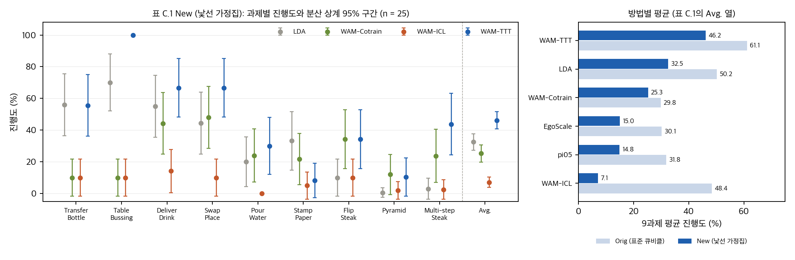
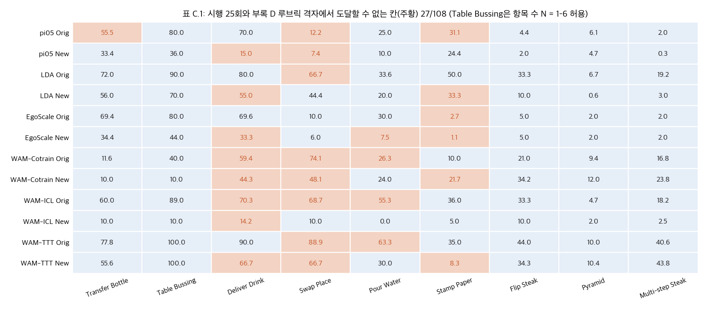
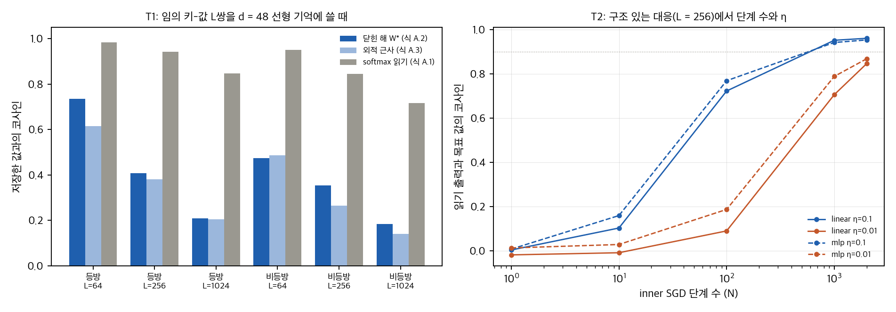

> **논문:** Yusen Feng, Bingchen Han, Jiangran Lyu 외. *WAM-TTT: Steering World-Action Models by Watching Human Play at Test Time.* CoRL 2026 포스터, arXiv:2607.06988 (v3, 2026-10-23).
> 공식 코드는 2026-11-26 기준으로 확인하지 못했습니다. 이 글의 그림은 우리가 그린 그래프입니다. 논문 그림은 arXiv 비독점 배포 라이선스라서 넣지 않았습니다.

## 논문이 묻는 것

로봇 파운데이션 모델을 새 과제 변형이나 사용자 선호 행동으로 돌리려면 보통 로봇 시연을 더 모으거나 미세조정을 합니다. 이 논문은 **사람이 시연하는 영상**을 그 인터페이스로 삼습니다. 사람 영상을 문맥 토큰으로 계속 넣는 방식(in-context)은 영상이 늘수록 문맥이 길어집니다. 대신 영상을 **작은 고속 가중치 기억**에 써 넣고, 사전학습된 World-Action Model(WAM)은 그대로 두자는 것입니다.

구성은 두 단계입니다. 먼저 사람-로봇 짝 데이터 2,286쌍으로 메타 학습을 합니다. 백본은 LDA(Qwen3-VL-4B + 16블록 MMDiT)이고, 비디오 전문가 블록에 TTT 잔차 가지를 붙입니다. 안쪽 루프는 사람 영상에서 비디오 예측 손실과 키-값 재구성 손실(식 3)로 고속 가중치를 SGD 한 번 갱신하고, 바깥 루프는 그 가중치로 로봇 질의를 읽어 로봇 WAM 손실을 줄입니다. 배포할 때는 행동 라벨 없는 사람 영상 몇 개로 고속 가중치만 한 번 갱신합니다(학습률 0.01, 메타 학습은 0.1).

## 이 글에서 확인한 것

**1. 보고된 평균은 표와 맞고, LDA 대비 이득의 방향은 분명합니다.** 표 C.1의 12개 행 평균이 모두 재계산과 소수 첫째 자리까지 일치합니다. 낯선 가정집(New)에서 WAM-TTT 46.2%, LDA 32.5%로 차이가 13.7포인트입니다. 시행별 점수가 없어서 [0, 1] 값의 분산 상계(25회 가정)로 구간을 잡으면 이 차이의 95% 구간은 +6.2 ~ +21.3입니다(표 값에서 계산). 방향은 분명하고 크기는 넓습니다.

*그래프 (우리가 그림). 표 C.1 값을 그렸고 구간은 시행 25회와 분산 상계를 가정한 것입니다.*

**2. 과제별 승패 문장은 표와 다르게 읽힙니다.** 본문은 "9과제 중 7개를 확실히 이기고 Flip Steak에서 비기며, 예외는 Stamp Paper뿐"이라고 씁니다. 표 1과 맞춰 보면 LDA만 기준으로 7승 2패(Transfer Bottle 55.6 대 56.0, Stamp Paper 8.3 대 33.3)이고 비긴 과제는 없습니다. Flip Steak의 WAM-TTT 값은 34.3입니다. 기준선 전체와 비교하면 6개 과제에서 가장 높고, Pyramid는 WAM-Cotrain(12.0)이 WAM-TTT(10.4)보다 높습니다. 기준선을 밝히지 않은 문장이라 표와 다르게 읽히는 것으로 보이며, 저자 확인이 필요합니다.

**3. 가장 큰 격차(+39.1, WAM-ICL 대비)는 기준선 구성에 기댑니다.** v3 본문은 WAM-ICL이 낮은 이유를 "우리 WAM은 배포 시 전체 사람 영상에 행동 노이즈 제거를 조건화하도록 사전학습되지 않았다"고 설명합니다. 표 2에서 LingBot-VA 2.0 방식의 ICL 변형은 한 과제(Swap Place)에서 50.0이고 WAM-TTT는 66.7입니다. 시행 수가 없어 25회를 가정하면 차이 16.7의 분산 상계 p는 0.22로 이 한 과제 비교는 구분되지 않습니다. LDA 대비 +13.7이 더 직접적인 비교입니다.

**4. 과제를 표본으로 보면 근거가 약해집니다.** 칸마다 25회라는 시행 단위에서는 LDA 대비 차이가 뚜렷합니다(평균 열 z = 3.6). 아홉 과제를 표본으로 쌍체 t 검정을 하면 p = 0.063이고 부호 검정은 7승 2패에서 p = 0.18입니다. 과제별로는 Table Bussing(+30.0), Multi-step Steak(+40.8), Flip Steak(+24.3)이 뚜렷하고 보정하면 앞의 둘이 남습니다.

**5. 일부 칸의 값은 "25회, 부록 D 루브릭" 격자에 맞지 않습니다.** 부록 D는 과제마다 항목 가중치(합 1.0)를 주므로 시행 n회 평균이 가질 수 있는 값은 격자 위에 있습니다. n = 25를 가정하면 표 C.1의 108칸 중 27칸이 격자에 없습니다. 예를 들면 Swap Place 66.7(WAM-TTT, New), Stamp Paper 8.3, Transfer Bottle 55.5(π0.5, Orig.)입니다. 1/3, 1/6, 1/9 꼴이 많아서 칸마다 시행 수가 다르거나 채점 규칙이 부록과 다를 가능성이 있습니다. 표 3의 Swap Place 두 값(WAM-TTT 88.9, w/o TTT 74.1)은 10회 격자에도 없고, 표 C.1의 Orig. 열 값과 같습니다. 캡션은 New 설정이라고 적으므로 설정이나 시행 수의 서술을 저자에게 확인해야 합니다. 정수 복원이 되지 않아 Wilson이나 Fisher 검정은 하지 않았습니다.

*그래프 (우리가 그림). 시행 25회와 부록 D 가중치의 최대공약수로 만들 수 있는 평균인지 검사했습니다(Table Bussing은 항목 수 1–6 허용).*

**6. 시험 시 한 번의 갱신이 기억을 쓰는지는 절제로 확인되지 않았습니다.** 표 B.1은 inner 단계 수 N = 1, 시험 시 학습률 0.01(메타 학습의 1/10)입니다. N, 학습률, 가중 λ, 사람 영상의 개수에 대한 절제와 적응 지연은 본문에 없습니다. 아래 토이에서 식 3의 정규화(1/(B L_h d))를 그대로 쓰면 한 단계 갱신의 읽기 변화가 작았습니다. 다만 인용한 Spatial-TTT류 층은 per-token 학습률과 정규화를 쓰는데 WAM-TTT가 같은 방식인지 본문에 없어서, 토이가 논문의 모델에 대한 반증은 아니고 확인되지 않은 부분이라는 뜻입니다.

**7. 버전 사이에 식 6이 바뀌었고 표 숫자는 그대로입니다.** v1과 v2는 참고문헌 확장 외에 본문과 표가 같습니다. v3은 메타 학습의 바깥 손실에 λΣL_KVM 항을 추가했고, 사람 영상 인터페이스 비교(표 2)와 ICL 기준선 설명, 부록 E.7을 더했습니다. 표 1, C.1, E.1–E.3의 숫자는 세 판본이 같습니다. 어느 목적으로 학습한 모델이 표의 결과인지는 본문에서 확인되지 않습니다.

## 토이: 선형 기억의 용량과 한 단계의 크기

부록 A는 선형 고속 가중치에서 키-값 재구성 손실의 최소해가 선형 어텐션 읽기라고 설명합니다(식 A.2–A.4). 논문도 이 등식이 선형 특수 경우에만 정확하다고 적습니다. d = 48 소형 모델로 두 가지를 봤습니다(키·값 분산 1 가정, 한 시드).

- **용량.** 서로 무관한 L쌍을 d × d 선형 기억에 넣으면 값 복원 코사인이 L = 64, 256, 1024에서 0.74, 0.41, 0.21로 떨어집니다. 키가 등방이면 닫힌 해와 외적 근사가 가깝고(코사인 0.91–0.98) 비등방이면 벌어집니다(0.34–0.57).
- **한 단계.** 키의 선형 함수를 값으로 하는 구조 있는 대응(L = 256)에서 η = 0.1은 읽기가 약 1.8–3.6%, η = 0.01은 0.17–0.36% 변하고, 목표 코사인 0.9까지 η = 0.1이면 약 300단계가 걸렸습니다.

*그래프 (우리가 그림). 식 3의 MSE 갱신을 그대로 쓴 소형 토이입니다. 실제 층의 갱신 규칙은 다를 수 있습니다.*

## 공개 자료와 구현 가능성

공식 코드는 확인하지 못했습니다(논문과 프로젝트 페이지에 링크가 없고 저자 계정의 저장소는 프로젝트 페이지 하나입니다). 백본 LDA-1B와 TTT 참고 구현 Spatial-TTT는 공개되어 있습니다. 본문에 없는 정보가 많습니다. TTT 가지를 붙인 블록의 수와 위치, f_W의 구조, 시험 시 사람 영상의 개수·길이, 적응 시간, WAM-ICL이 받는 문맥의 크기입니다.

논문 수치의 재현에는 로봇 세 기체, 짝 데이터 2,286쌍, 8×H800 메타 학습이 필요해서 일반 노트북에서는 어렵습니다. 메커니즘의 소형 재구현(비디오 쪽 고속 가중치 + inner 한 단계 + 바깥 역전파)은 Apple M4 Pro급 기기에서 새 패키지 설치 없이 시작할 수 있는 규모입니다(노력 2–3주 추정, 측정 전).

## 저자에게 묻고 싶은 것

- 표 C.1과 표 3, E.1의 일부 칸 값이 부록 D의 격자와 맞지 않습니다. 칸별 시행 수와 채점 규칙, 표 3 Swap Place 열의 설정은 무엇입니까?
- 시험 시 사람 영상의 개수와 프레임 수, 갱신 한 번의 소요 시간, 메타 학습(0.1)과 시험(0.01)의 학습률 차이의 의도는 무엇입니까?
- 사람 영상을 바꿔 넣었을 때(다른 과제, 다른 전략) 로봇 행동이 따라 바뀝니까? 평가 과제 아홉 개는 메타 학습 과제와 같아서 새 과제 변형의 조종은 이 표들로는 확인되지 않습니다.
- 메타 학습의 짝 사람 영상이 평가 가정집에서 촬영될 때, "previously unseen" 평가는 어떤 분리를 뜻합니까?

## 이 글의 한계

논문은 시행별 점수를 주지 않아 정확검정은 하지 않았고, 분산 상계는 실제 구간보다 넓습니다. 표 2와 표 4의 시행 수는 25회로 가정했습니다. 로봇 실험, 학습, 추론은 하지 않았습니다. 공식 코드가 없어 학습 설정은 논문 서술로만 확인했습니다. 계산은 이 저장소의 `analysis/recompute.py`와 `analysis/toy_fast_weight.py`에 있습니다.

## 자료

- [통합 리포트 PDF](report/report_public.pdf)
- [01. 논문 분석: WAM-TTT (arXiv:2607.06988)](analysis/01_paper_analysis.md)
- [02. 선행연구와 자료: WAM-TTT (arXiv:2607.06988)](analysis/02_prior_work.md)
- [03. 수치 재계산과 해석: WAM-TTT (arXiv:2607.06988)](analysis/03_analysis.md)
- [04. 주장 검증과 구현 가능성: WAM-TTT (arXiv:2607.06988)](analysis/04_claim_verification.md)
