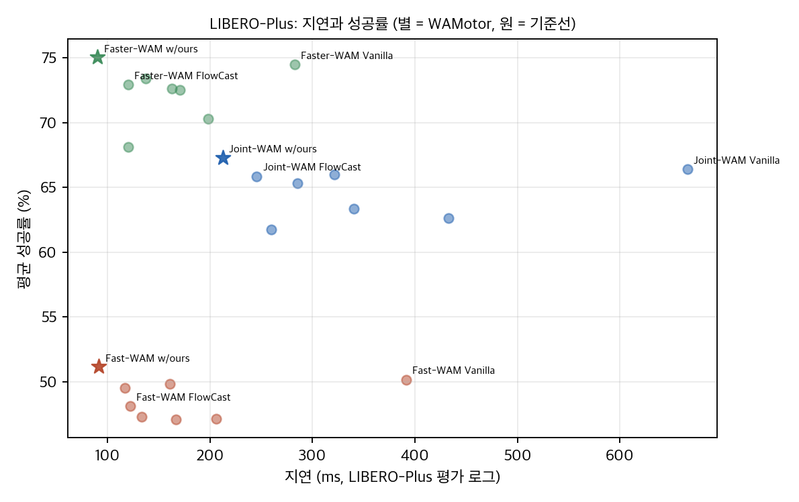
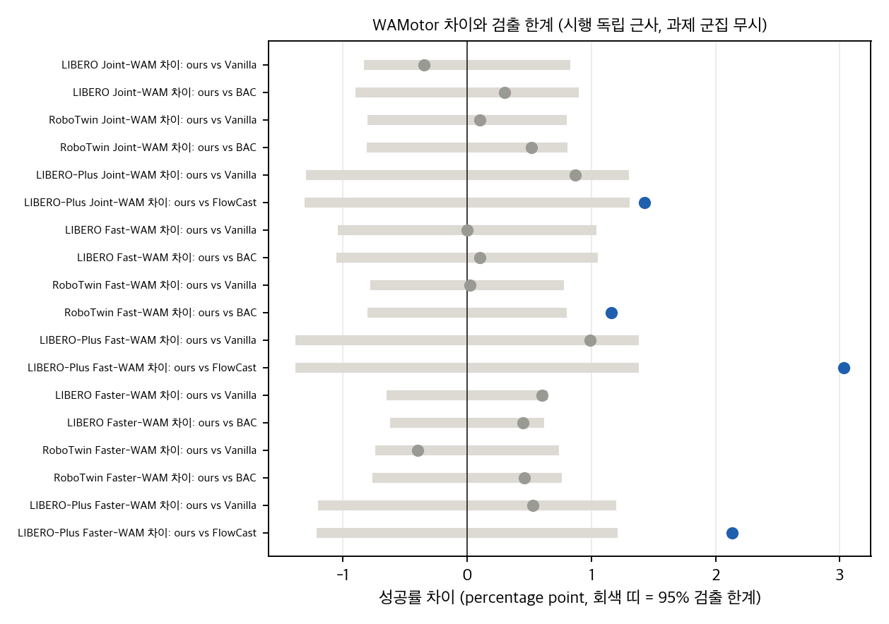
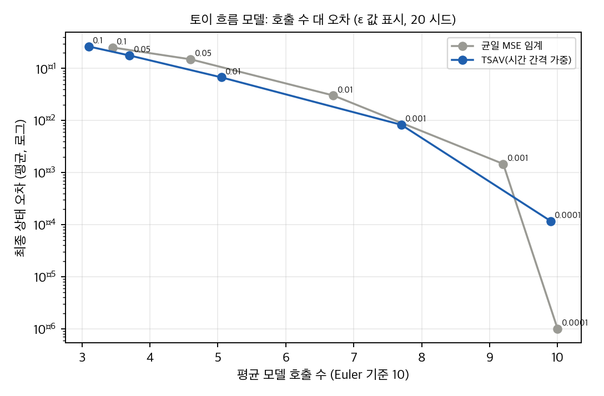

WAMotor는 월드 액션 모델(WAM)의 행동 생성을 빠르게 하는 방법입니다. 학습은 새로 하지 않고, 추론 중 이미 계산한 속도를 재사용해 여러 denoising 스텝을 한 번에 넘깁니다. 이 글은 논문 표를 다시 계산하고, 공식 저장소를 실행하지 않고 읽어 본 결과입니다.

## 무엇을 바꿨나

WAM은 행동을 flow matching으로 N번의 Euler 스텝을 거쳐 만듭니다. 투기적 추론은 초안을 만들고 병렬로 검증해 스텝을 건너뜁니다. 기존 방법은 과제마다 초안 모델을 학습해야 했습니다. FlowCast처럼 속도를 재사용하면 학습이 필요 없지만, 저자들은 WAM에서 이 가정이 두 가지로 깨진다고 봤습니다.

1. **속도 변화가 균일하지 않습니다.** 처음과 끝 스텝 사이의 속도 변화가 큽니다. 논문 부록 표에서 이 두 전이가 MSE의 66–80%를 차지합니다.
2. **적분 간격이 균일하지 않습니다.** 같은 속도 오차라도 간격이 크면 상태 오차가 제곱으로 커집니다.

WAMotor는 이 두 가지를 반영합니다. 첫 Euler 스텝 뒤의 속도를 앵커로 쓰고(RAVS), 검증 임계를 간격의 제곱에 비례하도록 바꿉니다(TSAV). 샘플러 자체는 FlowCast와 같습니다.

## 표를 다시 계산해 보니

그림: LIBERO-Plus 평가 로그의 지연과 평균 성공률. 별은 WAMotor, 원은 기준선입니다. 우리가 그린 그래프입니다.

- **속도비는 본문과 맞습니다.** LIBERO 3.05–4.19×, RoboTwin 2.86–4.02×, LIBERO-Plus 3.13–4.28×입니다. 평균도 표 안에서 맞습니다.
- **성공률 차이는 검출되지 않습니다.** Vanilla와의 차이는 −0.40에서 +0.99 pp 사이입니다. 95% 검출 한계는 벤치마크에 따라 0.65에서 1.4 pp입니다. "정확도 유지"는 맞지만 "정확도 향상"이라고 하기는 어렵습니다.

그림: 주요 비교의 차이(점)와 95% 검출 한계(회색 띠). 시행을 독립으로 가정한 근사입니다. 우리가 그린 그래프입니다.

- **제거 실험의 기준선은 FlowCast입니다.** 논문 Table 4의 "neither" 행이 Table 3의 FlowCast 행과 세 모델 모두 같습니다. 본문에는 이 설명이 없습니다.

## 코드를 읽어 보니

공식 저장소(Overdue-Lin/WAMotor)의 샘플러는 논문의 임계식과 보정 절차를 그대로 구현합니다. 다음은 확인이 필요합니다.

- **지연 비교의 공정성.** 투기 경로의 예측 함수만 CUDA에서 `torch.compile(mode="reduce-overhead")`로 감쌉니다. 기준 경로는 감싸지 않습니다. 논문에는 이 점이 없습니다. 속도비의 일부가 알고리즘이 아니라 컴파일 효과일 수 있습니다.
- **지연 측정 설정.** 측정 스크립트의 ε 기본값은 5e-2인데, 논문 본문은 10⁻²입니다. 어느 설정으로 Fig. 3가 나왔는지는 적혀 있지 않습니다.
- **평가 코드가 없습니다.** LIBERO와 LIBERO-Plus 성공률 평가를 실행하는 스크립트가 저장소에 없습니다. RoboTwin 평가와 지연 측정 코드만 있습니다. 기준선 여섯 개의 구현도 없습니다.
- **라이선스가 없습니다.** 저장소에 라이선스 파일이 없습니다.

## 이론의 범위

정리 4.5는 시간 간격 가중 검증이 최종 오차를 `h_mid·√ε·Σ G_k`로 묶는다고 말합니다. 이 상계는 Lipschitz 상수 L_k와 C_k를 알아야 계산됩니다. 논문은 이 값들을 재지 않았고, δ의 수치도 보고하지 않았습니다. 그래서 "보장"은 조건부입니다.

작은 흐름 모델로 확인해 보았습니다. 16차원, 고정 난수 MLP, Shift-5 스케줄, 10 스텝, 20 시드입니다. 같은 모델 호출 수(약 7–8회)에서 시간 간격 가중 검증이 균일 임계보다 최종 오차가 작았습니다. 이 결과는 한 모델의 결과이므로 WAM에 그대로 옮길 수는 없습니다.

그림: 토이 흐름 모델에서 모델 호출 수 대 최종 오차. 우리가 그린 그래프입니다.

## 정리

WAMotor는 학습 없이 WAM의 행동 생성을 빠르게 하는 방향으로 실용성이 있습니다. 다만 성공률 보존은 이 논문 설정의 범위에서만 말할 수 있고, 시드 변동과 평가 코드가 공개되지 않아 독립 확인은 아직 어렵습니다. 전체 재현은 CUDA 기기와 시뮬레이터가 있어야 가능합니다.

- 논문: https://arxiv.org/abs/2611.25413
- 공식 코드: https://github.com/Overdue-Lin/WAMotor (정적 읽기만, 라이선스 없음)

## 자료

- [통합 리포트 PDF](report/report_public.pdf)
- [WAMotor 논문 분석 (arXiv:2611.25413)](analysis/01_paper_analysis.md)
- [WAMotor 선행연구와 관련 자료](analysis/02_prior_work.md)
- [WAMotor 수치 재계산과 일관성 검사](analysis/03_analysis.md)
- [WAMotor 코드 대조 (논문 ↔ 공식 저장소)](analysis/04_code_verification.md)
