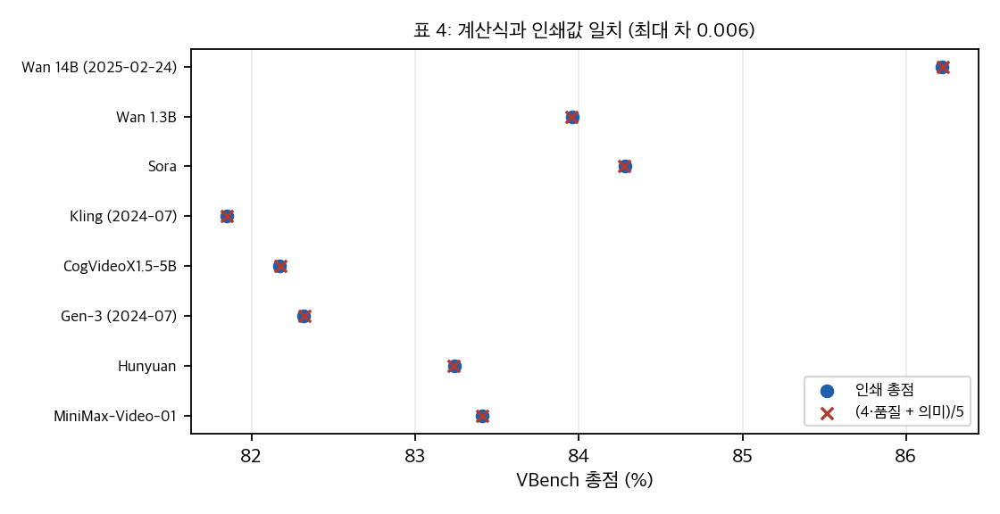
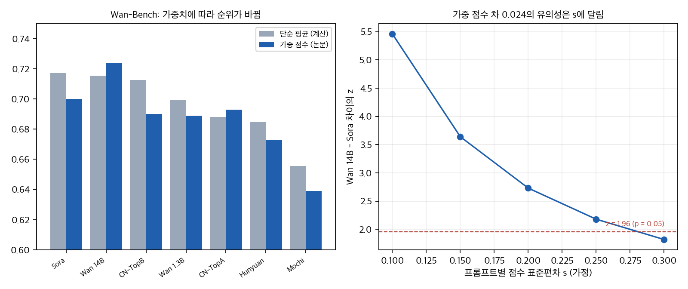
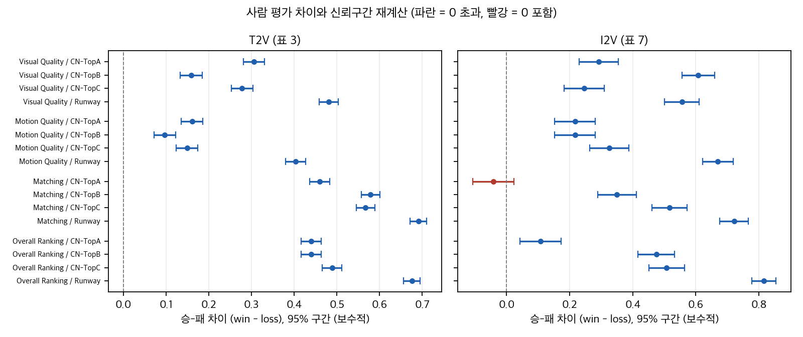

> **논문:** Wan Team (Alibaba Group). *Wan: Open and Advanced Large-Scale Video Generative Models.* 기술 보고서, arXiv:2503.20314 (v2, 2025-04-19).
> 공식 코드(Apache-2.0, Wan-Video/Wan2.1)는 얕게 받아 정적으로만 읽었고 실행하지 않았습니다. 논문 그림은 싣지 않고, 우리가 그린 그래프만 씁니다.

## 이 글이 다루는 것

오픈 영상 생성 모델은 로봇 학습 쪽에서도 자주 백본으로 쓰입니다. 세계 행동 모델(WAM)이 영상 확산 모델을 빌려 쓰는 경우가 많습니다. 그래서 이 글은 Wan이 어떻게 만들어졌는지, 보고된 숫자가 얼마나 믿을 만한지, 그리고 이 맥에서 무엇을 돌려 볼 수 있는지를 봅니다.

Wan은 1.3B과 14B 두 크기의 T2V, I2V를 기본으로 하고, 편집(VACE), 얼굴 개인화, 카메라 제어, 실시간 생성, 영상→오디오까지 같은 계열로 묶습니다. 이 글은 구조와 수치에 집중합니다.

## 구조: 세 덩어리

**Wan-VAE.** 3D 인과적 VAE입니다. 시간과 공간을 4×8×8로 줄여 16채널 잠재로 만듭니다. 첫 프레임은 시간 압축을 하지 않고 공간만 줄입니다. GroupNorm 대신 RMSNorm을 써서 인과성을 지키고, 특징 캐시로 긴 영상을 4프레임 청크로 나눠 처리합니다. 저장소 코드에서 캐시 길이 2, 청크 수 1 + (t−1)/4를 확인했습니다.

**DiT.** 패치 (1,2,2)로 토큰화합니다. 81프레임 720p면 잠재가 21×45×80이라 토큰이 **75,600개**입니다. 480p는 **32,760개**입니다. 텍스트는 교차 어텐션으로 넣고, 영상 토큰끼리는 시공간 전체 어텐션을 씁니다. 블록은 자기 어텐션, 교차 어텐션, FFN 순서입니다. 14B는 40층, 폭 5120, 1.3B는 30층, 폭 1536입니다.

**텍스트와 목표.** 텍스트 인코더는 umT5이고 512토큰을 씁니다. 학습 목표는 rectified flow의 속도 예측 MSE입니다. 추론은 UniPC 솔버로 기본 50스텝을 돌립니다.

## 숫자를 다시 계산해 보니

**VBench 총점은 맞습니다.** 보고된 총점은 (4·품질 + 의미)/5로 계산한 값과 8개 행 모두 일치합니다. 최대 차이는 0.006으로 반올림 범위입니다. 14B는 86.22로 리더보드 값과 같습니다. 의미 점수(84.44)가 총점 차이의 큰 부분을 만듭니다.

그래프: 표 4의 인쇄 VBench 총점과 (4·품질 + 의미)/5 계산값. 두 점이 거의 겹칩니다. 우리가 그린 그래프입니다.

**Wan-Bench 1위는 가중치에 달려 있습니다.** 14개 지표를 단순 평균하면 Sora(0.717)가 Wan 14B(0.715)보다 높습니다. 논문의 1위는 사람 선호와의 상관으로 정한 가중치를 쓴 결과입니다. 그런데 가중치 값이 인쇄되지 않았습니다. 가중 점수 차 0.024는 프롬프트별 점수의 표준편차가 0.28보다 작을 때만 p < 0.05가 됩니다. 이 값은 공개되지 않았습니다.

그래프: 왼쪽은 14개 지표의 단순 평균과 논문의 가중 점수, 오른쪽은 차이 0.024의 z 값이 프롬프트별 표준편차에 따라 바뀌는 모습. 우리가 그린 그래프입니다.

**사람 평가 셀은 승률이 아닙니다.** 표 7에는 음수 셀(매칭 대 CN-TopA, −4.2%)이 있습니다. 승률은 음수가 될 수 없으므로 셀 값은 승-패 차이입니다. 표 3의 캡션은 "비율"이라고 쓰지만, 같은 셀을 비율로 읽으면 종합 순위 44%가 "우위"와 반대가 됩니다. 신뢰구간은 "All Rounds" 값을 표본 수로 두고 보수적으로 계산했습니다. 표 3의 모든 셀은 0보다 확실히 큽니다. 표 7의 매칭 대 CN-TopA는 구간이 0을 포함합니다. "모든 차원에서 우수"라는 본문과 맞지 않습니다.

그래프: 표 3(T2V)과 표 7(I2V)의 승-패 차이와 95% 구간(보수적). 파란 점은 0 초과, 빨간 점은 0을 포함합니다. 우리가 그린 그래프입니다.

## 코드와 논문이 다른 곳

공식 저장소는 **추론 전용**입니다. 학습 스크립트, 옵티마이저, 데이터 파이프라인, Wan-Bench 평가 코드가 없습니다. 논문은 학습 전체를 공개한다고 쓰지만 저장소에는 없습니다.

구조는 대부분 맞습니다. 14B DiT 설정(40층, 폭 5120, FFN 13824), 패치 (1,2,2), VAE 4×8×8·16채널·RMSNorm, 특징 캐시, umT5 512토큰, 전체 어텐션이 코드와 같습니다. 1.3B은 계산상 1.42B로 명칭보다 9% 큽니다. 계산식 오차일 수 있어 가중치로 확인해야 합니다.

가속 주장 세 가지(확산 캐시 1.62배, FP8 1.13배, 8비트 어텐션 1.27배)는 코드가 없습니다. 품질 수치도 없어 "무손실"이라는 말은 검증할 수 없습니다. 샘플링 시프트도 논문에 없습니다. 저장소 기본값은 720p에서 5.0, 480p 이미지-영상에서 3.0입니다. 시프트는 결과를 크게 바꿀 수 있는 값입니다. 1.3B의 VRAM 8.19 GB는 측정 설정을 적지 않았습니다. 저장소 README의 효율 표 주석은 1.3B를 RTX 4090에서 offload와 텍스트 인코더 CPU 실행으로 돌렸다고 밝힙니다. 8.19 GB가 이 설정에서 나온 값인지는 확인할 수 없습니다.

## 이 맥에서 무엇이 되나

Apple M4 Pro(약 24 GiB, CUDA 없음) 기준입니다.

- **추론 14B는 불가입니다.** bf16 가중치만 26.6 GiB라서 메모리에 올라가지 않습니다.
- **추론 1.3B는 조건부입니다.** 가중치는 2.6 GiB입니다. CUDA 기본값과 autocast를 포팅해야 합니다. 480p 5초 한 편은 연산량으로 보면 1–2시간 안팎으로 추정합니다. 측정하지 않은 추정입니다.
- **학습은 불가입니다.** 학습 코드가 없고, AdamW 상태만 10 GB를 넘습니다.
- **VAE 재구성 측정은 시작할 수 있습니다.** 127M 크기라서 로봇 프레임에서 세부 보존을 보는 데 쓸 수 있습니다.

## 남는 질문

- 사람 평가의 과제 수, 주석자 수, 셀별 표본 수, 평가자 일치도
- Wan-Bench 가중치와 프롬프트별 점수, 시드 반복
- 표 5의 스텝 표기 (본문은 100k·150k, 표는 10k·15k)
- 같은 RTX 4090에서 본문 8 FPS와 그림 31 캡션 20 FPS의 차이
- 확산 캐시의 품질 손실과 2D 컨텍스트 병렬의 통신 비율

## 정리

Wan은 공개 추론 코드와 가중치가 있는 대표적인 오픈 영상 모델입니다. 구조 설명은 코드와 맞고, VBench 계산도 맞습니다. 다만 사람 평가 값과 Wan-Bench 1위는 측정 설계를 확인해야 판단할 수 있습니다. 로봇에 쓰려면 학습 코드를 새로 짜야 하고, 이 맥에서는 추론과 VAE 측정까지가 현실적입니다.

---

*재계산과 검사 스크립트, 그래프 생성 코드, 대조 노트는 게시용 패키지에 함께 들어 있습니다. 가중치와 데이터는 받지 않았고 공식 코드는 실행하지 않았습니다.*

## 자료

- [통합 리포트 PDF](report/report_public.pdf)
- [Wan: Open and Advanced Large-Scale Video Generative Models (arXiv:2503.20314) 논문 분석](analysis/01_paper_analysis.md)
- [선행 연구, 계보, 자료 (Wan, arXiv:2503.20314)](analysis/02_prior_work.md)
- [03 재계산과 일관성 검사 (Wan, arXiv:2503.20314 v2)](analysis/03_analysis.md)
- [04 논문과 공식 코드 대조 (Wan2.1, 정적 읽기)](analysis/04_code_verification.md)
