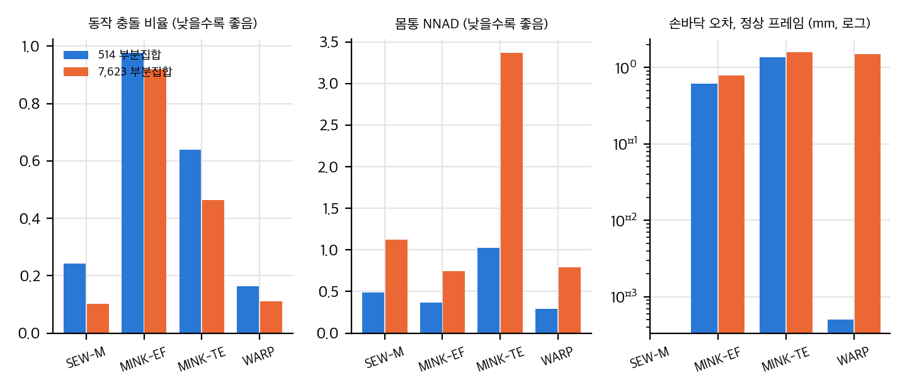
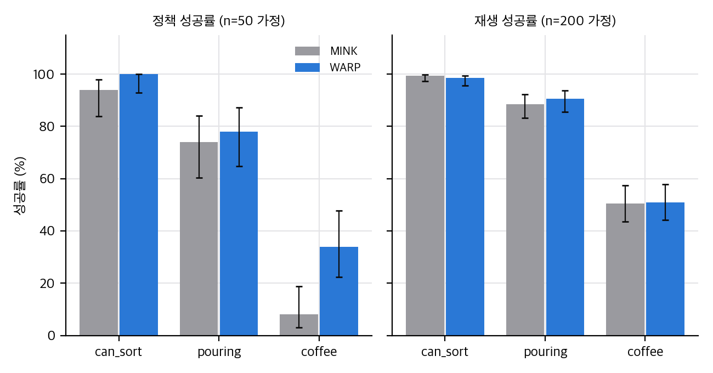
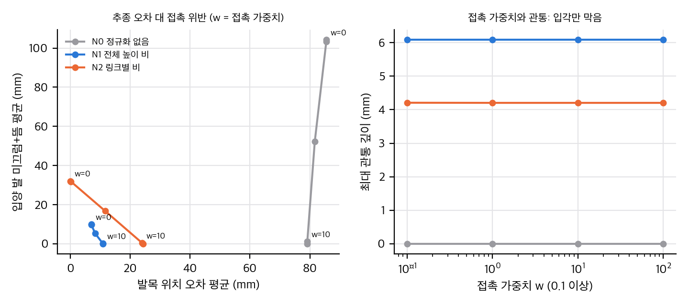
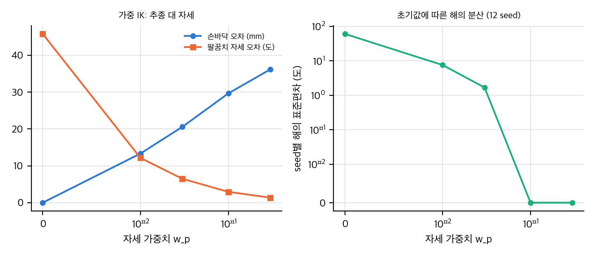

사람 영상이나 VR 시연을 로봇 행동으로 바꾸는 리타게팅은 텔레오퍼레이션 없이 데이터를 모으는 길입니다. 이 논문(WARP)은 오프라인 리타게팅을 두 가지 실패 양식으로 봅니다. 손 정확도를 높이면 몸통과 팔꿈치가 무너지고, 자세를 맞추면 손이 어긋납니다. 해법으로 SEW(어깨-팔꿈치-손목) 표현의 닫힌 형식 해를 쓰고, 손바닥을 등식 제약으로 두며, 몸통 위치를 보정하고, 기지는 느리게 따라가게 했습니다.

## 무엇을 주장하나

1. 리타게팅이 정확하고 일관되면, 같은 정책 구조로 학습했을 때 성공률이 오른다.
2. 시뮬 DexMimicGen 실험에서 정책 성공률이 59%에서 71%로 올랐다.
3. 실물에서 사람 시연만으로 전신 모바일 조작 정책을 학습했다. 과제 네 개, 과제당 시연 50개.

## 헤드라인 수치는 어떤 설정인가

서론의 "손바닥 오차 99.34% 감소"와 본문의 "150배"는 MINK-EF 대비 손바닥 평균 위치 오차입니다. 공개 저장소의 설정 프리셋에 대응시켜 보면, 논문 표에서 "JL off"로 적힌 WARP 행은 관절 한계와 기지 필터를 **둘 다** 끈 설정으로 보입니다. 전체 시스템 행("JL on")에서는 손바닥 평균 오차가 24.0 mm, 방향 오차가 3.26도입니다. 같은 표의 MINK-EF on은 0.75 mm, 0.011도입니다. 그러니 "정확 일치"라는 주장은 기지 필터를 빼고 나서야 성립합니다.

*그림: 논문 표 값으로 그린 직접 그래프. 514개 부분집합과 7,623개 부분집합에서 최고 순위가 바뀌는 항목이 있습니다.*

7,623개 확장 부분집합에서는 같은 지표의 순위가 달라집니다. 정상 프레임 손바닥 오차는 MINK-EF가 0.79 mm로 WARP의 1.51 mm보다 낮습니다. 원시 평균의 우위는 MINK-EF의 이상치 프레임에서 나옵니다. 자기 충돌과 관절 한계 비율도 514개에서만 WARP가 최저입니다.

## 정책 실험은 사람 데이터가 아닙니다

DexMimicGen 시뮬 실험의 원천은 GR1 **로봇** 시연입니다. 사람 시연을 쓴 것은 실물뿐입니다. 시뮬에서 정책 차이는 세 과제 평균 +12%p이고, 과제별로는 coffee(8%에서 34%)에 집중합니다.

*그림: 논문 Table 1 값으로 그린 직접 그래프. 정책은 n = 50, 재생은 n = 200을 가정했습니다(논문에 표본 크기가 없어 값의 격자로 추정).*

coffee 과제만 Holm 보정 후 유의합니다(p ≈ 0.008). 롤아웃 수, 학습 시드 수, 반복 학습 결과가 논문에 없어서 차이의 안정성을 판단할 수 없습니다.

## 서론의 "35%"

실물 실험에서 세 과제의 정책 롤아웃 차이를 평균하면 35%p입니다(상자 회전 +25, 카트 밀기 +50, 세탁 +30). 상대 비율로는 WARP 59%, MINK 24%로 약 2.4배입니다. 과제당 10회 시행이고, 비교 대상인 MINK가 어떤 변형인지 적혀 있지 않습니다.

## 계산 시간 주장

논문은 "프레임당 마이크로초"와 "SEED 한 시간 대 하루"를 말합니다. 표의 프레임당 시간은 6.8 ms이고, 514개 부분집합 기준으로 계산하면 WARP는 약 15분, MINK-EF는 약 7.3시간입니다. 두 주장 모두 표 값과 맞지 않아서, 조건을 확인해야 합니다.

## 구현할 수 있나

공식 재현은 불가능합니다. 공개 저장소에는 MINK 기준선과 재생 도구가 있지만, WARP 솔버(`geo_kin`)는 별도 라이선스 휠이고 정책 학습 코드는 없습니다. 기하 부분(손바닥 등식, 팔꿈치 SP3)은 numpy로 중간 난이도이고 CPU로 충분합니다. 정책 학습은 코드가 없어 처음부터 만들어야 하고, 규모에 따라 GPU가 필요합니다.

## 장난감으로 본 교환 관계

논문 모델이 아니라 두 장난감으로 교환 관계만 확인했습니다.

*그림: 직접 만든 장난감(평면 2링크, 로봇 정강이가 사람보다 김). 정규화 없이 링크별로 맞추면 추종 오차는 줄지만 입각 발이 미끄러집니다. 접촉 가중치를 올리면 미끄럼은 사라지고 발목 오차가 늘어납니다. 스윙 중 관통은 입각 항으로 막히지 않습니다.*

*그림: 직접 만든 장난감(손바닥 위치만 맞춤, seed 12개). 자세 가중치가 0이면 seed마다 해가 60도씩 흩어지고, 가중치를 올리면 해는 일관되지만 손바닥이 30 mm 가까이 밀립니다. 가중 IK로는 둘을 동시에 맞출 수 없습니다.*

## 정리

WARP는 리타게팅의 일관성과 손 정확도를 함께 얻으려는 좋은 설계 방향입니다. 다만 헤드라인 수치는 한 설정에서만 나오고, 정책 실험은 로봇 시연에서 가져왔고, 통계와 시간 주장은 표와 맞지 않습니다. 사람 데이터 기반 전신 학습을 판단하려면 설정별 수치와 시드 변동이 필요합니다.

분석 문서와 장난감 코드는 게시 패키지에 함께 들어 있습니다. 논문 그림과 표는 라이선스(CC BY-NC-ND 4.0) 때문에 싣지 않았습니다.

## 자료

- [통합 리포트 PDF](report/report_public.pdf)
- [WARP: Whole-Body Retargeting for Learning from Offline Human Demonstrations 논문 분석](analysis/01_paper_analysis.md)
- [WARP 선행연구와 관련 연구](analysis/02_prior_work.md)
- [WARP 재계산, 검정, 유도, 장난감 검증](analysis/03_analysis.md)
- [WARP 논문과 공개 코드 대조 (정적 읽기)](analysis/04_code_verification.md)
