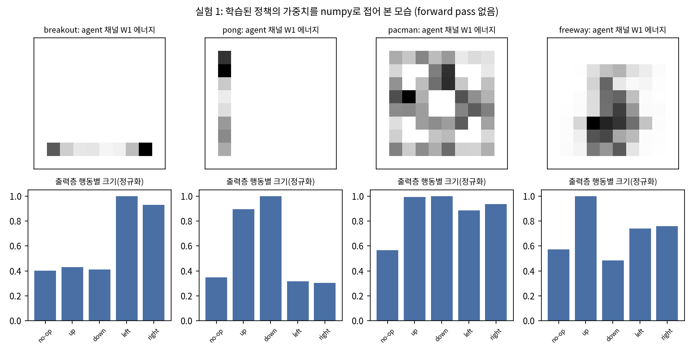
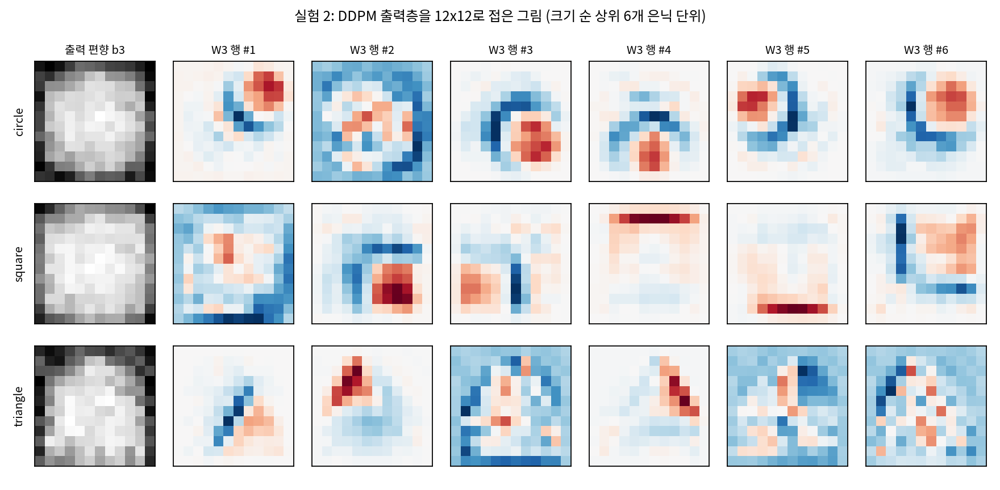
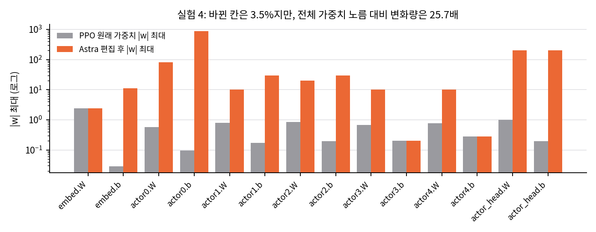
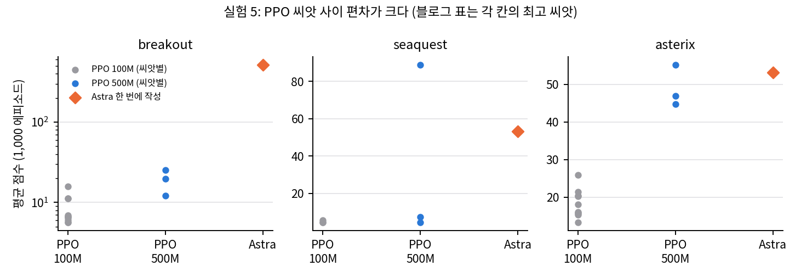
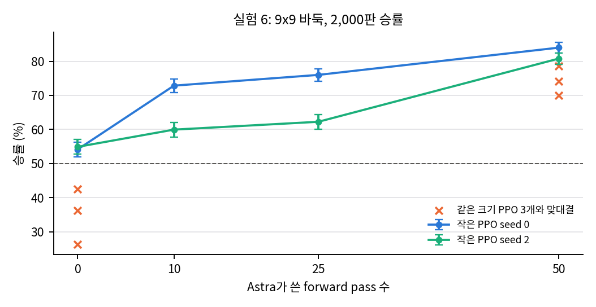
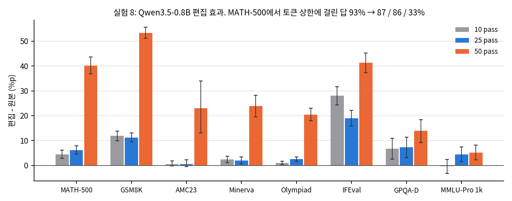
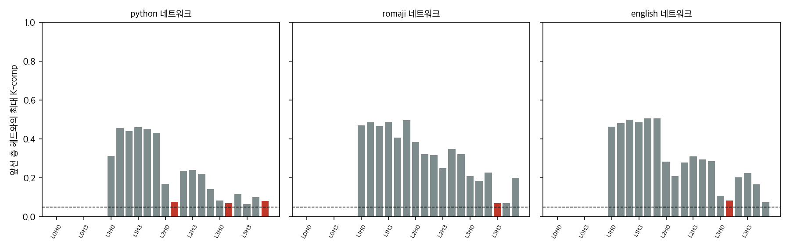

# 수치 재계산과 해석

모든 수치는 공개 로그(`logs_official/`, CC BY 4.0)에서 CPU로 다시 계산했습니다. 스크립트는 `verify_logs.py`(→ `verify_logs_results.json`), `weight_reading_toy.py`(→ `weight_reading_toy_results.json`), `plot_figures.py`입니다.

## 1. 읽기 실험이 얼마나 어려운가 (실험 1·2)

블로그와 같은 조건(forward pass 없음)으로, LLM 없이 numpy 몇 줄로 첫 층과 출력층을 접어 보았습니다.

그림: 실험 1의 네 정책. 위는 첫 층 W1에서 agent 채널 가중치 제곱합을 10x10 칸으로 접은 것, 아래는 출력층 W3에서 행동별 평균을 뺀 열의 크기(최댓값으로 정규화). 직접 계산.

| 게임 | agent 에너지가 가장 몰린 행·열(안쪽 8x8 기준 비율) | 크게 구분하는 행동 | Astra 답 |
|---|---|---|---|
| Breakout | 8행(맨 아래) 97.4% | left 1.00, right 0.93 (나머지 0.40–0.43) | Breakout 99% |
| Pong | 1열(맨 왼쪽) 96.5% | down 1.00, up 0.90 (나머지 0.30–0.35) | Pong 96% |
| Pac-Man | 고르게 퍼짐(최대 행 17.1%, 최대 열 16.4%) | 네 방향 모두 0.89–1.00 | Pac-Man 96% |
| Freeway | 가운데 영역(최대 행 25.6%) | up 1.00, down 0.48 | Frogger 97% |

"패들이 맨 아래 행에서 좌우로 움직인다 → Breakout", "왼쪽 열에서 위아래로 움직인다 → Pong", "위로만 간다 → 길 건너기" 같은 추론은 이 표만으로 사람도 할 수 있습니다. Astra가 이 판단을 17,253개 숫자 텍스트만 보고, 도구 없이 해냈다는 점은 인상적입니다. 하지만 정보는 첫 층과 마지막 층에 거의 그대로 드러나 있습니다. 블로그도 실험 3 서두에서 "앞의 두 실험은 첫 층이나 마지막 층만 읽어도 풀 수 있었다"고 인정합니다(p.6).

그림: 실험 2의 세 DDPM. 출력 편향 b3와, 노름이 큰 은닉 단위 6개의 출력 가중치를 12x12로 접은 것. 사각형은 가로·세로 변, 삼각형은 빗변, 원은 호가 보인다. 직접 계산.

출력 편향만 봐도 삼각형은 위쪽 폭이 좁습니다(편향이 평균보다 큰 칸 수: 위 세 행 평균 2.67, 아래 세 행 평균 7.0). 원과 사각형은 편향만으로는 덜 구분되지만(위 4.0 대 아래 3.67, 위 5.0 대 아래 3.33), 출력 단위의 그림에서는 직선 변과 호가 뚜렷합니다. Astra가 테두리만 그린 이유도 이 그림으로 설명됩니다. 각 출력 단위가 테두리 조각을 그리고 속을 채우는 것은 편향(넓은 덩어리)이 맡는데, Astra는 단위들만 읽었습니다.

**결론:** 실험 1·2는 "가중치를 텍스트로만 받아도 얕은 구조를 찾는다"는 증거입니다. 깊은 계산을 이해한다는 증거는 실험 3에서 나와야 합니다.

## 2. 실험 3: 확률의 크기와 복사 헤드 기준

| 항목 | 값 |
|---|---|
| 정답 언어에 준 확률(대화 6개) | 0.56, 0.52, 0.55, 0.62, 0.58, 0.48 (평균 0.55) |
| log loss | 0.60 (균등 추측 ln 3 = 1.10) |
| 복사 헤드, induct > 0.2 | Python 2.1, 3.1, 3.5 / romaji 3.3 / English 3.1 (다른 헤드는 모두 0.019 이하) |
| 복사 헤드, induct > 0.3(채점 스크립트 기본값) | Python 3.5 / romaji 없음 / English 3.1 |

언어 판정은 맞았지만 확신이 크지 않습니다. 보기 3개 중 정답에 평균 0.55를 줬습니다. 복사 헤드 쪽이 더 강한 결과입니다. 0.2 기준에서 다섯 헤드를 모두 맞혔고 다른 헤드는 하나도 복사 헤드로 부르지 않았습니다. 0.2와 0.3 사이에 헤드가 없고, 복사 헤드가 아닌 헤드는 모두 0.02 이하라서 기준을 어디에 두든 Astra의 지목은 "실제로 induction 점수가 높은 헤드"와 일치합니다. 로그 README가 0.3 기준 필드(`true_copy_heads`)와 블로그의 0.2 기준이 다르다는 점을 스스로 밝혀 둔 것도 확인했습니다.

## 3. 실험 4: "3.5%"의 크기

그림: 텐서별 |w| 최댓값, 원래 PPO(회색)와 Astra 편집 후(주황). 로그 축. 직접 계산.

- 바뀐 칸: 6,073 / 171,664 = 3.54% (`eval/oneshot_result.json`과 일치).
- 변화량 노름 / 원래 노름(Frobenius, 14개 텐서 전체): **25.7배**. 로그의 `rel_change` 25.66과 일치합니다.
- 텐서별로 actor0.b는 원래 노름의 3,737배, actor_head.b는 938배, actor_head.W는 55배입니다. 원래 |w| ≤ 1인 층에 80(actor0.W), 200(actor_head.W), 876(actor0.b)을 넣었습니다.

편집은 tanh 단위를 포화시켜 if-then 스위치로 쓰는 손 설계 제어기입니다. 출력층에 ±200을 넣으면 특정 조건에서 해당 행동의 확률이 1에 가까워집니다. 원래 정책은 그 조건이 꺼진 뒤에만 영향이 있습니다. 이 방식은 해석 가능하고 정확하지만, "기존 정책을 조금 고쳤다"보다 "조건부로 덮어쓰는 모듈을 붙였다"가 정확한 설명입니다.

## 4. 실험 5: 씨앗 편차와 에피소드 상한

그림: 게임별 PPO 씨앗 점수(회색 100M, 파랑 500M)와 Astra가 한 번에 쓴 네트워크(주황). Breakout은 로그 축. 직접 계산.

| 게임 | PPO 100M 최고 / 중앙값(씨앗 수) | PPO 500M 최고 / 중앙값(씨앗 3) | Astra | Astra 평균 에피소드 길이 |
|---|---|---|---|---|
| Breakout | 15.8 / 6.6 (10) | 25.3 / 19.8 | 517.4 ± 7.4 | 7,417 스텝(상한 10,000의 74%) |
| Seaquest | 5.6 / 4.4 (3) | 88.9 / 7.5 | 53.1 ± 1.4 | 1,412 |
| Asterix | 25.8 / 17.1 (10) | 55.2 / 46.9 | 53.2 ± 1.0 | 858 |

- Breakout의 큰 차이는 에피소드 상한의 영향이 큽니다. 공을 계속 받아 내면 점수는 시간에 비례해 오르고, Astra 네트워크는 대부분의 에피소드를 상한 근처까지 끌고 갑니다. 최고 PPO는 평균 282 스텝에서 끝납니다.
- Seaquest는 PPO 500M 씨앗 하나(88.9)만 높고 나머지 둘은 7.5, 4.4입니다. 중앙값과 비교하면 Astra(53.1)가 7배 높고, 최고 씨앗과 비교하면 60%입니다. 블로그는 최고 씨앗과 비교해 "60%"라고 보수적으로 보고했습니다.
- Astra 네트워크의 0이 아닌 가중치는 815 / 803 / 637개(20,486개 중 3–4%)입니다. 희소한 손 설계 회로라는 뜻입니다.

## 5. 실험 6: 피드백의 효과

그림: forward pass 예산별 승률(2,000판, Wilson 95% 구간)과 같은 크기 PPO 세 씨앗과의 맞대결(x 표시). 직접 계산.

| 예산 | 작은 PPO seed 0 | 작은 PPO seed 2 | 같은 크기 PPO 3개 맞대결 |
|---|---|---|---|
| 0 | 54.1% [52.0, 56.3] | 54.9% [52.7, 57.1] | 42.6 / 26.3 / 36.3% |
| 10 | 72.9% [70.9, 74.8] | 60.0% [57.8, 62.1] | - |
| 25 | 76.0% [74.1, 77.8] | 62.3% [60.1, 64.4] | - |
| 50 | 84.0% [82.3, 85.5] | 80.8% [79.0, 82.5] | 74.2 / 70.0 / 78.5% |

- pass 0개 네트워크도 무작위 상대와 REINFORCE 상대에게는 98.8–99.7%를 이깁니다. 바둑 규칙을 아는 휴리스틱으로서는 이미 동작합니다.
- 같은 크기 PPO를 이기려면 pass 50번(연습 대국 47번 + 국면 분석 3번, 대국당 최대 128판)이 필요했습니다. 연습 상대 "strong"은 PPO 씨앗 1이고, 채점 상대는 씨앗 0·2라서 상대 자체는 분리되어 있습니다. 하지만 같은 학습 절차의 씨앗이므로 약점이 겹칠 수 있습니다. 블로그의 "same-size PPO를 이긴다"는 이 범위에서의 결과입니다.
- 예산마다 실행이 1개라 10 → 25 구간의 작은 증가가 의미 있는지는 판단할 수 없습니다.

## 6. 실험 8: 무엇이 좋아졌는가

그림: 벤치마크별 (편집 - 원본) 정확도 차이와 문제 단위 짝 부트스트랩 95% 구간. 직접 계산.

### 6.1 문제 단위 짝 비교

| 벤치마크 | 10 pass | 25 pass | 50 pass |
|---|---|---|---|
| MATH-500 | +4.5 [2.8, 6.2] | +6.2 [4.6, 7.9] | **+40.2 [36.9, 43.6]**, 개선 306 / 악화 0 |
| GSM8K | +11.9 [9.9, 13.8] | +11.2 [9.5, 13.0] | **+53.3 [51.0, 55.5]**, 개선 916 / 악화 4 |
| AMC23 | +0.6 [-0.2, 1.9] | +0.6 [-0.5, 2.3] | +23.0 [13.1, 33.9] |
| Minerva | +2.4 [1.1, 3.8] | +2.0 [0.6, 3.5] | +23.9 [19.6, 28.2] |
| OlympiadBench | +1.0 [0.4, 1.7] | +2.6 [1.7, 3.5] | +20.5 [18.0, 23.0] |
| IFEval | +28.0 [24.3, 31.7] | +19.0 [15.8, 22.2] | +41.3 [37.3, 45.2] |
| GPQA Diamond | +6.7 [2.5, 11.0] | +7.3 [3.2, 11.4] | +13.9 [9.2, 18.4] |
| MMLU-Pro 1k | -0.3 [-3.2, 2.5] | +4.4 [1.5, 7.4] | +5.2 [2.3, 8.2] |

(%p, 괄호는 95% 구간. MMLU-Pro는 1표본이라 구간이 넓습니다.)

50 pass 편집의 효과는 통계적으로 매우 분명합니다. MATH-500에서 나빠진 문제가 하나도 없다는 점이 특히 눈에 띕니다. 반복을 줄이는 편집이 "끝까지 가지 못하던 풀이를 끝까지 가게 할 뿐, 원래 맞히던 풀이를 망가뜨리지 않는다"는 해석과 맞습니다.

### 6.2 이득이 어디서 오는가

- MATH-500에서 토큰 상한(32,768)에 걸린 답의 비율: 원본 93.0% → 10 pass 87.2% → 25 pass 86.4% → 50 pass 33.1%.
- 정확도가 크게 오른 것은 상한 비율이 크게 줄어든 50 pass뿐입니다. 10·25 pass는 상한 비율이 6–7%p 줄고 정확도도 4–6%p 올랐습니다.
- Astra의 연습 문제 검증(1,152문제)에서 구조된 579개 중 576개가 원래 잘린 답이었습니다(`runs/p50c/final_answer.md`).
- 반복이 거의 없는 Gemma 3 270M(상한 도달 8.5%)에서는 편집 네 개가 엄격 채점 기준 -0.15 – +1.0%p였고, 25 pass 하나만 구간이 0을 살짝 넘었습니다([+0.2, +1.85]). 블로그의 결론("가려진 능력을 꺼낼 뿐 없는 능력은 못 더한다", p.17)과 맞습니다.

### 6.3 기준선에 대한 질문

원본의 7.9%는 thinking on, 32,768 토큰, presence penalty 1.5라는 특정 설정에서의 값이고, 이 설정에서 모델이 반복에 빠진다는 것은 Qwen 모델 카드도 경고합니다(블로그 p.16). 따라서 이 결과는 "수학 능력 향상"보다 "알려진 실패 모드의 정밀한 제거"로 읽어야 합니다. 같은 문제를 푸는 더 단순한 방법들(반복 패널티 조정, thinking 끄기, 토큰 예산과 강제 종료, Arditi식 평균 차이 방향 제거를 스크립트로 수행)이 어디까지 따라오는지가 다음 비교 대상입니다. 로그에는 이 기준선이 없습니다.

### 6.4 실행 선택

공개된 결과표(`eval/RESULTS_excerpt.md`)에 있는 Qwen 편집 실행:

| 실행 | MATH-500 | 블로그 |
|---|---|---|
| v2, 0 pass | 7.9 (편집 없음) | 없음 |
| v3, 5 pass | 7.9 (편집 미제출) | 없음 |
| v3, 10 / 25 / 50 pass | 12.3 / 14.1 / 48.1 | 보고 |
| v4, 10 pass | 7.9 (편집 미제출) | 없음 |
| v4, 25 pass | 14.1 | 없음 |
| v5, 5–50 pass | 미완(…) | 없음 |

값이 있는 실행 중 큰 이득(48.1)은 하나뿐이고, 같은 예산의 다른 실행이 없어 재현성을 판단할 수 없습니다. 저자들은 이 표를 그대로 공개해서 판단할 근거를 남겼습니다.

## 7. 실험별로 LLM이 더한 것

| 실험 | 정보가 있는 곳 | 기존 기법으로 되는가 | LLM이 더한 것 |
|---|---|---|---|
| 1 | 첫 층·출력층 | 시각화로 보임(§1) | 텍스트에서 구조를 찾고 세계 지식(게임 이름)과 연결 |
| 2 | 출력층 | 시각화로 보임(§1) | 같음 |
| 3 | 층 사이 composition | Elhage식 점수 | 해당 분석을 스스로 고르고 수행, 언어 판정까지 추론 |
| 4 | 장면 설명 + 정책 | 손 설계 제어기 + 전환 | 실패 진단과 배선을 한 번에, 도구 없이 |
| 5 | 게임 소스 | 휴리스틱을 Tracr식으로 컴파일 | 휴리스틱 설계와 컴파일을 한 번에, 도구 없이 |
| 6 | 규칙 + 대국 피드백 | 휴리스틱 + 측정 기반 탐색 | 같은 일을 148만 가중치 규모에서 수행 |
| 7 | attention 패턴 | activation 비교 | 탐침 텍스트 설계 |
| 8 | activation + 측정 | 방향 제거, 디코딩 처방 | 실패 모드 발견, 위치 특정, 대조군 설계, 측정 기반 선택 |

공통점은 **기존 해석·설계 기법의 선택과 실행을 자연어 지시만으로 끝까지 수행한다**는 것입니다. 새 종류의 능력이라기보다 연구자가 하던 일련의 작업을 자동화한 것에 가깝고, 그 자체로 실용적 가치가 큽니다.

## 추가 검증 (2026-11-11)

### 추가 검증 1: 블록 가중치만으로 K-composition 점수를 계산해 복사 헤드를 찾을 수 있는가

**목적.** 실험 3에서 Astra는 실행 없이 가중치만 읽어 복사 헤드 5개를 맞혔습니다(§2). 같은 일을 표준 기법인 K-composition 점수(Elhage et al., 2021)로 자동화할 수 있는지 봅니다. 점수가 높은 헤드가 실행으로 측정한 복사(induction) 헤드와 맞으면 "가중치 읽기"가 기존 기법으로도 된다는 뜻이고, 안 맞으면 그 읽기는 기존 기법으로 대체되지 않는다는 뜻입니다.

**데이터.** 블록 가중치 `networks/{python,romaji,english}/blocks.npz` 세 개와 정답 `eval/heads.json`, `eval/scores.json`, `eval/key.json`, 설명 `README.md`를 공개 로그 커밋 `4d09ba6`에서 받았습니다(`raw.githubusercontent.com`, 로그 전체 367 MB 대신 필요한 파일만). 크기는 blocks.npz 세 개가 각 28.3 MB(합 84.9 MB), 나머지 JSON과 README는 합 25 KB입니다. 라이선스는 CC BY 4.0입니다(02_prior_work.md §5). Git blob SHA1로 받은 파일이 커밋과 일치함을 확인했습니다. 원본 파일은 `data/`(git 제외)에 있습니다.

**설정.**
- 가중치 규약은 README에 따라 (출력, 입력) 순서이며, 헤드 h는 각 행렬의 64행 또는 64열 블록입니다.
- 헤드 h2의 K 입력 행렬 W_K^{h2}와 헤드 h1의 OV 행렬 W_V^{h1}W_O^{h1}(384×384)로 점수 ‖W_OV^{h1} W_K^{h2}‖_F / (‖W_OV^{h1}‖_F ‖W_K^{h2}‖_F)를 계산합니다. 층 l1 < l2인 모든 쌍을 봅니다.
- LayerNorm 이득(gamma)은 W_K 앞에 곱하고, 평균 제거는 투영 행렬로 넣었습니다. 편향(beta)은 무시했습니다.
- forward pass는 하지 않습니다. 입력층(임베딩)이 blocks.npz에 없어서 토큰 수준의 해석은 하지 않았습니다.
- 무작위 기준선은 같은 형태의 가우시안 행렬 200쌍으로 잡았습니다(seed 0).
- 평가 대상은 층 1–3의 헤드 54개입니다(층 0 헤드는 앞선 층이 없어 점수를 정의할 수 없음). 정답은 `induct > 0.2`인 복사 헤드 5개이고, 평가 지표는 AUC와 상위 5개 정밀도입니다.
- 스크립트 `analysis/extra_kcomp.py` → `analysis/extra_kcomp_results.json`, 그림 `report/figures/extra_kcomp_heads.png`. numpy 4스레드, 실행 0.7 s(다운로드 제외).
- 합성 검사: 시뮬레이션 두 헤드에서 K 입력을 OV의 쓰기 부분공간에 맞추면 점수가 무작위보다 뚜렷이 높고(0.125 대 0.051), 직교 부분공간에서는 0.002로 떨어져 방향이 맞게 계산됨을 확인했습니다.

**결과.**
- 무작위 기준선은 평균 0.051(표준편차 0.0006, 95% 분위 0.052)입니다.
- 정답 복사 헤드의 앞선 층과의 최대 점수는 모두 기준선 근처입니다. python L2H1 0.078, python L3H1 0.070, python L3H5 0.080, romaji L3H3 0.069, english L3H1 0.084.
- 층 1 헤드는 0.31–0.51로 높고, 이 점수들은 주로 층 0 헤드 L0H4·L0H5와 맺어집니다.
- 상위 5개(english L1H5 0.507, english L1H4 0.506, english L1H2 0.500, romaji L1H5 0.498, romaji L1H3 0.488)는 모두 정답이 아닙니다.
- 평가: AUC 0.049(정답 복사 헤드가 나머지보다 낮은 점수를 받음), 상위 5개 정밀도 0.0, 재현율 0.0.
- 실행으로 측정한 python L0H5(`prev` 0.649)와 python 복사 헤드의 K-comp는 0.078–0.080으로 기준선 수준입니다. 이전 토큰 헤드의 출력이 복사 헤드의 K 입력으로 직접 흐른다는 가중치 증거는 나오지 않았습니다.

**결론.** 표준 K-composition 점수만으로는 실험 3의 복사 헤드가 찾아지지 않습니다. 따라서 Astra의 가중치 읽기는 이 점수로 대체되지 않으며, 단순한 자동화로 같은 답을 얻은 것은 아닙니다. 이 결과는 §2의 "실행 없이 복사 헤드 5개를 정확히 찾은 것이 가장 강한 읽기 결과"라는 판단과 맞습니다. 다만 Astra가 무엇을 근거로 맞혔는지는 이 검사로 밝혀지지 않습니다.

**그림.** 네트워크별 헤드의 앞선 층과의 최대 K-comp(빨간 막대는 정답 복사 헤드, 점선은 무작위 기준선).

**한계.**
- 임베딩과 출력층이 없어서 OV의 토큰 수준 해석과 이전 토큰 헤드의 확인(가중치만으로는 판별 불가)은 하지 않았습니다. 정답 라벨만 사용했습니다.
- 복사 헤드가 Q 쪽으로 이전 토큰 정보를 읽는 경로라면 K-comp로는 잡히지 않을 수 있습니다. Q-comp나 V-comp는 계산하지 않았습니다.
- 편향(beta)과 잔차 흐름의 다른 기여는 무시했습니다.
- 헤드 5개, 네트워크 3개의 작은 표본이라 AUC는 불확실성이 큽니다. 같은 구조의 다른 씨앗 없이 일반화할 수 없습니다.
