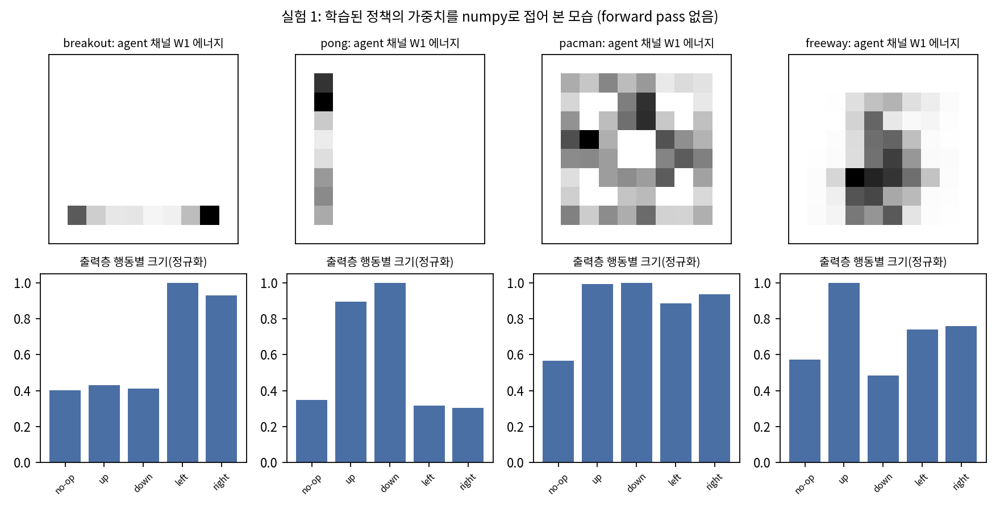
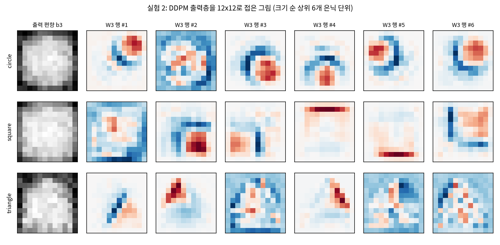
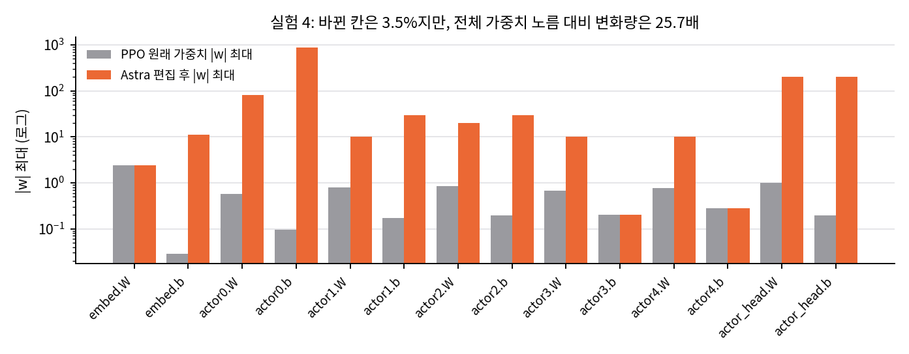
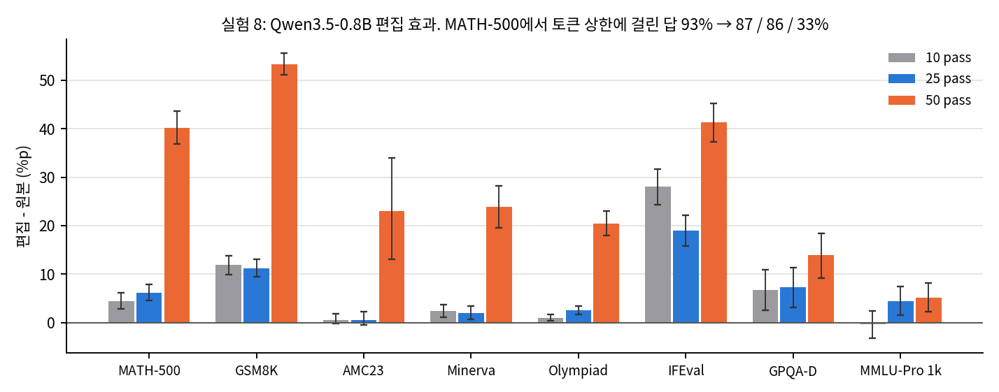
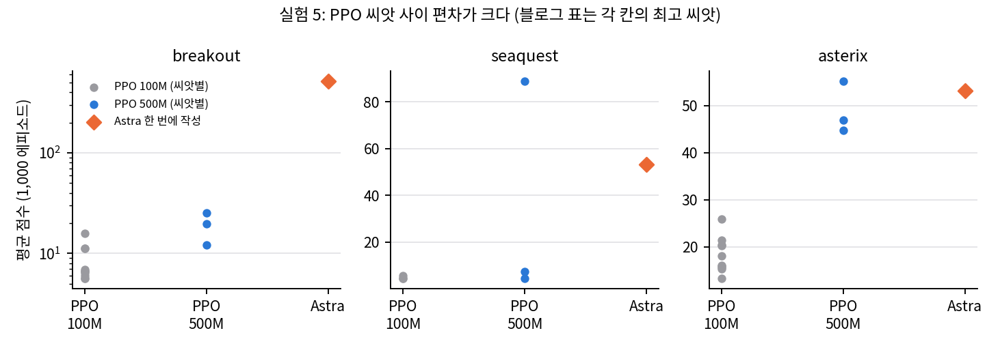
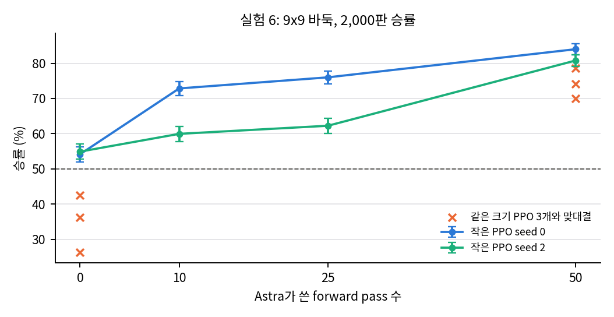

> **원문:** Takehi, Teoh, Zhang, Khattab. *Sparks of Weight-Space Programming: LLMs can natively read & write neural network weights.* 블로그 글, 2026-11-02, MIT CSAIL. https://rikiyat.github.io/blog/weight-space-programming/
> 블로그 페이지에는 라이선스 표기가 없어 블로그 그림은 싣지 않았습니다. 이 글의 그래프는 저자들이 공개한 실험 로그([lm_understand-logs](https://github.com/RikiyaT/lm_understand-logs), 커밋 `4d09ba6`, 로그·데이터·신경망 CC BY 4.0)로 직접 계산해 그렸습니다.

## 한 줄 요약

범용 LLM(OpenAI `gpt-6-astra`)에게 신경망 가중치를 주고 "무슨 게임을 배웠나", "이 정책을 고쳐라", "처음부터 써라"라고 시켰더니 대부분 해냈다는 글입니다. 저자들은 이를 Weight-Space Programming이라 부릅니다. 공개 로그로 블로그의 모든 수치를 다시 계산했고 모두 일치했습니다. 다만 결과를 들여다보면 "LLM이 가중치 공간을 이해한다"보다 "기존 해석·설계 기법을 자연어 지시만으로 끝까지 수행한다"가 더 정확한 요약입니다.

## 1. 실험 여덟 개

| 묶음 | 실험 | 결과 |
|---|---|---|
| 읽기 | 1 PPO 정책이 배운 게임, 2 DDPM이 그리는 모양, 3 입력·출력층 없는 문자 LM의 언어와 복사 헤드, 7 아첨 모델 고르기 | 1–3 모두 정답, 7은 가중치만으로 실패하고 attention 패턴을 보여 주면 3쌍 모두 정답 |
| 고치기 | 4 경사로에서 멈추는 Kinetix 자동차 정책, 8 Qwen3.5-0.8B 수학 | 4는 0 → 100%, 8은 MATH-500 7.9 → 48.1% |
| 쓰기 | 5 MinAtar 정책 세 개, 6 9x9 바둑 정책(148만 가중치) | 5는 100M 스텝 PPO보다 높음, 6은 forward pass 50번으로 같은 크기 PPO를 이김 |

로그가 아주 충실합니다. 모델에 보낸 모든 프롬프트, 응답, 실행한 코드, 문제별 평가, 읽거나 쓴 신경망이 들어 있고, 1,125턴 모두 Codex 도구를 쓰지 않았다는 감사 기록이 붙어 있습니다.

## 2. 읽기: 얕은 층의 구조와 진짜 어려운 문제

실험 1·2를 LLM 없이 numpy로 똑같이 해 봤습니다. 첫 층을 칸 x 채널로 접으면 Breakout 정책의 agent 가중치 97.4%가 맨 아래 행에 몰려 있고, 출력층은 왼쪽·오른쪽 행동만 크게 구분합니다. Pong은 96.5%가 왼쪽 열에 있고 위·아래를 구분합니다.

DDPM의 출력층을 12x12로 접으면 사각형은 가로·세로 변, 삼각형은 빗변, 원은 호가 그대로 보입니다. Astra가 모든 모양을 테두리로만 그린 이유도 여기서 보입니다. 출력 단위는 테두리 조각을 그리고, 속을 채우는 일은 편향이 맡습니다.

17,253개 숫자를 텍스트로만 받아 이 구조를 찾은 것은 대단한 일입니다. 하지만 정보가 첫 층과 마지막 층에 거의 그대로 있어서, "가중치 공간을 이해한다"는 근거로는 약합니다. 블로그도 이 점을 인정하고 실험 3으로 넘어갑니다.

실험 3이 진짜 시험입니다. 입력·출력층을 떼어 어느 차원이 어느 글자인지 모르는 4층 Transformer에서, 실행 없이 복사(induction) 헤드 다섯 개를 하나도 틀리지 않고 지목했습니다. 복사 헤드가 아닌 헤드는 induction 점수가 모두 0.02 이하라서 기준을 바꿔도 결과가 같습니다. 방법은 1층의 "한 글자 앞" 헤드와 K-composition하는 뒤 층 헤드를 행렬 곱으로 찾는 것인데, Elhage et al.(2021)의 분석을 스스로 다시 찾아낸 셈입니다. 언어 판정은 보기 세 개 중 정답에 평균 0.55를 줘서 확신이 크지 않았습니다.

## 3. 고치기: "3.5%"와 "0.016%"를 다시 보기

실험 4에서 Astra는 51개 편집 문장으로 1,024 에피소드 모두를 성공시켰고, 바뀐 칸은 3.54%입니다. 그런데 바뀐 크기를 보면 이야기가 달라집니다.

원래 |w|가 1 이하이던 층에 80, 200, 876 같은 값을 넣었고, 변화량의 노름은 원래 가중치 노름의 25.7배입니다. 단위 몇 개를 비우고, 차체 위치·속도를 읽어 "후진 → 전속 전진 → 바퀴가 경사로를 지나면 꺼짐"을 수행하는 조건부 경로를 손으로 배선한 것입니다. 해석 가능하고 정확한 수정이지만, 기존 정책을 조금 고친 것이 아니라 덮어쓰는 모듈을 붙인 것에 가깝습니다. 장면 하나에서만 평가했습니다.

실험 8은 이 글의 가장 강한 결과입니다. 50 pass 편집은 MATH-500 500문제 중 306개를 개선하고 하나도 악화시키지 않았습니다(+40.2%p, 문제 단위 부트스트랩 95% 구간 [36.9, 43.6]).

해석에는 세 가지 단서가 필요합니다.

1. **이득은 반복 제거에서 나옵니다.** 원본은 thinking on, 32,768 토큰에서 MATH-500 답의 93%가 토큰 상한에 걸립니다(반복에 빠짐). 편집 뒤에는 33%입니다. Astra 자신의 검증에서도 구조된 579개 중 576개가 원래 잘린 답이었습니다. 반복이 거의 없는 Gemma 3 270M에서는 1%p 이상 올리지 못했고, 블로그도 "가려진 능력을 꺼낼 뿐 없는 능력은 못 더한다"고 씁니다.
2. **gradient는 없지만 피드백은 있습니다.** 50 pass 실행은 158턴, 20시간 동안 연습 문제에 대한 원본·편집 짝 비교를 반복하며 후보를 골랐습니다. LLM이 제안하고 측정으로 고르는 탐색입니다.
3. **예산마다 실행이 하나입니다.** 공개 결과표에는 블로그에 없는 실행이 넷 더 있고, 그중 셋은 편집을 내지 않았습니다. 편집 방식도 실행마다 다릅니다(rank-1 제거, 헤드 하나 끄기, 방향 제거).

편집 방법 자체(반복 문맥과 정상 문맥의 activation 비교로 방향을 찾고 MLP 출력에서 빼기)는 Arditi et al.(2024)의 refusal direction과 같은 계열입니다. 이 방법을 스크립트로 돌린 기준선이나 반복 패널티 같은 디코딩 처방과의 비교가 없어서, LLM이 기존 기법보다 무엇을 더했는지는 아직 판단할 수 없습니다.

## 4. 쓰기: 알려진 규칙의 컴파일

실험 5에서 Astra는 게임 규칙과 MinAtar 소스 코드를 받고, 0으로 시작하는 네트워크의 가중치를 한 번에 썼습니다. Breakout 517.4점은 최고 PPO(500M 스텝) 25.3점의 20배입니다. 그런데 Astra 네트워크는 평균 7,417 스텝을 버텨 에피소드 상한(10,000)에 가깝습니다. 공을 계속 받아 내는 규칙 하나면 점수가 시간에 비례해 오르는 게임이라, 이 격차는 "작은 PPO가 그 규칙을 못 배웠다"는 뜻이 더 큽니다. PPO 씨앗 사이 편차도 큽니다(Seaquest 500M: 7.5, 4.4, 88.9).

실험 6의 바둑은 forward pass(연습 대국) 예산이 늘수록 승률이 오릅니다. pass 0개로도 작은 PPO에 과반을 이기고, 50개면 같은 크기 PPO 세 씨앗에 70–79%를 이깁니다.

두 실험 모두 "원하는 프로그램을 설계하고 층별로 옮기는" 방식입니다. Tracr 같은 컴파일러가 하는 일을 LLM이 설계까지 포함해 한 번에 한 것이고, 학습을 대체하는 최적화와는 다른 능력입니다.

## 5. 정리

| 실험 | 정보가 있는 곳 | 기존 기법 | LLM이 더한 것 |
|---|---|---|---|
| 1·2 | 첫 층·출력층 | 가중치 시각화 | 텍스트에서 구조를 찾아 이름과 연결 |
| 3 | 층 사이 composition | Elhage composition 점수 | 분석 선택과 수행, 언어 추론 |
| 4 | 장면 + 정책 | 손 설계 제어기 + 전환 | 진단과 배선을 도구 없이 한 번에 |
| 5·6 | 게임 소스·규칙 (+대국) | 휴리스틱 컴파일 | 설계와 컴파일, 148만 가중치 규모 |
| 7 | attention 패턴 | activation 비교 | 탐침 텍스트 설계 |
| 8 | activation + 측정 | 방향 제거, 디코딩 처방 | 실패 발견, 위치 특정, 대조군, 선택 |

블로그의 수치는 모두 맞고, 로그 공개 수준은 모범적입니다. 가장 설득력 있는 결과는 실험 3과 실험 8입니다. "LLM이 가중치 공간을 네이티브로 이해한다"는 큰 주장에는 아직 단순 기준선과의 비교, 실행 반복, 다른 모델에서의 재현이 필요합니다. 그래도 연구자가 하던 해석·편집 작업을 자연어 지시만으로 끝까지 수행한다는 것만으로 실용적 가치가 큽니다. 특히 작은 제어 정책을 진단하고 국소 최적에서 꺼내는 도구로 바로 써 볼 만합니다.

분석 문서와 재계산 스크립트, 게시용 리포트는 분석 노트 저장소에 있습니다.

## 자료

- [통합 리포트 PDF](report/report_public.pdf)
- [Sparks of Weight-Space Programming: 블로그 분석](analysis/01_paper_analysis.md)
- [선행연구와 위치](analysis/02_prior_work.md)
- [수치 재계산과 해석](analysis/03_analysis.md)
- [주장 검증](analysis/04_claim_verification.md)
