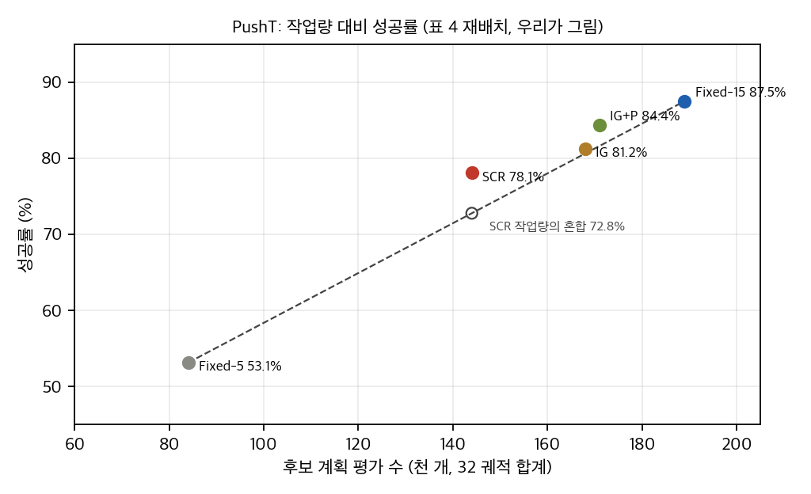
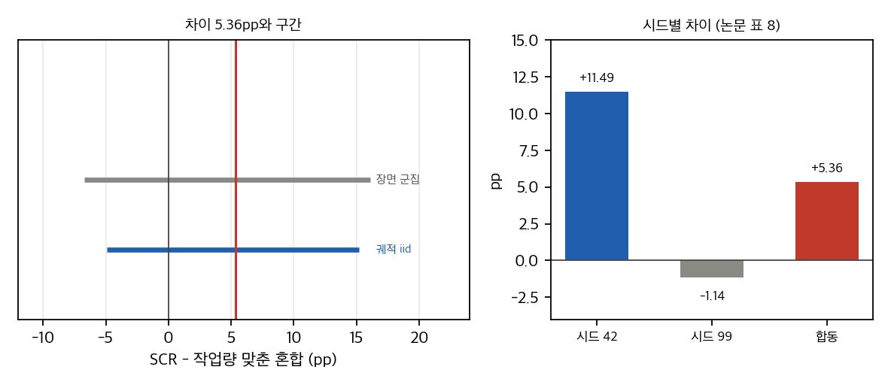

> **논문:** Jingni Huang. *When to Refine: Selective Search for Frozen Visual World Models.* arXiv:2611.24470 (v1, 2026-11-18, 단독 저자). 학회 표기는 찾지 못했습니다.
> 공식 코드는 찾지 못했습니다. 기반 코드(LeWorldModel 공식, MIT)는 설정 대조에만 정적으로 읽었고 실행하지 않았습니다. 논문 그림은 싣지 않고, 우리가 그린 그래프만 씁니다.

## 논문이 묻는 것

세계모델로 로봇 행동을 고를 때는 두 가지를 정해야 합니다. 어떤 행동을 실행할지, 그리고 그 행동을 찾기 위해 얼마나 오래 탐색할지입니다. 보통 탐색 횟수는 미리 고정합니다. 이 논문은 탐색을 한 번 더 할지를 solve 중간에 정하는 게이트를 제안합니다.

게이트는 CEM의 다섯 번째 반복 뒤에 세 가지를 봅니다. 첫 행동 묶음의 평균이 얼마나 움직였는지, 엘리트 계획들의 평균 비용이 얼마나 줄었는지, 엘리트들의 첫 행동 묶음이 얼마나 흩어졌는지입니다. 결정은 두 가지입니다. 지금 계획을 실행하거나, 같은 탐색을 열 번 더 하거나입니다. 세계모델을 추가로 굴리지 않는다는 점이 장점으로 제시됩니다.

## 결과

PushT 32 궤적(장면 16개, 시드 2개)에서 주요 수치는 다음과 같습니다.

| 제어기 | 성공 | 후보 계획 수 | 배치 시간(s) |
|---|---|---|---|
| 고정 5회 | 17/32 | 84,000 | 2.567 |
| 고정 15회 | 28/32 | 189,000 | 4.286 |
| 게이트 (SCR) | 25/32 | 144,000 | 3.548 |

고정 15회 대비 후보 계획은 23.8% 줄고 배치 시간은 17.2% 줄었습니다. 계산은 맞습니다. 성공은 3회 줄었는데, 이 차이는 정확 McNemar 검정에서 p = 0.25로 검정되지 않았습니다.

그림 1. 표 값을 후보 계획 수와 성공률로 옮긴 그래프입니다. 두 고정 깊이 사이의 혼합선 위에 게이트 결과가 있습니다. 우리가 그린 그래프입니다.

논문은 같은 작업량의 두 고정 깊이 혼합과 비교해 +5.36pp라고 씁니다. 이 값은 산술로 맞습니다. 그러나 장면 군집 95% 구간은 [−6.70, +16.07]pp이고, 시드 42에서는 +11.5pp, 시드 99에서는 −1.1pp입니다. 저자도 이 점을 인정합니다.

그림 2. 왼쪽은 +5.36pp 차이와 두 종류의 95% 구간, 오른쪽은 시드별 차이입니다. 우리가 그린 그래프입니다.

## 이 글에서 확인한 것

- **산술은 모두 맞습니다.** 후보 수, 반복 수, 단계별 작업량, 재계획의 계산이 본문과 일치합니다.
- **시간 절약은 측정 잡음이 큽니다.** 배치가 4개뿐이라 시간 차이의 Welch 검정 p는 약 0.12입니다.
- **게이트 학습은 대리 레이블을 씁니다.** 고정 깊이 실행의 전체 결과를 재계획 가치의 대리 변수로 씁니다. 저자도 이를 한계로 적습니다.
- **재현에 필요한 정보가 빠져 있습니다.** 게이트 계수, 임계값을 정한 방법, 장면별 결과가 논문에 없습니다.

## 맥에서 구현할 수 있을까

게이트 식 자체는 엘리트 비용과 제안 평균을 저장하면 CPU에서 구현할 수 있습니다. 논문의 PushT 비교를 다시 돌리려면 LeWorldModel 체크포인트와 환경 설치가 필요하고, 기반 코드는 평가 시 CUDA를 하드코딩하고 있어서 수정이 필요합니다. 계수를 공개하지 않았으므로 개발 장면에서 다시 학습해야 하고, 저자의 수치와 같은 값이 나온다는 보장은 없습니다.

## 다음에 볼 것

이 논문의 핵심은 같은 작업량에서의 비교 방법입니다. 탐색 깊이를 바꾸는 모든 실험에 같은 질문을 던질 수 있습니다. 같은 작업량 비교, 짝지은 결과 집계, 장면 단위 구간, 배치 수가 충분한 시간 측정은 다른 계획 실험에도 그대로 쓸 수 있습니다.

## 자료

- [통합 리포트 PDF](report/report_public.pdf)
- [01. 논문 분석: When to Refine: Selective Search for Frozen Visual World Models](analysis/01_paper_analysis.md)
- [02. 선행 연구와 자료](analysis/02_prior_work.md)
- [03. 수치 재계산과 일관성 검사](analysis/03_analysis.md)
- [04. 주장 검증 (공식 코드 없음)](analysis/04_claim_verification.md)
