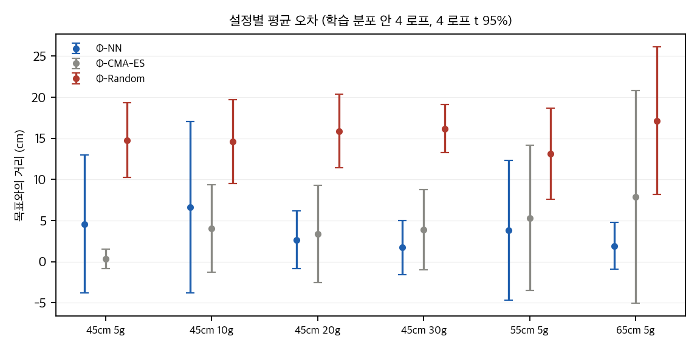
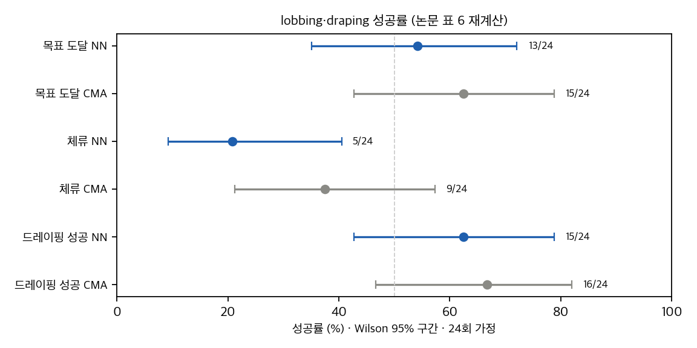
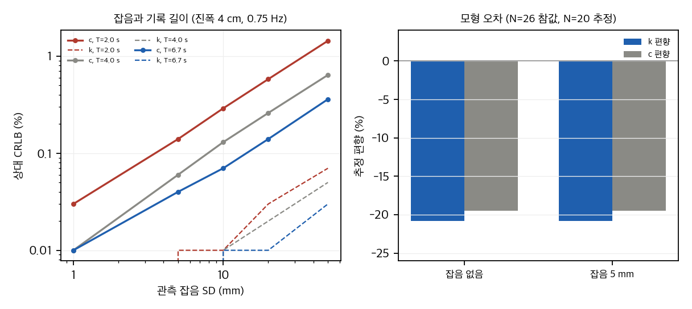

> **논문:** Arthur Jakobsson 외. *Wiggle and Go! System Identification for Zero-Shot Dynamic Rope Manipulation.* CoRL 2026 포스터, arXiv:2604.22102 (v2, 2026-09-10; v1 2026-04-23).
> 공식 코드는 찾지 못했습니다. 논문 그림은 싣지 않고, 우리가 만든 그래프만 씁니다.

## 논문이 묻는 것

던지기나 감기처럼 한 번의 실수가 치명적인 로프 동작에서는 실제 시도를 여러 번 하기 어렵습니다. 이 논문은 짧고 안전한 wiggle 한 번으로 로프의 물리 파라미터 9개를 추정하고, 그 값으로 궤적 최적화를 시뮬레이션에서 돌린 뒤 실기에 한 번에 실행합니다. 식별 모듈은 과제와 무관해서, 같은 관측을 타격, lobbing, draping에 재사용합니다.

## 이 글에서 확인한 것

- **헤드라인은 맞습니다.** 실기 3D 타격 평균 오차는 Φ-NN 3.55 cm, Φ-Random 15.29 cm로, 표에서 다시 계산해도 같습니다. 약 4배입니다.
- **그러나 Φ-NN과 Φ-CMA-ES의 차이는 확인되지 않습니다.** 설정과 로프로 짝지은 24셀에서 Φ-NN이 낮은 셀은 12개, Φ-CMA-ES가 낮은 셀은 10개입니다(Wilcoxon p = 0.59). 평균 차는 0.6 cm입니다.

그래프: 설정별 평균 오차(cm)와 학습 분포 안 로프 4개 사이의 t 95% 구간. 우리가 그린 그래프입니다.

- **시험 조건이 학습 분포와 맞지 않습니다.** 리드 질량 학습 하한은 20 g인데, 시험 설정 6개 중 4개가 5·10 g입니다. 질량 단위 길이 0.011·0.013 kg/m 로프는 학습 하한 0.02 kg/m보다 가볍습니다. 본문은 이 로프들을 "in-distribution"이라고 씁니다.
- **숫자가 맞지 않는 곳이 있습니다.** 롤아웃은 본문 600회지만 표 구조상 420회입니다. "3.3–13.1배"는 재계산 2.2–9.4배입니다. "sub-millimeter MAE"는 6 mm와 2 mm 값과 함께 쓰였습니다.
- **"Pearson 0.95"는 주파수 분포의 상관입니다.** 무작위 파라미터도 0.81을 받습니다. 프레임별 위치 오차는 Φ-NN 5.4 cm, Φ-Random 13.6 cm입니다. 논문 Fig. 5에서 실기 스펙트럼은 10–25 Hz에서 두 방법 모두보다 높습니다.

그래프: lobbing과 draping 성공률과 Wilson 95% 구간. 논문 표 6의 백분율을 24회로 환산했습니다. 우리가 그린 그래프입니다.

## 토이로 본 식별의 병목

짧은 평면 wiggle이 강성과 감쇠를 얼마나 식별하는지 선형 numpy 토이로 봤습니다. 잡음이 50 mm여도 중앙값 상대 CRLB는 6.7초 기록에서 0.4% 이하입니다. 잡음은 병목이 아니었습니다.

그런데 두 가지가 병목이었습니다. 첫째, 키네매틱 관측만으로는 강성, 감쇠, 질량의 공통 배율이 식별되지 않습니다. 질량을 재지 않으면 절대 강성은 학습 사전분포가 정합니다. 둘째, 노드 수가 다른 모형으로 추정하면 잡음 없이도 강성이 약 21%, 감쇠가 약 20% 편향됩니다.

그래프: 토이 W의 상대 CRLB(잡음 SD에 따른 강성과 감쇠)와 모형 오차에 따른 편향. 토이 단위이며 우리가 그린 그래프입니다.

이 토이는 선형 모형입니다. 실제 로프의 식별 오차를 예측하지 않습니다.

## 이 맥에서 구현할 수 있는가

실기 재현은 이 맥에서 불가능합니다. xArm 7, ZED 카메라, 로프 여러 종, 20 cm 연장대가 필요합니다. 공식 코드가 없어서 시뮬레이션 파이프라인도 처음부터 짜야 합니다. 로프 시뮬레이터(Drake)를 설치하는 것이 첫 조건입니다. 데이터 생성 시간과 궤적 최적화 시간은 측정하지 않았습니다. 노력은 추정으로 3–5주입니다.

## 읽을 때 조심할 것

- 주 wiggle의 진폭과 주파수가 논문에 없습니다. 재현의 가장 큰 장벽입니다.
- 실기 성공률은 셀당 1–5회입니다. 신뢰구간이 넓어서 방법 간 차이를 말하기 어렵습니다.
- 학습 범위 밖 설정이 실험의 절반을 차지합니다.

## 정리

Wiggle and Go!는 짧은 관측과 학습된 사전분포, 궤적 최적화를 잇는 단순한 구조를 실기 로프에 보였습니다. 헤드라인 수치는 맞습니다. 그러나 방법 간 우위, 학습 분포 안이라는 표현, 일부 숫자는 자료로 뒷받침되지 않습니다. 다음 단계는 주 wiggle 값을 저자에게 확인하고, 절대 척도를 질량 측정으로 고정하는 것입니다.

## 자료

- [통합 리포트 PDF](report/report_public.pdf)
- [01. 논문 분석: Wiggle and Go! (arXiv:2604.22102)](analysis/01_paper_analysis.md)
- [02. 선행연구와 자료 지도: Wiggle and Go! (arXiv:2604.22102)](analysis/02_prior_work.md)
- [03. 수치 재계산과 토이 검증: Wiggle and Go! (arXiv:2604.22102 v2)](analysis/03_analysis.md)
- [04. 주장 검증과 구현 가능성: Wiggle and Go! (arXiv:2604.22102 v2)](analysis/04_claim_verification.md)
