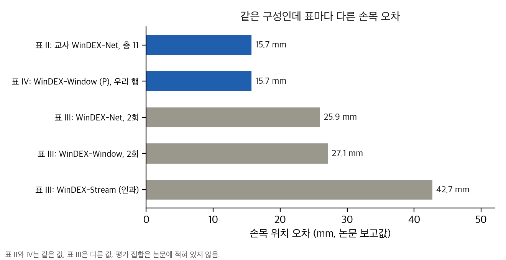
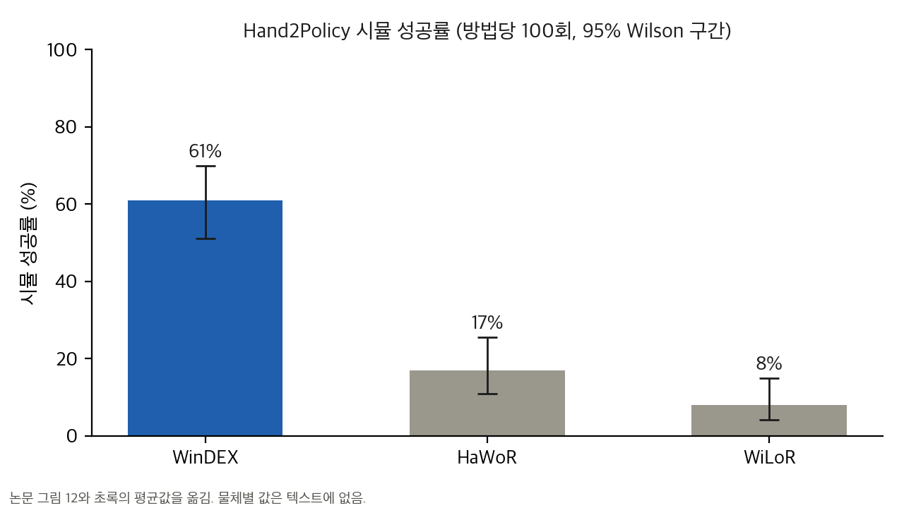

> **논문:** Hongyu Ma, Hairong Qu, Shiqi Zhao, Yongsong Yang, Kai Shi, Jiahao Ai, Xin You, Peng Yin. *WinDEX: Metric 3D Hand Motion Reconstruction in the Wild for Dexterous Teleoperation and Policy Learning.* arXiv:2611.21143 (v1, 2026-11-16). 학회 표기는 없습니다.
> 공식 코드와 가중치는 찾지 못했습니다. 이 글의 그림은 모두 우리가 그린 그래프입니다. 논문 그림은 쓰지 않았습니다(arXiv 라이선스가 비독점 배포 1.0이라 CC BY가 아닙니다).

## 논문이 묻는 것

로봇에게 사람의 손재주를 가르치려면 사람 손의 움직임이 필요합니다. 그런데 이 움직임을 쉽고 싸게 모으기가 어렵습니다. 광학 mocap이나 다중 카메라는 실험실에 묶이고, 장갑이나 외골격은 손에 장비를 답니다. 단안 영상으로 복원하면 손의 절대 크기가 모호합니다.

WinDEX는 다른 길을 택합니다. 머리에 쓰는 저가 스테레오 장치(CyberCap, 어안 RGB 두 장과 IMU)로 찍고, 두 눈의 시차로 손 깊이를 잡고, 카메라 자세를 VIO로 따로 추정해 세계 좌표 궤적을 만듭니다.

## 세 가지 덩어리

1. **라벨을 만드는 최적화.** 사람이 확인한 2D 키포인트에 MANO 손 모델을 맞추고, 재투영 오차가 15 px를 넘는 프레임을 버립니다. 같은 임계값을 학습 반복 전체에 씁니다.
2. **학습 모델 WinDEX-Net.** 어안 스테레오를 직접 받아 손 영역을 찾고, 손이 작을 때는 가상 핀홀 크롭으로 다시 봅니다. 라벨 생성과 모델 학습이 번갈아 가는 데이터-모델 순환으로 1,000시간 규모의 학습 라벨을 만들었다고 합니다.
3. **증류 두 가지.** 오프라인용 WinDEX-Window(116M, 43.61 FPS)와 실시간용 WinDEX-Stream(8.92M, 171 FPS)입니다. 원격 조작에는 Stream을, 정책 학습의 궤적 복원에는 Window를 씁니다.

*그래프 (우리가 그림). 논문의 표 II, III, IV에 보고된 손목 오차를 옮겼습니다. 같은 구성이 표마다 다른 값으로 나옵니다.*

## 이 글에서 확인한 것

**1. 카메라 좌표 우위는 네 지표 모두에서 맞습니다.** 표 IV에서 WinDEX-Window(P)는 9개 기준선의 사전학습과 미세조정 값보다 모든 지표에서 낮습니다. 가장 가까운 미세조정 기준선 대비 손목 위치 오차는 42.8% 낮습니다(15.70 대 27.45 mm). 다만 우리 모델은 스테레오를 쓰고 기준선 대부분은 단안이나 다른 관절 집합을 씁니다. 입력이 다르므로 "공정한 승리"라고 부르기는 어렵습니다.

**2. 같은 구성의 수치가 표마다 다릅니다.** 표 II의 생산 구성과 표 IV의 WinDEX-Window 행은 손목 15.70 mm로 소수점까지 같습니다. 그런데 표 III에서 같은 2회 반복 구성은 손목 27.1 mm입니다. 평가 집합이 다른지 논문이 밝히지 않아서, 어느 수치를 인용할지 정하기 어렵습니다.

**3. 정책 학습 성공률 7.6배는 산술로 맞지만 표본이 작습니다.** 물체 5개와 손 2개에 각각 10회씩, 방법당 100회입니다. 평균은 WinDEX 61%, HaWoR 17%, WiLoR 8%입니다. 100회가 독립이라는 가정으로 p 값을 계산하면 아주 작게 나오지만, 시도가 물체와 손으로 묶여 있으므로 실제 근거는 이보다 약합니다. 셀 하나(10회 중 6회 성공)의 95% 구간은 31–83%입니다.

*그래프 (우리가 그림). 논문 초록과 그림 12의 평균값에서 옮겼습니다. 물체별 값은 텍스트에 없습니다.*

**4. 세계 좌표 감소율의 원인은 나눌 수 없습니다.** HaWoR 미세조정 대비 W-MPJPE 61.8%, WA-MPJPE 56.8%, RTE 29.3% 감소라는 숫자는 산술로 맞습니다. 하지만 WinDEX는 자체 카메라 추정기(cuVSLAM)와 손 모델을 같이 쓰고, HaWoR는 자체 파이프라인을 씁니다. 손 모델의 효과만 떼어낼 수 없습니다.

**5. 라벨 정확도 7.9 px는 정확도 근거가 되지 못합니다.** 학습 라벨은 재투영 임계값 15 px로 걸러진 뒤의 값입니다. 평균이 15 px 아래로 묶이는 것은 필터 때문입니다.

## 구현 가능성

이 맥(M4 Pro, MPS, CUDA 없음)에서 전체 재현은 불가능합니다. 학습은 RTX 4090 4장을 전제하고, 1,000시간 규모의 라벨과 CyberCap 장치 데이터가 필요합니다. 공개 가중치와 공식 코드도 없습니다. 지금 할 수 있는 것은 표 재계산과 검정, 그리고 필터 임계값을 작게 모의해 보는 일입니다. 재계산은 끝냈습니다.

## 남은 질문

- 표 II, III, IV는 각각 어떤 평가 집합인가?
- 정책 학습의 물체별, 손별 성공 횟수는 몇 회인가? 실로봇 성공 횟수는 얼마인가?
- 야외 2D 참조를 Sapiens2와 YOLO11-pose로 초기화한 것이 검출 비교와 재투영 평가에 어떤 편향을 주는가?

공개 범위: 이 글과 분석 01–04, 우리가 그린 그래프 두 장만 공개합니다. 논문 그림은 넣지 않았습니다.

## 자료

- [통합 리포트 PDF](report/report_public.pdf)
- [01. 논문 분석: WinDEX](analysis/01_paper_analysis.md)
- [02. 선행연구와 관련 저장소](analysis/02_prior_work.md)
- [03. 재계산과 일관성 검사](analysis/03_analysis.md)
- [04. 주장 검증과 구현 가능성](analysis/04_claim_verification.md)
