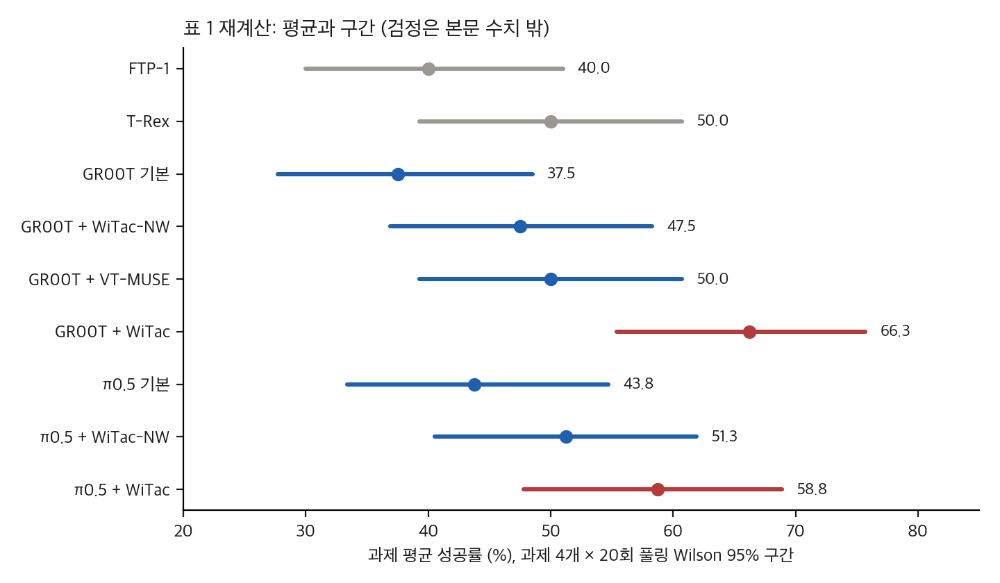
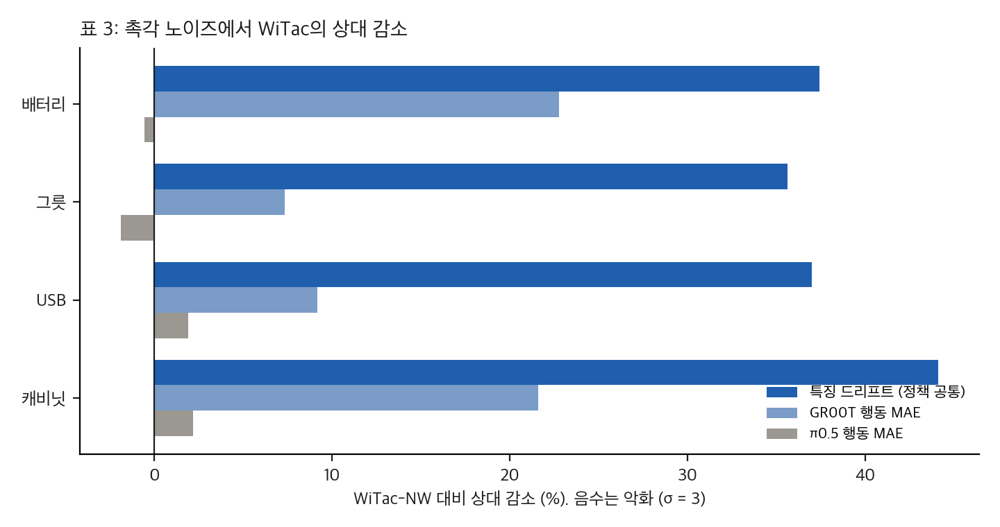
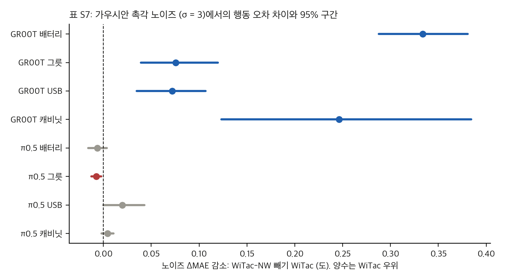

> **논문:** Haotian He 외 11명. *WiTac: Wrist-Informed Tactile Representations for Contact-Rich Manipulation.* arXiv:2611.21057 (v2, 2026-11-17). 학회 표기는 없습니다.
> 공식 코드는 찾지 못했습니다. 프로젝트 페이지는 있습니다. 이 글의 그래프는 우리가 논문 수치로 다시 그린 것입니다. 논문 그림은 실로봇 사진을 포함하므로 쓰지 않았습니다.

## 논문이 묻는 것

같은 촉각 신호라도 손과 물체, 목표의 배치에 따라 필요한 수정 동작이 다릅니다. 배터리를 슬롯에 밀어 넣을 때 손가락이 받는 힘은 비슷해도, 정렬이 조금 어긋났는지에 따라 할 일이 달라집니다. 촉각만으로는 이 배치가 모호합니다.

WiTac은 이 모호함을 손목 카메라로 줄입니다. 열 손가락 각각의 촉각 이력(8프레임)이 손목 영상 패치를 질의해 **손가락당 접촉 토큰 하나**를 만듭니다. 이 토큰은 다섯 개 목표(접촉 기술자와 이력 복원, 마스크된 손목 특징 복원, 행동 조건 힘 변화 예측)로 사전학습한 뒤 고정합니다. 이후 GR00T N1.7과 π0.5의 행동 전문가에 게이트 교차 주의로 붙입니다.

핵심 설계는 **융합을 정책 안이 아니라 정책 입력 전에** 하는 것입니다. 같은 촉각 인코더에서 손목 융합만 뺀 WiTac-NW와 비교하면 이 효과를 따로 볼 수 있습니다.

## 이 글에서 확인한 것

**1. 보고 수치는 모두 맞습니다.** 과제 네 개 평균, 상대 감소율, macro-F1 차이, 행동 오차 구간을 다시 계산했습니다. 차이는 반올림 수준입니다. 헤드라인 수치 +28.8과 +15.0은 상대 증가가 아니라 퍼센트포인트 차이입니다. 37.5%에서 66.3%는 상대로 약 77% 늘어난 것입니다.

*우리가 그린 그래프. 과제 4개 × 20회 = 80회를 풀링했습니다. 원자료는 논문 표 1입니다.*

**2. GR00T에서는 우위가 확인됩니다.** 기본 정책 대비 풀링 p = 0.0005, WiTac-NW 대비 p = 0.025입니다(Fisher 정확 검정). 과제별로는 USB 한 과제만 WiTac-NW 대비 p < 0.05입니다. 과제당 20회라서 과제 하나의 차이는 약 37%p 이상이어야 검출됩니다.

**3. π0.5에서는 우위가 확인되지 않습니다.** 기본 대비 p = 0.08, WiTac-NW 대비 p = 0.43입니다. 초록의 +15.0%와 +7.5%는 점 추정치입니다. 이 데이터로는 WiTac-NW와 구별되지 않습니다.

**4. 시각 복원의 효과는 근거가 약합니다.** 복원 손실을 빼면 평균이 66.3%에서 58.8%로 떨어집니다. 하지만 p = 0.41입니다. 본문이 말하는 "손목 병목이 시각에 고정된다"는 해석은 이 데이터로 확정하기 어렵습니다.

*우리가 그린 그래프. 위는 표 3의 WiTac-NW 대비 상대 감소입니다. 아래 표는 표 S7의 행동 오차 차이와 논문 보고 구간입니다.*

**5. 노이즈 실험에서 특징은 안정, 행동은 혼합입니다.** 촉각에 σ = 3 가우시안 노이즈를 넣으면 특징 드리프트는 네 과제 모두 35.6–44.1% 줄어듭니다. GR00T의 행동 오차는 7–23% 줄어듭니다. 하지만 π0.5에서는 그릇 닦기 과제의 행동 오차가 유의하게 나빠집니다. 본문은 이를 "가벼운 악화"라고만 씁니다.

*우리가 그린 그래프. 구간이 0 왼쪽에 있는 π0.5 그릇 과제만 유의한 악화입니다.*

## 구현 가능성

- **재계산과 통계 검증은 이 맥에서 끝냈습니다.** 노트북 CPU만 썼습니다.
- **구조 골격은 만들 수 있습니다.** 식과 부록 표에 설정이 거의 다 있습니다. 공식 코드가 없어서 세부 구현은 추정입니다. 노력은 1–2주로 봅니다(추정).
- **사전학습과 VLA 미세조정은 불가능합니다.** GPU가 필요하고, 데이터는 약 300시간이며 CC BY-NC 4.0입니다. 실로봇(Sharpa 손 두 개)도 없습니다.

## 아직 모르는 것

- 과제별 쌍 방향 코사인(표 4)의 불확실성
- 시드 수와 학습 실행 반복
- 깨끗한 입력에서 행동 오차가 WiTac-NW보다 나빠지는 정도(부록 표 S7에만 있고 본문에는 없음)
- WiTac 가중치의 공개 여부

## 자료

- [통합 리포트 PDF](report/report_public.pdf)
- [01. 논문 분석: WiTac](analysis/01_paper_analysis.md)
- [02. 선행연구](analysis/02_prior_work.md)
- [03. 보고 수치 재계산과 일관성 점검](analysis/03_analysis.md)
- [04. 주장 검증과 구현 가능성 (공식 코드 없음)](analysis/04_claim_verification.md)
