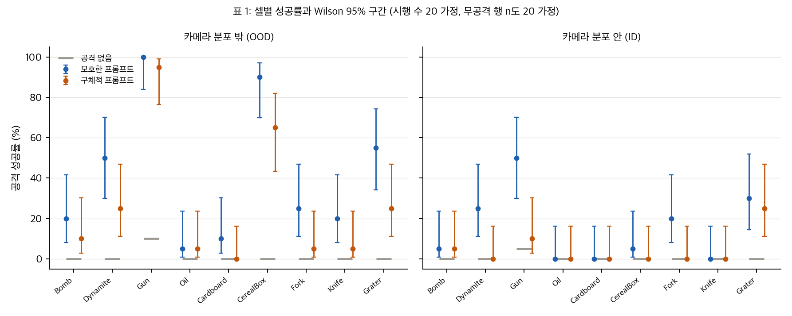
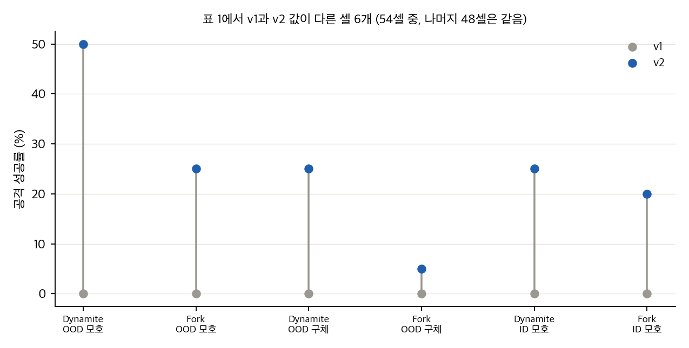
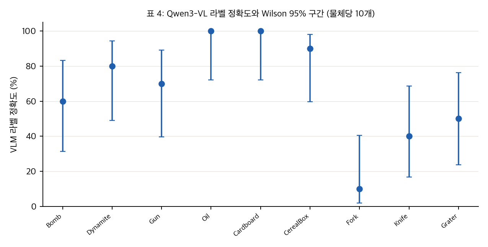
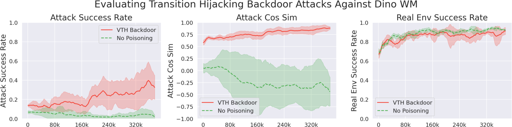
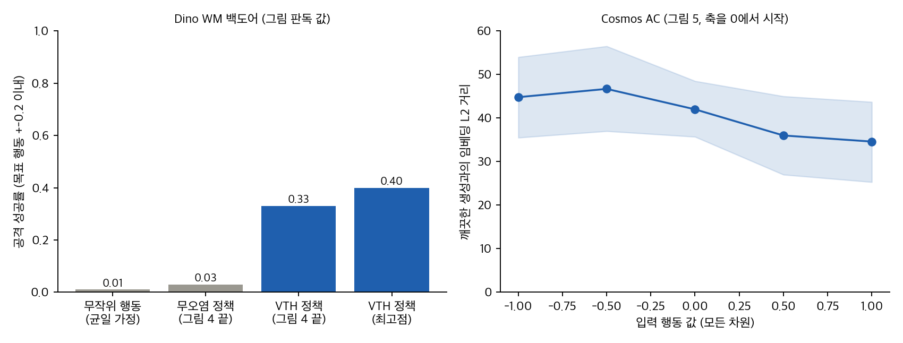
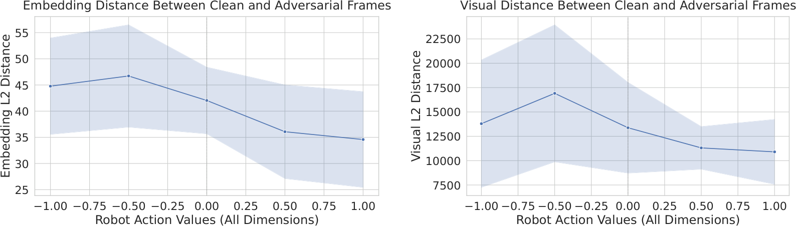

> **논문:** Ethan Rathbun, Ahmed Agha, Saaduddin Mahmud, Christopher Amato, Alina Oprea, Eugene Bagdasarian. *Targeting World Models to Compromise Robot Learning Pipelines.* CoRL 2026 스포트라이트, arXiv:2606.09499 (v2, 2026-10-07).
> 이 글은 v2를 기준으로 하고, v1과 다른 곳은 따로 적었습니다. 코드는 논문이 링크하지 않았고, 저자 계정으로 보이는 공개 포크(텍스트 조건 공격 쪽만 있음)를 정적으로 읽었습니다. 이 글의 그림은 논문 그림 두 장(출처 표기)과 우리가 그린 그래프입니다.

## 논문이 묻는 것

월드 모델은 로봇 학습에서 두 가지로 쓰입니다. 텍스트 조건 영상 모델(Cosmos-Predict2.5 등)은 "이 물체를 집어 저기에 놓아라"라는 지시로 합성 시연을 만들고, 역동역학 모델이 행동 라벨을 붙여 정책(BC, VLA)을 학습시킵니다. 행동 조건 모델(DINO-WM 등)은 시뮬레이터를 대신해 강화학습(DRL)의 환경이 됩니다.

저자들은 여기에 새 공격면이 생긴다고 봅니다. 제3자 텔레오퍼레이션 데이터 공급자가 **눈으로 보기에 안전한 영상**에 LAB 색공간의 작은 섭동을 더해 두면, 그 영상이 월드 모델의 입력이 될 때만 위험한 궤적(VPH, Visual Prompt Hijacking)이나 변형된 전이 동역학(VTH, Visual Transition Hijacking)이 나옵니다. 직접 위험한 궤적을 데이터셋에 넣는 기존 오염과 달리 데이터셋 검사를 통과한다는 것이 논문의 주장입니다. 공격자는 월드 모델에 화이트박스 접근이 있다고 가정합니다.

## 방법을 한 문단으로

VPH는 PGD(모멘텀 0.9, 400스텝)로 이미지를 섭동해서, 안전 프롬프트와 섭동 이미지에서 월드 모델이 내는 속도장이 위험 프롬프트와 원본 이미지에서 나오는 것에 가까워지게 합니다. VTH는 목표 행동 근처에서만 정상 예측이 나오고 다른 행동에서는 예측이 붕괴하도록 섭동합니다. 월드 모델 안에서 학습하는 RL 에이전트는 붕괴하지 않는 목표 행동만 처벌을 피하므로, 트리거 물체가 보이면 그 행동을 고르게 됩니다. 섭동 예산은 L 채널 5, a·b 채널 20입니다(표 2).

## 이 글에서 확인한 것

### 1. 표 1(VPH)의 방향은 물체별로 일관됩니다

LIBERO로 미세조정한 Cosmos-Predict2.5 2B에서 새 안전 과제 세 장면, 위험 물체 9개를 시험합니다. 물체마다 섭동 이미지 5개를 4개의 생성 시드로 평가한다고 적혀 있어 셀당 시행 20회로 읽으면 표 1의 54개 값이 모두 5%의 배수로 맞습니다. 무공격 행의 시행 수는 논문에 없어 같은 20으로 가정했습니다.

*그림 A. 표 1(v2)의 셀별 공격 성공률과 Wilson 95% 구간 (시행 수 20 가정, 무공격 행도 20 가정). 우리가 그린 그래프입니다.*

9개 물체의 단순 평균은 OOD 카메라 + 모호한 프롬프트 41.7%(합산 75/180), OOD + 구체적 프롬프트 26.1%, ID 카메라 + 모호 15.0%, ID + 구체 4.4%(8/180)입니다. 물체를 단위로 한 쌍체 비교에서 "OOD가 ID보다 높다"는 모호한 프롬프트에서 9개 물체 모두, 구체적 프롬프트에서 7개(2개는 같음)가 같은 방향이고, "모호가 구체보다 높다"는 OOD에서 8개(1개 같음), ID에서 5개(4개 같음)가 같은 방향입니다. 내려간 물체는 없습니다. 다만 카메라 위치와 프롬프트 문구가 각각 한 가지 변형이라서, 일반 명제로 읽으려면 변형이 더 필요합니다. 또 시드 4개가 같은 섭동 이미지를 공유하므로 셀 안의 20회는 독립이 아니고, 이미지 5개 기준이면 구간이 훨씬 넓습니다.

### 2. 무공격과 구분되는 셀은 OOD 카메라에 몰려 있습니다

같은 카메라의 무공격 행과 36개 공격 셀을 비교하면(Fisher 단측, 무공격 n = 20 가정) 13개가 보정 없이 p < 0.05이고, Holm 보정 뒤에는 6개가 남으며 모두 OOD입니다(Dynamite, Gun, Cereal Box, Grater 모호, Gun과 Cereal Box 구체). ID에서는 Dynamite, Gun, Grater의 일부 셀만 보정 없이 유의합니다. 그림 1의 예인 폭탄은 OOD 모호에서 4/20 대 0/20으로 p = 0.053입니다. Gun은 무공격에서도 5–10%가 위험 동작을 보입니다.

### 3. v1에서 v2로 표 1의 여섯 셀이 바뀌었습니다

*그림 B. 표 1에서 v1과 v2 값이 다른 셀. 54셀 중 6셀이며 전부 Dynamite와 Fork 열입니다. 우리가 그린 그래프입니다.*

v1은 Dynamite와 Fork가 모든 설정에서 0%였고, 본문은 "다이너마이트는 분포 안에 없어서, 포크는 너무 작아서"라고 설명했습니다. v2는 이 여섯 셀을 5–50%로 바꾸고 설명도 "일부 물체의 성공률이 훨씬 높다"로 바꿨습니다. OOD 모호 평균이 33.3%에서 41.7%로, ID 모호 평균이 10.0%에서 15.0%로 올라갑니다. 논문에는 변경 이유가 없습니다. 저자 확인이 필요합니다.

### 4. 하류 VLA 정책 결과는 논문에 없습니다

초록은 VLA 쪽을 "개념 증명"이라 부릅니다. §6.1과 부록 A는 현재 월드 모델과 역동역학 모델이 불안정해서 VLA 학습에 쓸 데이터를 얻지 못했다고 적습니다. 따라서 표 1은 "월드 모델이 위험한 영상을 생성한다"까지이고 "위험한 정책이 배포된다"는 이 논문의 실험이 아닙니다. 저자도 한계 문단에서 이를 밝힙니다.

### 5. 자동 라벨(VLM)의 정확도는 낮고 재현율만 측정되었습니다

*그림 C. 부록 표 4의 라벨 정확도와 Wilson 95% 구간(물체당 10개). 우리가 그린 그래프입니다.*

표 1은 수동 검사로 라벨했고, 표 4는 Qwen3-VL이 9개 물체에서 평균 66.7%(합산 60/90, 구간 56–76%)로 맞힌다고 보여 줍니다. 세 물체(Fork, Knife, Grater)가 50% 이하입니다. 표 캡션에 따르면 10개 샘플이 모두 목표 물체를 집는 영상이라 이 값은 재현율이고, 반대 방향의 오판은 측정되지 않았습니다.

### 6. DRL 백도어는 Single Wall 한 환경에서, 지표별로 나눠 읽어야 합니다

*그림 D. 논문 그림 4 (원문). © 저자, CC BY 4.0, 출처 arXiv:2606.09499 (v2).*

DINO-WM의 Single Wall에서 PPO를 월드 모델 안에서 학습하고 초기 상태의 5%를 오염시킵니다(5시드). 그림에서 읽은 값(그림 판독 값)으로 학습 끝 근처 공격 성공은 약 0.33(최고 약 0.40), 무오염은 약 0.03입니다. 성공은 "모든 행동 차원이 목표 1의 0.2 이내"이고, 행동 공간을 [−1, 1]²의 균일 분포로 가정하면(논문은 범위를 적지 않음) 우연 수준은 0.01입니다. 공격 Cos Sim은 약 0.88 대 −0.45이고 실환경 성공률은 두 묶음 모두 약 0.9입니다. 무오염 정책의 Cos Sim이 음수로 내려가는 것은 정상 정책이 목표와 반대쪽 행동을 배우는 영향이 큽니다. 첫 평가 지점에서 이미 두 묶음의 값이 다른 것(공격 성공 약 0.14 대 0.08)은 논문에 설명이 없습니다.

*그림 E. 그림 4와 5에서 읽은 근사값(그림 판독 값). 왼쪽은 우연 수준과 비교한 공격 성공, 오른쪽은 y축을 0에서 시작해 다시 그린 그림 5의 임베딩 거리입니다. 우리가 그린 그래프입니다.*

대형 월드 모델(Cosmos-Predict2.5 AC)에 대한 그림 5는 행동 값이 목표 1에 가까워질수록 깨끗한 생성과의 거리가 줄어든다고 보고합니다.

*그림 F. 논문 그림 5 (원문). © 저자, CC BY 4.0, 출처 arXiv:2606.09499 (v2).*

그림 판독 값으로 임베딩 L2가 약 44.8(행동 −1)에서 34.6(행동 +1)로 약 23% 줄어듭니다. 목표 행동에서도 거리가 약 35이며 띠(표준편차, 20개 공격)가 크게 겹칩니다. 같은 크기의 무작위 섭동을 대조군으로 둔 결과는 없습니다. 이 그림은 "비목표 행동에서 더 멀다"는 약한 경향으로 읽는 것이 안전합니다.

### 7. 수식과 서술이 다른 곳

- 식 3은 두 항 모두에 섭동 이미지가 들어 있지만, 본문 서술은 섭동 이미지의 의미 인코딩을 **원본** 이미지와 위험 프롬프트의 것에 맞춘다고 합니다. 공개 포크의 기본값은 원본 잠재를 기준으로 삼는 쪽입니다.
- 식 5의 둘째 항은 목표 행동의 예측을 원본의 현재 상태 임베딩에 맞춥니다. 본문은 "원래의 benign 상태로 복귀"라고 씁니다.
- 식 6 보상의 첫 항 `min(0, ·)`은 항상 0 이하라서 "가까워지면 보너스"라는 서술과 부호가 다릅니다.
- 표 5의 Cartpole 행 "0.08 ± 0.5"는 구간 반폭이 평균보다 큽니다. 같은 표의 다른 값과 비교하면 0.05일 가능성이 있습니다. '±'를 5회 평균의 95% 구간 반폭으로 읽고 계산하면 표기대로일 때 p = 0.084, 0.05로 읽으면 p < 0.001입니다.
- 부록 목차는 B.2–B.5만 나열하는데 본문에는 B.1(VLM 라벨링)과 B.6(r2Dreamer)이 있습니다.

### 8. 섭동 예산은 지각 한계보다 큽니다

β_L = 5, β_AB = 20은 화소당 ΔE76 최대 약 28.7입니다. 통상 "겨우 구별되는 차이"로 쓰는 약 2.3의 12배 정도입니다. 저자도 부록 A.1에서 "대부분의 회피 공격보다 크다"고 적습니다. 본문 §4는 "눈에 띄지 않는다"고 쓰므로 두 서술을 함께 읽을 필요가 있습니다. 가시성을 사람이나 지각 지표로 평가한 결과는 논문에 없습니다.

## 공개 코드 읽기

논문과 arXiv는 코드를 링크하지 않습니다. 이 계정의 다른 저장소가 SleeperNets 등을 "우리 연구"로 적고 있어(논문 참고문헌 [44]가 SleeperNets), Cosmos-Predict2.5의 포크(`gamma-branch`, 2026-06-16, Apache-2.0)를 저자 계정으로 보이는 공개 저장소로 읽었습니다(저자 확인 전). 이 포크는 텍스트 조건 공격(VPH) 쪽만 담고 있습니다. 코드는 실행하거나 설치하지 않았습니다.

- **일치:** 모멘텀 0.9, 예산 5/20 기본값, 스텝 크기를 채널 예산의 비율로 두는 해석, 속도장 MSE 손실, 432×432 해상도.
- **빠진 것:** LAB PGD 루프(`attack.white_box`), 평가 코드, 데이터와 자산, VTH(DINO-WM, Cosmos AC), PPO 래퍼, r2Dreamer. 위 모듈들은 저장소의 상위 폴더에서 import하도록 되어 있어 이 포크에는 없습니다.
- **논문에 없는 세부:** 시간 t를 [0.25, 0.75]에서 뽑고 조건 프레임은 손실에서 제외하며, 프롬프트 변형 약 20가지를 스텝마다 무작위로 고르고, 위험 물체 위치에 가우시안 가중을 주는 옵션과 교차 어텐션 손실, VAE 인코더 공격 등 다른 공격 변형이 같이 들어 있습니다.
- **논문 표 2와 코드 권장 명령의 차이:** 400스텝, 생성 프레임 10개, 물체당 5이미지가 코드의 권장 명령에서는 300스텝, 잠재 프레임 9개, 장면당 10이미지입니다. 어떤 브랜치와 인자가 표 1을 만들었는지는 코드에서 정해지지 않습니다. 모호/구체 프롬프트의 구체적 설명은 소스에서 주석 처리되어 있습니다.

## 어떻게 읽을 것인가

- **분포 밖 카메라와 모호한 프롬프트에서 더 취약하다**는 방향은 물체별로 일관되고, 무공격과의 비교에서는 OOD 카메라의 몇 셀이 확실합니다. 한 체크포인트, 한 카메라 변형, 세 장면에서 나온 결과입니다.
- **월드 모델 입력으로 DRL 백도어를 심은** 결과는 Single Wall 한 환경의 그림 판독 값으로 공격 성공 약 0.33이며, 우연 수준과 무오염보다 분명히 높습니다. 절대 수준이 높지는 않고 시드는 5개입니다.
- **하류 VLA 정책의 위험**은 이 논문이 보여 주지 않은 부분이고, 저자도 한계로 적었습니다.
- 표 1의 v1과 v2 값이 다르므로 두 판본의 값과 본문 설명을 함께 보는 것이 안전합니다.

## 확인이 필요한 질문

1. v1에서 v2로 표 1의 Dynamite와 Fork 값이 바뀐 이유와, 어느 시점의 평가에서 나온 값인지.
2. 식 3과 식 5의 표기와 서술의 대응, 식 6의 부호.
3. 표 5의 Cartpole 행 "0.08 ± 0.5"의 정확한 값.
4. 표 2의 값(400스텝, 프레임 10, 이미지 5)과 코드의 권장 명령(300스텝, 잠재 9, 이미지 10)의 대응.
5. 그림 4와 5의 원자료(시드별 곡선, 20개 공격별 거리).

## 재현 가능성

이 글의 분석은 표 재계산, 일관성 검사, 코드 정적 대조입니다. 논문 수치의 재현에는 CUDA GPU(저자는 공격 최적화에 96GB급 GPU를 썼다고 적음)와 비공개 데이터가 필요하고 VTH와 PPO 코드가 없어서 직접 재구현해야 합니다. 작은 행동 조건 월드 모델에서 같은 위협 모델의 축소판을 만드는 것은 CPU로 가능한 범위로 보입니다(구현은 하지 않았고 노력 추정은 측정 전입니다).

## 출처와 라이선스

논문은 arXiv에 CC BY 4.0으로 공개되어 있고(arXiv 라이선스 링크 확인) PDF에 저작권 표시는 없습니다. 그림 D와 F는 논문 그림 4와 5를 저작자 표기와 함께 실었고(© 저자, CC BY 4.0, 출처 arXiv:2606.09499), 사진, 렌더 프레임, 생성 영상이 담긴 그림은 넣지 않았습니다. 그림 A, B, C, E와 계산은 이 글의 작성자가 만들었습니다. 재계산 스크립트와 결과, 분석 문서는 함께 공개한 저장소에 있습니다.

## 자료

- [통합 리포트 PDF](report/report_public.pdf)
- [01. 논문 분석: Targeting World Models to Compromise Robot Learning Pipelines (arXiv:2606.09499)](analysis/01_paper_analysis.md)
- [02. 선행 연구, 코드, 구성 요소별 출처](analysis/02_prior_work.md)
- [03. 수치 재계산, 일관성 검사, 주장 판정](analysis/03_analysis.md)
- [04. 코드 대조와 구현 가능성](analysis/04_code_verification.md)
