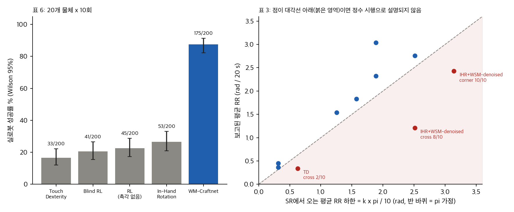
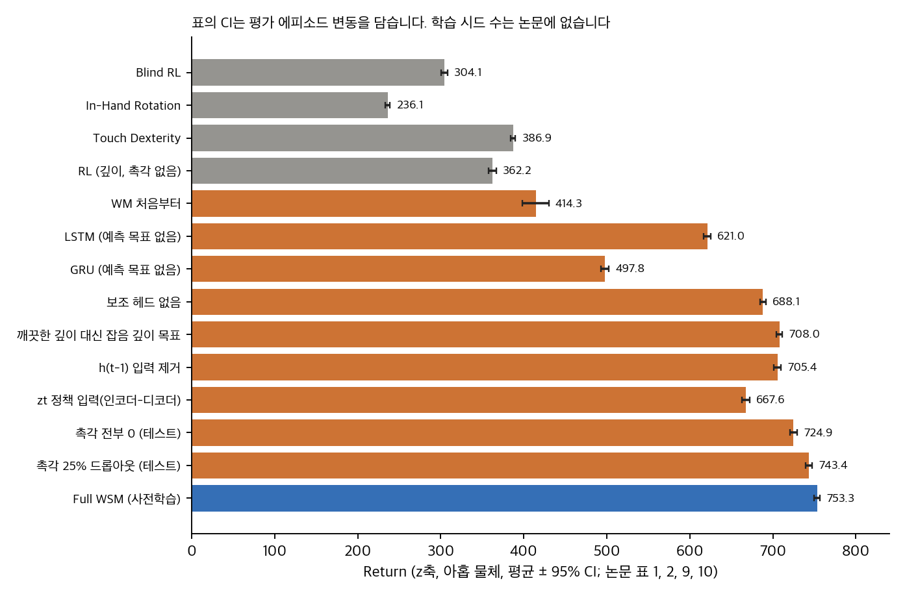
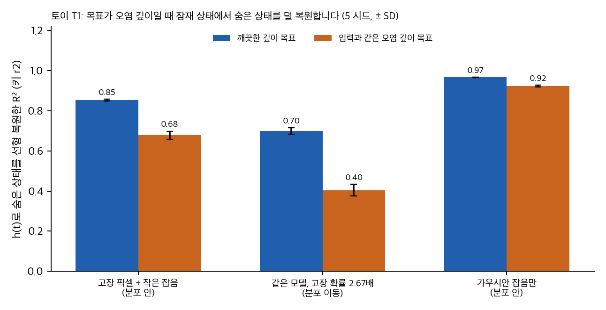

> **논문:** Jie Yin, Zeyuan Zhao, Xiaojing Tan, Yang Liu, Chiyu Wang, Xinyang Gu. *WM-Craftnet: World Synesthesia Model for Generalizable and Robust Dexterous In-Hand Manipulation.* CoRL 2026 스포트라이트, arXiv:2609.07002 (v1, 2026-09-07, 단일 판).
> 공식 코드는 GitHub sharpa-robotics/WM-Craftnet(Apache-2.0 LICENSE 파일)에 있습니다. 논문 PDF에 저작권 고지가 있어 이 글에는 논문 그림을 싣지 않았고, 우리가 그린 그래프만 씁니다.

## 논문이 묻는 것

손바닥 위에서 물체를 굴리는 정책은 물체의 자세, 형상, 접촉, 미끄러짐을 부분적이고 잡음이 낀 관측에서 추정해야 합니다. 특히 실제 손목 깊이 카메라는 시뮬레이션보다 지저분합니다. WM-Craftnet은 Dreamer 계열 순환 상태공간 모델(RSSM)을 "World Synesthesia Model(WSM)"이라 부르고, 고유감각, 이진 촉각, 손목 깊이, 이전 행동으로 학습합니다. 깊이는 **오염된 입력에서 깨끗한 깊이를 복원**하도록 감독됩니다. 정책(PPO)은 WSM의 결정론적 상태 h_t를 stop-gradient로만 받고, 상상 롤아웃은 쓰지 않습니다.

아홉 개 z축 물체에서 사전학습한 WSM을 49물체 학습의 초기값으로 재사용하고, x·y축, 보류 물체, 섭동 복구, 실로봇 20개 물체 200회 시험을 보고합니다. 가장 큰 보고 수치는 실로봇 성공률 175/200(기준선 33–53/200, 표 6)과 z축 Return 753.3(표 1)입니다.

## 이 글에서 확인한 것

**1. 실로봇 성공률 격차는 시행 단위 검정으로 압도적입니다.** 표 6의 175/200은 기준선 어느 것과 비교해도 Fisher p < 1e-36이고, Wilson 95% 구간은 [82.2, 91.4]%입니다(시행 독립 가정). 기준선은 저자가 22자유도 손에 다시 구현한 것으로 구현이 공개되지 않았고, 20개 물체 x 10회의 물체 단위 군집은 반영하지 못했습니다.

*그림 1 (우리가 그림). 왼쪽: 표 6의 실로봇 성공률과 Wilson 95% 구간. 오른쪽: 표 3에서 성공 횟수가 만드는 평균 회전량의 하한(반 바퀴 = π rad 가정)과 보고된 평균. 붉은 점은 하한보다 낮은 칸입니다.*

**2. 표 3의 세 칸은 평균 회전량(RR)이 성공 횟수(SR)에서 오는 하한보다 작습니다.** 성공 한 번이 반 바퀴(π rad) 이상의 회전이라면 평균 RR은 k·π/10 이상이어야 합니다. IHR + WSM-denoised 깊이의 십자 블록은 8/10인데 평균 RR이 1.21이고(하한 2.51), 모서리 블록은 10/10인데 2.43입니다(하한 3.14). Touch Dexterity의 십자 블록은 2/10에 평균 0.34입니다(하한 0.63). 나머지 열일곱 칸은 하한을 만족합니다. "반 바퀴"가 π rad보다 작게 정의됐거나 RR과 SR이 서로 다른 구간·채점자 평균으로 계산된 가능성이 있어, 저자 확인이 필요합니다.

**3. 효과의 방향은 맞지만 원인 분리에는 빈칸이 있습니다.** 표 1의 "처음부터 414.3"과 "사전학습 전체 753.3"의 차이는 WSM 구조와 추가 학습 예산을 함께 담습니다. 사전학습의 학습량, 학습 시드 수, 같은 예산의 기준선이 논문에 없습니다. 표 안 CI는 한 번 학습한 정책의 평가 에피소드 변동이므로, 표 2의 "깨끗한 깊이 대신 잡음 깊이 목표" Return 차이 45.3(z = 17.7)은 평가 변동 기준의 값입니다. 촉각을 테스트에서 전부 0으로 하면 Return은 3.8% 줄고(753.3 → 724.9) OffAxis는 같습니다(1.225 대 1.224). 학습 시점에 촉각을 뺀 대조와 실로봇 촉각 절제는 보고되지 않았습니다.

*그림 2 (우리가 그림). 논문 표 1, 2, 9, 10의 z축 Return과 95% CI. CI는 평가 에피소드 변동이며 학습 시드 변동은 논문에 없습니다.*

**4. 섭동 복구의 이득은 방향만 확실합니다.** 복구율 14.1% 대 6.2%는 (n = 128 가정) 18/128 대 8/128이고 Fisher p = 0.061입니다. 표의 퍼센트와 ± 폭은 n = 128의 정수 개수로 모두 설명됩니다. 가장 짧다는 복구 시간 2.56 s는 복구에 성공한 시행(18개 대 6–8개)만의 평균이며 Welch p = 0.13–0.42로 기준선과 구분되지 않습니다. 저자도 한계에서 절대 복구율이 낮다고 적었습니다.

**5. 공개 코드와 논문의 서술이 다른 곳이 있습니다.** 공식 저장소(커밋 a1e825a)를 정적으로 읽었습니다.

- 보상 예측: 식 7에는 보상 예측 항이 있지만 코드의 `reward_head.loss_scale`이 0.0이라 보상 헤드는 학습 신호를 만들지 않습니다.
- 촉각: 별도 인코더 입력이 아니라 한 스텝 관측 벡터(고유감각, 촉각, 명령 축 포함)의 일부로 월드 모델에 들어갑니다.
- 정책 입력: 액터는 깊이를 직접 받지 않고 WSM 특징으로만 받습니다(식 1에는 깊이가 정책 관측에 포함).
- 체크포인트: 공개된 z축 체크포인트의 설정은 자세, 촉각, 가치, 형상 보조 헤드가 모두 꺼진 구성(README가 "legacy"라 부름)이라, 표 1의 "전체 WSM"과 같은 구성인지 확인할 수 없습니다.
- 평가: 코드의 평가 집계기는 기본 창이 1024 에피소드이고 CI를 1.96·SD/√n으로 만듭니다. 논문은 128 에피소드라고 씁니다. RotR은 제어 한 스텝 회전량의 20배를 [−6.28, 2.0]로 자른 값의 평균입니다.
- 설정 값: 깊이 dropout 0.01(논문 표 7은 0.02), 리셋 잡음, 테스트 질량 범위(논문은 [0.1, 1.4] kg인데 코드는 학습과 같은 [0.2, 0.4] kg)가 논문과 다릅니다.
- 코드에 없는 것: 기준선, 보류 물체 목록, 49물체 구성, 섭동 복구 시험.

월드 모델 하이퍼파라미터, PPO 설정, 깊이 전처리, z축 보상 계수, 사전학습 이식 구성은 논문과 같습니다.

**6. 4차원 토이에서 깨끗한 목표의 효과는 결핍성 잡음일 때 컸습니다.** 숨은 상태 4차원에서 만든 32픽셀 "깊이"에 시간 상관이 있는 픽셀 고장을 넣고, 같은 인코더-GRU-디코더를 깨끗한 목표와 오염된 목표로 학습했습니다. 잠재 상태에서 숨은 상태를 선형으로 복원한 R²(`r2`)는 깨끗한 목표 0.85 대 오염 목표 0.68이고, 고장 확률을 2.67배로 올린 분포 이동에서는 0.70 대 0.40이었습니다. 가우시안 잡음만 있을 때는 0.97 대 0.92로 격차가 작았습니다(5 시드). 논문의 RSSM, PPO, 시뮬레이터가 아닌 합성 문제라서, 표 2의 차이가 같은 이유라는 증거는 아닙니다.

*그림 3 (우리가 그림). 토이 T1의 잠재 상태 복원 R²(5 시드, ± SD). 4차원 합성 문제입니다.*

## 이 맥에서 구현할 수 있는가

논문의 시뮬 학습과 평가는 Isaac Gym Preview 4(Linux, NVIDIA GPU)가 필요하고, 실로봇 재현은 22자유도 손과 촉각, 카메라, 전용 SDK가 필요해 이 분석 환경(Apple M4 Pro, CUDA 없음)에서는 불가능합니다. WSM만 따로 구현하는 축소판은 가능하고, 위 토이와 표 재계산을 그렇게 했습니다. 코드는 실행하지 않았고 체크포인트와 데이터도 받지 않았습니다.

## 한계와 확인할 것

- 표 3의 반 바퀴 정의, 평가 에피소드 수(128 대 1024), 사전학습 에폭 수, 학습 시드 수, 기준선 구현은 논문과 저장소에서 확인하지 못했습니다.
- 표 6의 보류 물체 칸(시뮬)에는 CI와 시행 수가 없어, 예를 들어 y축 Return 이득 5.4%는 구분 여부를 알 수 없습니다.
- 49물체 사전분포(9.37 대 3.28 rad)와 5블록 진단(RotR 1.10/1.34/1.46)은 시행 수와 학습 예산이 없어 검정하지 못했습니다.
- 위 통계는 표 값을 옮긴 것이고 시행 독립을 가정합니다. 저자의 원자료로 다시 확인하면 달라질 수 있습니다.

분석 문서(01–04), 재계산과 토이 스크립트, 결과 파일은 함께 게시한 노트에 있습니다. 논문 PDF는 arXiv:2609.07002에서 받을 수 있습니다.

## 자료

- [통합 리포트 PDF](report/report_public.pdf)
- [01. 논문 분석: WM-Craftnet (arXiv:2609.07002)](analysis/01_paper_analysis.md)
- [02. 선행연구와 관련 저장소](analysis/02_prior_work.md)
- [03. 수치 재계산, 일관성 검사, 토이 실험](analysis/03_analysis.md)
- [04. 공식 코드 대조와 구현 가능성](analysis/04_code_verification.md)
