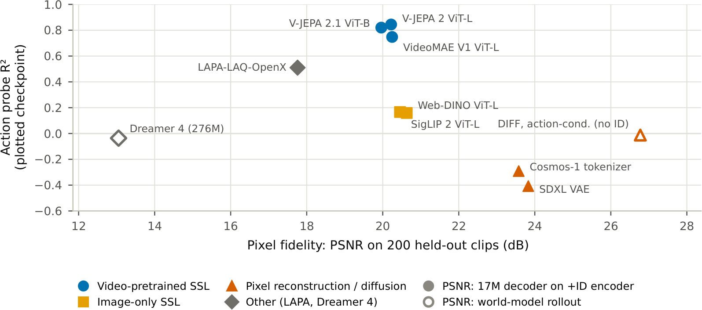
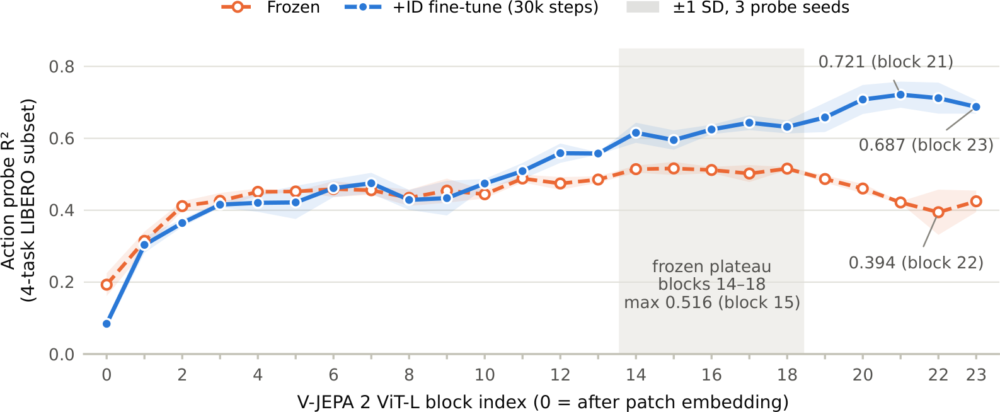
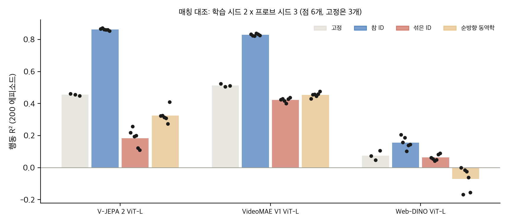
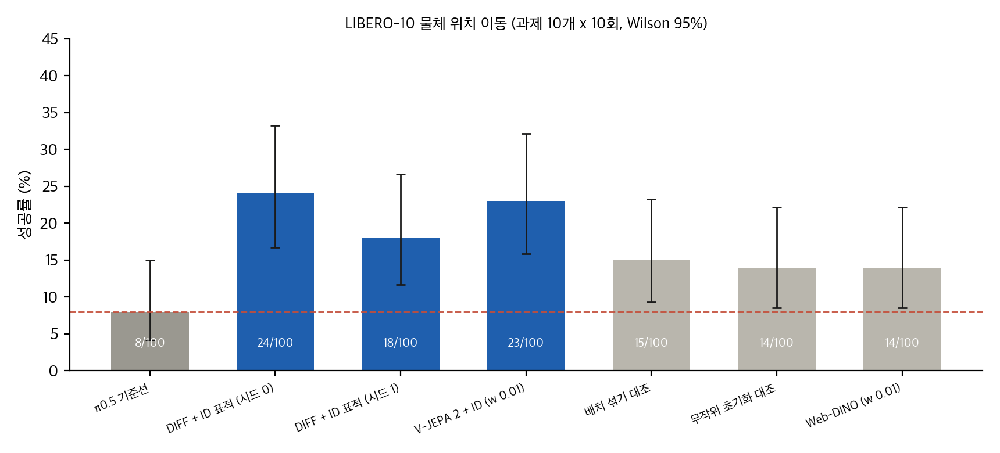

> **논문:** Jewon Yeom, Hanseul Kim, Jeongjae Park, Sungmok Jung, Jaejin Lee, Taesup Kim. *What Makes Video World Model Latents Action-Relevant: Prediction over Reconstruction.* CoRL 2026 포스터, arXiv:2606.07687 (v2, 2026-10-27).
> 공식 코드(MIT, k1seul/corl2026-action-relevant-latents)는 정적으로만 읽었고 실행하지 않았습니다. 이 글의 그림 가운데 두 장은 논문 그림(© 저자, CC BY 4.0)이고, 나머지 두 장은 우리가 원자료 CSV로 그린 그래프입니다.

## 논문이 묻는 것

비디오 세계모델은 다음 프레임을 예측하도록 학습합니다. 그 잠재 표현을 로봇 정책이 그대로 읽어 쓸 수 있다는 가정이 많습니다. 이 논문은 "어떤 사전학습 신호가 잠재 공간에 행동 관련 구조를 만드는가"를 묻습니다. 같은 역동역학 프로브로 이미지 자기지도, 비디오 사전학습, 재구성 오토인코더, 픽셀 확산, 단축 강제 동역학 모델을 비교합니다.

## 결과는 어떻게 읽히나

*논문 그림 1 (© 저자, CC BY 4.0, 출처 arXiv:2606.07687 v2). PSNR이 가장 높은 모델이 행동 R²는 0 이하입니다. 저자도 이 배치가 상관이나 파레토 frontier를 확정하지 않는다고 적었습니다.*

핵심은 비디오 사전학습 인코더입니다. LIBERO 보류 과제 4개에서 V-JEPA 2는 프리즈 0.40에서 ID 보조 손실로 0.84까지 올라갑니다. 같은 손실을 줘도 Web-DINO는 0.16에 머뭅니다.

V-JEPA 2의 블록별 프로브를 보면 행동 정보는 프리즈 상태에서 중간 블록(14–18)에 평탄하게 있다가 뒤쪽 블록에서 떨어집니다. ID 학습을 하면 뒤쪽 블록이 +0.25–0.32 올라가고 최고 블록이 21로 옮겨 갑니다.

*논문 그림 3 (© 저자, CC BY 4.0, 출처 arXiv:2606.07687 v2). 블록 0은 패치 임베딩 직후입니다.*

이득의 원인을 가르는 실험이 매칭 대조입니다. 같은 체크포인트에서 올바른 행동 짝짓기, 과제 안에서 행동만 섞은 짝짓기, 순방향 동역학을 비교했습니다.

*우리가 원자료 CSV로 그린 그래프. V-JEPA 2의 참 ID는 0.863, 섞은 ID는 0.184입니다. 26개 과제 쌍체 대비는 V-JEPA 0.836, VideoMAE 0.578, Web-DINO 0.097입니다.*

## 우리가 확인한 것

- **표 재계산.** 표 2, 표 4, 표 10(Spearman 순위 상관 0.88, 0.83, 0.67), 표 20을 원자료 CSV로 다시 계산했습니다. 모두 논문 값과 맞습니다.
- **논문 안의 불일치 두 개.** 같은 설정(DIFF, L2, λ = 0.05)의 R²가 본문과 표 5, 9에서는 0.572이고 표 6과 부록 A에서는 0.578입니다. V-JEPA와 VideoMAE의 차이는 본문에서 0.10이지만 표 1로는 0.09입니다.
- **학습 시드 변동.** 섞은 ID 조건에서 V-JEPA의 두 학습 시드 차이는 0.08로 큽니다. 논문의 ∆26 CI는 학습 체크포인트 두 개를 조건부로 둡니다. 시드 변동이 CI에 들어가지 않는다는 뜻입니다.

## 조심해서 읽을 부분

- **절대 프로브 값은 과제 범위에 민감합니다.** V-JEPA 2 프리즈 프로브는 4개 과제에서 0.449이지만 26개 보류 과제 전체에서는 −0.006입니다(95% 구간 −0.146에서 0.099, 표 19). ID 보조 손실을 쓴 값 0.84도 같은 4개 과제의 값이므로, 행동 복원도를 "0.84"로 인용하면 벤치마크 전체의 값처럼 읽힙니다.
- **폐루프 효과는 기준선 대비로만 확인됩니다.** π0.5에 목표를 붙이면 LIBERO-10 위치 이동 성공률이 8%에서 24%로 올라갑니다(시도 100회, Fisher p = 0.003, 보정 후 0.02). 하지만 배치 섞기와 무작위 초기화 대조군도 14–15%로 올라서, 목표와 대조군의 차이는 p = 0.10–0.15입니다. 전체 OOD 평균(LIBERO-PRO)은 69.0 대 68.7로 같습니다.

## 구현할 수 있는가

이 맥(Apple M4 Pro, CUDA 없음)에서 학습과 폐루프 재현은 불가능합니다. 매칭 대조는 ViT-L을 20k 스텝 학습해야 하고, 공식 설정은 CUDA를 기본으로 합니다. 프리즈 프로브는 LIBERO 데이터와 체크포인트를 받으면 조건부로 가능합니다. 노력 추정은 3–5일입니다(추정, 측정 전).

*우리가 원자료 CSV로 그린 그래프. 점선은 기준선 8%입니다. 막대 위 숫자는 성공 수/시도 수입니다. Wilson 95% 구간을 표시했습니다.*

## 공식 코드와 설정

공식 저장소는 MIT 라이선스이며 학습 설정, 평가 스크립트, 결과 CSV가 있습니다. 설정과 논문 값은 대부분 맞습니다. 다만 ID 헤드 구조, 클립 길이 32, 가중치 감쇠, 평가 중 로드 실패를 실패로 세는 방식은 논문 본문에 없습니다. 재현하려면 이 값들을 명시적으로 고정해야 합니다.

이 논문의 원자료와 함께 보면, 표현 선택을 픽셀 지표 대신 행동 프로브로 하려는 실험 설계에 쓸 만한 체크리스트가 됩니다. 짝짓기 대조를 기본 대조로 두고, 과제 단위 쌍체 검정과 학습 시드 여러 개를 함께 보고하는 것입니다.

## 자료

- [통합 리포트 PDF](report/report_public.pdf)
- [01. 논문 분석: What Makes Video World Model Latents Action-Relevant (arXiv:2606.07687)](analysis/01_paper_analysis.md)
- [02. 선행연구와 관련 저장소](analysis/02_prior_work.md)
- [03. 수치 재계산, 일관성 검사, 주장 판정](analysis/03_analysis.md)
- [04. 공식 코드 대조와 구현 가능성](analysis/04_code_verification.md)
