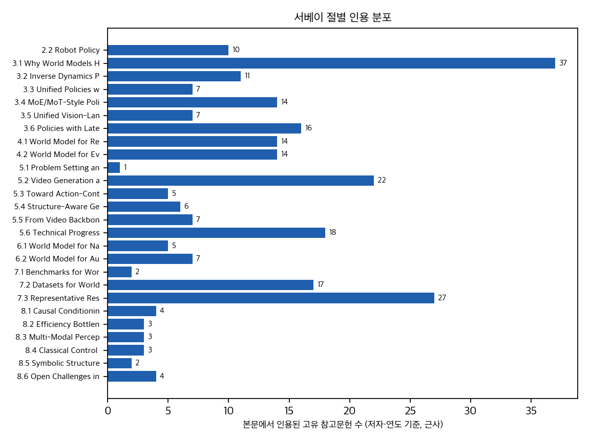
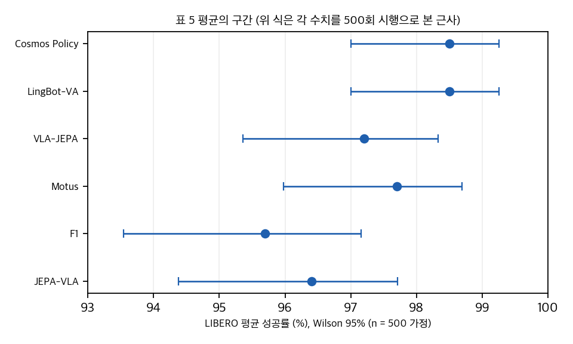
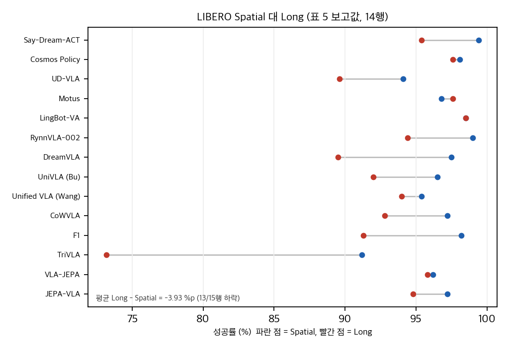

# 03 서베이의 정량 검토: 분류 포괄성, 수치 재계산, 주장 대조

**방법.** 서베이에는 새 실험이 없으므로 재현 대신 세 가지를 했습니다. (a) 본문 인용과 참고문헌으로 분류의 포괄성과 일관성을 셉니다. (b) 표 5·6의 수치를 재계산하고, 초록과 대조합니다. (c) 분류 체계를 이 저장소의 분석 폴더에 대응시킵니다(02 §4). 계산 스크립트는 `analysis/survey_taxonomy.py`(a), `analysis/recompute_survey.py`(b)입니다. 결과는 각각 `survey_taxonomy_results.json`, `recompute_survey_results.json`에 있습니다. 모두 CPU에서 1초 안에 돕니다.

**가정.** 표 5·6의 시행 횟수는 서베이에 없습니다. LIBERO 표준 평가는 suite마다 500회(과제 10 × 50회)라고 가정했습니다. 이 가정 아래서 정수 검사와 검정을 했고, 결과는 모두 가정 아래의 결과로 표시했습니다.

## 1. 인용 규모

- 참고문헌 202항목. 연도별로 2025년 92, 2026년 61로 전체의 76%(153/202)가 최근 두 해입니다. 2023–2024년은 33, 2022년 이전은 16입니다.
- 학회 표기: arXiv 109(54%), ICLR 21, CoRL 10, RSS 8, ICML 7, NeurIPS 6, ICRA 5, CVPR 4, IROS 4, ICCV 3, RA-L 3, ECCV 2, 기타(책·저널 등) 16.
- 본문 인용 키(저자·연도 쌍) 156개. 이 중 140개가 참고문헌 항목 하나에 대응하고, 16개는 자동 대응이 실패했습니다.
  - 16개를 `survey_refs_parsed.json`과 참고문헌 원문으로 수동 확인했습니다. 15개는 실제로 참고문헌에 있습니다. 이름 형식(Cai 2025 = Xiongyi Cai, Koh 2021 = Pathdreamer, Miller 1960, Wan 2025 = Team Wan 등), 저자 줄바꿈, 자동 파싱 한계 때문에 실패했습니다. 나머지 1개(Apr 2026)는 arXiv 스탬프입니다.
  - 따라서 본문이 참고문헌에 없는 항목을 인용하는 경우는 확인되지 않았습니다. 단, 아래 K2는 다른 종류의 문제입니다.
- 같은 (저자, 연도) 쌍에 항목이 여러 개인 경우가 29개 있습니다(예: Li 2025, Team 2025). 이런 키는 첫 번째 항목에 대응시켰으므로 절별 수치는 근사입니다.

**절별 고유 인용 수(참고문헌 항목 수, 근사):**

| 절 | 항목 수 | 절 | 항목 수 |
|---|---|---|---|
| 2.2 정책 | 10 | 5.2 상상을 통한 정책 학습 | 22 |
| 3.1 왜 도움이 되는가 | 37 | 5.3 행동 제어 가능 | 5 |
| 3.2 IDM형 | 11 | 5.4 구조 인식 | 6 |
| 3.3 단일 백본 | 7 | 5.5 기반 모델 | 7 |
| 3.4 MoE/MoT | 14 | 5.6 기술 흐름 | 18 |
| 3.5 통합 VLA | 7 | 6.1 내비게이션 | 5 |
| 3.6 잠재 공간 | 16 | 6.2 자율주행 | 7 |
| 4.1 강화학습 | 14 | 7.2 데이터셋 | 17 |
| 4.2 평가 | 14 | 7.3 결과 표 | 27 |
| 5.1 범위 | 1 | 8.x 열린 과제 | 4 · 3 · 3 · 3 · 2 · 4 |

인용이 얇은 절: 5.1(1개), 7.1 벤치마크 개요(2개), 8.5 기호 구조(2개). 분류 설명이 가장 두꺼운 절은 3.1(37개)인데, 이 절은 분류 자체보다 동기 설명입니다.

그래프: 절별 고유 인용 수. 우리가 만든 그래프입니다. 수치는 위 표와 같습니다.

## 2. 포괄성 점검: 빠진 계보

참고문헌 문자열 검색으로 확인했습니다.

- **모델 기반 강화학습의 잠재 동역학(Dreamer·PlaNet 계열):** DreamerV3(Hafner 외 2023)와 PlaNet은 없습니다. DayDreamer(Wu 외)만 있습니다. §4.1 강화학습 절이 이 계열을 빠뜨렸습니다. 서베이 §1은 "model-based RL(Nguyen and Widrow 1990; Jiang 2026; Zhu 2026)"을 근거로 드는데, 이 인용 가운데 Dreamer 계열 잠재 동역학 연구는 없습니다.
- **자기회귀 영상 생성(Diffusion Forcing, Self-Forcing 계열):** 없습니다. 서베이의 §5.5(기반 모델)와 §8.2(효율)가 다루어야 할 주제인데 빠져 있습니다.
- **Genie 3 등 상용 세계 모델:** 참고문헌에는 Genie Envisioner(Liao 외)만 있습니다. 차이는 크지 않습니다.

위 빠짐은 서베이의 분류 설명을 바꿀 정도는 아닙니다. 다만 "주요 계보를 포괄한다"는 주장(§1 기여 2)을 약하게 합니다.

## 3. 표 5·6 재계산

### 3.1 평균 검산

표 5의 행 중 네 suite 값이 모두 있고 평균이 보고된 행은 15개입니다. 모든 행이 0.1 자리까지 맞습니다. 한 행만 경계값입니다. Say-Dream-ACT는 네 값의 평균이 98.15인데 보고값은 98.1입니다. 반올림 기준에 따라 98.1 또는 98.2가 됩니다. 불일치로 보지는 않습니다.

### 3.2 n = 500 정수 검사

500회 시행이라면 각 셀은 0.2%의 배수(k/5)여야 합니다. 값이 있는 63개 셀 중 10개가 정수가 아닙니다.

| 방법 | suite | 보고값 | 500회 환산 |
|---|---|---|---|
| Cosmos Policy | Spatial | 98.1 | 490.5 |
| LingBot-VA | Spatial, Long | 98.5 | 492.5 |
| UD-VLA | Spatial, Object | 94.1, 95.7 | 470.5, 478.5 |
| DreamVLA | Spatial, Goal, Long | 97.5, 89.5, 89.5 | 487.5, 447.5, 447.5 |
| UniVLA (Bu) | Spatial | 96.5 | 482.5 |
| F1 | Long | 91.3 | 456.5 |

원논문들이 다른 시행 횟수나 평균 방식을 썼을 수 있습니다. 서베이는 이를 밝히지 않았습니다. 따라서 "오류"가 아니라 "확인 불가"로 기록합니다.

### 3.3 Long, Goal, Object를 Spatial과 비교

| 비교 | 행 수 | 평균 차이 (%p) | 비고 |
|---|---|---|---|
| Long − Spatial | 15 | −3.93 | 13행 하락, Motus만 상승, LingBot-VA는 동일 |
| Goal − Spatial | 15 | −1.96 | |
| Object − Spatial | 15 | +1.20 | Object가 Spatial보다 높음 |

서베이의 주장("Goal과 특히 Long에서 더 큰 하락이 흔하다", §7.3)은 재계산으로 지지됩니다. 다만 평균 차이는 방법마다 같은 조건에서 얻은 값이 아니므로 인과로 읽으면 안 됩니다.

### 3.4 상위 방법 간 검정 (n = 500 가정, suite 4개 합산 2000회)

| 비교 | 성공 수 | 차이 (%p) | Fisher 양측 p |
|---|---|---|---|
| Motus vs F1 | 1954/2000 vs 1913/2000 | +2.05 | 0.0004 |
| VLA-JEPA vs JEPA-VLA | 1944 vs 1928 | +0.80 | 0.18 |
| Cosmos Policy vs Motus | 1969 vs 1954 | +0.75 | 0.11 |
| LingBot-VA vs Motus | 1968 vs 1954 | +0.70 | 0.14 |
| F1 vs Unified VLA (Wang) | 1913 vs 1909 | +0.20 | 0.82 |
| Say-Dream-ACT vs Cosmos Policy | 1963 vs 1969 | −0.30 | 0.54 |
| VLA-JEPA vs Motus | 1944 vs 1954 | −0.50 | 0.37 |
| Cosmos Policy vs LingBot-VA | 1969 vs 1968 | +0.05 | 1.00 |

한계가 있습니다. 서로 다른 논문의 결과를 합쳐서 검정하면 논문 사이의 차이(구현, 시드, 학습 데이터)가 무시됩니다. 따라서 이 p값은 "같은 조건에서 얻었다면"이라는 가정 아래의 상한 수준으로만 봅니다. 그럼에도 Cosmos Policy, LingBot-VA, Motus, VLA-JEPA, JEPA-VLA의 상위 군은 1pp 안쪽에서 구분되지 않습니다. 이는 표 5의 순위를 강하게 믿기 어렵다는 서베이 본문의 경고(§7.3 마지막 문단)와 맞습니다.

그래프: LIBERO 평균의 Wilson 95% 구간(n = 500 가정). 우리가 만든 그래프입니다. 평균을 한 번의 500회 시행 비율로 본 근사이므로 참고용입니다.

그래프: 표 5의 Spatial과 Long 값. 우리가 만든 그래프입니다.

## 4. 본문과 표, 표와 표의 일관성

| # | 내용 | 근거 | 판정 |
|---|---|---|---|
| K1 | Table 1의 "GE-Act (Bharadhwaj et al., 2025)"는 저자가 틀렸습니다. 본문 §3.2에서는 "GE-Act (Liao et al., 2026)"입니다. arXiv:2508.05635의 저자는 Liao 외(Genie Envisioner)이고, Bharadhwaj 외는 Gen2Act입니다 | Table 1 행 451, 본문 행 703, arXiv 메타데이터 | 오류 |
| K2 | WorldVLA(arXiv:2506.21539)는 참고문헌 항목이 없습니다. 본문 행 461, 780, 1757과 Table 1은 "Cen et al., 2025"를 인용하는데, 이 키의 유일한 항목은 RynnVLA-002입니다 | 참고문헌 행 58, 문자열 검색 0건 | 누락 의심. 확인 필요 |
| K3 | Motus: Table 1은 "MoT fusion", 본문 §3.4는 "Mixture-of-Transformers", 표 5·6은 "Single-backbone"입니다 | Table 1 행 ~455, 본문 행 712, 표 5 행 1630 근처, 표 6 행 1684 근처 | 분류 불일치 |
| K4 | LingBot-VA: Table 1과 본문 §3.4는 MoT, 표 5는 MoE/MoT, 표 6은 Single-backbone입니다 | 표 6 그룹 위치 | 표 사이 불일치 |
| K5 | UVA와 VideoPolicy: Table 1은 "Shared backbone"이고, 표 5의 그룹 라벨 위치로 보면 "Decoupled"입니다 | 표 1 행 ~440, 표 5 레이아웃 | 불일치 가능. 레이아웃 판독이라 중간 확신 |
| K6 | VLA-JEPA: 표 6은 "Latent-space WM", 표 5에서는 Unified VLA 블록 쪽에 있습니다 | 표 5·6 레이아웃 | 불일치 가능. 레이아웃 판독 |
| K7 | UniPi의 표 5 LIBERO Long 0.0과 표 6 CALVIN 0.92. UniPi 초록(arXiv:2302.00111)에는 LIBERO와 CALVIN이 없고, LIBERO는 2023년 중반 공개되어 UniPi(2023년 2월) 이후입니다 | 초록 확인, LIBERO 공개 시점 | 출처 의심 |
| K8 | 이름 충돌: Table 1의 "UniVLA (Wang 2025)"는 표 5의 "Unified VLA (Wang 2025)"와 같은 논문인데, 표 5에는 "UniVLA (Bu 2025b)"도 따로 있습니다 | 표 1, 표 5 | 명명 혼동 |
| K9 | 표 5의 Say-Dream-ACT 98.1 | 3.1 참조 | 반올림 경계, 불일치 아님 |

K1과 K2는 참고문헌 수준의 오류이고, K3–K6은 분류 체계 자체의 불안정성입니다. K7은 수치의 출처 문제입니다. 서베이 §2.1의 정의(행동 조건부 예측)를 기준으로 하면, Motus와 LingBot-VA의 자리는 결합 방식으로 정해야 합니다. 그렇게 하면 Table 1의 "MoT fusion"이 옳고 표 6의 "Single-backbone"은 틀린 것입니다.

## 5. 초록과 대조한 정량 주장

이 절은 작업 기준의 15개 이상을 채우지 못했습니다. 18개 항목을 확인했는데, 초록에 해당 수치가 있어서 판정할 수 있었던 것은 V1 하나뿐입니다. 나머지는 초록 검증이 불가능합니다. 초록에 없는 수치는 본문이나 표를 열어 봐야 하는데, 이 단계는 시간 제약으로 생략했습니다. 대신 표 안의 내부 검산(§3)과 출처 추적(K7)으로 보완했습니다.

| # | 방법(arXiv) | 서베이 값 (위치) | 초록에서 확인 | 판정 |
|---|---|---|---|---|
| V1 | Cosmos Policy (2601.16163) | LIBERO 평균 98.5 (표 5) | 초록 "98.5% ... LIBERO" | 일치 |
| V2 | Cosmos Policy | Spatial 98.1, Object 100.0, Goal 98.2, Long 97.6 | suite 값은 초록에 없음 | 확인 불가 (내부 평균은 일치) |
| V3 | Motus (2512.13030) | LIBERO 평균 97.7 | 초록에 LIBERO 수치 없음(시뮬레이션 +15%, +45% 상대 향상만) | 확인 불가 |
| V4 | Motus | RoboTwin 88.7 / 87.0 (표 6) | 없음 | 확인 불가 |
| V5 | LingBot-VA (2601.21998) | LIBERO 평균 98.5 | 초록에 수치 없음 | 확인 불가 |
| V6 | LingBot-VA | RoboTwin 92.9 / 91.6 | 없음 | 확인 불가 |
| V7 | VLA-JEPA (2602.10098) | LIBERO 평균 97.2 | 없음 | 확인 불가 |
| V8 | VLA-JEPA | SimplerEnv 65.2 / 57.3 | 없음 | 확인 불가 |
| V9 | JEPA-VLA (2602.11832) | LIBERO 평균 96.4 | 없음 | 확인 불가 |
| V10 | JEPA-VLA | RoboTwin 73.5 / 17.7 | 없음 | 확인 불가 |
| V11 | UVA (2503.00200) | LIBERO-Long 90.0 (표 5) | 없음 | 확인 불가 |
| V12 | VPP (2412.14803) | CALVIN 4.33 (표 6) | 없음 | 확인 불가 |
| V13 | UniPi (2302.00111) | LIBERO-Long 0.0 (표 5) | LIBERO 언급 없음, 공개 시점상 불가능 | 불일치 의심 (K7) |
| V14 | UniPi | CALVIN 0.92 (표 6) | CALVIN 언급 없음 | 불일치 의심 (K7) |
| V15 | Say-Dream-ACT (2602.10717) | LIBERO 평균 98.1 | 없음 | 확인 불가 |
| V16 | F1 (2509.06951) | LIBERO 평균 95.7 | 없음 | 확인 불가 |
| V17 | Genie Envisioner (2508.05635) | Table 1 저자 Bharadhwaj | arXiv 메타데이터 저자는 Liao 외 | 불일치 (K1) |
| V18 | Fast-WAM (2603.16666) | Table 1 "test-time skipped" | 제목 "Do WAMs need test-time future imagination?" | 정성적 일치 |

**요약:** 18개 중 초록으로 수치를 확인한 것은 V1 하나(일치)입니다. 출처가 의심되는 것은 UniPi 두 값(V13, V14)입니다. 메타데이터 불일치는 K1(V17)입니다. 나머지 13개는 확인 불가입니다. 정성 항목 V18은 제목 수준으로 일치합니다.

## 6. 분류 체계와 이 저장소의 대응

## 7. 재계산 한계

- 표 5·6의 시행 횟수, 시드, 평가 설정은 서베이에 없습니다. 모든 검정은 가정에 의존합니다.
- 초록 검증은 18개 중 수치 판정이 가능했던 것이 V1 하나뿐이었습니다.
- 파싱은 자동이었으므로 인용 수는 ±3% 정도 흔들릴 수 있습니다(동명이인, 저자 줄바꿈).
- 원논문 본문과 부록은 열지 않았습니다. 따라서 표 값이 원논문과 맞는지는 확인되지 않았습니다.
