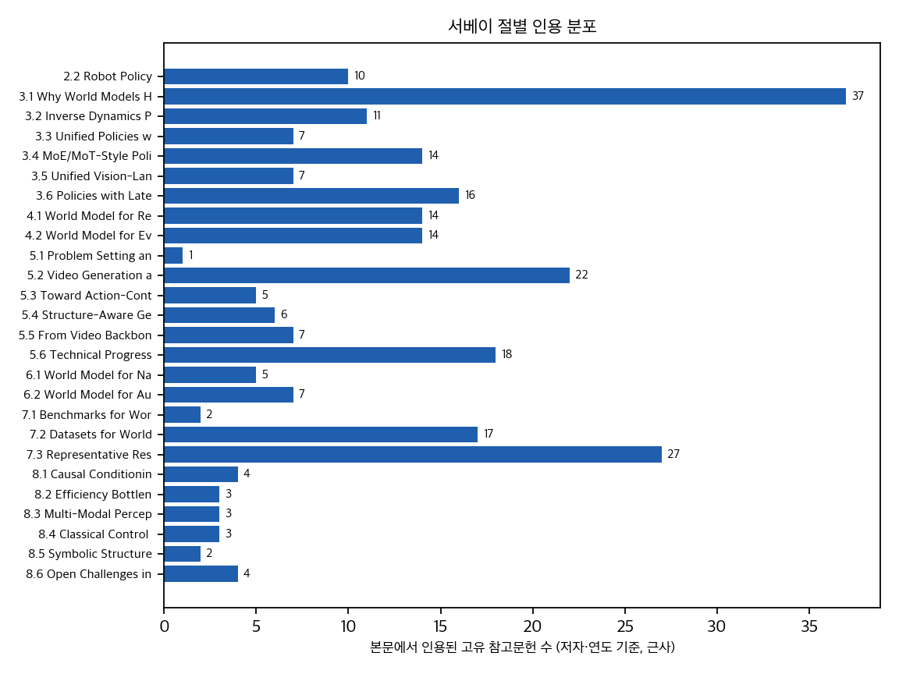
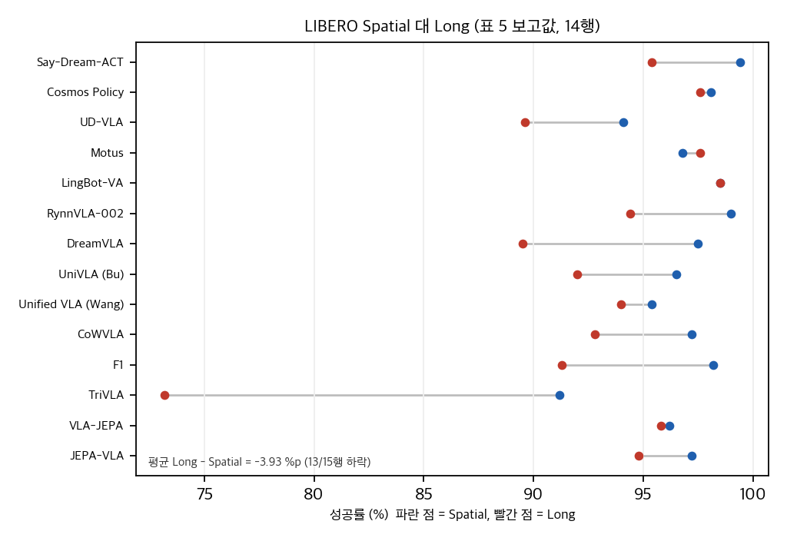
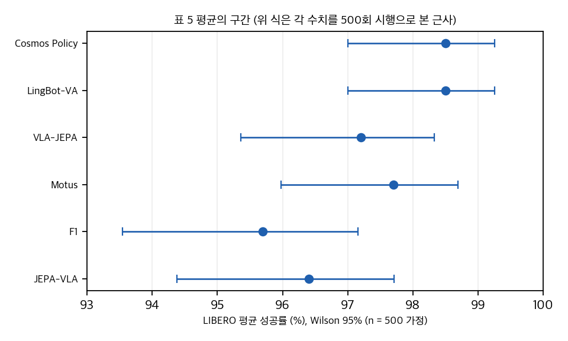

> **논문:** Bohan Hou 외 18인. *World Model for Robot Learning: A Comprehensive Survey.* arXiv:2605.00080 (v1, 2026-04-30). 학회 표기 없음.
> 라이선스는 CC BY 4.0입니다(arXiv abs 페이지 확인). 이 글의 그림은 모두 우리가 만든 그래프입니다. 논문 그림은 싣지 않았습니다.

## 서베이가 하는 일

세계 모델은 로봇 정책이 앞날을 예측하도록 돕는 부품입니다. 이 서베이는 세계 모델이 정책과 어떻게 결합되는지, 시뮬레이터로 어떻게 쓰이는지, 영상 생성 모델이 어떻게 발전했는지를 정리합니다. 정책 결합은 다섯 가지 방식(IDM형, 단일 백본, MoE/MoT, 통합 VLA, 잠재 공간)으로 나뉩니다.

서베이는 새 방법이 없습니다. 그래서 이 글에서는 세 가지를 봤습니다. 인용이 얼마나 넓은지, 표 수치가 맞는지, 본문 주장이 표로 뒷받침되는지입니다.

## 인용 규모

참고문헌 202개 중 153개(76%)가 2025–2026년 논문입니다. 빠르게 움직이는 분야라는 점은 분명합니다. 반면 빠진 계보도 보입니다. GR00T 계열, DreamerV3·PlaNet 계열의 잠재 동역학, 자기회귀 영상 생성(Diffusion Forcing, Self-Forcing)이 참고문헌에 없습니다.

그래프: 절별 고유 인용 수(저자·연도 기준 근사). 우리가 만든 그래프입니다.

## 표 5 재계산

LIBERO 표(표 5)의 네 suite 값으로 평균을 다시 계산했습니다. 15행 모두 보고된 평균과 맞습니다. 한 행만 반올림 경계입니다.

다음으로 시행 횟수를 봤습니다. 서베이는 시행 횟수를 적지 않았습니다. LIBERO 표준 평가가 suite마다 500회라고 가정하면, 63개 셀 중 10개가 정수 횟수가 되지 않습니다. 원논문의 평가 방식이 달랐을 수 있으므로 오류로 단정하지는 않습니다.

서베이 주장 중 하나는 "Goal과 특히 Long에서 성능이 더 많이 떨어진다"입니다. 재계산하면 평균 Long − Spatial은 −3.93 %p이고, 15행 중 13행이 떨어집니다. 이 주장은 맞습니다.

그래프: 표 5의 Spatial(파랑)과 Long(빨강) 성공률. 우리가 만든 그래프입니다.

## 상위 방법은 구분되지 않습니다

Cosmos Policy, LingBot-VA, Motus, VLA-JEPA, JEPA-VLA는 LIBERO 평균이 96–98.5%입니다. 500회 가정 아래의 구간을 그려 보면 대부분 겹칩니다.

그래프: LIBERO 평균의 Wilson 95% 구간(500회 가정). 한 번의 시행 비율로 본 근사입니다. 우리가 만든 그래프입니다.

서로 다른 논문의 결과를 합쳐서 검정하면 논문 사이의 차이가 무시됩니다. 그래서 검정 결과는 참고용입니다. 그래도 표의 순위를 강하게 믿기는 어렵다는 점은 같습니다.

## 본문과 표가 맞지 않는 곳

- **Table 1의 저자 오류:** GE-Act의 저자가 Bharadhwaj 외로 적혀 있습니다. 같은 서베이 본문은 Liao 외로 적고, arXiv 메타데이터도 Liao 외입니다(Genie Envisioner).
- **WorldVLA 참고문헌 누락 의심:** WorldVLA 인용이 RynnVLA-002 항목 하나를 가리킵니다.
- **분류 불일치:** Motus와 LingBot-VA는 본문과 표 1에서는 MoT이고, 표 5와 6에서는 단일 백본입니다.
- **UniPi 수치 출처:** 표 5의 LIBERO-Long 0.0과 표 6의 CALVIN 0.92는 UniPi 초록에 없습니다. LIBERO는 UniPi 이후에 공개되었습니다. 원논문 확인이 필요합니다.

## 구현 가능성

- **서베이의 주장 검증:** 이 맥(Apple M4 Pro, 24 GiB)에서 충분합니다. 재계산과 문헌 대조만 필요합니다.
- **서베이가 인용한 방법의 재현:** 이 맥에서는 불가능합니다. 영상 세계 모델의 학습과 평가에 CUDA GPU가 필요합니다.

## 한계

- 시행 횟수와 평가 설정이 서베이에 없어서 검정은 가정에 의존합니다.
- 초록으로 수치를 확인할 수 있었던 것은 한 항목뿐입니다. 나머지는 원논문 본문을 확인해야 합니다.
- 서베이 저장소는 큐레이션 목록이라 방법의 구현 코드가 아닙니다.

## 자료

- [통합 리포트 PDF](report/report_public.pdf)
- [World Model for Robot Learning: A Comprehensive Survey (arXiv:2605.00080) 분석](analysis/01_paper_analysis.md)
- [선행연구와 자료 위치 (arXiv:2605.00080)](analysis/02_prior_work.md)
- [03 서베이의 정량 검토: 분류 포괄성, 수치 재계산, 주장 대조](analysis/03_analysis.md)
- [04 서베이 주장 검증 (claim verification)](analysis/04_claim_verification.md)
