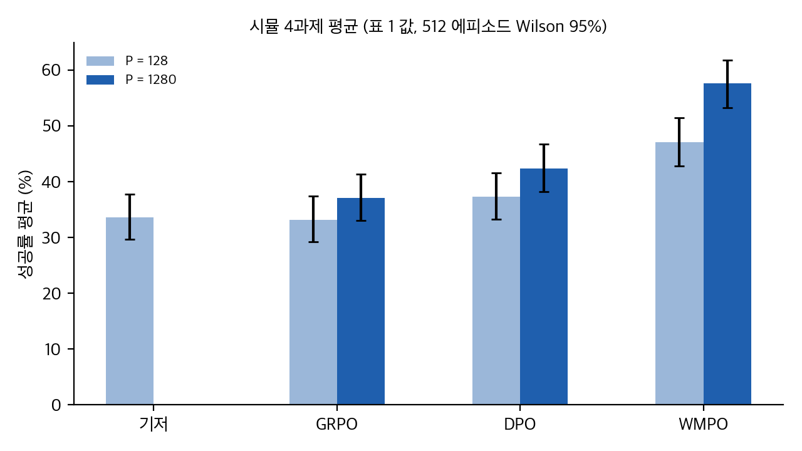
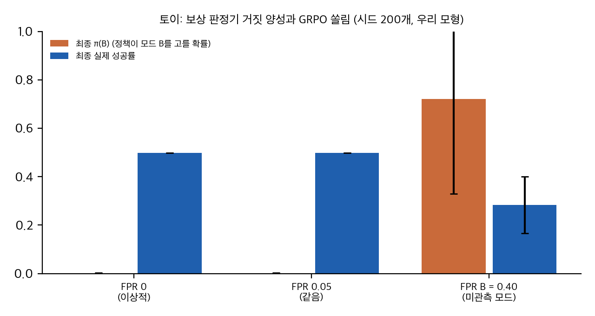

> **논문:** Fangqi Zhu, Zhengyang Yan, Zicong Hong, Quanxin Shou, Xiao Ma, Song Guo. *WMPO: World Model-based Policy Optimization for Vision-Language-Action Models.* ICLR 2026 (포스터), arXiv:2511.09515 (v1, 2025-11-12).
> 공식 코드는 GitHub WM-PO/WMPO에 있습니다(Apache-2.0). 이 글의 그림은 우리가 그린 그래프 두 장뿐이며, 논문 그림은 쓰지 않았습니다.

## 한 문장 요약

VLA 정책을 픽셀 공간의 행동 조건부 비디오 세계모델 안에서 GRPO로 학습하는 방법입니다. 실제 로봇 없이 강화학습을 하려는 시도이고, 방법의 구조는 흥미롭습니다. 다만 논문의 수치는 "크게 좋다"라는 인상보다 조건이 많이 붙습니다.

## 방법: 세 부분

1. **세계모델.** OpenSora 백본에 3D VAE 대신 SDXL의 2D VAE를 씁니다. 대규모 로봇 데이터(Open X-Embodiment)로 사전학습한 뒤, 정책이 직접 낸 실제 궤적으로 **정책 행동 정렬**을 합니다. 이유는 공개 데이터가 대부분 성공 궤적이라 실패 상황이 부족하다는 점입니다.
2. **보상 모델.** VideoMAE 인코더와 선형 헤드로 된 이진 분류기입니다. 8프레임 슬라이딩 윈도우를 돌려 한 클립이라도 임계값을 넘으면 성공으로 봅니다.
3. **온폴리시 GRPO.** 같은 초기 상태에서 그룹 8개의 상상 궤적을 뽑고, 전부 성공이거나 전부 실패인 그룹은 버립니다(동적 샘플링). KL 항은 없습니다.

## 결과를 어떻게 읽을까

그림: 논문 표 1의 시뮬 4과제 평균과 512 에피소드 기준 Wilson 95% 구간. 우리가 그린 그래프이며, 논문의 시드 분산은 반영하지 않았습니다.

- **시뮬 평균.** 기저 정책 33.6%에서 WMPO는 P = 128일 때 47.1%, P = 1280일 때 57.6%입니다. 가장 강한 기준선인 DPO보다 9.8점, 15.2점 높습니다. 산술은 맞습니다. 다만 시드 실험이 없어서 차이가 얼마나 흔들릴지는 알 수 없습니다.
- **GRPO는 적은 예산에서 기저보다 낮습니다** (P = 128, 33.2%). "온폴리시가 낫다"는 주장은 이 점과 함께 읽어야 합니다.
- **표의 정수 검사.** 표 2의 WMPO Pos. 값 22.3%는 128회 평가로는 나올 수 없습니다. 표 1의 한 칸도 소수점이 어긋납니다. 작은 오류지만 원자료 공개가 있으면 확인할 수 있는 부분입니다.
- **일반화.** 위치, 배경, 질감을 바꾼 세 조건에서 WMPO 평균은 29.6%로 기저 23.7%보다 높습니다. 그러나 기저 대비 차이는 세 조건 모두 유의하지 않습니다. DPO와 비교했을 때 배경 변화에서만 차이가 뚜렷합니다.
- **실세계.** 한 과제, 30회 시행으로 WMPO 70%, DPO 60%, 기저 53%입니다. 이 표본으로는 세 방법을 구분할 수 없습니다.

## 보상 모델이 문제일 수 있는 이유

논문은 보상 모델의 F1이 0.95를 넘는다고 한 줄로만 씁니다. 검증 데이터와 임계값 선택 과정이 없습니다. 공식 코드는 과제마다 다른 임계값(0.62, 0.66, 0.82, 0.96)을 씁니다.

이 문제가 왜 중요한지 토이로 확인했습니다. 두 행동 모드가 있고, 한 모드에서만 보상 모델의 거짓 양성이 많다고 가정하면 GRPO는 그 모드로 쏠립니다. 실제 성공률이 절반 가까이 떨어질 수 있습니다.

그림: 우리가 만든 토이 모형의 결과 (논문 결과가 아님). 시드 200개, 평균과 SD. 판정기 오류가 모드마다 같으면 쏠림이 없고, 학습 분포 밖 모드의 거짓 양성이 크면 정책이 그 모드를 고릅니다.

## 구현 가능성

- 세계모델 사전학습(12M 스텝)과 GRPO 학습(H100 32장)은 이 맥에서 불가능합니다.
- 공식 세계모델의 추론 한 번과 보상 모델 점수 계산은 가중치를 받은 뒤 조건부로 확인할 수 있습니다.
- 2-D 도달 과제 같은 축소판은 1–2주 정도 걸릴 것으로 보입니다(추정).

## 열린 질문

- 학습 중 정책이 방문하는 상상 궤적에서 보상 모델의 FPR은 얼마인가?
- 정책 행동 정렬로 얼마나 많은 실패 상황을 메웠는가? 실패 비율을 바꾸면 세계모델의 실제 성공률 예측 오차는 어떻게 변하는가?
- 지속 학습(§4.5)의 세계모델 갱신 코드는 공개되었는가? 현재 공개된 설정은 세계모델을 고정합니다.

자세한 재계산, 검정, 코드 대조는 분석 노트(`01`–`04`)에 있습니다.

## 자료

- [통합 리포트 PDF](report/report_public.pdf)
- [01. 논문 분석: WMPO (arXiv:2511.09515)](analysis/01_paper_analysis.md)
- [02. 선행연구, 공식 저장소, 이 저장소의 관련 분석](analysis/02_prior_work.md)
- [03. 수치 재계산, 일관성 검사, 토이 실험](analysis/03_analysis.md)
- [04. 논문 ↔ 공식 코드 대조 (D1–D9)와 구현 가능성](analysis/04_code_verification.md)
