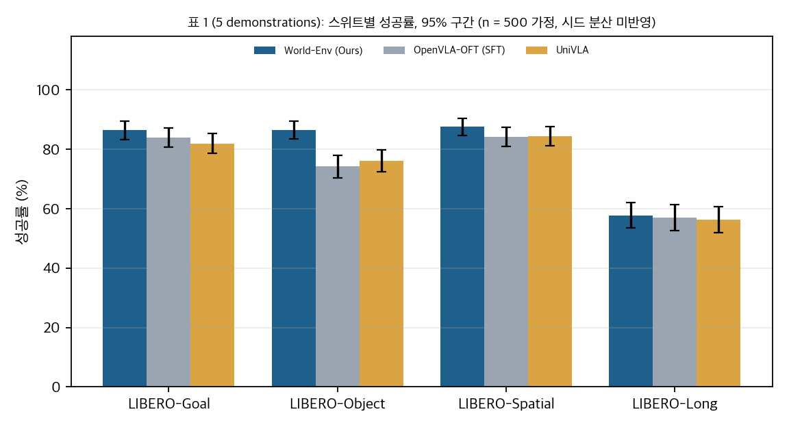
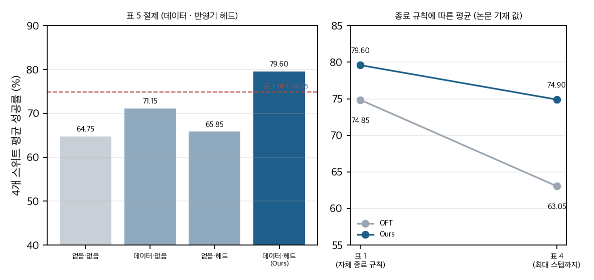

> **논문:** Junjin Xiao 외. *World-Env: Leveraging World Model as a Virtual Environment for VLA Post-Training.* arXiv:2509.24948 (v6, 2026-04-27). 학회 표기는 확인되지 않았습니다.
> 공식 코드는 GitHub amap-cvlab/world-env(Apache-2.0)에 있습니다. 이 글의 그림은 우리가 그린 그래프 두 장입니다. 논문 그림은 넣지 않았습니다(arXiv 비배타적 배포 라이선스).

## 논문이 묻는 것

VLA 정책은 시연이 적으면 성능이 떨어지고, 실세계에서 강화학습을 하려면 되돌릴 수 없는 시도가 많이 필요합니다. World-Env는 학습된 영상 세계모델을 가상 환경으로 쓰고, VLM 기반 반영기가 상상한 영상에서 종료와 연속 보상을 주는 후학습을 제안합니다. 정책은 OpenVLA-OFT이고, 시연은 과제당 5개입니다.

## 이 글에서 확인한 것

**1. 평균 개선은 있지만 Object에 집중되어 있습니다.** LIBERO 시연 5개 설정에서 OFT 평균 74.85, World-Env 평균 79.6입니다. 스위트 독립과 샘플링 오차만 가정하면 평균 차이 4.75점은 z = 3.74입니다. 그런데 스위트별로 보면 Object (+12.4점)만 뚜렷하고, Goal, Spatial, Long은 샘플링 오차 안입니다. 학습 시드 분산은 논문에 없습니다.

*논문 표 1의 수치를 다시 그렸습니다. 스위트당 평가 시행 500을 가정했고, 시드 분산은 반영하지 않았습니다.*

**2. 같은 방법의 기준선 평균이 표마다 다릅니다.** 표 1에서 OFT는 74.85인데, 종료 신호를 쓰지 않고 최대 스텝까지 본 표 4에서는 63.05입니다. World-Env는 79.6에서 74.9로 떨어집니다. 논문은 표 1에 쓴 종료 규칙을 밝히지 않았습니다. 그래서 "반영기 종료가 불필요한 행동을 줄인다"는 주장은 이 두 표만으로는 판단하기 어렵습니다.

**3. 절제에서 두 요소는 함께 있을 때만 효과가 큽니다.** 추가 데이터와 반영기 헤드를 따로 넣으면 각각 평균 1–6점이고, 함께 넣으면 평균 79.6입니다. 교호작용은 +7.35점입니다. 그런데 "둘 다 없음" 행의 평균 64.75는 표 1의 OFT 74.85보다 낮습니다. 이 행이 무엇을 기준으로 했는지 논문에 없습니다.

*왼쪽은 표 5의 2×2 절제 평균입니다. 오른쪽은 표 1과 표 4에서 두 방법 평균이 바뀌는 모습입니다.*

**4. 공식 코드에는 논문의 기여 하나가 없습니다.** 논문은 세계모델에 VGGT 기하 특징 주입을 넣었다고 씁니다. 공식 저장소에서 VGGT는 검색되지 않습니다. 세계모델은 EnerVerse-AC 기반 잠재 확산 모델입니다. 학습 중 롤아웃을 보면 LIBERO 물리는 계속 돌고, 세계모델은 외부 카메라 영상만 만듭니다. "물리 상호작용을 대체한다"는 표현은 공개 코드의 학습 구조와 다릅니다.

**5. 실세계 결과는 시행 수가 없어서 판단할 수 없습니다.** 네 과제의 합산 검정은 과제당 10회 가정에서 p = 0.16이고, 100회 가정에서는 p ≈ 2e-7입니다. 저자에게 시행 수를 확인하기 전에는 결론을 내리지 않습니다.

**6. 이진 보상의 이점 퇴화는 메커니즘으로 맞습니다.** 토이에서 성공률이 높은 과제에서는 묶음의 57%가 이점 0이었습니다. 연속 보상에서는 0입니다. 다만 크기는 반영기 점수 분포에 달려 있고, 논문은 직접 비교 실험을 보이지 않았습니다.

## 구현 가능성

이 맥(Apple M4 Pro, 24 GiB, MPS, CUDA 없음)에서 논문 수치의 재현은 불가능합니다. RL 학습은 8 GPU에서 48시간이고, 공식 코드는 CUDA 계열 패키지에 의존합니다. 공식 세계모델의 추론 한 번은 체크포인트 다운로드와 MPS 포팅 뒤에 조건부로 가능합니다. 개념 재구현은 가능하고, 이진 대 연속 보상의 토이는 이미 돌렸습니다.

## 다음에 볼 것

- 세계모델 학습 데이터 규모와 반영기 학습 데이터 (논문에 없음).
- 표 1과 표 4 중 어느 종료 규칙이 기본인지, RL 반복 수와 시드 수.
- 공식 설정과 논문 설정의 차이 (헤드 학습률, `fix_scale_head`, `scale_factor`).

자세한 분석은 저장소의 `analysis/` 아래 문서를 봅니다. 재계산 스크립트와 토이는 같은 폴더에 있고, 게시본 `git/` 폴더에 함께 들어 있습니다.

## 자료

- [통합 리포트 PDF](report/report_public.pdf)
- [01. 논문 분석: World-Env (arXiv:2509.24948)](analysis/01_paper_analysis.md)
- [02. 선행연구, 공식 저장소, 관련 분석](analysis/02_prior_work.md)
- [03. 수치 재계산, 일관성 검사, 토이 실험](analysis/03_analysis.md)
- [04. 공식 코드 대조: 논문 ↔ `amap-cvlab/world-env`](analysis/04_code_verification.md)
