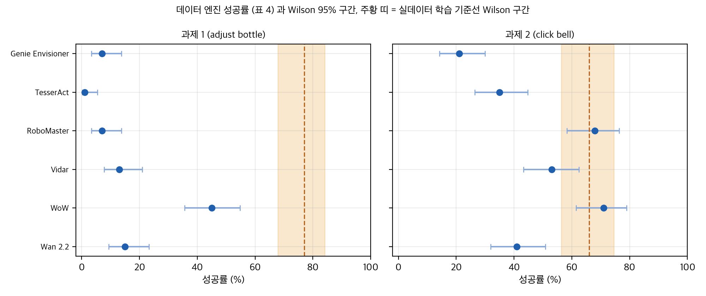
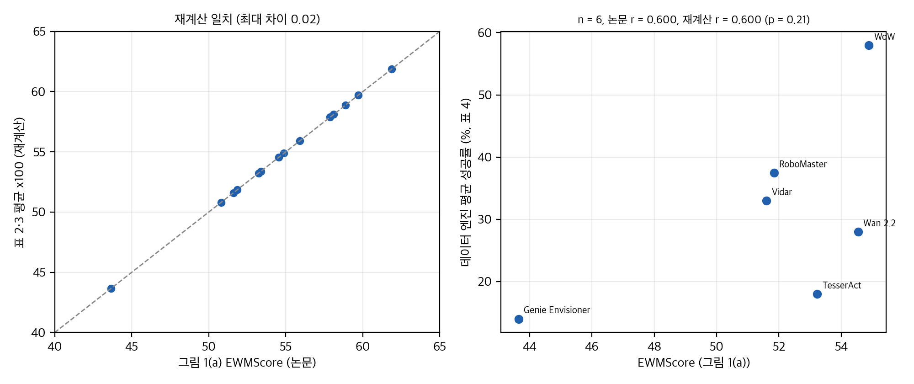
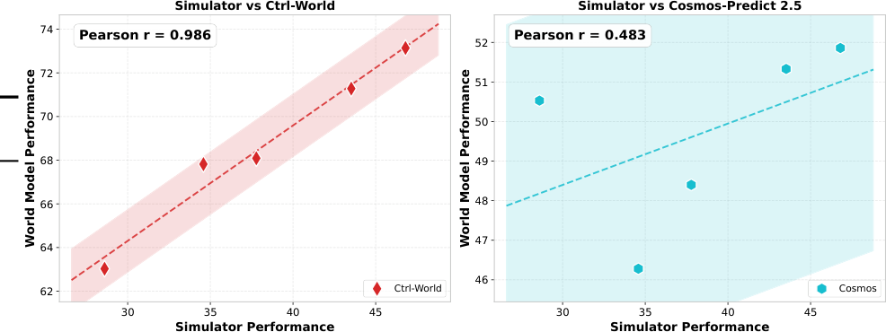
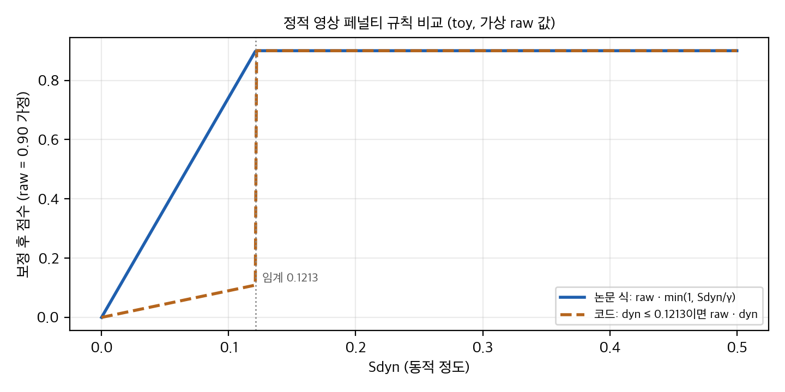
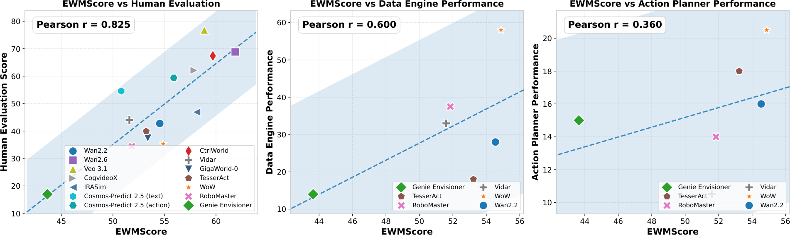

> **논문:** Yu Shang 외 20인 (Tsinghua 외). *WorldArena: A Unified Benchmark for Evaluating Perception and Functional Utility of Embodied World Models.* arXiv:2602.08971 (v2, 2026-02-11). 학회 표기는 없습니다. 라이선스는 CC BY 4.0입니다.
> 공식 코드는 GitHub `tsinghua-fib-lab/WorldArena`에 있고, 루트 LICENSE 파일이 없습니다. 이 글의 그림은 논문 그림 두 장(© 저자, CC BY 4.0, 출처 표기)과 우리가 그린 그래프입니다.

## 무엇을 평가하나

로봇 세계 모델은 행동을 조건으로 다음 장면을 예측합니다. 그래서 두 가지를 물을 수 있습니다. 영상이 그럴듯한가, 그리고 그 모델이 실제 의사결정에 쓸모 있는가. 기존 벤치마크는 대부분 앞의 질문만 봤습니다. WorldArena는 뒤의 질문을 세 가지 역할로 나눠 봅니다.

- **데이터 엔진:** 생성 영상으로 정책을 학습했을 때 성공률이 오르는가
- **정책 평가자:** 세계 모델 안에서 정책의 순위를 시뮬레이터와 같게 매기는가
- **행동 계획자:** 모델이 낸 행동열을 시뮬레이터에서 실행했을 때 성공하는가

영상 품질은 16개 지표로 봅니다. 시각 품질, 움직임, 내용 일관성, 물리, 3D, 제어 가능성의 여섯 차원입니다. 여기에 사람 평가 70명, 3,500개 영상을 더합니다. 그리고 이 모두를 하나로 합친 EWMScore를 제안합니다. 14개 모델을 RoboTwin 2.0 데이터로 평가했고, 저자들은 "시각 품질이 높아도 과제 성능이 따라오지 않는다"고 결론짓습니다.

## 점수가 어떻게 만들어지나

EWMScore는 16개 정규화 지표의 산술 평균입니다. 가중치는 없습니다. 흐름, 궤적, 광도 일관성, 움직임 부드러움, 깊이 지표는 99/1 백분위 경계로 정규화합니다. 이 경계는 표 6에 있습니다.

표 2와 3의 값으로 평균을 다시 계산하면 그림 1(a)의 EWMScore와 14개 모델 모두 최대 0.02 차이입니다. 정의와 값은 맞습니다. 다만 이 평균을 계산하는 코드는 저장소에 없습니다. 경계도 평가한 14개 모델이 아니라 "8개 모델"에서 구했다고 적혀 있습니다. 모델을 추가하면 점수가 바뀔 수 있다는 뜻입니다.

## 과제 차이는 몇 번의 실행으로 설명되나

과제 성공률은 과제당 100회 실행의 결과입니다. 실데이터로 학습한 기준선은 과제 1에서 77%, 과제 2에서 66%입니다.

*그림: 데이터 엔진 성공률과 Wilson 95% 구간. 우리가 그린 그래프입니다. 실행 100회를 가정했습니다.*

과제 1에서는 모든 생성 데이터가 실데이터보다 유의하게 낮습니다. 과제 2에서 본문은 RoboMaster(68%)와 WoW(71%)가 실데이터를 넘는다고 씁니다. 그러나 차이는 각각 2pp와 5pp이고, Fisher 검정으로 p = 0.88과 0.54입니다. 이 차이는 확인할 수 없습니다. 게다가 시드를 바꾼 반복 결과가 없습니다. 학습 분산은 논문에 보고되지 않았습니다.

## 상관 계수는 몇 개의 점에서 나왔나

*그림: 왼쪽은 표 2·3 평균과 그림 1(a)의 일치, 오른쪽은 EWMScore와 데이터 엔진 평균의 산점도. 우리가 그린 그래프입니다.*

논문의 상관 계수 세 개 가운데 두 개는 6개 모델에서 나왔습니다. 데이터 엔진 r = 0.600과 행동 계획 r = 0.360입니다. 6개 점에서 5% 수준의 임계는 0.811입니다. 그래서 0.600은 "약한 상관"이라기보다 "구분할 수 없음"에 가깝습니다. 간단한 모의 실험을 해 보면, 참 상관이 0.8이어도 6개 점에서는 관측 r이 0.6 이상으로 나올 확률이 84%입니다. 사람 평가 r = 0.825는 그림 5의 점 14개로 보아 n = 14이고, 원자료는 없습니다.

정책 평가자는 정책 5개로 검사했습니다. Ctrl-World의 r = 0.986은 95% 구간이 [0.80, 0.999]입니다. Cosmos-Predict 2.5의 r = 0.483은 구간이 [−0.70, 0.96]입니다. 방향은 맞지만, 두 값의 차이가 확실하다고 하기에는 정책 수가 너무 적습니다.

*그림 4 (논문): 정책 5개에서 시뮬레이터 성공률과 세계 모델 성공률의 산점도. © 저자, CC BY 4.0, 출처 arXiv:2602.08971 (v2).*

## 식과 코드가 다른 곳

정적 영상 페널티는 이 논문에서 가장 흥미로운 아이디어입니다. 거의 움직이지 않는 영상이 일관성 지표에서 높은 점수를 받는 문제를 막으려고, Subject, Background, Photometric 점수에 움직임 정도 Sdyn을 곱합니다. 논문 식은 `min(1, Sdyn/γ)`입니다. γ 값은 없습니다.

공식 코드는 다릅니다. Sdyn이 0.1213 이하일 때만 Sdyn을 곱하고, 그보다 크면 아무것도 곱하지 않습니다. 임계에서 점수가 불연속으로 뛰어오릅니다. 같은 입력에서 두 규칙의 차이는 최대 0.79입니다. 두 규칙 모두 정적 영상이 움직이는 영상보다 낮다는 방향은 같습니다. 그러나 정적 영상의 점수는 0.78에서 0.10으로 떨어져, 페널티의 크기가 규칙에 따라 크게 다릅니다.

*그림: 논문 식과 코드 규칙의 점수 차이 (가상 입력, raw 0.90). 우리가 그린 그래프입니다.*

*그림 5 (논문): EWMScore와 사람 평가·데이터 엔진·행동 계획의 상관. © 저자, CC BY 4.0, 출처 arXiv:2602.08971 (v2).*

## 본문 해석과 표가 어긋나는 곳

본문은 "TesserAct는 궤적 정확도가 높다", "WoW는 행동 따르기가 강하다", "CogVideoX는 시각 품질이 뛰어나다"고 씁니다. 표 3에서 이들은 중간 아래 순위입니다. TesserAct는 14개 중 9위, WoW는 8위, CogVideoX의 시각 품질은 9위입니다. 임베디드 모델이 상호작용 지표에서 강하다는 주장도 일반 영상 모델 평균과 비교하면 맞지 않습니다.

## 읽을 때 주의할 점

- 논문은 한계 절이 없습니다. 시드, 신뢰구간, 판정기 일치도가 빠져 있습니다.
- 여섯 지표가 Qwen 계열 VLM 판정에 기댑니다. 판정기 편향은 다루지 않았습니다.
- 닫힌 모델(Veo 3.1, Wan 2.6)을 RoboTwin으로 후학습했는지 본문에 없습니다. 이 차이가 상위권 점수에 영향을 줄 수 있습니다.

## 재현 가능성

이 맥에서 할 수 있는 것은 재계산, 통계 검정, 작은 모의 실험입니다. 세계 모델 14개를 생성하거나 π0.5를 학습하거나 RoboTwin 시뮬레이터에서 롤아웃하는 것은 GPU와 시뮬레이터가 필요합니다. 그래서 이 글은 논문 값과 공식 코드를 정적으로 읽은 결과에 한정합니다.

## 자료

- 논문: [arXiv:2602.08971](https://arxiv.org/abs/2602.08971) (CC BY 4.0)
- 공식 코드 (1.0): [tsinghua-fib-lab/WorldArena](https://github.com/tsinghua-fib-lab/WorldArena) (루트 LICENSE 없음)
- 프로젝트 페이지: [world-arena.ai](https://world-arena.ai)
- 재계산과 toy 스크립트, 분석 문서는 게시 패키지 `git/`에 있습니다.

## 자료

- [통합 리포트 PDF](report/report_public.pdf)
- [01. 논문 분석: WorldArena](analysis/01_paper_analysis.md)
- [02. 선행연구와 코드 위치](analysis/02_prior_work.md)
- [03. 수치 재계산과 일관성 검사](analysis/03_analysis.md)
- [04. 코드 대조와 구현 가능성](analysis/04_code_verification.md)
