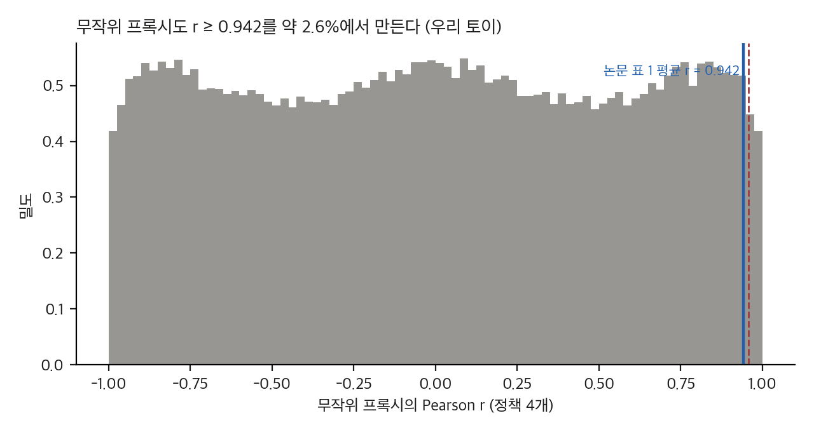
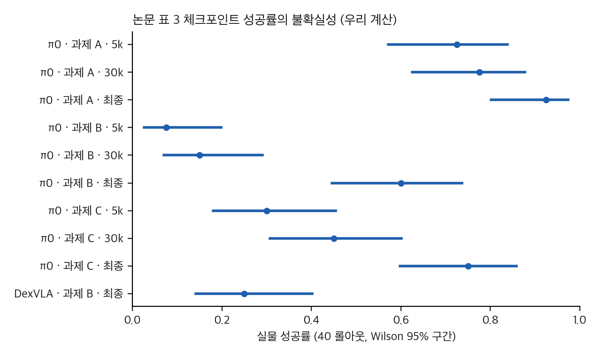

> **논문:** Yaxuan Li, Yichen Zhu, Junjie Wen, Chaomin Shen, Yi Xu. *WorldEval: World Model as Real-World Robot Policies Evaluator.* arXiv:2505.19017 (v1, 2025-05-25). 본문에 "Preprint. Under review."라고 적혀 있고, 학회 표기는 확인하지 못했습니다.
> 공식 코드(MIT)는 정적으로만 읽었고 실행하지 않았습니다. 논문 그림은 싣지 않고, 우리가 만든 그래프만 씁니다. 논문의 라이선스는 CC BY 4.0입니다.

## 논문이 묻는 것

실물 로봇 정책을 평가하려면 시간과 장비가 많이 듭니다. 이 논문은 영상 생성 세계모델을 정책 평가기로 쓰자고 제안합니다. 정책 네트워크 내부의 잠재 행동 벡터를 영상 모델의 조건으로 넣으면, 같은 장면에서 정책이 할 행동을 영상으로 그릴 수 있다는 주장입니다. 생성 영상의 성공 여부는 Gemini-2.0이 판정하고, 그 순위를 실물 성공률 순위와 비교합니다.

## 이 글에서 확인한 것

**표 1 평균은 맞습니다.** 과제 3개와 정책 4개에서 WorldEval의 Pearson r 평균 0.942, MMRV 0.044가 표 값과 일치합니다. 실물 시뮬레이터 평가는 r 0.411, MMRV 0.261입니다.

**정책 4개로는 상관이 불확실합니다.** 정책이 4개면 양측 p < 0.05 임계는 |r| = 0.950입니다. 과제 중 Strike Block(0.887)은 이 임계를 넘지 못합니다. 무작위 값을 넣어도 r ≥ 0.942가 나오는 비율은 약 2.6%입니다(토이).

그래프: 무작위 프록시가 정책 4개에서 만드는 Pearson r의 귀무 분포와 논문 표 1 평균 0.942. 우리가 시뮬레이션으로 그렸습니다.

**체크포인트 성공률은 정수로 맞습니다.** 부록 표 3의 성공률은 모두 40회 시행 중 성공 수입니다. π0 과제 B는 5k에서 3/40, 최종에서 24/40이고 Fisher 정확검정 p ≈ 8.5 × 10⁻⁷입니다. 과제 A의 5k에서 30k 사이 차이는 p ≈ 0.80이라 구분되지 않습니다.

그래프: 논문 표 3의 체크포인트별 성공률(40회 시행)과 Wilson 95% 구간. 우리가 계산했습니다.

**판정기 정확도가 없습니다.** 성공 판정이 Gemini-2.0에서 나오는데, 판정기의 참·거짓 오류율을 보고하지 않습니다. 순위는 대칭 오차라면 유지되지만, 오차가 정책마다 다르면 상관이 흔들립니다.

**논문 문장과 코드의 차이가 있습니다.** 논문은 MMRV 차이를 "2.24"라고 쓰는데 표에서는 0.224입니다. 공식 코드는 행동 청크를 시간축으로 평균낸 뒤 조건으로 넣습니다. 같은 평균을 가진 두 궤적은 같은 조건을 받습니다(토이). 공식 저장소에는 정책 임베딩 추출기와 평가 파이프라인이 없습니다.

## 이 맥에서 구현할 수 있는가

**핵심 학습과 평가는 불가능합니다.** 14B 영상 모델의 LoRA 학습은 논문 기준 8× H800에서 약 11시간이며, 이 맥에서는 가중치를 올리는 것부터 어렵습니다. 실물 실험과 RoboTwin 비교도 GPU와 외부 API가 필요합니다.

**가능한 것은 부분 검증입니다.** 표 재계산, 정책 수에 따른 상관의 불확실성 계산, 행동 조건 경로의 소형 토이는 CPU에서 됩니다. 판정기 정확도 측정은 외부 API 호출이 필요하므로 실행 전에 확인이 필요합니다.

## 정리

WorldEval은 "세계모델을 정책 평가기로 쓸 수 있다"는 가능성을 실물 데이터로 보여 준 논문입니다. 다만 근거의 규모가 작습니다. 정책 4개, 과제 3개, 판정기 검증 없음이라는 조건에서 얻은 상관을 그대로 믿기는 어렵습니다. 다음 단계로는 정책 수를 늘리고 판정기를 라벨된 영상으로 먼저 검증하는 설계가 필요합니다.

## 자료

- [통합 리포트 PDF](report/report_public.pdf)
- [WorldEval: World Model as Real-World Robot Policies Evaluator — 논문 분석 (arXiv:2505.19017)](analysis/01_paper_analysis.md)
- [WorldEval 선행연구와 관련 자료 (02)](analysis/02_prior_work.md)
- [WorldEval 수치 재계산과 토이 검증 (03)](analysis/03_analysis.md)
- [WorldEval 공식 코드 대조 (04)](analysis/04_code_verification.md)
