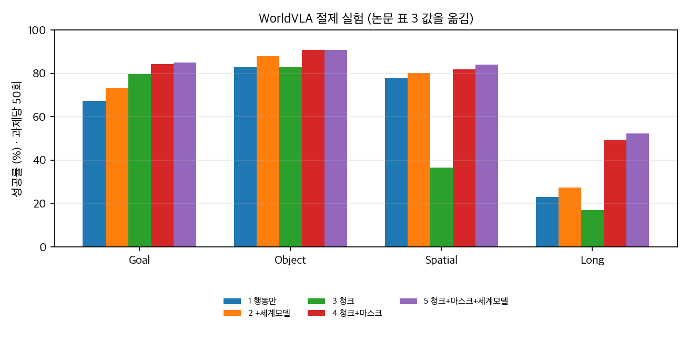
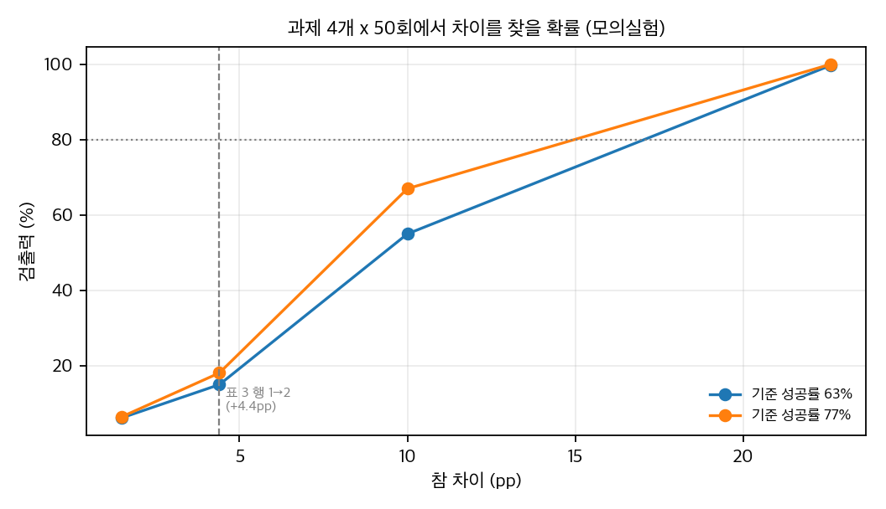

> **논문:** Jun Cen 외 12인. *WorldVLA: Towards Autoregressive Action World Model.* arXiv:2506.21539 (v1, 2025-06-26). 학회는 NeurIPS 2026 poster 페이지에서 확인했지만, 제목과 요약 일부가 arXiv 버전과 달라 같은 논문인지는 확정하지 못했습니다.
> 라이선스는 **CC BY-NC-SA 4.0**입니다. 논문 그림은 싣지 않고, 우리가 그린 그래프 두 장만 씁니다. 공식 코드는 Apache 2.0이며 정적으로만 읽었습니다.

## 논문이 묻는 것

VLA 모델은 행동을 출력으로만 다루고, 세계 모델은 행동을 입력으로 받아 다음 장면을 예측합니다. WorldVLA는 한 자기회귀 Transformer가 두 역할을 함께 하도록 만듭니다. 이미지, 텍스트, 행동을 모두 이산 토큰으로 바꾸고 같은 어휘에 넣습니다. 행동을 만들 때는 이미지와 지시문을 보고, 영상을 만들 때는 이미지와 행동을 봅니다.

이 논문의 주장은 두 가지입니다. 하나는 두 역할을 섞어 학습하면 서로 도와 성능이 오른다는 것입니다. 다른 하나는 행동을 여러 개(청크) 자기회귀로 만들면 뒤의 행동이 앞 행동의 오류를 물려받으므로, 청크 사이의 어텐션을 가려야 한다는 것입니다.

## 확인한 것: 가장 강한 증거는 마스크

LIBERO 네 과제(Spatial, Object, Goal, Long)에서 절제 실험(논문 표 3)의 평균 성공률을 다시 계산했습니다. 평균은 모두 논문 표와 맞았습니다.

- 마스크 없이 청크를 쓰면 평균 54.0%입니다. 마스크를 쓰면 76.6%입니다. 차이는 +22.6pp이고, 두 비율 검정에서 p<0.001입니다. Spatial은 +45.1pp, Long은 +32.4pp입니다.
- 청크 없이 행동만 학습한 행과 세계 모델을 더한 행의 차이는 +4.4pp입니다. 청크와 마스크가 있는 행에서는 +1.5pp입니다. 두 값 모두 과제당 50회의 롤아웃으로는 유의하지 않습니다.

*그래프: 논문 표 3의 다섯 행을 과제별로 옮겼습니다(논문 값, 우리가 그림). 막대 높이는 과제당 50회 롤아웃의 성공률입니다.*

## 확인한 것: 검출력이 부족하다

과제당 50회에서 성공률 p의 95% 반폭은 p=0.85일 때 약 ±10pp입니다. 네 과제를 합쳐 200회로 봐도, 기준 성공률이 70% 근처라면 80% 검출력을 얻으려면 약 13pp 차이가 필요합니다. 논문이 보고한 +4.4pp는 이 설계로는 검출력이 약 15–18%입니다.

*그래프: 평균 성공률 차이를 95% 수준에서 찾을 확률을 모의실험한 결과입니다(독립 가정, 우리가 그림).*

## 본문과 표가 맞지 않는 곳

- **서론의 FVD 10% 감소.** 표 4를 보면 50프레임에서 FVD가 718.6에서 674.1로 6.2% 줄었고, 10프레임에서는 250.0에서 255.1로 늘었습니다.
- **서론의 "청크에서 성공률이 10–50% 떨어진다".** 청크를 쓴 행과 쓰지 않은 행을 비교하면 Goal은 오히려 12.3pp 올랐습니다. 떨어진 것은 Spatial(−41.1pp)과 Long(−6.1pp)입니다.
- **표 5와 표 6의 지표.** 표 5의 2프레임 값 84.4는 표 3의 행 4 Goal 성공률과 같아서, 기본 설정(행 5)과 다른 설정의 값으로 보입니다. 표 6의 "사전학습" 행은 표 3의 행 2와 과제별 값이 다릅니다.

## 코드와 논문의 차이

공식 저장소의 링크는 후속 모델 RynnVLA-002로 이어집니다. v1 코드는 `worldvla` 브랜치에 있고, 그 브랜치의 LICENSE는 Apache 2.0입니다.

- **손실 가중.** 논문 식 (4)는 행동 손실과 영상 손실을 α=0.04로 섞는다고 씁니다. 코드는 영상 토큰 한 개의 가중치를 0.04로 두고 PyTorch의 가중 평균으로 정규화합니다. 두 방식은 샘플 구성에 따라 상대 가중이 몇 배 다를 수 있습니다.
- **학습 설정.** 학습률(5e-6), 배치(GPU 2장, 장당 8), 에포크(40), 가중치 감쇠(0.1) 같은 설정은 논문에 없고 코드에만 있습니다. 코드에는 논문에 없는 z-loss 항(1e-5)도 있습니다.
- **데이터 분할.** 논문은 궤적 90% 학습, 10% 검증이라고 씁니다. 코드에는 과제 단위의 외부 검증 세트가 추가로 있습니다.

## 재현할 수 있는가

이 맥(Apple M4 Pro, 24 GiB, CUDA 없음)에서는 논문 수치를 전체 재현할 수 없습니다. 7B 백본 학습이 필요하기 때문입니다. 맥에서 할 수 있는 일은 세 가지입니다. 표를 다시 계산하는 일(완료), 마스크 함수가 설계대로 블록을 가리는지 CPU에서 단위 검증하는 일, 행동 256 bin 이산화가 정밀도를 얼마나 깎는지 toy로 보는 일입니다.

## 정리

WorldVLA에서 남길 것은 청크 어텐션 마스크입니다. 효과가 크고 여러 과제에서 일관되었습니다. 세계 모델이 행동을 돕는다는 주장은 이 실험 설계로는 확인되지 않았습니다. 재현하려면 학습 설정을 코드에서 가져오고, 손실 가중 방식을 명시하고, 롤아웃을 훨씬 늘려야 합니다.

---

*이 글의 수치는 논문 표를 옮기고 다시 계산한 것입니다. 공식 코드는 정적으로 읽었고 실행하지 않았습니다. 분석 문서와 스크립트는 `analysis/`에 있습니다.*

## 자료

- [통합 리포트 PDF](report/report_public.pdf)
- [01. 논문 분석: WorldVLA (arXiv:2506.21539 v1)](analysis/01_paper_analysis.md)
- [02. 선행 연구, 코드·라이선스, 학회 확인](analysis/02_prior_work.md)
- [03. 수치 재계산, 일관성 검사, 통계적 불확실성](analysis/03_analysis.md)
- [04. 논문 ↔ 공식 코드 대조 (정적 읽기)](analysis/04_code_verification.md)
