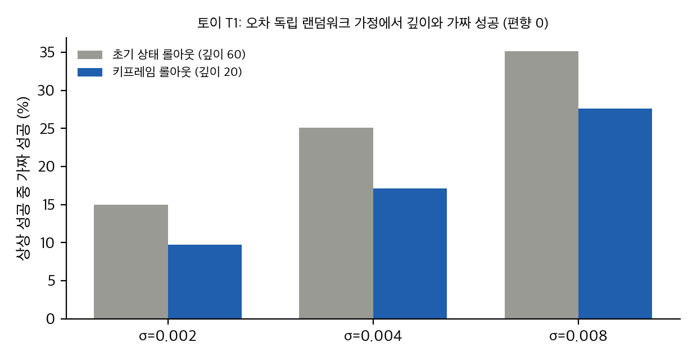
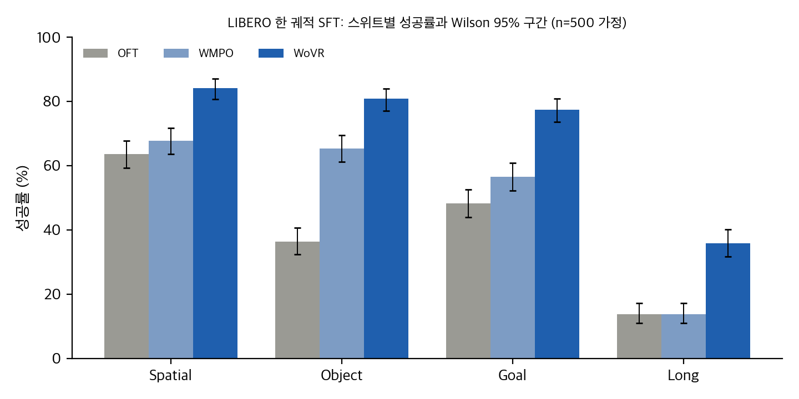

> **논문:** Zhennan Jiang 외. *WoVR: World Models as Reliable Simulators for Post-Training VLA Policies with RL.* CoRL 2026 포스터, arXiv:2602.13977 (v3, 2026-11-05).
> 공식 코드는 GitHub RLinf/RLinf(Apache-2.0)와 youmo445/diffsynth-studio-rlinf(Apache-2.0)에 있습니다. 이 글의 그림은 우리가 그린 그래프 두 장입니다. 논문 그림은 넣지 않았습니다(arXiv 비배타적 배포 라이선스).

## 논문이 묻는 것

VLA 정책을 실제 로봇에서 강화학습하려면 시도가 너무 많이 필요합니다. 그래서 학습된 영상 세계모델을 시뮬레이터로 쓰는 방법이 나오고 있습니다. 문제는 상상 속 롤아웃이 점점 틀어진다는 것입니다. 틀어진 상상에서 성공 신호가 나오면 정책은 실제 과제가 아니라 모델의 오차를 학습합니다. WoVR는 세계모델이 충실하다고 가정하지 않고, RL이 불완전한 상상과 어떻게 상호작용할지를 바꿉니다.

세 장치가 있습니다. 첫째, 행동을 두 경로로 넣고 첫 프레임을 앵커로 쓰는 Wan2.2-TI2V-5B 기반 세계모델입니다. 둘째, 임계 상태 근처에서 짧게 상상을 시작하는 키프레임 롤아웃(KIR)입니다. 셋째, 정책이 바뀐 뒤 세계모델을 낮은 빈도로 다시 학습하는 PACE입니다.

*우리가 만든 토이 실험(numpy)입니다. 오차가 독립 랜덤워크로 쌓인다는 가정에서 롤아웃 깊이 60과 20의 차이만 봅니다. 논문의 효과 크기를 검증하지 않습니다.*

## 이 글에서 확인한 것

**1. LIBERO 개선은 크고, 기준선은 WMPO입니다.** 한 궤적 SFT에서 WoVR는 평균 69.5%, WMPO는 50.9%입니다. 스위트당 평가 500회를 가정하면 이 차이는 샘플링 오차로 설명하기 어렵습니다. 다만 학습 시드 분산이 빠져 있습니다. 풀 SFT에서는 96.0% 대 92.4%로 차이가 3.6점입니다.

*논문 표 2의 수치를 다시 그렸습니다. 평가 에피소드 수는 논문에 없어 500으로 가정했습니다.*

**2. PACE는 같은 데이터량에서도 효과가 보입니다.** 기본 정책 데이터 2,500 궤적만 쓴 77.5%와 1,500 궤적 + 정렬 1,000 궤적의 82.5%를 비교하면 p ≈ 0.005입니다. 그러나 실로봇 실험에서는 PACE를 쓰지 않았습니다.

**3. KIR의 기여는 약합니다.** KIR를 빼면 79.7%로 2.8점 떨어집니다(p ≈ 0.11). 이 차이는 시드 분산 수준일 수 있습니다.

**4. 실로봇 체크포인트를 평가 결과로 골랐습니다.** 부록 F.4에 따르면 SFT 체크포인트 중 실로봇 평가가 가장 좋은 것을 RL 초기값으로 썼습니다. Franka의 개선(평균 51.1% → 80.0%)은 방향이 확실하지만, AgileX에서 WoVR와 WMPO의 차이는 유의하지 않습니다(26/90 대 17/90).

**5. 공식 코드와 논문의 차이.** RLinf 저장소에는 키프레임 파일을 읽는 코드는 있지만 만드는 코드는 없습니다. 재학습 루프도 없습니다. 보상도 논문의 이진 보상(임계 0.5)과 달리 차분 보상에 임계 0.9를 씁니다. RLinf 문서는 v1 수치를 싣고 있습니다.

## 구현할 수 있을까

이 맥(M4 Pro, 24 GiB, CUDA 없음)에서는 논문 수치를 재현할 수 없습니다. LIBERO 세계모델 RL 학습은 GPU 여러 장이 필요하고, 실로봇 데이터는 공개되지 않았습니다. 공식 세계모델로 롤아웃 한 번을 만드는 것은 가중치 다운로드와 MPS 포팅 뒤에 가능할 수 있습니다. 소형 세계모델과 키프레임 롤아웃, 재정렬 루프를 직접 구현하는 것은 1–2주면 가능하다고 추정합니다(측정 전).

## 정리

WoVR는 "세계모델 RL에서 가짜 성공을 다룬다"는 질문을 실험으로 밀어붙였습니다. LIBERO의 큰 차이와 PACE의 데이터량 대비 효과는 흥미롭습니다. KIR의 기여와 실로봇 결과에는 더 많은 시드와 독립된 평가가 필요합니다.

## 자료

- [통합 리포트 PDF](report/report_public.pdf)
- [01. 논문 분석: WoVR (arXiv:2602.13977)](analysis/01_paper_analysis.md)
- [02. 선행연구와 관련 저장소](analysis/02_prior_work.md)
- [03. 수치 재계산, 일관성 검사, 토이 실험](analysis/03_analysis.md)
- [04. 공식 코드 대조와 구현 가능성](analysis/04_code_verification.md)
