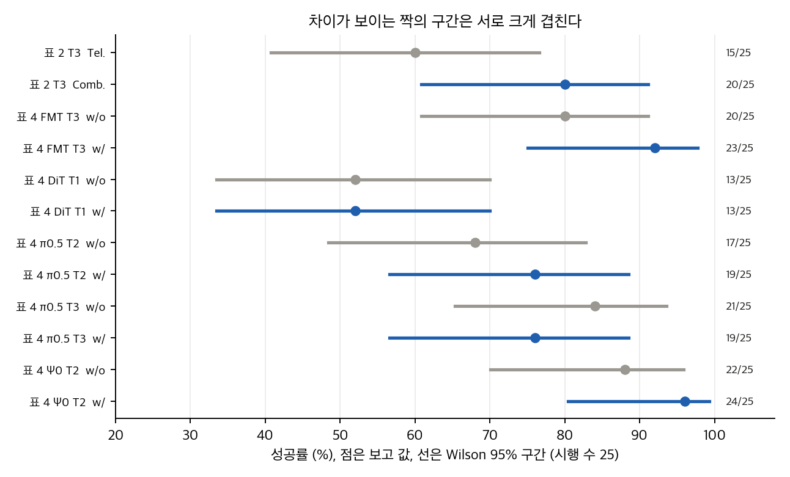
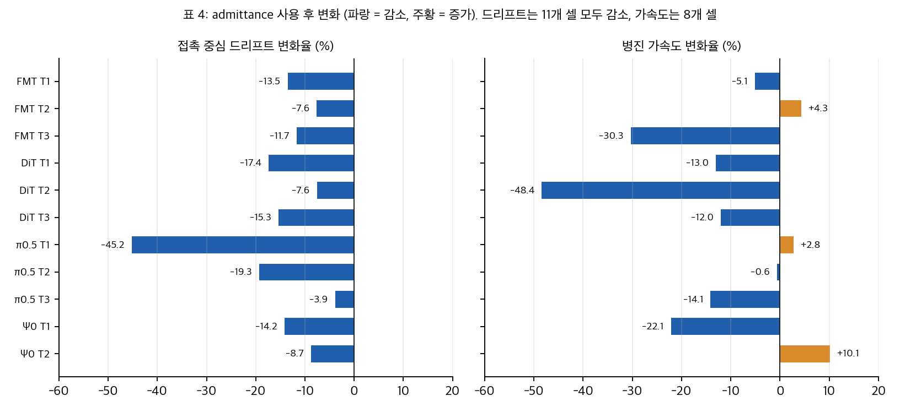
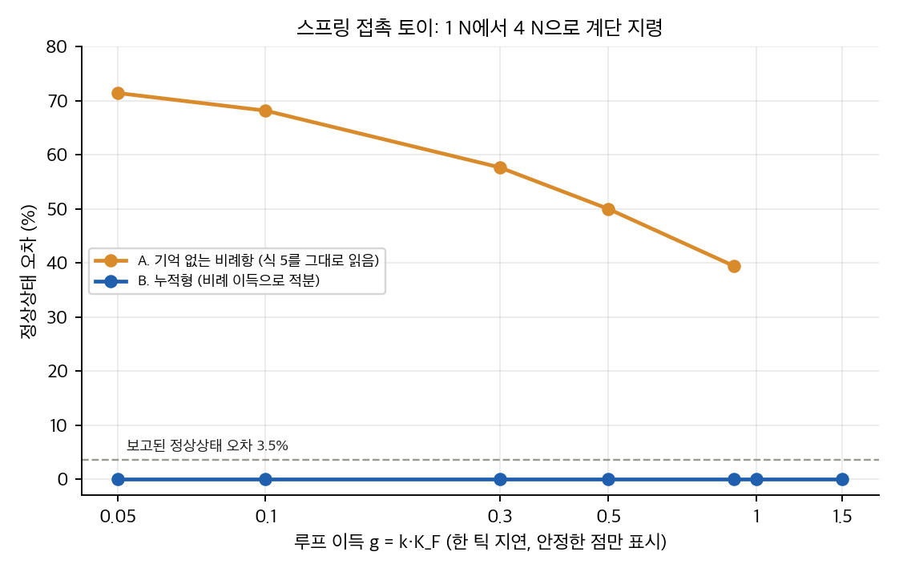

# 03. 수치 재계산, 일관성 검사, 토이

표 1–5와 본문·부록의 서술 수치를 옮겨 다시 계산했습니다(`analysis/recompute.py`, 결과 `recompute_results.json`, numpy·scipy·statsmodels, 수 초). 학습이나 실험은 하지 않았고, 토이 하나(`analysis/toy_admittance.py`, 1초 미만)만 돌렸습니다. 번호는 재계산 V1–V14, 일관성 K1–K15, 토이 T1입니다.

**전제.** 시행 수는 논문 §5.2와 부록 8.6에 있는 "설정당 과제마다 N = 25회"를 씁니다. 지표(드리프트, 힘, 가속도)는 평균만 보고되어 있어 분산이나 구간은 계산할 수 없습니다. 표 5는 시행 수가 없어 정수 해만 찾았습니다. 성공률 검정은 설정마다 독립 시행이라고 가정한 Fisher 정확 검정이고, 같은 조건의 반복이 아닌 시행 사이 짝지음(초기 조건)은 알 수 없습니다.

## 1. 정수 격자 (V1)

표 2와 표 4의 성공률 30칸(표 2 6칸, 표 4 24칸으로 Ψ0 T3의 0 두 칸 포함)을 N = 25의 k/25 격자(4%의 배수)에 놓아 보았습니다.

- **29칸은 격자에 정확히 놓입니다**(100, 80, 60, 52, 68, 76, 84, 88, 92, 96, 0).
- **표 4 Ψ0 T2 w/o의 89%는 놓이지 않습니다.** 22/25 = 88%, 23/25 = 92%입니다. 같은 값이 프로젝트 페이지 표에도 있습니다(`04` C16, K1).

## 2. 표 2 서술 수치 (V2)

| 서술 (§5.2) | 재계산 | 판정 |
|---|---|---|
| Tel. 평균 성공률 86.7% | (100 + 100 + 60) / 3 = 86.7 (Comb. 93.3) | 일치 |
| 원격조종이 Comb. 대비 16.7, 14.0, 15.9% | 2.2/13.2 = 16.7, 2.2/15.7 = 14.0, 1.4/8.8 = 15.9 | 일치. 인간 자료는 11.0, 13.5, 7.4분으로 원격조종의 5.0, 6.1, 5.3배 |
| 드리프트가 Comb. 대비 평균 약 11% 큼 | Tel./Comb. − 1의 평균 11.2%. (Tel. 대비 Comb.가 줄어든 비율로는 9.9%, 과제별 2.29, 3.57, 1.01 mm) | 일치 (기준이 Comb.) |
| 평균 접촉 힘 약 2배 | 1.46, 3.06, 1.45배 → 평균 1.99 | 일치. 절대 값은 T2에서 0.17 → 0.52 N |
| 병진·회전 가속도 평균 46.3%, 41.5% 감소 | 23.0, 69.0, 47.0 → 46.3 / 11.5, 63.4, 49.5 → 41.5 | 일치. 과제 평균이며 T2가 크게 기여 |
| T3 성공률 +20% | 60 → 80 = +20 %p | 일치 (%p) |

## 3. 표 2 성공률 검정과 검정력 (V3)

| 비교 | Tel. | Comb. | Wilson 95% (Tel. / Comb.) | Fisher p |
|---|---|---|---|---|
| T1 | 25/25 | 25/25 | 86.7–100 / 86.7–100 | 1.0 |
| T2 | 25/25 | 25/25 | 86.7–100 / 86.7–100 | 1.0 |
| **T3** | **15/25** | **20/25** | 40.7–76.6 / 60.9–91.1 | **0.217** |
| 세 과제 합산 | 65/75 | 70/75 | 77.2–92.6 / 85.3–97.1 | 0.276 |

- T3 차이 +20 %p의 Newcombe 95% 구간은 −5.3 ~ +42.3 %p입니다.
- 60% 대 80%를 25회씩으로 구분할 검정력은 0.23(Fisher 정확 기각역)이고, 80% 검정력에는 팔당 약 82회가 필요합니다. 80% 대 92%는 약 131회, 88% 대 96%는 약 180회입니다(정규 근사).
- T1, T2는 양쪽 모두 25/25로 천장에 닿아 있어 Tel.과 Comb.를 성공률로 가를 수 없습니다. 성공률로 읽을 수 있는 비교는 T3 하나이고 이 시행 수에서는 방향만 확인됩니다.


<p class="cap">그림 A. 성공 횟수는 보고된 비율을 25회 격자로 되돌린 값이고, 점은 비율, 선은 Wilson 95% 구간입니다. 우리가 그린 그래프입니다.</p>

## 4. 표 3 서술 수치 (V4, ViT-FMT, admittance w/o → w/)

| 서술 (§5.3) | 재계산 (T1, T2, T3) | 판정 |
|---|---|---|
| 드리프트 평균 10.9% 감소 | −13.5, −7.6, −11.7 → 10.9 | 일치 |
| 접촉 힘 평균 +2.7% | +15.3, **−75.0**, +67.7 → +2.7 | 일치 (과제별 부호가 다름) |
| 병진 가속도 10.4% 감소 | 5.1, **−4.3**(증가), 30.3 → 10.4 | 일치 |
| 회전 가속도 9.0% 감소 | 8.5, **−7.8**(증가), 26.1 → 9.0 | 일치 |
| "모든 과제에서 일관되게 매끄러움 개선" | T2에서 병진·회전 모두 증가(1.87 → 1.95, 12.63 → 13.61) | 평균은 맞고 T2는 반대 (K6) |

표 3의 w/o 열은 표 2의 Comb. 열과 모든 칸에서 같고(`recompute_results.json` V4), 표 4의 ViT-FMT 행과도 같습니다.

## 5. admittance의 성공률 효과 (V5)

표 4의 w/o → w/ 성공률 11쌍(Ψ0 T3의 0/0 제외)을 25회 격자로 되돌려 검정했습니다.

| 백본 / 과제 | w/o | w/ | 차 (%p) | Fisher p |
|---|---|---|---|---|
| ViT-FMT T3 | 20/25 | 23/25 | +12 | 0.417 |
| π0.5 T1 | 22/25 | 23/25 | +4 | 1.0 |
| π0.5 T2 | 17/25 | 19/25 | +8 | 0.754 |
| π0.5 T3 | 21/25 | 19/25 | **−8** | 0.725 |
| Ψ0 T1 | 22/25 | 23/25 | +4 | 1.0 |
| Ψ0 T2 | 22/25 (89% 격자 밖, 88%로 환산) | 24/25 | +8 | 0.609 |
| 나머지 5쌍 (FMT T1, T2, DiT T1, T2, T3) | 같음 | 같음 | 0 | 1.0 |

- 올라간 쌍 5, 같은 쌍 5, 내려간 쌍 1(π0.5 T3). Holm 보정 후 모두 1.0입니다.
- 11개 층(과제 × 백본)을 합친 CMH 공통 오즈비는 1.25(95% 구간 0.76–2.07, p = 0.378)이고, 합계 성공은 w/ 232/275, w/o 225/275입니다. 부록 8.6의 "성공률은 대체로 변하지 않는다"는 서술과 일치합니다. admittance의 성공률 개선은 이 표에서 확인되지 않고, 확인되는 것은 아래 접촉 품질 지표입니다.

## 6. admittance의 접촉 품질 효과 (V6)

표 4의 11개 셀에서 w/o 대비 w/를 셉니다.

| 지표 | 낮아진 셀 | 비고 |
|---|---|---|
| 접촉 드리프트 | **11/11** | 11개 모두 같은 방향이면 독립 셀 가정의 부호 검정 p = 0.001. 감소율은 3.9–45.2%, 셀 평균 14.9% |
| 병진 가속도 | 8/11 | 증가한 셀: FMT T2(+4.3%), π0.5 T1(+2.8%), Ψ0 T2(+10.1%). 셀 평균 11.7% 감소 |
| 회전 가속도 | 8/11 | 셀 평균 11.3% 감소 |
| 평균 접촉 힘 | 올라간 셀 6, 같은 셀 2, 내려간 셀 3 | 논문은 힘을 "예측 기준을 추종한 조정"으로 서술. 높고 낮음이 목표가 아님 |

드리프트의 일관된 방향은 이 표에서 가장 강한 증거입니다. 지표별 분산이 없어 차이의 크기(예: T1에서 18.12 → 15.67 mm)를 시행 변동과 견줄 수는 없습니다. 드리프트 정의의 기준인 "센서 기하 중심"이 목표값인지(접촉이 중심에 있을수록 좋은지)는 논문이 설명하지 않습니다.


<p class="cap">그림 B. 표 4의 w/o에서 w/로의 상대 변화(파랑은 감소, 주황은 증가). 드리프트는 11개 셀 모두 감소, 병진 가속도는 8개 셀에서 감소합니다. 우리가 그린 그래프입니다.</p>

## 7. 백본 비교 (V7)

- **성공률(표 4의 w/ 열, 과제 세 개를 합친 75회).** ViT-FMT 73/75 대 ViT-DiT 51/75(p = 1.6e-6), π0.5 61/75(p = 0.0025), Ψ0 47/75(p = 5.7e-8). ViT-FMT의 우위는 시행 수로도 확실합니다(75회 합산, 과제 간 층화 없이). Ψ0는 T3에서 0/25입니다.
- **가속도 (§5.4).** 아래 표에서 §5.4 본문 값과 표 4에서 계산한 값을 비교합니다.

| 백본 | §5.4 본문 (병진 / 회전) | 표 4 w/ 열 평균 | 표 4 w/o 열 평균 | 같은 과제(T1, T2)만 w/ |
|---|---|---|---|---|
| ViT-FMT | 2.07 / 14.18 | 2.07 / 14.18 (일치) | 2.29 / 15.66 | 2.46 / 16.09 |
| ViT-DiT | 2.90 / 18.35 | 2.33 / 14.98 | 3.31 / 20.38 | 2.48 / 15.07 |
| π0.5 | 4.62 / 28.45 | 4.46 / 28.19 | **4.62** / 29.48 | 4.93 / 30.50 |
| Ψ0 (T1, T2만) | 3.38 / 22.83 | 4.36 / 28.02 | 4.57 / 29.59 | 4.36 / 28.02 |

ViT-FMT만 표 4와 정확히 일치합니다. π0.5의 병진 4.62는 w/o 열 평균과 같지만 회전 28.45는 어느 열과도 다릅니다. ViT-DiT와 Ψ0는 어느 열과도 맞지 않습니다(K3). 그리고 Ψ0는 T3 값이 정의되지 않아 두 과제로만 평균되므로 다른 백본과 같은 과제 집합이 아닙니다(K4). 과제를 T1, T2로 맞추면 ViT-FMT(2.46 / 16.09)와 ViT-DiT(2.48 / 15.07)의 가속도는 거의 같습니다.

## 8. 부록 8.6의 집계 값 (V8)

| 서술 | 재계산 | 판정 |
|---|---|---|
| ViT-FMT 성공률 평균 98.7% | 표 4 여섯 칸 평균 95.3(w/ 97.3, w/o 93.3) | 어느 평균과도 불일치 (K2) |
| 순위 FMT > π0.5 > ViT-DiT, Ψ0 | π0.5 80.7, ViT-DiT 68.0, Ψ0 60.8 (여섯 칸 평균) | 순서 일치 |
| admittance가 드리프트 약 17% 감소 | 11개 셀 평균 14.9, 백본별 평균의 평균 14.7, 평균 값끼리의 비 15.0 | 재현 안 됨 (K5) |
| 병진 약 14%, 회전 약 13% 감소 | 셀 평균 11.7, 11.3 / 백본별 평균의 평균 11.2, 10.9 / 값끼리의 비 11.2, 10.8 | 재현 안 됨 (K5) |

## 9. 표 5, 데이터 재생 (V9)

- 보고 성공률 89.29%는 25/28, 96.15%는 25/26으로만 나옵니다(분모 50 이하에서 유일한 해). **85.35%는 분모 50 이하의 k/n이 없고** 가장 작은 해가 134/157입니다. 시행 수가 논문에 없어 어느 단위(에피소드, 구간, 프레임)의 비율인지 알 수 없습니다(K8).
- 25/28 대 25/26을 가정하면 Fisher p = 0.612입니다(분모 가정). 85.35 → 89.29 → 96.15의 순차 상승은 이 자료로 방향만 말할 수 있습니다.
- 드리프트: 보정 + admittance는 보정 대비 −35.9%(17.88 → 11.46)로 서술과 일치합니다. 그런데 보정은 원시 원격조종 대비 +14.7%(15.59 → 17.88)이고, 보정 + admittance는 원시 원격조종 대비 −26.5%입니다(K9).
- 매끄러움: admittance 추가 시 병진 +13.7%(3.57 → 4.06), 회전 +6.4%(25.51 → 27.15)로 "moderate loss"의 크기를 환산할 수 있습니다.

## 10. 표 1, 힘 헤드 (V10)

- RMSE 1.05 N / 힘 RMS 5.56 N = 18.9%. 지연 151/68 = 2.22배(서술 "2.2×"와 일치).
- 힘 변화율 RMS는 예측이 실측의 0.638(인간), 0.647(원격조종)배입니다. 두 행의 예측이 같은 비율로 매끄러운 점은, 매끄러움 차이(원격조종 실측 5.23배 큼, 예측 5.29배 큼)가 헤드가 아니라 **데이터의 성질**임을 보입니다. 표 1은 "인간 데이터의 힘이 더 매끄럽다"를 보이고, 그것이 정책 성능을 올리는지는 표 2의 몫입니다.
- 교차상관 지연은 50 Hz에서 20 ms 단위이고 68 ms = 3.4 스텝, 151 ms = 7.55 스텝입니다(에피소드 평균). 예측 구간 400 ms에 비해 인간 68 ms, 원격조종 151 ms입니다.
- 평가 대조(마지막 힘 유지, 상수 예측)가 없어 RMSE 1.05 N이 얼마나 좋은지의 기준은 힘 RMS 5.56 N뿐입니다.

## 11. 힘 헤드 매개변수 하한 (V11)

부록 8.4는 힘 헤드를 "2층, 4헤드, D = 320 TransformerDecoder, 총 0.5M 매개변수"로 서술합니다. 자기 어텐션과 교차 어텐션을 모두 갖는 표준 디코더 층의 매개변수를 세면(편향과 LayerNorm 포함):

| 피드포워드 폭 | 2층 합계 |
|---|---|
| 어텐션 두 개만 (FFN 제외) | 1,643,520 |
| FFN 폭 = D = 320 | 2,058,240 |
| FFN 폭 = 4D = 1280 | 3,288,960 |
| FFN 폭 2048 (PyTorch 기본) | 4,273,536 |

FFN을 제외한 어텐션 두 개만으로도 1.64M이므로 보고된 0.5M의 약 3.3배(FFN 폭 D일 때 4.1배)입니다. 위치 질의 20 × 320은 6,400개로 영향이 작습니다. 교차 어텐션 하나만 있는 구조라도 2층이면 약 1.2M입니다(K11). 어텐션의 입출력 투영이 D × D가 아니거나(예: 낮은 차원 투영), 보고 단위가 다를 가능성이 있어 저자 확인이 필요합니다.

## 12. 게이트 임계값과 접촉 힘 수준 (V12)

- 보정 모듈은 f_threshold = 0.5 N(부록 8.4)보다 큰 힘이 있는 손에만 오프셋을 줍니다. T2 베개의 평균 접촉 힘은 Tel. 0.17, Comb. 0.52, admittance 후 0.13 N으로 게이트 근처 또는 아래입니다. 평균이 접촉이 필요한 구간의 값이므로 순간 값은 더 넓게 분포하겠지만, 이 과제에서는 게이트가 켜지고 꺼지는 경계에 놓일 수 있습니다(K10). T3(0.66, 0.96 N)도 0.5 N의 1.3–1.9배입니다.
- f_max = 20 N, 보정 범위 0–25 N, 인간 T1 힘 RMS 5.56 N. 팔뚝·가슴은 힘 보정이 없습니다(부록 8.1).

## 13. 협동 과제 자료량과 제어 수치 (V13, V14)

- 보 56개 × 약 15초 = 약 14.0분, 테이블 45개 × 약 15초 = 약 11.2분(부록 8.5). 시행 수와 성공률은 보고되지 않았습니다.
- 보 8.72 N(약 0.89 kg), 테이블 39 N(약 3.98 kg)입니다. 평가 과제 T1–T3 물체의 무게는 논문에 없습니다.
- 50 Hz × 20 스텝 = 400 ms, 조건 열 2 × 20 = 40 토큰, π0.5·Ψ0의 12 Hz = 83.3 ms(서술 83 ms와 일치)로 구조 수치끼리는 맞습니다.
- 그림 8의 3.5%는 4 N 목표에서 약 0.14 N, 1 N 목표에서 약 0.035 N입니다. 센서 분해능은 논문에 없습니다.

## 14. 일관성 검사 (K1–K15)

위치는 논문 절·표 번호입니다. "관측"은 관측된 값의 관계이고, 원인은 가능성으로만 적었습니다. 저자 확인이 필요한 항목은 마지막 열에 표시했습니다.

| # | 위치 | 관측 | 확인 필요 |
|---|---|---|---|
| K1 | 표 4 Ψ0 T2 w/o | 89%는 25회 격자(88, 92)에 없음. 프로젝트 페이지도 같은 값 | 시행 수 또는 값 |
| K2 | 부록 8.6 | "ViT-FMT 98.7% on average"가 표 4의 평균(95.3; w/ 97.3; w/o 93.3)과 다름 | 집계 방법 |
| K3 | §5.4 대 표 4 | ViT-FMT만 표 4 w/ 평균과 일치. π0.5 병진 4.62는 w/o 평균과 같고 회전 28.45는 어느 열과도 다름. ViT-DiT 2.90 / 18.35, Ψ0 3.38 / 22.83은 어느 열과도 다름 | 어느 실행의 값인지 |
| K4 | §5.4, 부록 8.6 | Ψ0는 T3이 정의되지 않아 T1, T2 평균인데 다른 백본은 T1–T3 평균. T3의 가속도는 ViT-FMT에서 가장 낮은 과제(1.29, 10.38)라 FMT에 유리한 집합. T1, T2로 맞추면 FMT 2.46 / 16.09와 ViT-DiT 2.48 / 15.07 | 과제 집합 |
| K5 | 부록 8.6 | "약 17%, 14%, 13%"를 표 4에서 재현하지 못함(셀 평균 14.9, 11.7, 11.3) | 집계 방법 |
| K6 | §5.3 | "consistently improves smoothness", "substantially improves"가 T2의 증가(병진 +4.3%, 회전 +7.8%)와 평균 감소 약 10% 및 접촉 힘 0.52 → 0.13 N과 함께 읽힘 | 서술 수위 |
| K7 | 부록 8.6 표 4 주석 | "§5.4와 별도 실행이라 값이 다를 수 있다"고 쓰지만 ViT-FMT 행은 §5.3 표 3, §5.2 표 2의 Comb. 값과 칸마다 같음(지표 4개 × 과제 3개 모두 동일) | 어느 행이 별도 실행인지 |
| K8 | 표 5 | 85.35%는 분모 50 이하 해가 없음(최소 134/157), 89.29 = 25/28, 96.15 = 25/26. 시행 단위와 수 미기재 | 분모 |
| K9 | 부록 8.7 서술 대 표 5 | 보정은 원시 원격조종보다 드리프트 +14.7%(15.59 → 17.88)인데 서술은 보정의 효과를 실행 가능성(성공률 85.35 → 89.29)으로 설명. 합산(보정 + admittance)은 드리프트 −26.5% | 단독 효과의 해석 |
| K10 | 부록 8.4 대 표 2, 3 | 게이트 0.5 N, T2 평균 접촉 힘 0.17 / 0.52 / 0.13 N | 게이트 값의 과제별 조정 여부 |
| K11 | 부록 8.4 | "총 0.5M"이 표준 구성의 하한 1.64M(어텐션만)과 다름 | 매개변수 세는 방식 |
| K12 | 표 4 | 접촉 힘이 w/o와 w/에서 소수 둘째 자리까지 같은 셀 2개(π0.5 T2 0.50/0.50, Ψ0 T2 2.50/2.50). 같은 행의 드리프트와 가속도는 다름 | 측정·반올림 |
| K13 | §3.3, §4 | 힘 헤드는 공유 인코더로 기울기를 보내는 구조(§3.3)인데 π0.5, Ψ0는 인코더 동결(§4). 이 두 모델에 힘 헤드를 붙이는 방식(폭 D = 320 외)은 서술이 없음 | 부착 방식 |
| K14 | §5.1 | 보류 시연 10개가 두 출처(인간, 원격조종) 각각인지 합산인지 서술 없음. 표 2의 T1 원격조종 자료가 2.2분이라, 합산이면 원격조종 행의 평가 시연이 소수일 수 있음 | 보류 시연 수 |
| K15 | §8.1, §8.4 | 보정 범위 0–25 N, 겔 패드는 포화 범위를 넓힌다고 서술되는데 f_max = 20 N | 상한 선택 |

일치하는 것들: §5.2의 86.7%, 16.7·14.0·15.9%, 2배, 46.3·41.5%, §5.3의 10.9·2.7·10.4·9.0%, ViT-FMT 2.07·14.18, 부록 8.7의 35.9%, 표 1의 2.2배, 12 Hz = 83 ms, 400 ms = 20 스텝, 표 2 = 표 3 w/o. 표 값의 산술 일치율은 높고, 어긋남은 부록의 집계 서술과 한 칸(K1)에 모여 있습니다.

## 15. 토이 T1: 식 (5)를 스프링 접촉에 놓으면

부록 8.8은 "비례 admittance 법칙"이 1 N → 4 N 계단 지령을 정상상태 오차 3.5% 이내로 추종한다고 보고합니다(그림 8). 식 (5)의 법선 항은 Δp_z = K_F (f_ref − f_meas)로 적혀 있습니다. 접촉을 스프링 f = k (x0 + Δp_z)로 두고(초기 접촉 1 N, 지령 4 N 단일 계단으로 단순화, 한 틱 지연 200 Hz), 식을 두 가지로 읽었습니다(`analysis/toy_admittance.py`, 결과 `toy_admittance_results.json`, 그림 `own_toy_admittance.png`). 루프 이득은 g = k K_F입니다.

| 읽기 | 정상상태 오차 | 안정 조건 | 3.5%에 필요한 이득 |
|---|---|---|---|
| A. 기억 없는 비례항 (매 틱 Δp = K_F e) | 3 / (4 (1 + g))로 g가 0.9일 때 39.5%, g → 1에서 약 37.5% | g < 1 | 약 20.4 (안정 범위 밖) |
| B. 누적형 (Δp ← Δp + K_F e) | 0 (g < 약 2에서 안정) | g < 2 | 필요 없음 |

그림 8(그림 판독 값)은 1, 2, 3, 4 N의 네 단계로 약 20초이고, 각 단계 뒤 힘이 수 초에 걸쳐 올라갑니다. 예를 들어 4 N 단계(약 11.7 s 시작)에서 처음 약 5초는 두 손 모두 약 3.0–3.9 N이고 약 17 s 이후에야 4 N 근처에 닿습니다. 즉시 응답하는 비례항보다 수 초에 걸쳐 쌓이는 응답에 가까운 모양이지만, 이 한 번의 기록만으로 구현을 가를 수는 없습니다. 해석: 3.5% 오차는 식 (5)를 한 틱마다 새로 계산하는 순수 비례항으로 읽으면 이 단순 모델에서는 나올 수 없고, 누적(적분 작용)이 있거나 센서·로봇 동역학이 토이와 다른 경우에 가능합니다. 이것은 논문이 틀렸다는 결과가 아니라 **식 (5)의 표기가 구현을 특정하지 못한다**는 결과입니다. 한계: 관절 추종, IK, PD, 센서 필터, 겔 패드의 비선형, 지연의 실제 크기를 넣지 않았고, K_F, K_R의 값이 논문에 없어 이득의 크기를 비교할 수 없습니다. 실제 구현의 확인에는 코드가 필요합니다.


<p class="cap">그림 C. 토이 T1. 매 틱 순수 비례항(A)은 안정한 이득 범위에서 37% 이상의 정상상태 오차를 남기고, 누적형(B)은 0입니다. 우리가 그린 그래프입니다.</p>

## 16. 재실행

```bash
python3 analysis/recompute.py          # V1–V14, 결과 recompute_results.json
python3 analysis/toy_admittance.py     # T1, 결과 toy_admittance_results.json
python3 analysis/plot_figures.py       # 그래프 세 장 (report/figures/own_*.png)
```
