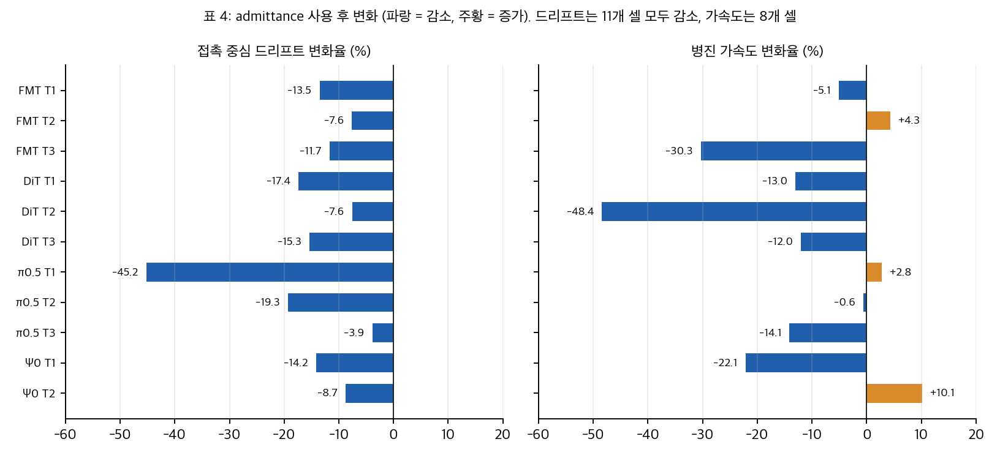
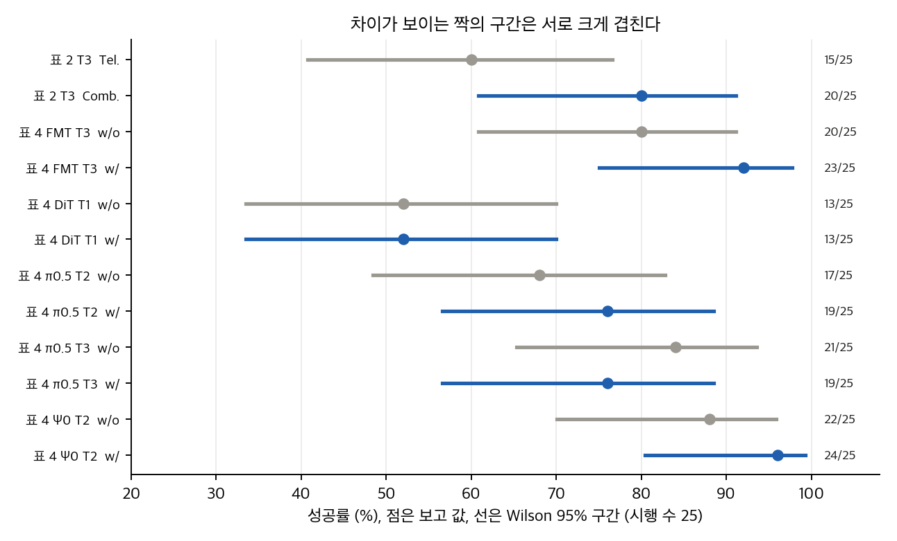
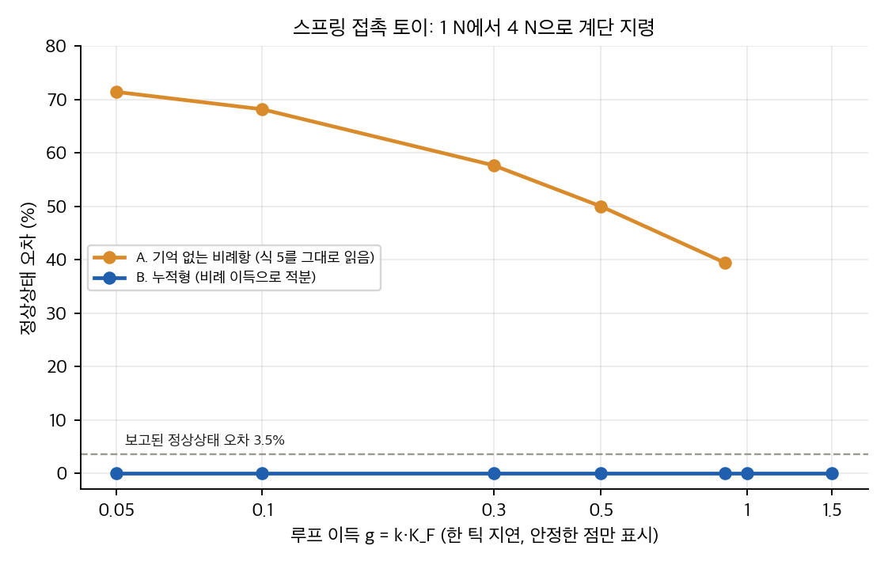

> **논문:** Jaehwi Jang, Zhaoyuan Gu 외 16명. *WT-UMI: Tactile-based Whole-Body Manipulation via Force-Supervised Contact-Aware Planning.* CoRL 2026 포스터, arXiv:2606.13232 (v1, 2026-06-11).
> 학습 코드는 아직 없습니다(프로젝트 페이지 "Code (Coming Soon)"). 하드웨어 설계(CAD, 기판, 부품 목록)만 별도 저장소로 공개되어 있습니다. 논문은 arXiv 비독점 배포 라이선스라서 논문 그림은 싣지 않고, 우리가 그린 그래프만 실었습니다.

## 논문이 묻는 것

큰 물체를 팔과 몸통으로 안아 옮기려면 여러 곳의 접촉 위치와 힘을 함께 조절해야 합니다. 사람 시연은 힘을 자연스럽게 조절하지만 로봇이 실행할 행동 라벨이 없고, 원격조종 시연은 라벨이 있지만 힘 조절이 덜 자연스럽습니다. WT-UMI는 같은 촉각 장치(가슴판, 팔뚝 덮개, 손에 쥐는 GripTac)를 사람과 휴머노이드(Unitree G1)가 함께 쓰게 하고, 세 가지를 얹습니다.

1. **목표 자세 보정.** 접촉 모드가 맞는 원격조종 구간과 사람 구간을 짝지어, 사람 손 자세를 로봇 목표 자세로 바꾸는 병진 오프셋을 학습합니다(접촉 중인 손에만 적용).
2. **힘 헤드를 가진 플래너.** 행동 디노이저와 독립된 교차 어텐션 헤드가 미래 법선 힘 궤적을 회귀하고, 둘은 인코더만 공유합니다.
3. **촉각 admittance.** 예측된 힘을 기준으로 접촉 중심과 법선 힘을 비례 보정합니다.

요가볼, 베개, 양동이 세 과제(설정당 25회)에서 평가하고, 사람과 함께 보와 테이블을 드는 두 과제는 부록에 성공 사례로 실었습니다.

## 이 글에서 확인한 것

**1. admittance의 접촉 드리프트 감소는 표 4의 11개 셀 모두에서 같은 방향입니다.** 셀 평균 −14.9%입니다. 병진·회전 가속도는 8개 셀에서 줄고 ViT-FMT의 베개 과제에서는 늘었습니다. 반면 성공률은 올라간 쌍 5, 같은 쌍 5, 내려간 쌍 1이고(시행 수 25 가정, 표 값을 k/25로 환산) 층화 공통 오즈비는 1.25(p = 0.38)입니다. 논문도 "성공률은 대체로 변하지 않는다"고 서술하므로, 이 표에서 admittance가 확인해 주는 것은 접촉 위치 쪽입니다. 지표별 분산이 없어 변화의 크기를 시행 변동과 비교할 수는 없습니다.

*그림 1. 표 4에서 admittance를 켠 뒤의 접촉 중심 드리프트와 병진 가속도의 상대 변화. 파랑은 감소, 주황은 증가입니다. 우리가 그린 그래프입니다.*

**2. 합친 데이터의 성공률 이득은 T3 한 과제에서 보입니다.** 원격조종만 15/25, 합친 데이터 20/25입니다(Fisher p = 0.217, 차이 +20 %p의 95% 구간 −5.3 ~ +42.3 %p). T1과 T2는 두 조건 모두 25/25입니다. 접촉 힘이 약 2배, 가속도가 46.3%와 41.5% 줄었다는 서술은 표에서 모두 재현됩니다. 다만 합친 데이터는 원격조종 자료의 6–7배(13.2분 대 2.2분 등)여서, 보정의 효과와 자료량이 함께 움직입니다. 보정하지 않은 사람 라벨을 쓴 정책이나 자료량을 맞춘 대조는 논문에 없습니다.

*그림 2. 표 2와 표 4에서 차이가 보이는 짝의 성공률(25회 가정)과 Wilson 95% 구간. 구간이 크게 겹칩니다. 25회씩으로 80% 대 92%를 구분하려면 팔당 약 131회가 필요합니다. 우리가 그린 그래프입니다.*

**3. 힘 헤드를 끈 대조와 외부 기준선이 없습니다.** 모든 변형이 힘 헤드를 포함하고, 힘 감독이 정책 성능을 올리는지는 표 1(예측 품질)로만 다룹니다. 초록의 "네 정책 기준선"은 같은 파이프라인 안의 백본(ViT-FMT, ViT-DiT, π0.5, Ψ0)이어서, UMI-FT나 ForceMimic 같은 외부 방법과의 비교는 아닙니다. 백본끼리의 성공률 차이는 분명합니다(w/ 열 75회 합산, ViT-FMT 73/75 대 ViT-DiT 51/75, p = 1.6e-6).

**4. 부록의 집계 서술과 표 4가 한 번에 이어지지 않습니다.** ViT-FMT의 성공률 평균 "98.7%"는 표 4 여섯 칸의 평균 95.3(admittance 켠 열만 97.3)과 다릅니다. "드리프트 약 17%, 병진·회전 약 14%와 13% 감소"는 셀 평균 14.9, 11.7, 11.3%에서 나옵니다. 5.4절의 가속도 값 중 ViT-FMT만 표 4와 일치하고, 나머지 세 백본은 표 4의 어느 열과도 맞지 않으며 Ψ0는 T3이 정의되지 않아 두 과제로 평균됩니다. 표 4의 Ψ0 T2 "89%"는 25회 격자(88, 92%)에 없습니다. 부록 표 4가 5.4절과 "별도 실행"이라는 주석이 있지만 ViT-FMT 행은 5.2절과 5.3절의 값과 같아, 어느 값이 어느 실행인지 저자 확인이 필요합니다.

**5. 표 5(데이터 재생)는 분모가 없고, 보정 단독의 드리프트는 원시 원격조종보다 큽니다.** 89.29%는 25/28, 96.15%는 25/26으로만 나오고 85.35%는 분모 50 이하에서 해가 없습니다. 보정은 원시 원격조종 대비 드리프트가 +14.7%(15.59 → 17.88 mm)이고, admittance를 더하면 11.46 mm입니다. 서술은 보정의 효과를 실행 가능성(성공률)으로 설명합니다.

**6. 힘 헤드 "0.5M 매개변수"와 게이트 0.5 N.** 부록 8.4는 D = 320, 2층 디코더(자기 어텐션과 교차 어텐션)를 0.5M으로 적습니다. 표준 구성으로 세면 어텐션 두 개만으로 1.64M이어서, 매개변수를 세는 방식을 저자에게 확인할 필요가 있습니다. 또 접촉 게이트의 임계값은 0.5 N인데, 베개 과제의 평균 접촉 힘은 0.17, 0.52, 0.13 N(원격조종, 합친 데이터, admittance 후)로 같은 크기입니다.

**7. 식 (5)의 표기가 구현을 특정하지 못합니다.** 부록 8.8은 "비례 admittance 법칙"이 1 N에서 4 N으로의 목표 변화를 정상상태 오차 3.5% 이내로 추종한다고 보고합니다. 스프링 접촉 토이(단일 계단, 한 틱 지연)에서 식 (5)를 매 틱 새로 계산하는 순수 비례항으로 읽으면 안정한 이득 범위에서 37% 이상의 오차가 남고, 누적형으로 읽으면 0이 됩니다. 논문의 그림 8은 수 초에 걸쳐 오르는 응답입니다(그림 판독). 이 토이는 관절 추종, IK, 센서 필터를 넣지 않았고 이득 값이 논문에 없어서, "구현이 어느 쪽인지" 저자 확인이 필요하다는 결론입니다.

*그림 3. 스프링 접촉 토이에서 루프 이득에 따른 정상상태 오차. 순수 비례항(주황)은 안정한 이득 범위에서 37% 이상이 남고 누적형(파랑)은 0입니다. 우리가 그린 그래프입니다.*

## 구현 가능성과 열린 질문

- 공개된 것은 하드웨어 설계(STEP CAD, 기판 거버 파일, 부품 목록, 조립 안내)입니다. 부품 목록 가격은 견적 품목을 뺀 합이 약 2,100 USD입니다. 학습 코드, 체크포인트, 시연 데이터는 없고, 두 저장소 모두 LICENSE 파일이 없습니다.
- 논문 결과의 재현에는 Unitree G1, 전신 촉각 센서, 시연 데이터, RTX 6000급 GPU가 필요합니다. 반면 힘 헤드, 접촉 게이트 보정, 폐루프 admittance를 합성 데이터에서 축소 구현하는 일은 노트북급 환경에서도 가능해 보입니다(노력 추정 3–4일, 측정 전).
- 저자 확인이 필요한 것: 부록 8.6의 집계 방법, 표 4의 Ψ0 T2 값, 표 5의 시행 수와 단위, 힘 헤드의 매개변수 수, 식 (5)의 이득과 누적 여부, 힘 헤드의 λ_F = 0 대조.

재계산 스크립트와 결과는 이 글과 함께 공개한 노트의 `analysis/`에 있습니다.

## 자료

- [통합 리포트 PDF](report/report_public.pdf)
- [01. 논문 분석: WT-UMI (arXiv:2606.13232)](analysis/01_paper_analysis.md)
- [02. 선행연구와 관련 저장소](analysis/02_prior_work.md)
- [03. 수치 재계산, 일관성 검사, 토이](analysis/03_analysis.md)
- [04. 주장 검증과 구현 가능성](analysis/04_claim_verification.md)
