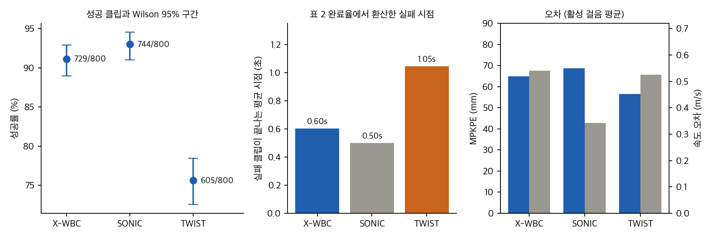
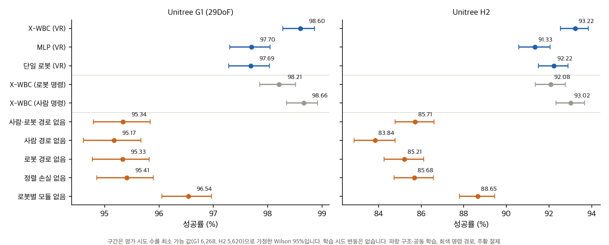
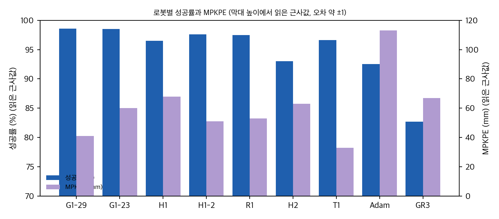
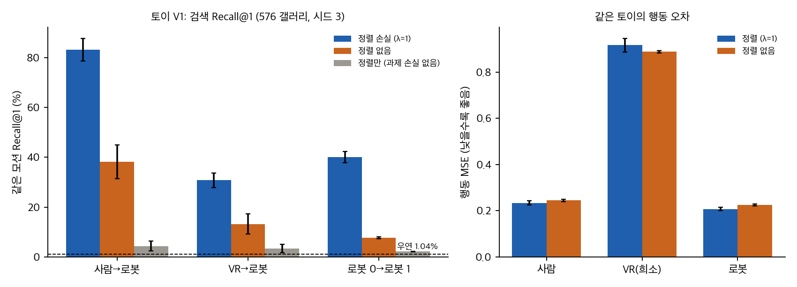

> **논문:** Juntong Zhang, Chun Gu, Li Zhang. *X-WBC: A Cross-Embodiment Foundation Model for Humanoid Whole-Body Control.* CoRL 2026 포스터, arXiv:2609.15213 (v2, 2026-10-25).
> 공식 저장소(GitHub LogosIntelligenceLab/x-wbc)는 프로젝트 페이지와 출시 예고만 있고 코드는 없습니다. 이 글의 그림은 모두 우리가 그린 그래프이며 논문 그림은 쓰지 않았습니다.

## 논문이 묻는 것

휴머노이드 전신 제어(WBC)는 보통 로봇 하나에 정책 하나를 학습합니다. X-WBC는 여러 로봇의 롤아웃을 한 PPO 배치에 섞어 **공유 인과 Transformer** 하나를 학습하고, 로봇마다 고유감각 인코더와 행동 디코더만 따로 둡니다. 명령은 사람 전신, 로봇 기준 모션, 희소 VR 5점 세 경로를 같은 토큰 공간에 정렬해 받습니다. 9종 로봇을 시뮬레이션에서 함께 학습하고 Unitree 4종에서 시연합니다.

## 이 글에서 확인한 것

**1. TWIST 대비 격차는 확실하고 SONIC과의 차이는 검정할 수 없습니다.** 외부 모션 100STYLE 800 클립에서 X-WBC는 729개, SONIC은 744개, TWIST는 605개를 완주했습니다. X-WBC와 TWIST의 +15.5 %p는 클립이 스타일별로 묶여 유효 표본이 8분의 1로 줄어도 p = 0.003입니다. 반면 SONIC과의 −1.9 %p는 같은 클립을 평가했으므로 짝지은 검정이 맞는데, 불일치 쌍 수가 없어 p가 6e-5에서 0.21까지 움직입니다.

*그래프 (우리가 그림). 표 2의 수치를 다시 그렸습니다. 가운데 패널은 평균 클립 완료율에서 환산한 값으로, 실패한 클립이 평균 0.5–1.05초에 끝납니다(추정).*

**2. 실패는 모두 시작 직후에 몰립니다.** 완료율 91.66%에서 거꾸로 풀면 X-WBC의 실패 클립은 평균 6%(약 0.6초) 지점에서 끝납니다. 세 시스템 모두 1초 안팎입니다. 점진적으로 쓰러지는 것이 아니라 클립 시작의 상태 전환에서 실패하는 쪽으로 읽힙니다. 이 값은 평균에서 낸 추정이고 논문은 이 점을 말하지 않습니다. 같은 계산으로 보면 "TWIST의 낮은 위치 오차는 일찍 끝난 클립 때문"이라는 설명도 걸음의 3.3%에만 해당해 힘을 잃습니다.

**3. 여러 로봇을 섞는 직접 효과는 약 1 %p입니다.** 표 1에서 G1은 98.60 대 단일 로봇 97.69, H2는 93.22 대 92.22입니다. 값들이 정수 비율로 맞아떨어지려면 평가 시도가 최소 8,000개쯤이어야 하고(추정), 그 표본으로는 평가 잡음으로 설명되지 않습니다. 그러나 학습 시드 수, 단일 로봇 기준선의 샘플 수와 계산량이 적혀 있지 않고, 9종 중 2종만 비교합니다. 같은 표에서 세 명령 경로를 함께 학습하고 정렬하는 구성의 효과(희소 VR 정책 SR 3.2–3.4 %p, H2에서 7.5–9.4 %p)가 훨씬 큽니다.

*그래프 (우리가 그림). 표 1의 성공률입니다. 구간은 평가 시도를 하한(G1 6,268, H2 5,620)으로 가정한 값이며 학습 시드 변동은 들어 있지 않습니다.*

**4. 로봇별 편차가 큽니다.** 그림 3 왼쪽 막대에서 읽은 값으로 GR3의 성공률은 약 83%, Adam의 MPKPE는 약 113 mm로 가장 나쁩니다. 공동 학습의 이득이 이런 약한 로봇에서 더 큰지는 검사하지 않았습니다.

*그래프 (우리가 그림). 논문 그림 3 왼쪽 막대에서 읽은 근사값입니다(오차 약 ±1). 논문 그림 자체는 넣지 않았습니다.*

**5. 검색 Recall@1은 정렬 손실이 최적화한 양을 되읽습니다.** 논문은 토큰 검색 정확도(교차 출처 94.2%, 교차 로봇 76.1%)를 "모션 정체성이 공유된다"는 증거로 듭니다. 하지만 정렬 손실은 같은 클립의 토큰끼리의 거리를 직접 줄이는 항이고, 정렬 없이 학습한 모델과의 대조는 없습니다. 합성 데이터의 작은 토이(로봇 3대, 지도 회귀, 약 1분)에서 정렬 손실은 교차 로봇 검색을 7.7%에서 40.1%로 올렸지만 행동 오차는 4–7% 안에서만 움직였습니다. 정렬 손실만 쓰면 토큰이 붕괴해 검색이 우연 수준으로 돌아갑니다. 토이는 X-WBC를 재현한 것이 아니라 지표의 해석을 확인한 것입니다.

*그래프 (우리가 그림). 토이의 같은 모션 Recall@1(왼쪽)과 행동 MSE(오른쪽), 시드 3의 평균과 SD입니다.*

**6. 사소하지만 짚을 것들.** 학습 종료의 방향 한계 0.8은 전체 회전 0.8 rad(약 46도)이고 평가 종료의 0.8은 수직 투영 중력 성분 차이(기울기 약 78도)라서 뜻이 다릅니다. 보상 가중치와 커널 폭, 종료 한계는 BeyondMimic 공식 설정과 같지만 부록은 출처를 적지 않았습니다. H2에서 "격차가 더 크다"는 서술은 실패율 감소로 보면 G1이 더 큽니다. 표 2 SR의 반올림 규칙도 섞여 있습니다(91.125는 올림, 75.625는 내림).

## 구현 가능성

논문 수치의 재현은 개인 환경에서는 어렵습니다. 학습은 H100 8장으로 약 2일이고 데이터(BONES-SEED 288시간, 저장 약 759 GB)는 접근 승인이 필요하며, 코드와 체크포인트는 공개되지 않았습니다. 공유 Transformer와 로봇 ID 라우팅, 쌍별 정렬 손실의 구조는 약 4M 매개변수, 제어 한 스텝 약 4 MFLOP라 CPU에서도 구현할 수 있습니다.

## 재계산 자료

표 재계산(`analysis/recompute.py`)과 토이(`analysis/toy_alignment.py`), 점검 항목 K1–K23과 주장 C1–C16은 함께 올린 노트와 리포트에 있습니다.

## 자료

- [통합 리포트 PDF](report/report_public.pdf)
- [01. 논문 분석: X-WBC (arXiv:2609.15213)](analysis/01_paper_analysis.md)
- [02. 선행연구, 공식 저장소, 구성 요소별 출처](analysis/02_prior_work.md)
- [03. 수치 재계산, 일관성 검사, 토이 실험](analysis/03_analysis.md)
- [04. 주장 검증과 구현 가능성 (공식 코드 없음)](analysis/04_claim_verification.md)
