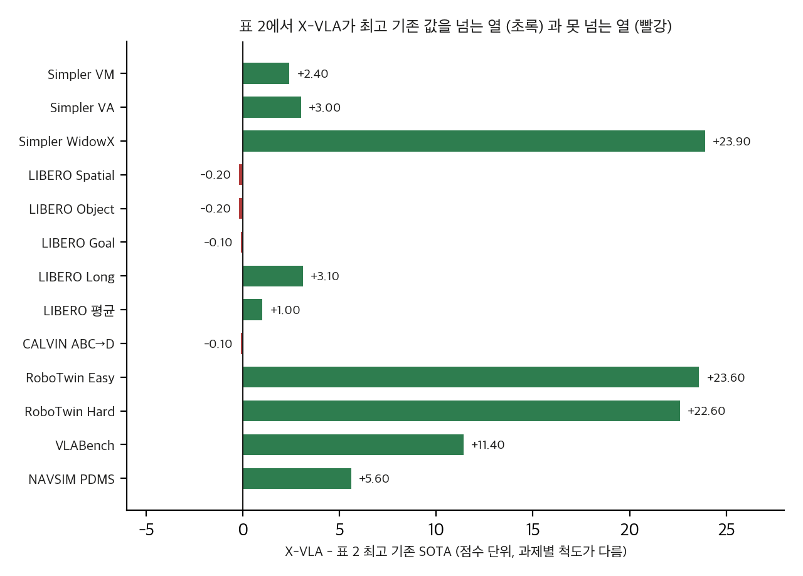
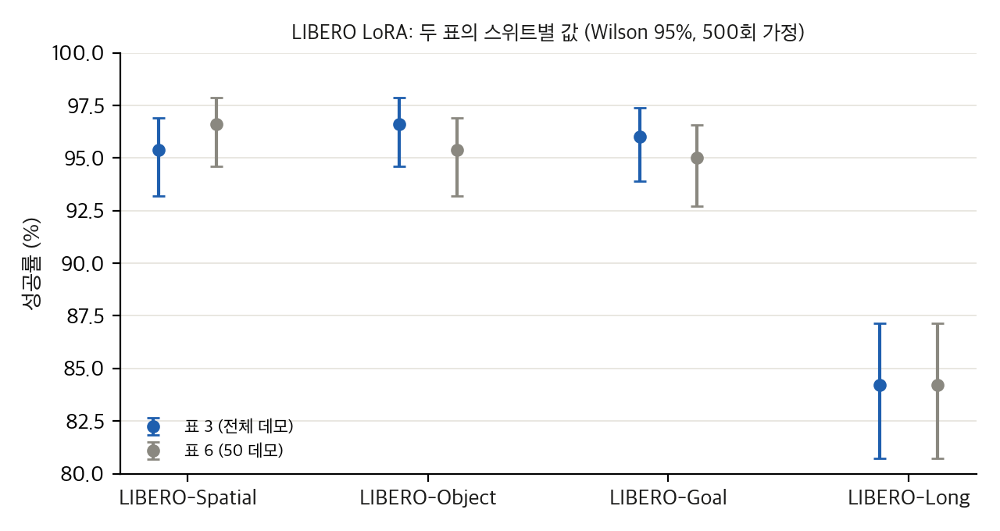

> **논문:** Jinliang Zheng, Jianxiong Li 외. *X-VLA: Soft-Prompted Transformer as Scalable Cross-Embodiment Vision-Language-Action Model.* ICLR 2026 포스터, arXiv:2510.10274 (v1, 2025-10-11, 하나뿐인 버전).
> 공식 코드(Apache-2.0, 2toinf/X-VLA)는 정적으로만 읽었고 실행하지 않았습니다. 논문 라이선스는 CC BY-NC-ND 4.0이라 논문 그림은 싣지 않고, 우리가 만든 그래프만 씁니다.

## 논문이 묻는 것

로봇 학습에서 데이터를 많이 모으려면 여러 로봇의 데이터를 한 모델에 넣어야 합니다. 그런데 로봇마다 팔의 개수, 카메라 배치, 과제 분포가 달라서 같은 모델에 넣으면 학습이 흔들리기 쉽습니다. 기존 VLA 대부분은 행동을 내는 출력층만 로봇별로 나눴습니다.

X-VLA는 다른 자리에서 해결합니다. 데이터 원천마다 학습 가능한 **소프트 프롬프트** 벡터를 하나씩 두고, 백본은 모든 원천이 공유합니다. 원천별로 추가되는 파라미터는 전체의 0.04%입니다. 백본은 Florence-Large 계열 VLM 인코더에 24층 Transformer를 얹은 흐름 정책이고, 0.9B 모델을 29만 에피소드로 사전학습한 뒤 새 로봇에 적응시킵니다.

## 이 글에서 확인한 것

**평균 열의 SOTA 주장은 맞습니다.** 표 2에서 Simpler 세 열, LIBERO 평균, RoboTwin Easy와 Hard, VLABench, NAVSIM 여덟 열에서 X-VLA가 열별 최고 기존 값을 넘습니다. 논문은 여섯 벤치마크 가운데 다섯 곳에서 SOTA라고 씁니다. 세어 보면 CALVIN을 뺀 다섯 곳입니다.

*그래프: 표 2에서 X-VLA 값에서 최고 기존 값을 뺀 차이 (초록은 넘는 열, 빨강은 못 넘는 열). 척도가 과제마다 달라 점수 차이만 비교합니다. 우리가 그린 그래프입니다.*

그러나 세부 스위트에서는 다릅니다. LIBERO Spatial (98.2 대 98.4), Object (98.6 대 98.8), Goal (97.8 대 97.9)과 CALVIN (4.43 대 4.53, FLOWER)에서는 X-VLA가 최고가 아닙니다. 초록의 "most suites"라는 표현이 이 점을 감춥니다.

**같은 설정의 두 표가 어긋납니다.** 표 3과 표 6은 모두 LoRA 9M 파라미터 PEFT의 LIBERO 결과입니다. 표 3 (전체 데모)은 Spatial 95.4, Object 96.6, Goal 96.0, Long 84.2입니다. 표 6 (50 데모)은 같은 설정이라고 적혀 있는데 Spatial 96.6, Object 95.4, Goal 95.0, Long 84.2입니다. 평균은 0.25점 차이라서 문제가 작아 보이지만, 스위트별 값이 서로 바뀌어 있어 열이 뒤바뀌었을 가능성이 있습니다.

*그래프: 표 3과 표 6 LoRA의 스위트별 값과 Wilson 95% 구간 (스위트당 500회를 가정). 두 값이 구간 안에서 겹칩니다. 우리가 그린 그래프입니다.*

**작은 불일치가 몇 개 더 있습니다.** CALVIN 표 14 값의 평균 길이는 4.414인데 표 2는 4.43이라고 씁니다. RoboTwin 50과제의 Hard 평균은 38.2인데 본문은 39.0입니다. NAVSIM PDMS는 표의 평균 성분으로 계산하면 X-VLA가 84.3, 기준선들도 3–5점 낮아서 열 정의나 PDMS 정의가 표준과 다른 것으로 보입니다.

**스케일링 주장은 약하게 받쳐집니다.** 모델 크기, 데이터 다양성, 데이터량에 따라 포화가 없다고 씁니다. 그림 5에 적힌 R²는 −0.925입니다. 음수 R²는 맞춘 직선이 평균보다 나쁘다는 뜻이라서 "포화가 없다"는 결론을 수치로 받치지 못합니다.

**Soft-Fold 데이터의 규모가 맞지 않습니다.** 논문은 1,200 궤적이라고 씁니다. 그런데 시간당 20–25 에피소드로 모았다면 48–60시간이 걸리는데 그림 11은 24시간이라고 씁니다. 공개된 HF 데이터셋 카드는 1,500 에피소드입니다.

## 논문 식과 공식 코드는 다른 목적입니다

논문 식 (2)는 흐름 정책의 속도장 v_θ를 A − A_0에 맞추는 flow matching입니다. 공식 코드 `modeling_xvla.py`는 네트워크 출력을 **깨끗한 행동 A와 직접 비교**합니다. 샘플링도 속도 적분이 아니라 `action`을 반복해서 덮어쓰는 x-예측 정제입니다. 두 방식은 같은 분포를 다른 매개화로 쓸 수 있지만, 논문과 코드의 목적이 다르다는 사실은 본문에 설명되어 있지 않습니다.

그리퍼 손실도 다릅니다. 논문은 그리퍼에 BCE를 쓴다고 하지만, 공식 코드의 AGIBOT 행동 공간은 그리퍼에 MSE를 씁니다. 사전학습 데이터의 약 49%가 AGIBOT이라서 이 차이는 작지 않습니다.

학습 레시피에도 빈칸이 있습니다. 소프트 프롬프트 길이는 논문에 없고 (코드 기본 32), 프롬프트와 VLM의 학습률 축소 배율은 적혀 있지 않습니다 (코드 기본 1.0, README 예시 0.1). weight decay는 논문 표 7에 0.01인데 코드 기본값은 0.0입니다.

## 이 맥에서 구현할 수 있는가

공식 저장소는 Apache-2.0이고, 사전학습 체크포인트 (3.5 GB, Apache-2.0)가 공개되어 있습니다. 그래서 **추론 확인은 현실적인 목표**입니다. LIBERO 스위트 하나의 LoRA 체크포인트로 표 3과 표 6 중 어느 쪽이 맞는지 확인할 수 있습니다. 설치와 MPS 포팅이 필요해서 노력은 2–3일로 보지만, 실제 측정 전 추정입니다.

반면 사전학습 (64 A100, 4일), LoRA 미세조정 (GPU), Soft-Fold 학습 (476 GB 데이터, 400K 스텝)은 맥에서 다시 할 수 없습니다. NAVSIM 평가 코드도 공개되어 있지 않아서 자율주행 결과는 이 저장소만으로 재현할 수 없습니다.

## 읽을 때 조심할 것

- 표 2의 기준선 수치는 원논문 값을 가져온 것으로 보이며, 같은 평가 조건에서 다시 돌린 결과인지 본문에 없습니다.
- 시드 수가 없습니다. 표마다 한 번 실행한 값인지, 여러 번의 평균인지 알 수 없어서 차이의 유의성을 말하기 어렵습니다.
- 논문 그림 5, 그림 7, 그림 9의 수치는 이미지에만 있어서 이 분석에서는 검산하지 못했습니다.
- 공식 저장소의 README는 HF 형식 변환 뒤 약 1%의 성능 하락이 있다고 씁니다.

## 정리

X-VLA의 아이디어 (원천별 소프트 프롬프트, 원천 가중 샘플링, 두 단계 적응)는 작고 실용적입니다. 평균 SOTA도 대체로 맞습니다. 다만 표의 세부 값과 코드·논문 목적 함수 사이에는 확인이 필요한 어긋남이 있습니다. 재현은 이 맥에서 어렵고, 추론 확인으로 표의 어긋남을 먼저 정리하는 것이 합리적입니다.

## 자료

- [통합 리포트 PDF](report/report_public.pdf)
- [01. 논문 분석: X-VLA (arXiv:2510.10274)](analysis/01_paper_analysis.md)
- [02. 선행연구와 관련 자료: X-VLA](analysis/02_prior_work.md)
- [03. 수치 재계산과 일관성 검사: X-VLA](analysis/03_analysis.md)
- [04. 논문 ↔ 공식 코드 대조: X-VLA](analysis/04_code_verification.md)
