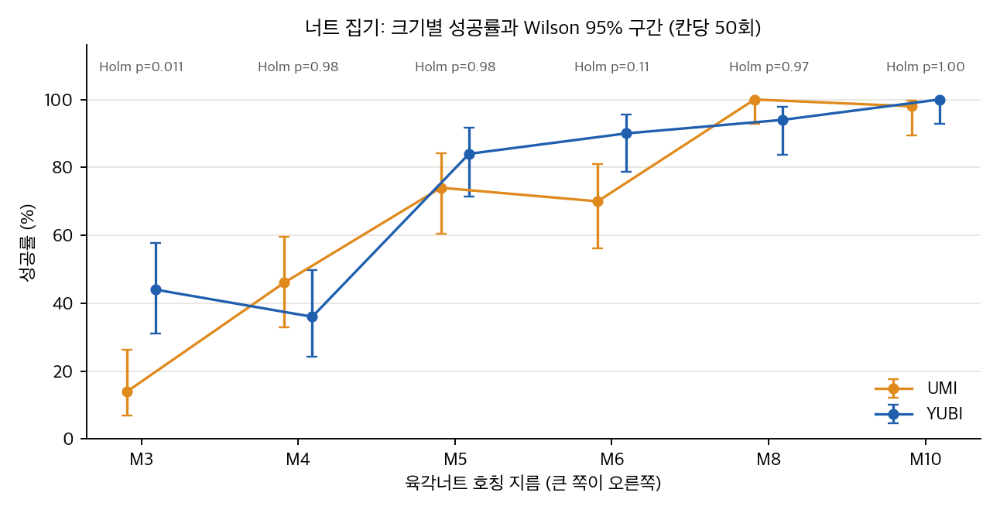
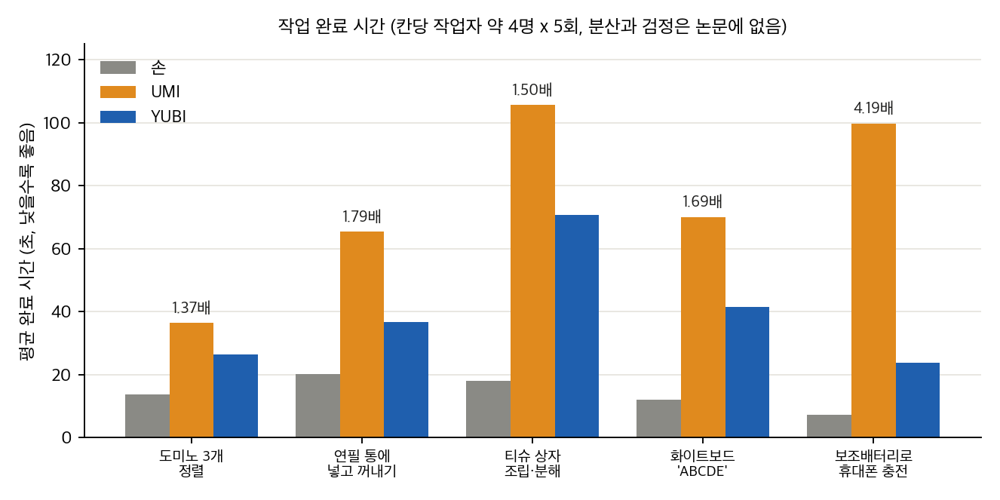
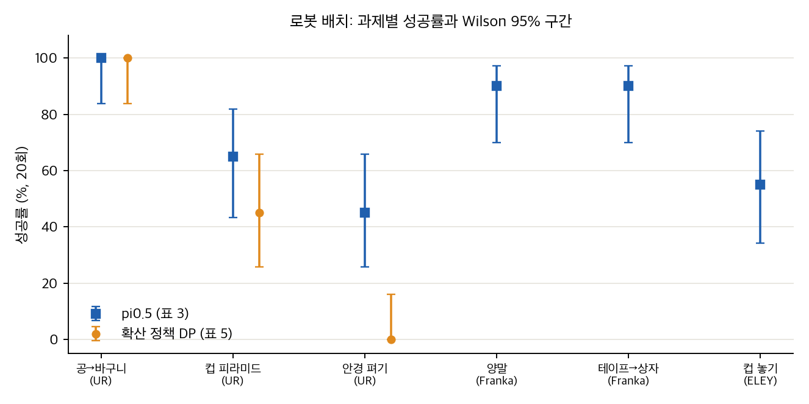

> **논문:** Takehiko Ohkawa, Jumpei Arima 외. *YUBI: Yielding Universal Bidigital Interface for Bimanual Dexterous Manipulation at Scale.* CoRL 2026 포스터, arXiv:2606.10244 (v1, 2026-06-08, CC BY-SA 4.0).
> 공식 하드웨어는 github.com/Toyota/yubi-hw(CERN-OHL-W-2.0), 소프트웨어는 위 `code` 링크(Apache-2.0)에 있습니다. 이 글의 그림은 모두 우리가 논문 수치를 다시 그린 그래프이고, 논문 그림은 쓰지 않았습니다.

## 논문이 묻는 것

UMI처럼 손에 쥐는 그리퍼로 로봇 없이 시연을 모으는 방식은 값이 싸지만, 권총형 손잡이가 손가락과 그리퍼 끝 사이에 거리를 만들고 780 g이 넘어 정밀 작업이 어렵습니다. YUBI는 엄지가 한 턱을, 검지와 중지가 반대 턱을 직접 밀게 해서 조리개가 손의 집는 동작을 그대로 따르게 합니다. 그리퍼와 컨트롤러를 합쳐 약 319 g이고, Quest 3S 헤드셋은 사람이 쓰지 않고 책상 프레임에 고정합니다. 이렇게 22개 책상에서 179명이 약 두 달간 8,434시간, 에피소드 120만 개, 과제 119개를 모았다고 보고합니다.

## 이 글에서 확인한 것

**1. 정밀도 시험의 개선은 가장 작은 너트 한 칸에서만 확실합니다.** 육각너트 M10부터 M3까지 칸당 50회(작업자 10명 x 5회)입니다. 그림에서 읽은 값으로 칸마다 Fisher 검정과 Holm 보정을 하면 M3(44% 대 14%)만 p = 0.0105로 남습니다. M6의 +20 pp는 보정 후 p = 0.11이고, M4(36 대 46)와 M8(94 대 100)은 UMI가 오히려 높습니다. 크기를 층으로 한 합산 검정은 p = 0.011이지만 같은 작업자가 여러 번 시도한 것을 독립으로 본 값입니다. 작업자 군집 상관을 0.2로 가정하면 p = 0.12가 됩니다.

*그림 1. 논문 그림 5의 숫자를 읽어 다시 그린 그래프. 칸당 n = 50, Wilson 95% 구간, 위쪽은 Holm 보정 p.*

**2. 작업 시간은 다섯 과제 모두 UMI보다 빠르지만 검정이 없습니다.** UMI 대비 배속은 1.37배에서 4.19배이고 기하평균은 1.92배입니다. 4.19배는 휴대폰 충전 한 과제에서만 나옵니다. 손 조작과의 격차를 40–82%만 메웁니다. 과제당 작업자가 4명이고 평균만 있어서 논문의 "significantly faster"는 검정 없는 표현입니다.

*그림 2. 논문 그림 6의 평균 완료 시간을 다시 그린 그래프. 막대 위 숫자는 UMI/YUBI 배속.*

**3. 로봇 배치는 89/120 성공이고, 두 표가 서로 겹칩니다.** 여섯 과제를 20회씩 돌려 74.2%입니다(Wilson 65.7–81.2%). 확산 정책과의 비교(표 5)에서 안경 펴기(9 대 0, p = 0.0012)만 유의하고 컵 쌓기는 p = 0.34입니다. 또 표 3은 다중 과제 정책의 결과라 하고 표 5는 과제별 미세 조정이라 하는데 UR 세 과제의 값이 같습니다. 정책은 전체 데이터의 0.7%(8,456 demo)만 썼습니다.

*그림 3. 표 3(π0.5)과 표 5(확산 정책)의 성공 횟수를 다시 그린 그래프. 20회, Wilson 95% 구간.*

**4. 표 2의 시간과 에피소드 수가 서로 맞지 않습니다.** 8,434시간을 1.20M 에피소드로 나누면 25.3초인데 표 2의 평균은 39.8초입니다. 39.8초라면 13,267시간이 됩니다. 과제 평균과 에피소드 가중 평균의 차이일 수 있지만 표가 가중 방식을 적지 않았습니다. 같은 맥락에서 680만 "demo"는 하위 행동 단위이고, "가장 큰 UMI 데이터셋"이라는 주장은 같은 표의 GenRobot(13K 시간)과 어긋납니다.

**5. 공개 코드는 하드웨어와 수집 스택이고, 논문 데이터를 만든 처리 전부가 아닙니다.** 정적으로 읽어 보면 논문은 회전을 오일러각으로 적지만 변환 구성은 쿼터니언 7차원이고, 행동은 30 Hz 한 스텝 델타입니다. 부록 A.2의 필터 단계와 ChArUco 보정, 정책 학습과 배치 코드는 공개물에 없고, 추적 품질은 사후 비율 기준 대신 실시간 기록 게이트로 처리합니다. Quest 쪽 앱은 소스 없이 APK로만 배포됩니다.

**6. 데이터셋은 CC-BY-NC-SA 공개가 아니라 접근 제한입니다.** 논문은 데이터를 그렇게 공개한다고 쓰지만, 2026-11-22에 확인한 Hugging Face 저장소 6개는 수동 승인 방식이고 제한 접근 약관입니다. UMI Arena 등록 팀 전용이며 등록은 10월 9일에 마감됐습니다. 대회 페이지는 40개 장비와 20,000시간을 말해 논문의 22책상, 8,434시간과 시점이 다릅니다.

## 구현할 수 있을까

이 글의 필자 환경(Apple M4 Pro, 약 24 GiB, CUDA 없음)에서 논문 실험을 재현할 수는 없습니다. 수치 재계산과 일관성 검사는 끝냈고(`analysis/recompute.py`, 수 초), 행동 표현이나 필터 임계값 같은 소규모 검사는 합성 궤적으로 CPU에서 할 수 있습니다. 글러브 제작과 수집 스택은 3D 프린터, Quest 3S, Linux 장비가 필요합니다. 정책 학습은 GPU와 접근 제한 데이터, 비공개 설정이 걸림돌이라 하지 않았습니다.

## 남은 불확실성

- 그림 5와 6의 원자료(작업자별 값)가 없어 군집 상관과 표준편차를 추정하지 못했습니다.
- 가격("그리퍼 하나 USD 200 미만")은 BOM에 가격 열이 없어 확인하지 못했습니다.
- 데이터 약관 본문과 STEP 파일 내용은 열지 않았습니다.

## 자료

- [통합 리포트 PDF](report/report_public.pdf)
- [01. 논문 분석: YUBI (arXiv:2606.10244)](analysis/01_paper_analysis.md)
- [02. 선행연구와 공식 저장소: YUBI (arXiv:2606.10244)](analysis/02_prior_work.md)
- [03. 수치 재계산과 주장 판정: YUBI (arXiv:2606.10244 v1)](analysis/03_analysis.md)
- [04. 공식 코드 대조와 구현 가능성: YUBI (arXiv:2606.10244 v1)](analysis/04_code_verification.md)
