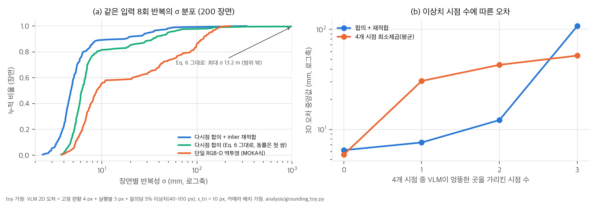

# 03. 핵심 식 해석과 toy 검증

공식 코드가 없어서, 본문 식(v3)과 v1 부록의 하이퍼파라미터로 toy를 직접 구현했습니다. 스크립트는 `analysis/grounding_toy.py`(Eq. 5–6, 결과 `grounding_toy_results.json`), `analysis/alignment_toy.py`(Eq. 7, 결과 `alignment_toy_results.json`), `analysis/table_check.py`(표 재계산, 결과 `table_check_results.json`)이고, 모두 CPU에서 몇 초 안에 끝납니다.

## 1. 다시점 합의 삼각측량 (Eq. 5–6)의 성질

### 1.1 후보와 지지 수
시점이 M개면 후보는 시점 쌍 수 C(M, 2)개입니다. 4대면 6개입니다. 후보 X_{a,b}의 지지 수 S_tri는 재투영 오차가 ε_tri 이하인 시점 수로, 0부터 M까지의 정수입니다. 따라서 다음이 성립합니다.

- 네 시점 중 세 시점(inlier)이 같은 곳을 가리키면, inlier 쌍에서 나온 후보는 지지 수가 3 이상입니다. 이상치 시점이 하나면 그 시점이 포함된 쌍의 후보는 지지 수가 2 이하입니다. 그래서 **이상치 시점 하나는 항상 걸러집니다.**
- 이상치가 둘이면 inlier 쌍도 지지 수 2가 되어 이상치 쌍과 동률이 될 수 있고, 결과는 동률 처리 규칙에 달립니다. v3 본문에는 그 규칙이 없습니다. v1 부록은 지지 수가 τ_tri = 0.5·M을 "넘어야" 채택하고(4대면 3 이상), 아니면 ray voting으로 대체했습니다. v3에서는 그 대체 경로가 사라졌습니다.

### 1.2 어느 쌍을 고르는지가 정밀도를 정합니다
두 광선의 사잇각을 θ라고 하면, 2D 오차 σ_px에 대한 3D 오차는 대략 z·σ_px / (f·sin θ)입니다. 카메라 4대에 스테레오 쌍이 포함되어 있으므로, 기선 12 cm 스테레오 쌍(1 m 거리에서 θ ≈ 7°)으로 삼각측량하면 오차가 넓은 기선 쌍(θ ≈ 60–90°)보다 약 7–8배 커집니다. Eq. 6은 지지 수만 보고 쌍을 고르므로, 동률일 때 좁은 기선 쌍이 선택되면 정밀도가 크게 떨어집니다. 표준 RANSAC처럼 **최다 지지 후보의 inlier 시점 전체로 다시 삼각측량**하면(refit) 이 문제가 사라집니다.

## 2. toy: 다시점 합의 vs 단일 RGB-D 역투영 (G1–G3)

**모델 (가정):** VLM 2D 출력 = 장면별로 고정된 의미 편향 N(0, 4 px) + 실행별 흔들림 N(0, 3 px) + 질의당 5% 확률의 이상치(40–100 px)입니다. 카메라는 f = 900 px, 1280×720이고, 4대 중 2대가 기선 12 cm 스테레오 쌍입니다. 목표는 높이 8–15 cm 용기의 윗면이며, 절반은 안쪽, 절반은 테두리 6 mm 이내입니다. 단일 RGB-D는 기준 시점 픽셀의 광선이 처음 맞는 표면의 깊이(+3 mm 잡음)로 역투영합니다. 카메라 배치와 잡음 크기는 논문에 없어서 가정한 값입니다.

### 2.1 반복성 (G1, Table IV와 같은 10 장면 × 8회 설계를 20번 반복)

| 방법 | σ 평균 (mm) | σ 중앙값 | 최악 장면 σ (평균) | σ > 10 mm 장면 | 정확도 오차 중앙값 |
|---|---|---|---|---|---|
| 다시점 합의, Eq. 6 그대로 (동률이면 첫 쌍) | 80.4 | 6.2 | 720.5 | 18.5% | 5.5 |
| 다시점 합의 + inlier 재적합 | **9.8** | **4.8** | 46.3 | 11% | 5.2 |
| 4개 시점 최소제곱 (평균) | 12.4 | 11.7 | 23.1 | 62.5% | 6.4 |
| 단일 RGB-D 역투영 (MOKA식) | 38.3 | 8.8 | 126.8 | 44.5% | 12.3 |



해석:
- **메커니즘은 논문 설명과 맞습니다.** 단일 RGB-D는 픽셀이 용기 테두리를 넘어가면 깊이가 탁자로 튀어서 긴 꼬리가 생깁니다. 다시점 합의는 깊이 맵을 쓰지 않으므로 이 꼬리가 없습니다.
- **평균 비율은 꼬리가 만듭니다.** 재적합 합의 대 RGB-D의 σ 비율은 평균 기준 3.9배지만 중앙값 기준 1.9배입니다. 논문 Table IV의 "3배"도 평균이고, MOKA의 δ_max 64.9 mm가 평균을 크게 끌어올렸을 가능성이 높습니다(`04` C4b).
- **Eq. 6을 글자 그대로 구현하면 위험합니다.** 동률일 때 스테레오 쌍을 고르면 미터 단위로 튀는 장면이 나옵니다(최악 13 m). 저자 구현은 이를 처리했겠지만, 본문만으로는 재현할 수 없는 부분입니다.
- **평균(최소제곱)은 이상치에 약합니다.** 한 번의 실행(4개 질의)에 이상치가 하나라도 섞일 확률이 18.5%(1 − 0.95⁴)라서, 8번 반복하면 대부분의 장면에서 한 번 이상 끌려가고 σ 중앙값이 11.7 mm가 됩니다. "평균 대신 합의"라는 논문의 선택이 옳다는 것을 보여 줍니다.

### 2.2 이상치 시점 수 (G2)

| 이상치 시점 | 합의 + 재적합: 중앙값 / p90 (mm) | Eq. 6 그대로 | 최소제곱 |
|---|---|---|---|
| 0 | 6.2 / 11.4 | 7.4 / 12.7 | 5.6 / 9.1 |
| 1 | **7.4 / 13.1** | 8.8 / 49.7 | 30.5 / 45.7 |
| 2 | 12.4 / 99.5 | 16.5 / 402 | 44.2 / 64.3 |
| 3 | 108 / 844 | 113 / 1,271 | 54.7 / 79.2 |

4대 구성에서는 이상치 하나까지만 확실히 버팁니다(§1.1). 둘이면 꼬리가 10 cm 수준이 되고, 셋이면 합의가 틀린 쌍을 고릅니다. 가림이 심해 두 시점 이상이 대상을 못 보는 장면에서는 시점을 늘리거나 합의 실패를 감지해 재질의해야 합니다.

### 2.3 ε_tri 민감도 (G3, 이상치 시점 1개)

| ε_tri (toy px) | 3 | 5 | 10 | 20 | 40 |
|---|---|---|---|---|---|
| 재적합: 중앙값 / p90 (mm) | 11.0 / 288 | 10.1 / 390 | 7.5 / 14.2 | **6.4 / 11.7** | 7.1 / 25.2 |
| Eq. 6 그대로 | 19.9 / 492 | 36.4 / 1,785 | 8.8 / 99.8 | 9.1 / 19.9 | 15.9 / 63.1 |

ε_tri가 VLM의 시점별 오차(여기서는 편향 + 흔들림 약 5 px)보다 작으면 inlier가 거의 없어 동률이 생기고, 꼬리가 폭발합니다. 너무 크면 이상치 시점도 inlier로 들어옵니다. v1 부록의 ε_tri = 20 px(640×480)는 같은 화각이면 이 toy 해상도에서 약 40 px입니다. 실제 VLM 오차가 이 toy보다 꽤 크다는 것을 시사합니다. **ε_tri는 VLM의 픽셀 오차 분포에 맞춰 정해야 하는 핵심 하이퍼파라미터**인데, v3 본문에는 값이 없습니다.

## 3. 두 앵커 정렬 (Eq. 7)

### 3.1 왜 회전 축을 제한하는가 (A1)
대응점이 X^s ↔ X^app, X^e ↔ X^term 두 쌍뿐이면, 두 앵커를 잇는 직선 둘레의 회전은 두 점을 움직이지 않습니다(toy에서 잔차 0 확인). 즉 일반 3-DoF 회전을 쓰면 도구가 그 축 둘레로 얼마나 돌아가 있는지(예: 주전자 주둥이가 어느 쪽을 향하는지)를 정할 수 없습니다. v1은 "앵커를 맞추는 강체 변환"이라고만 썼고, v3는 "회전을 미리 정한 축으로 제한"이라고 고쳤습니다. 이 수정은 필요한 것입니다.

### 3.2 연직축 제한의 닫힌 해와 잔차 (A2, A3)
회전을 연직축(z)으로 제한하고 병진을 더하면 자유도는 4입니다. 두 앵커의 제곱오차를 최소화하는 해는 다음과 같습니다.

```
u = (X^e − X^s)/2,  w = (X^term − X^app)/2
θ = atan2( (u × w)_z , u_xy · w_xy )
t = (X^app + X^term)/2 − R_z(θ) (X^s + X^e)/2
앵커 잔차 = |w − R_z(θ) u|  (두 앵커에서 같음) = 두 앵커 간 벡터 불일치의 절반
```

| 장면 앵커 간격 − 저장 간격 | 높이차 불일치 0 cm | 3 cm |
|---|---|---|
| 0 cm | 0.0 cm | 1.5 cm |
| 2 cm | 1.0 cm | 1.8 cm |
| 5 cm | 2.5 cm | 2.9 cm |
| 10 cm | **5.0 cm** | 5.2 cm |

축척을 바꾸지 않으므로 저장 궤적과 장면의 기하가 다르면 오차를 양 끝에 반씩 나눠 가집니다. 예를 들어 주둥이-드리퍼 거리가 저장 궤적보다 10 cm 멀면, 붓기 시작점과 끝점이 각각 5 cm 어긋납니다. 라이브러리 항목이 장면과 비슷한 크기여야 하고, 그렇지 않으면 구간별 정렬이나 축척 허용 같은 확장이 필요합니다. 본문은 이 잔차를 보고하지 않습니다.

## 4. 어포던스 영역 (Eq. 9)은 투표형 visual hull입니다

s(q) = (1/M) Σ_v 1(π_v(q) ∈ B_v)이고, v1 부록의 τ = 0.65이면 4대 기준 3개 이상의 박스에 투영되어야 합니다. 2D 박스 하나의 역투영은 시야뿔이므로, 이 영역은 시야뿔들의 "4개 중 3개" 교집합입니다.

- **가시성 검사가 없습니다.** 박스 안에 투영되기만 하면 가려진 뒷면 꼭짓점도 들어갑니다. 손잡이처럼 둘러 잡는 부위에는 오히려 맞는 성질이지만, 머그 손잡이를 고른 박스가 몸통 일부와 겹치면 몸통 꼭짓점도 들어올 수 있습니다. 시점 수가 많을수록 이런 과포함이 줄어듭니다.
- **박스가 크면 영역도 넓어집니다.** 박스는 축정렬 직사각형이라 기울어진 손잡이에서는 주변 부위까지 포함됩니다. Table III에서 어포던스를 켜면 장면당 후보 수가 줄고(도구 22 → 16, P&P 69 → 27) 충돌 없는 비율이 96%로 오르는 것과 일관됩니다.

## 5. Table IV에서 추론할 수 있는 것 (C4, C4b)

**침투 지표.** 장면 s의 waypoint 가운데 비율 c_s가 1 mm를 넘고 나머지는 1 mm 이하라고 하면, P_avg,s ≤ c_s·P_max,s + (1 − c_s)·1 mm입니다. 장면 평균을 취하면 다음 하한을 얻습니다.

```
max_s P_max,s ≥ ( P_avg − (1 − Coll) · 1 mm ) / Coll
```

| 행 | 평균 P_max | 최악 장면 P_max 하한 | 총 P_max 중 그 장면 비중 |
|---|---|---|---|
| Tool / MOKA | 20.4 mm | **95.4 mm** | 94% |
| Tool / Ours | 20.3 mm | 67.4 mm | 66% |
| P&P / MOKA | 37.2 mm | 36.2 mm | (모든 waypoint가 충돌, 제약 없음) |
| P&P / Ours | 32.6 mm | 88.1 mm | 27% |

(Coll% 반올림 ±0.5와 P_avg 반올림을 반영한 보수적 값.) 도구 사용 5개 장면에서 MOKA와 Ours의 차이는 "모든 장면이 조금씩 나쁘다"가 아니라, **한 장면에서 10 cm 가까이 박히는 실패**가 두 방법 모두에 있고, 그 장면에서 충돌하는 waypoint 비율이 다르다는 쪽에 가깝습니다. Ours P&P도 9 cm 가까이 박히는 장면이 적어도 하나 있습니다. 논문이 이 지표에 충돌 고려 보정(Eq. 8) **이전** 값을 쓴 것은 그라운딩 자체를 평가하려는 의도라 타당합니다. 다만 꼬리 정보(장면별 분포)가 함께 있어야 해석할 수 있습니다.

**반복성 지표.** σ는 장면 평균이고 δ_max는 "최악값"입니다. δ_max가 장면별 σ의 최댓값이라면 MOKA의 나머지 9개 장면 σ 평균은 (10 × 8.1 − 64.9)/9 = 1.79 mm로 Ours(2.5 mm)보다 작습니다. δ_max가 한 실행의 최대 이탈이라면, 편차 합이 0이라는 제약에서 그 장면의 σ ≥ 64.9/√7 = 24.5 mm이고, 나머지 9개 평균은 6.3 mm 이하입니다. 어느 해석이든 "3배"의 상당 부분은 이상치 한 장면에서 나옵니다. toy(§2.1)도 평균 비율 3.9배, 중앙값 비율 1.9배로 같은 양상을 보입니다.
