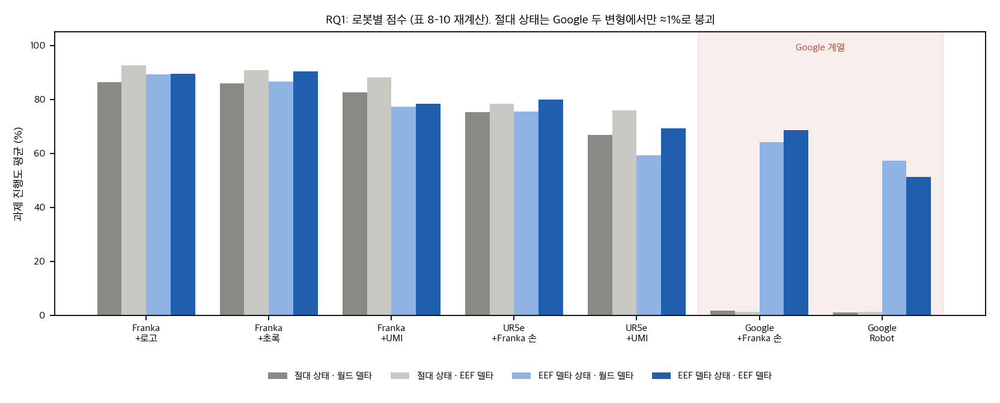
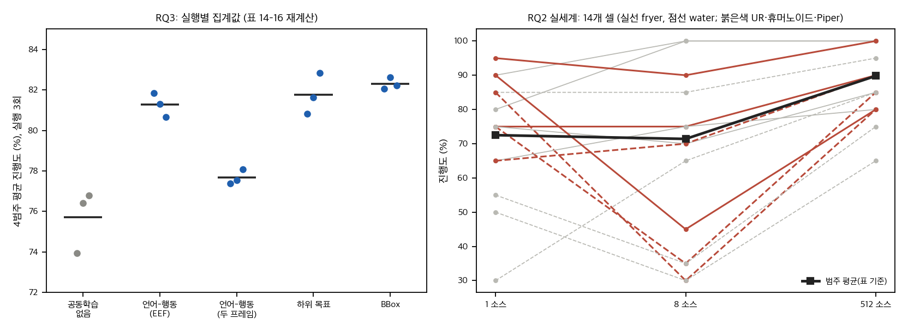
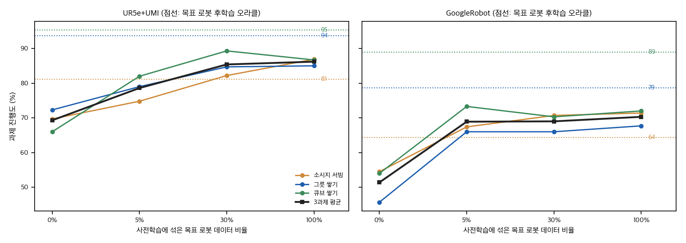

# ZETA 보고 수치 재계산과 일관성 점검 (03)

재현(학습, 시뮬, 실로봇)은 하지 않았습니다. 논문 부록 C의 실행별 표(표 8–23)를 읽어 본문 표 2–5, 그림 4–6의 라벨, 초록과 프로젝트 페이지의 수치를 다시 만들고, 통계적으로 말할 수 있는 범위를 확인했습니다. 모든 계산은 `analysis/recompute.py`(numpy, scipy, 1초)와 `analysis/toy_frame_invariance.py`(numpy, scipy, 1초 미만)에 있고, 결과는 `analysis/recompute_results.json`과 `analysis/toy_frame_invariance_results.json`입니다. 점검 항목 번호는 재계산 V, 일관성 K입니다. 주장 판정은 `04`에 있습니다.

**집계 규칙(부록 H.4).** 실행마다 로봇별로 과제 평균 → 범주 안 로봇 평균 → 네 범주 산술평균(소스 열 제외) → 세 실행의 평균과 표준편차.

**검정 한계.** 시뮬 비교는 실행이 3개뿐입니다. 3 대 3 정확 순열검정의 최소 양측 p는 0.1이므로 Welch p는 근사로만 읽고, "세 실행이 모두 분리됨(완전 분리)"을 함께 적습니다. 롤아웃 단위 원자료(0, 0.5, 1 점수)는 공개되지 않아 롤아웃 수준의 정확 검정은 할 수 없습니다.

## 1. 재계산 요약

| 항목 | 결과 |
|---|---|
| 표 2의 24개 평균(4 조합 × 6 열) | **24/24 일치**(±0.06 이내, 반올림) |
| 표 4의 30개 평균(5 변형 × 6 열) | **30/30 일치** |
| 표 2, 4의 ± 54개 | **54/54가 모표준편차**(n으로 나눔, ddof = 0)와 일치. 표본표준편차(n−1)와는 0개 |
| 표 3(실세계) 24개 값 | 24/24 일치(과제 평균 → 범주 평균 → 4범주 평균) |
| 초록 "15, 18, 7%p"와 "13.4%p" | 15.4, 17.9, 6.6, 13.4로 모두 재현. 단 기준 선택이 결과를 좌우(V10) |
| 표 11–13의 512 소스 열, 표 14–16의 "공동학습 없음" 열, 표 17–19의 0% 행 | 모두 표 8–10의 EEF-Delta/EEF-Delta 열과 **셀 단위로 동일**(같은 모델 재사용) |
| **본문 표 5의 5% 노출 최고 표현 71.1** | **그림 6 본문(78.6, 68.9)과 표 17–19에서 나오는 73.75와 불일치**(K1) |
| 시뮬 소시지 과제 분모 | 값 96개 중 95개가 99롤아웃 격자(k/99)에 맞고 100 격자에는 18개만 맞음(V9) |

이 논문의 집계 산수는 대체로 깨끗합니다. 불일치는 표 5의 한 칸 계열, 소시지 분모, 서술 수준에 있습니다.

## 2. 재계산 V

### V1. 표 2 재계산과 ±의 정의

표 8–10의 실행별 값에서 로봇별 과제 평균 → 범주 → 평균을 다시 만들면 표 2의 24개 평균이 모두 일치합니다. ±는 세 실행 집계값의 **모표준편차**입니다(예: EEF/EEF 평균의 세 실행 값 73.95, 76.42, 76.80 → 평균 75.72, ddof = 0 표준편차 1.26 → 표는 1.3). 논문은 "standard deviation across these three run-level aggregates"(H.4)라고만 쓰고 n으로 나누는지 밝히지 않았습니다. n = 3에서 n−1로 나누면 값이 약 1.22배 커집니다(예: 1.3 → 1.5).

### V2. 로봇별로 보면 RQ1의 상태 효과는 구글 로봇 두 변형이 만든다

범주 평균은 로봇 1–2대의 평균입니다. 표 8–10에서 로봇별 3과제 평균(%)은 다음과 같습니다.

| 로봇(범주) | Abs·World | Abs·EEF | EEF·World | EEF·EEF | 상태 효과(Abs·EEF → EEF·EEF) |
|---|---|---|---|---|---|
| Franka+로고 (APP) | 86.5 | 92.7 | 89.2 | 89.5 | −3.2 |
| Franka+초록 (APP) | 86.0 | 90.9 | 86.7 | 90.4 | −0.5 |
| Franka+UMI (GRP) | 82.6 | 88.2 | 77.2 | 78.3 | **−9.9** |
| UR5e+Franka 손 (ARM) | 75.2 | 78.5 | 75.6 | 79.9 | +1.4 |
| **Google+Franka 손 (ARM)** | **1.8** | **1.3** | 64.1 | 68.6 | **+67.3** |
| UR5e+UMI (FULL) | 66.8 | 76.0 | 59.4 | 69.3 | −6.7 |
| **GoogleRobot (FULL)** | **1.0** | **1.2** | 57.4 | 51.4 | **+50.2** |

- **절대 상태를 쓰는 두 조합은 구글 로봇 두 변형에서 거의 0점**(0.0–4.7%, 세 과제 모두, 표 8–10)이고, 같은 조합이 UR5e 변형에서는 67–79점입니다. 즉 표 2의 ARM 38.5–39.9와 FULL 33.9–38.6은 "한 로봇은 75, 다른 로봇은 1"의 평균입니다. "절대 상태가 ARM, FULL에서 약하다"는 서술은 **구글 로봇 하나(변형 둘)에서 나온 붕괴**입니다.
- 구글 로봇 두 변형을 빼고 나머지 5개 목표(로고, 초록, UMI, UR5e+Franka, UR5e+UMI)의 단순 평균을 내면 Abs·World 79.4, **Abs·EEF 85.3**, EEF·World 77.6, EEF·EEF 81.5입니다. 이 5개에서는 **EEF-Delta 상태의 효과가 −2.8%p(음)**, EEF-Delta 행동의 효과가 +4.9%p입니다. 네 로봇 범주 전체 평균의 주효과(상태 +12.1, 행동 +3.3)와 방향이 다릅니다.
- 구글 로봇에서 절대 상태가 실패하는 원인은 논문이 설명하지 않습니다. 베이스 프레임 정의(원점, 자세)가 소스 풀과 크게 다를 때 절대 좌표 입력이 분포 밖이 되는 것이 자연스러운 후보이지만, 이는 추정이며 팔 형태학의 영향과 분리하는 실험은 없습니다(`04` C1). 구글 로봇의 두 변형이 모두 "ARM"과 "FULL"에 걸쳐 있어 팔/그리퍼 교란이 아니라 **베이스 프레임 교란**이 지배했을 가능성이 있습니다.
- UR5e 변형(Franka 손, UMI)에서는 EEF-Delta 상태가 거의 도움이 되지 않습니다(+1.4, −6.7). 그리퍼 변경(Franka+UMI)에서는 EEF-Delta 상태가 **10%p 낮춥니다**(88.2 → 78.3, Welch p = 0.017, 세 실행 완전 분리). 논문은 §5.6에서 "외형·그리퍼만 바뀌면 Abs. EEF 상태 + EEF-Delta 행동도 경쟁력"이라 적어 이 부분을 인정합니다.

*그래프 (우리가 그림). 표 8–10 재계산의 로봇별 점수. 절대 상태 조합은 구글 계열 두 변형에서만 약 1%로 무너집니다.*

### V3. RQ1 유의성 (3 대 3 Welch)

| 비교(EEF·EEF 대 …) | 범주 | 차이 | Welch p | 세 실행 완전 분리 |
|---|---|---|---|---|
| Abs·World | 평균 | +15.4 | 0.0002 | 예 |
| Abs·EEF | 평균 | +11.1 | 0.0035 | 예 |
| EEF·World | 평균 | **+2.4** | **0.10** | **아니오** |
| Abs·EEF | GRP | −9.9 | 0.017 | 예(낮은 쪽) |
| EEF·World | ARM | +4.5 | 0.058 | 예 |

- "EEF-Delta 행동이 평균을 올린다"(+2.3~4.3%p, 표의 +2.4는 실행값 평균 차이)는 효과는 가장 작고 EEF-Delta 상태 조건에서는 구별되지 않습니다(p = 0.10, 분리 안 됨). 평균을 지배하는 것은 상태 표현이고(V2), 그 효과는 구글 로봇 두 변형에서 옵니다.
- 초록의 "약 15%p"는 **최고 대 최저 조합**의 차이(75.7 − 60.3 = 15.4)입니다. 같은 행동 표현을 두고 상태만 바꾼 차이는 +11.1(EEF-Delta 행동), +13.1(World-Delta 행동)입니다.

### V4. RQ2 시뮬(고정 총량 640K): 1 → 8 → 512 소스

표 11–13 재계산(평균, %):

| 소스 수 | e_s | APP | GRP | ARM | FULL | 평균 | 평균의 실행 SD |
|---|---|---|---|---|---|---|---|
| 1 | 86.2 | 84.8 | 57.6 | 54.4 | 34.5 | **57.8** | 0.4 |
| 8 | 88.9 | 89.1 | 76.3 | 63.6 | 52.5 | **70.4** | 0.65 |
| 512 | 91.5 | 90.0 | 78.3 | 74.3 | 60.4 | **75.7** | 1.26 |

- 512 대 1: **+17.9%p**(초록의 "약 18"과 일치, Welch p = 0.001, 세 실행 완전 분리). 이득은 FULL +25.9, GRP +20.7, ARM +19.9, APP +5.2로 "GRP, ARM, FULL에서 가장 크다"는 서술과 맞습니다.
- 이 이득의 **대부분은 1 → 8**(+12.6)이고 8 → 512는 +5.3입니다(ARM +10.7, FULL +7.9, GRP +2.0, APP +0.9). 소스 수가 8개만 돼도 이득의 70%가 나옵니다. 512개가 필요하다는 결론은 이 표만으로는 나오지 않습니다. (그림 4(a)에는 본문이 말하지 않은 128 소스 점이 있어 곡선이 8 이후 완만합니다(K12). 고정 구현체당 예산 비교는 그림 5에 수치가 없습니다. K10)
- 구현체당 궤적 수가 640K → 1,250으로 줄어드는 조건에서 1 소스는 **단일 구현체 640K**입니다. 즉 이 비교는 "구현체 다양성"과 "구현체당 데이터 밀도"를 함께 바꿉니다. 논문도 이를 인정하고(§5.3 "결합된 설계 변수") 프로젝트 페이지는 "두 방식은 인과 분리가 아니라 상보적 증거"라고 씁니다.
- 로봇별로 1 → 512 이득이 가장 큰 쪽은 UR5e+UMI(+29.2), UR5e+Franka 손(+26.2), GoogleRobot(+22.5), Franka+UMI(+20.7), Google+Franka 손(+13.6)입니다(표 11–13 평균). 소스 풀이 Franka 계열(링크 축척 0.7–1.3)이라는 점에서, 풀이 가르쳐 준 것이 "팔 길이 변화 일반"인지 "소스에 있는 Franka식 운동학의 변이"인지는 분리되지 않습니다.

### V5. RQ3 (표 4)

- 재계산은 30/30 일치. 실행별 4범주 평균: 없음 [73.95, 76.42, 76.80], LAP-EEF [81.85, 81.30, 80.65], LAP-두 프레임 [77.38, 77.55, 78.08], 하위 목표 [80.81, 81.61, 82.83], BBox [82.06, 82.61, 82.22].
- **기준선 쪽이 가장 흔들립니다**(SD 1.3 대 0.2–0.8). 기준선 한 실행(73.95)이 낮아 평균이 75.7입니다. LAP-두 프레임의 세 실행(77.4–78.1)은 기준선의 높은 두 실행(76.4, 76.8)과 가깝습니다.
- 기준선 대비 평균 차이와 Welch p: LAP-EEF +5.5(p = 0.015), LAP-두 프레임 **+1.9(p = 0.16)**, 하위 목표 +6.0(p = 0.0074), BBox +6.6(p = 0.015). 세 변형은 분명하고 LAP-두 프레임은 분명하지 않습니다(완전 분리이긴 하나 간격이 작음).
- 범주별 이득(기준선 대비 %p):

| 변형 | e_s | APP | GRP | ARM | FULL |
|---|---|---|---|---|---|
| LAP-EEF | −1.0 | −1.3 | +8.4 | +5.0 | +10.1 |
| LAP-두 프레임 | −2.0 | −1.4 | +1.5 | **−0.5** | +8.1 |
| 하위 목표 | −2.4 | +0.4 | +9.1 | +3.5 | +11.1 |
| BBox | −1.1 | +0.3 | +8.7 | +5.8 | +11.5 |

- **소스 구현체 e_s 점수가 네 변형 모두에서 1.0–2.4%p 내려갑니다**(p = 0.18–0.37, 구별 안 됨). 본문은 이 점을 논의하지 않습니다. APP도 두 LAP 변형에서 −1.3, −1.4입니다. "모든 변형이 기준선보다 낫다"는 4범주 평균 기준이고, LAP-두 프레임은 ARM에서 오히려 낮습니다.
- 캡션 "가장 큰 이득은 더 큰 구현체 변화에서"는 FULL에서는 맞지만 이득이 GRP(+8~9)가 ARM(+4~6)보다 큽니다. 변화 크기 순서(GRP < ARM < FULL)와 이득 순서가 단조가 아닙니다.
- 공동학습은 모방 예시 비율을 100%에서 75%로 줄입니다(부록 I). 같은 스텝 수에서 보조 변형이 모방 손실을 덜 본다는 점에서 보수적인 비교이기도 합니다.

*그래프 (우리가 그림). 왼쪽: 표 14–16 재계산의 RQ3 실행별 4범주 평균(점)과 평균(막대). 오른쪽: 표 22, 23의 실세계 RQ2 14개 셀(실선 에어프라이어, 점선 물주기).*

### V6. RQ4 (표 17–19)

재계산(UR5e+UMI, GoogleRobot, 3과제 평균 %):

| 설정 | UR5e+UMI | GoogleRobot | 평균 |
|---|---|---|---|
| 0%(strict) | 69.3 | 51.4 | 60.35 |
| 5% | 78.6 | 68.9 | **73.75** |
| 30% | 85.4 | 69.0 | 77.2 |
| 100% | 86.2 | 70.3 | 78.25 |
| 목표 후학습 오라클 | 90.0 | 77.3 | 83.65 |

- **+13.4%p 재현**: (78.6 − 69.3 = 9.3)과 (68.9 − 51.4 = 17.5)의 평균. 본문의 5% 값, 프로젝트 페이지 값과 일치합니다. 한계 이득은 0 → 5%에서 +13.4, 5 → 30%에서 +3.5, 30 → 100%에서 +1.1로 "5%가 가장 큰 한계 이득"이 맞습니다.
- **"오라클 아래" 서술은 평균에서만 성립합니다.** 과제별 노출(5/30/100%) − 오라클(%p):

| 목표 | 설정 | 소시지 | 그릇 | 큐브 |
|---|---|---|---|---|
| UR5e+UMI | 5% | −6.3 | −14.7 | −13.3 |
| UR5e+UMI | 30% | **+1.1** | −9.0 | −6.0 |
| UR5e+UMI | 100% | **+5.8** | −8.7 | −8.6 |
| GoogleRobot | 5% | **+3.1** | −12.7 | −15.7 |
| GoogleRobot | 30% | **+6.4** | −12.7 | −18.7 |
| GoogleRobot | 100% | **+7.1** | −11.0 | −17.0 |

소시지 서빙에서는 목표 구현체 후학습 오라클이 5–100% 노출 모델보다 **낮은 경우가 많습니다**(오라클이 상한 참고선이라는 설명과 상충). 오라클과의 차이는 그릇과 큐브 과제에서 나옵니다. 오라클이 소시지에서 약한 이유(후학습이 장면 하나로 과적합, 실행 3회 변동 등)는 논문에 없습니다.
- "노출이 후학습을 대신하지 못한다"는 결론은 과제 3개 중 2개에서만 지지됩니다.
- 비율 4개와 목표 2개, 모두 FULL 범주입니다. 초록의 "평균 목표 구현체 진행도 13.4%p"는 **FULL 범주 대상 2개**의 평균이고, 외형·그리퍼 변화 대상에서의 노출 효과는 보지 않았습니다.

*그래프 (우리가 그림). 표 17–19의 노출 비율별 과제 점수(실선)와 목표 후학습 오라클(점선).*

### V7. 실세계 RQ1 (표 3, 20, 21)

- 표 20, 21(과제별 10회 평균)로 과제 평균 → 범주 평균 → 4범주 평균을 만들면 표 3의 24개 값이 일치합니다(최대 차이 0.06).
- **범주당 로봇 수가 다릅니다.** APP, GRP, ARM은 각 로봇 1대, FULL은 4대(휴머노이드, UR+UMI, 휴머노이드+UMI, Piper)입니다. 4범주 단순 평균은 ARM의 로봇 1대를 FULL의 로봇 1대보다 4배 무겁게 셉니다. 대상 14개 셀(7 로봇 × 2 과제)을 단순 평균하면 Abs·World 41.1, Abs·EEF 42.1, EEF·World 53.2, EEF·EEF **86.4**로, 표 3의 평균 56.0, 61.6, 60.8, 89.9와 크게 다릅니다(범주 평균이 대상 단순 평균보다 Abs·World 14.9, Abs·EEF 19.5, EEF·World 7.6, EEF·EEF 3.5%p 높습니다. 절대 상태 조합은 FULL의 휴머노이드 계열에서 0점이라 단순 평균에서 더 낮아지는데, 범주 평균은 FULL을 로봇 1대 몫으로 줄입니다).
- 순위는 안정적입니다. 대상 14개 셀에서 EEF·EEF가 Abs·World를 14/14, EEF·World를 14/14, Abs·EEF를 13/14(동률 1)로 이깁니다(부호검정 p = 0.00012, 0.00012, 0.00024). 실세계 RQ1의 "EEF-Delta 상태+행동이 가장 좋다"는 결론은 이 실험에서 매우 분명합니다. 시뮬과 달리 **실세계에서는 행동 표현보다 두 가지를 모두 로컬로 쓰는 조합이 다른 모든 조합을 압도**합니다(EEF·EEF 89.9 대 다른 조합 56.0–61.6, 단 EEF·World 조합이 시뮬(73.4)과 달리 60.8에 그침).
- 합산 근사(140회로 환산, 점수 {0, .5, 1}을 성공 수로 보는 보수적 근사): EEF·EEF 대 Abs·EEF Fisher p = 2.6e-8, 대 EEF·World 1.3e-8. 롤아웃 원자료가 없어 근사입니다.
- 실세계 회당 점수는 {0, 0.5, 1}이고 10회 평균이라 모든 셀이 5의 배수입니다(재계산 확인: 표 20–23의 모든 값이 5의 배수).
- 실세계의 Abs. EEF 상태는 휴머노이드(두 과제, 두 구성)에서 모두 0점입니다. 시뮬에서 구글 로봇이 0점인 것과 같은 모양의 붕괴입니다(V2).

### V8. 실세계 RQ2 (표 22, 23)

| 소스 수 | e_s | APP | GRP | ARM | FULL | 평균 |
|---|---|---|---|---|---|---|
| 1 | 80.0 | 87.5 | 55.0 | 75.0 | 72.5 | **72.5** |
| 8 | 97.5 | 92.5 | 82.5 | **55.0** | **55.6** | **71.4** |
| 512 | 100.0 | 97.5 | 92.5 | 87.5 | 81.9 | **89.8** |

- 512 소스 열은 실세계 RQ1의 EEF·EEF 열과 모든 셀에서 같습니다(같은 모델).
- **8 소스는 1 소스보다 낫지 않습니다**: 14개 (대상 × 과제) 셀에서 5승 7패 2무(부호검정 p = 0.77). 평균 72.5 → 71.4. ARM(75 → 55)과 FULL(72.5 → 55.6)은 크게 내려갑니다. 8 소스가 1 소스보다 낮은 셀 7개 중 Piper(에어프라이어 90 → 45), UR(물 주기 75 → 35), 휴머노이드(물 주기 85 → 30)가 큽니다(10회 평균이라 셀 하나의 불확실성이 큼).
- **512 대 1**: 12승 2패(p = 0.013). 평균 72.5 → 89.8. 시뮬의 1 소스 평균(57.8)보다 실세계 1 소스(72.5)가 훨씬 높은 점에 주의하세요(실세계 목표 로봇과 장면이 후학습 소스와 가깝거나 과제가 쉬울 수 있음, 원인은 논문에 없음).
- 서술 "비단조"는 사실이지만 시뮬의 단조 증가(57.8 → 70.4 → 75.7)와 어긋나는 점을 논문은 "구현체당 데이터 밀도 감소"로 해석합니다. 이 해석은 검증되지 않았습니다(시드, 셀당 10회의 불확실성만으로도 설명될 수 있음).

### V9. 분모와 정수 가능성

점수가 {0, 0.5, 1}이고 시도가 100회면 셀 평균은 0.5의 배수여야 합니다(부록 H.4). 표 8–19의 값이 k/(2n) × 100 격자에 반올림 오차(0.06) 안에서 맞는지 n = 100과 n = 99로 확인했습니다.

| 표 | 값 수 | 100 격자에 맞음 | 99 격자에 맞음 |
|---|---|---|---|
| 8 (소시지, RQ1) | 96 | 18 | **95** |
| 9 (그릇, RQ1) | 96 | **96** | 21 |
| 10 (큐브, RQ1) | 96 | **95** (75.7 하나만 불일치) | 34 |
| 11, 14, 17 (소시지, 다른 RQ) | 72, 120, 30 | 15, 9, 2 | **72, 120, 30** |
| 12, 13, 15, 16, 18, 19 (그릇, 큐브) | | **전부** | 일부 |

- **소시지 서빙 과제의 모든 셀이 99롤아웃 격자(예: 80.8 = 80/99, 83.8 = 83/99, 89.9 = 89/99)에 맞고**, 그릇과 큐브는 100롤아웃 격자에 맞습니다. 즉 소시지는 로봇·설정마다 **99롤아웃**으로 보입니다(한 롤아웃이 무효나 크래시였을 가능성은 추정). 본문 "100 rollouts per task–embodiment pair"(§5.1)와 모델당 6,300 = 3 × 7 × 100 × 3은 소시지에서 문자 그대로는 맞지 않습니다. 영향은 작지만(1%) 롤아웃 단위 분석에서 분모를 틀리게 만듭니다.
- 표 10의 Franka+UMI RQ1 큐브 한 칸 `75.7`은 다른 모든 큐브 값(정수)과 달리 정수 격자에 맞지 않고 99 격자(75.76)에 맞는 것처럼 보입니다. 오타 또는 이 한 칸만 99롤아웃일 가능성이 있습니다(원인은 확인 불가).
- 6,300은 소스 구현체 e_s 열을 평가 모델당 포함하지 않은 수입니다. e_s까지 평가하면 3 × 8 × 100 × 3 = 7,200입니다(표에는 e_s 열이 있음).

### V10. 초록과 프로젝트 페이지 수치

| 주장 | 재계산 | 판정 |
|---|---|---|
| 표현 "약 15%p" | 75.7 − 60.3 = 15.4(최고 대 최저). EEF·EEF 대 Abs·EEF 11.1, 대 EEF·World 2.3 | 산수 맞음, 기준 선택이 최대치 |
| 다양성 "약 18%p" | 512 대 1(표 11–13) 17.9 | 맞음. 고정 총량 비교의 첫 점 대비 |
| 공동학습 "약 7%p" | 최고 BBox 6.6, LAP-EEF 5.6, 하위 목표 6.1, LAP-두 프레임 1.9 | 최고값 기준. 변형 평균은 약 5 |
| 노출 "13.4%p" | 9.3와 17.5의 평균 → 13.4 | 맞음. 대상 2개(FULL) |
| 프로젝트 페이지 "격차 26.5 → 4.2" | 표 5의 열 범위: 0% 60.4−33.9 = 26.5, 5% 71.1−66.9 = 4.2 | 표 5 값으로는 맞음. 단 5% 열의 71.1은 K1 |
| 프로젝트 페이지 "+5.6, +6.1, +6.6 pp" | 81.3−75.7, 81.8−75.7, 82.3−75.7 | 맞음 |

### V11. 표 1 표현의 좌표계 불변성 (numpy 검산)

베이스 프레임을 임의의 강체변환 G만큼 옮겨(다른 로봇의 베이스 정의를 흉내) 같은 물리 동작을 두 정의로 표현하면(무작위 200개 궤적, 4스텝 이력):

| 표현 | 변환 후 최대 변화의 중앙값 |
|---|---|
| Abs. EEF 상태 | 1.6 (바뀜) |
| **EEF-Delta 상태** | 2e-16 (불변) |
| World-Delta 행동(오일러각 차) | 0.36 (바뀜, 최대 6.4: 각도 랩어라운드) |
| **EEF-Delta 행동** | 2e-16 (불변) |

EEF-Delta 표현은 정의상 베이스 프레임 불변이고, 절대 표현과 World-Delta 행동은 아닙니다. 이는 RQ1 효과의 메커니즘이 될 수 있는 정의 수준의 사실이지만, 구글 로봇의 붕괴가 이 이유인지는 이 계산으로 확인되지 않습니다. 또한 EEF-Delta 상태는 로봇의 **절대 위치 정보를 모두 버립니다**(현재 프레임에 대한 과거 자세만 남음). 오일러 순서는 논문에 명시가 없어 xyz로 가정했습니다.

## 3. 일관성 K

| 번호 | 내용 | 위치 | 판정 |
|---|---|---|---|
| K1 | 표 5의 최고 표현(EEF·EEF) 5% = **71.1**. 그러나 같은 모델의 그림 6 본문 값(UR5e+UMI 78.6, GoogleRobot 68.9)과 표 17–19는 5% 평균 **73.75**를 준다. 표 5의 0% 열(33.9, 38.6, 58.4, 60.4)은 표 2의 FULL 열과 정확히 같으므로 같은 모델이어야 한다. 5% 열도 같다면 이득은 +10.7(표 5)이 아니라 +13.4(초록)여야 한다 | §5.5 표 5 대 그림 6, 부록 표 17–19 | **불일치(해소 못 함)**. 표 5의 다른 세 5% 값(66.9, 69.2, 67.5)은 원자료가 없어 확인 불가. 프로젝트 페이지도 71.1을 복제 |
| K2 | 소시지 과제 99롤아웃, 큐브 한 칸 75.7, 평가 롤아웃 수 6,300 대 7,200 | §5.1, 부록 H, 표 8, 10 | V9 |
| K3 | ± 가 모표준편차(n으로 나눔)임이 명시되지 않음 | 부록 H.4 | 54/54 확인. n = 3에서 표본표준편차는 1.22배 큼 |
| K4 | "state-free = h = 0인 퇴화 EEF-Delta 상태": 표 1의 이력 합은 i = 0..h−1이므로 h = 0이면 빈 집합(길이 0), 항등 변환 하나가 들어 있다는 설명은 h = 1일 때 | §4.1, 표 1, 부록 L | 표기 오류(내용 영향은 작음) |
| K5 | "두 곡선 모두 오라클 아래": 평균에서만 성립, 소시지에서는 노출 모델이 오라클을 넘는 경우가 5/6 설정 | §5.5, 그림 6 캡션 | V6 |
| K6 | v2의 §5.6 "고정 총량 추세는 실세계 비단조" 단서가 v3에서 삭제. §5.3 본문과 프로젝트 페이지는 비단조를 계속 서술 | §5.6 | 서술 약화(수치 변경 없음). `04` C3 |
| K7 | ARM 범주 38.5–39.9는 UR5e(≈75) + GoogleRobot(≈1)의 평균. FULL도 같은 구조. 범주 평균이 "한 로봇이 모든 것을 좌우"하는 구조를 가림 | 표 2, 표 8–10 | V2 |
| K8 | RQ2 512 소스, RQ3 기준선, RQ4 0%가 모두 RQ1 최고 조합의 같은 세 실행. RQ 간 비교의 "실행 k"는 같은 모델이라 상관이 있고, 3개 실행이 독립 사전학습인지 후학습만의 반복인지 논문에 없음 | 부록 C | 확인 불가 |
| K9 | 실세계 범주당 로봇 수 불균형(1, 1, 1, 4)과 범주 단순 평균, 점수 거의 {0, .5, 1} 10회 | 표 3, 부록 G.2 | V7 |
| K10 | 그림 5(고정 구현체당 예산 32 → 128 → 512)의 값은 그림에만 있고 표가 없다(부록 C에도 없음). 본문의 "증가한다"는 그림 판독에만 의존 | §5.3, 그림 5 | 수치 재계산 불가. 그림은 모든 범주가 오르는 것처럼 보이나 판독 오차가 있음(해상도 80 dpi 확인) |
| K11 | v3의 본문-부록 상호 참조(Appendix D, E, F, G, H, K), 표 번호(표 1–5), 그림 번호(4–7)가 일치 | 전체 | v1/v2의 "supplementary material" 지칭이 v3에서 구체적 부록 문자로 바뀌어 추적이 쉬움(이 분석에서 어긋난 참조는 못 찾음) |
| K12 | **그림 4(a)(고정 총량, 시뮬)에는 128 소스 점이 있다**(x축 1, 8, 128, 512, 220 dpi로 확인). 그런데 본문 §5.3과 표 7은 1/8/512만 쓰고 부록 표 11–13에도 128 소스 값이 없다. 그림에서 128 점은 8과 512 사이 값으로 읽힌다(대략 APP 88, GRP 76, ARM 71, FULL 57). 8 → 128 → 512 구간의 이득이 작아 시뮬 곡선이 **포화**하는 모양이다 | 그림 4(a), §5.3, 표 7, 표 11–13 | 원자료 없음. 서술과 그림 불일치(128 점이 본문에 없음). 포화는 8 → 512 이득이 +5.3이라는 V4와 같은 방향 |

## 4. 해석

효과 크기를 한 표로 묶으면 다음과 같습니다(시뮬, 4범주 평균 기준, 실행 3회).

| 요인 | 보고된 이득 | 재계산 | 이 분석의 판독 |
|---|---|---|---|
| 상태 표현(EEF-Delta) | ≈ +15 | +12.1(주효과), 최고 대 최저 +15.4 | **구글 로봇 두 변형이 전부**. 나머지 5개 목표에서는 −2.8 |
| 행동 표현(EEF-Delta) | 평균을 올림 | +3.3(주효과) | 작고 EEF-Delta 상태 조건에서 비유의(p = 0.10) |
| 소스 다양성(512 대 1) | ≈ +18 | +17.9 | 이득의 70%가 1 → 8에서, 구현체당 데이터 밀도와 결합 |
| 공동학습(최고) | ≈ +7 | +6.6(BBox), +1.9(최저) | 소스 e_s는 −1~−2.4 하락, ARM에서 LAP-두 프레임은 −0.5 |
| 5% 노출(FULL 대상 2개) | +13.4 | +13.4 | 표 5의 71.1과 불일치(K1), 소시지에서는 오라클 초과 |

### 이 연구가 확실하게 보여준 것

- **재계산이 깨끗합니다.** 보고 평균 54개와 실세계 평균 24개가 전부 재현됩니다.
- **실세계 RQ1의 우열은 분명합니다.** EEF·EEF가 다른 조합을 14개 셀에서 13–14승(p ≤ 0.0003)합니다.
- **소스 다양성의 이득과 노출의 한계 이득은 크고 일관적입니다.** 단 해석은 위 표의 단서가 붙습니다.

### 이 연구가 보여주지 않은 것

- **좌표 표현이 "무엇"을 푸는지**: 구글 로봇의 절대 상태 붕괴가 베이스 프레임 때문인지 운동학 때문인지(V2).
- **소스 풀 폭**: 소스 512개가 모두 Franka 계열이라 "다양성"은 축척 0.7–1.3, 손가락 형상, 색의 변이입니다. 목표(UR5e, GoogleRobot)가 풀 밖인 것은 맞지만 풀이 UR5e 계열을 포함하지 않았다는 사실과 "512가 8보다 낫다"의 관계는 검증되지 않았습니다.
- **장면 일반화**: 평가 물체와 장면이 후학습과 같은 인스턴스, 같은 장면입니다(부록 H.3). 구현체 전이만 격리하는 설계의 대가로 "장면이 바뀌어도 전이가 유지되는가"는 모릅니다. 후학습이 장면 하나, 물체 조합 하나에서 이루어지므로(부록 F) 정책이 그 장면에 강하게 맞춰져 있을 수 있습니다.
- **통계적 힘**: 시뮬 3개 실행, 실세계 과제당 10회. 3 대 3으로는 p < 0.1이 최소입니다. 작은 차이(표현의 행동 효과 +2.4, LAP-두 프레임 +1.9)는 구분할 수 없습니다.
- **백본과 과제의 폭**: 하나의 백본(π0.5식 MoT), 시뮬 과제 3개, 실세계 과제 2개, 두 손가락 그리퍼만.
- **사전학습 데이터의 시뮬 편중**: 사전학습 640K는 전부 시뮬 pick-and-place이고(§4.2) 후학습 데이터도 시뮬(또는 50개 실제 시연)입니다. 시뮬-실 전이는 도메인 랜덤화에 의존하며, 실세계는 "외적 타당성 점검"으로만 쓰였습니다(§5.1, 과제 2개 × 대상 7개 × 10회).

## 5. 파일

| 파일 | 내용 |
|---|---|
| `analysis/parse_tables.py` | 부록 표 8–23을 paper/paper.txt에서 읽음 |
| `analysis/recompute.py` | V1–V10 재계산, 검정, 분모 점검. 출력 `recompute_results.json` |
| `analysis/toy_frame_invariance.py` | V11 좌표계 불변성 점검. 출력 `toy_frame_invariance_results.json` |
| `analysis/plot_figures.py` | 우리가 그린 그래프 세 장 |
