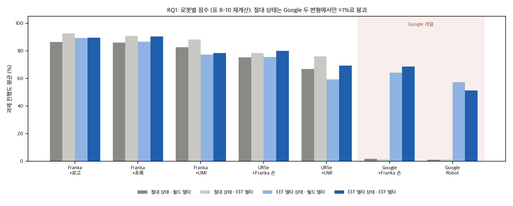
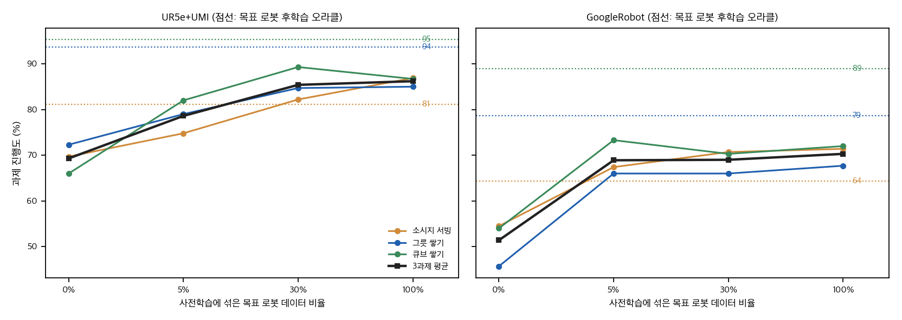
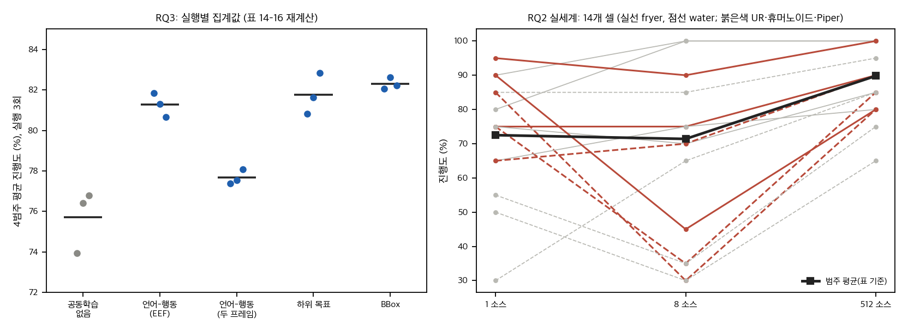

> **논문:** Mi Yan, Wenhao Zhang, Zhiqi Zhang, Yu Peng, Tangxinyu Wang 외. *ZETA: A Controlled Study of Zero-Shot Cross-Embodiment VLA Transfer for Tabletop Manipulation.* CoRL 2026 스포트라이트, arXiv:2609.02546 (v3, 2026-10-11).
> 공식 GitHub 저장소(MiYanDoris/ZETA)는 README와 티저 그림뿐이고 "Code coming soon"입니다. 이 글의 그림은 우리가 그린 그래프 세 장입니다. 논문 그림은 arXiv 라이선스(CC BY-NC-ND 4.0)상 싣지 않았습니다.

## 논문이 묻는 것

새 로봇에서 과제 시연 없이 쓰는 제로샷 교차 구현체 전이는 논문마다 정의가 다르고, 평가가 과제와 환경과 구현체 변화를 함께 바꿉니다. ZETA는 **strict**(목표 구현체가 모든 학습에 없음)와 **pretrain-exposed**(사전학습에만 있음)를 나누고, 외형, 그리퍼, 팔, 전체 변화(APP, GRP, ARM, FULL)로 묶은 목표 14종(시뮬 7, 실세계 7)에서 네 요인을 비교합니다. 상태·행동 표현, 소스 구현체 다양성(절차 생성 Franka 계열 512개), 보조 공동학습, 목표 구현체 노출입니다. 백본은 π0.5식 MoT 하나이고, 시뮬은 모델당 6,300롤아웃(3과제 × 7목표 × 100회 × 3 실행), 실세계는 140회입니다.

## 이 글에서 확인한 것

부록의 실행별 표(표 8–23)로 본문 표를 다시 만들었습니다. **산수는 깨끗합니다.** 표 2와 4의 평균 54개, 표 3(실세계) 24개가 전부 맞고, ±는 세 실행 집계값의 모표준편차(n으로 나눔)입니다. 다만 숫자가 말하는 범위는 서술보다 좁습니다.

**1. 표현 비교의 ARM·FULL 이득은 구글 로봇 두 변형에서 나옵니다.** 절대 상태를 쓰는 두 조합은 구글 계열 로봇에서 세 과제 모두 약 1점이고, 같은 조합이 UR5e 변형에서는 67–79점입니다. 표 2의 ARM 38.5–39.9는 "한 로봇은 75점, 다른 로봇은 1점"의 평균입니다. 구글 두 변형을 빼면 EEF-Delta 상태의 효과는 오히려 −2.8%p(절대 상태+EEF 행동 85.3 대 EEF 상태+EEF 행동 81.5)이고, 그리퍼 변경(Franka+UMI)에서는 −9.9%p(p = 0.017)입니다. 논문은 "외형이나 그리퍼만 바뀌면 절대 상태도 경쟁력 있다"고 쓰지만, 이득의 출처가 구글 로봇 하나라는 점은 말하지 않습니다.

*그래프 (우리가 그림). 네 상태·행동 표현의 로봇별 점수(표 8–10 재계산). 절대 상태 조합은 구글 계열에서만 약 1%로 무너집니다.*

**2. 표 5의 5% 값이 그림 6과 어긋납니다.** 목표 구현체 데이터를 사전학습에 5%만 넣으면 평균 +13.4%p라고 합니다(그림 6 본문의 78.6, 68.9와 부록 표 17–19에서 재현됩니다). 그런데 같은 모델이어야 하는 표 5의 EEF·EEF 5%는 71.1이고(0% 열은 표 2의 FULL 열과 정확히 같습니다), 부록 표 17–19의 같은 모델 5% 평균은 73.75입니다. 표 5로 이득을 계산하면 +10.7입니다. 프로젝트 페이지도 71.1을 복제합니다.

**3. "오라클 아래"는 평균에서만 맞습니다.** 목표 구현체로 후학습한 오라클은 상한 참고선이라고 서술되지만, 소시지 서빙에서는 5–100% 노출 모델이 오라클보다 높은 설정이 6개 중 5개입니다(그릇과 큐브에서는 6–19%p 낮습니다). 13.4%p는 FULL 범주 대상 2개의 평균입니다.

*그래프 (우리가 그림). 표 17–19의 노출 비율별 과제 점수(실선)와 목표 후학습 오라클(점선). 소시지 서빙(주황)에서는 노출 모델이 오라클을 넘습니다.*

**4. 소시지 과제는 99롤아웃 격자에 맞습니다.** 점수가 {0, 0.5, 1}이고 100회면 평균은 0.5의 배수여야 합니다. 소시지 표 96개 값 중 95개가 k/99(80.8 = 80/99 등)에 맞고 100 격자에는 18개만 맞습니다. 그릇과 큐브는 100 격자에 맞습니다. 본문 "100 rollouts per pair"와 어긋나고, 표 10의 75.7 한 칸은 정수 격자에도 없습니다.

**5. 소스 구현체 수의 이득은 1 → 8에서 대부분 나오고, 실세계 8 소스는 1 소스보다 낫지 않습니다.** 시뮬 512 대 1은 +17.9%p(p = 0.001)이고 그중 70%가 1 → 8입니다. 실세계는 14개 (대상 × 과제) 셀에서 8 대 1이 5승 7패(p = 0.77), 512 대 1이 12승 2패(p = 0.013)입니다. v3가 §5.6의 "실세계 비단조" 단서를 삭제했고, 그림 4(a)에는 본문에 없는 128 소스 점이 있습니다.

**6. 보조 공동학습은 BBox, 하위 목표, EEF 프레임 언어-행동에서 분명하고(+5.5~6.6%p, p ≤ 0.015) 두 프레임 언어-행동은 +1.9%p(p = 0.16)로 구별이 어렵습니다.** 소스 구현체 점수는 네 변형 모두 1.0–2.4%p 내려가는데 본문은 이 점을 논의하지 않습니다.

*그래프 (우리가 그림). 왼쪽은 표 14–16 재계산의 실행별 4범주 평균(점)과 평균(막대). 오른쪽은 표 22, 23의 실세계 RQ2 14개 셀(실선 에어프라이어, 점선 물주기).*

**7. 실세계 RQ1의 EEF 상태+EEF 행동 우위는 분명합니다.** 14개 셀에서 다른 조합을 13–14승(부호검정 p ≤ 0.0003)합니다. 다만 범주 평균은 APP, GRP, ARM이 각 로봇 1대, FULL이 4대라 범주 단순 평균이 로봇 한 대의 영향을 키웁니다.

## 구현 가능성

- **논문 전체의 재현은 불가능합니다.** 코드, 데이터, 가중치가 없고, 설정이 H800 16장 사전학습(120K 스텝)과 IsaacSim 렌더링, 실로봇 7종을 전제합니다.
- **정의 수준의 검산은 CPU로 됩니다.** EEF-Delta 상태와 행동은 베이스 프레임을 강체변환으로 옮겨도 변하지 않고(최대 변화 약 1e-15), 절대 상태와 월드 델타 행동은 변합니다. 이것이 구글 로봇 붕괴의 원인이라는 증거는 아닙니다.
- 이 글은 재현 실험을 하지 않았습니다. 재계산, 검정, 좌표계 검산만 했습니다.

## 한계

- 시뮬 비교는 실행이 3개뿐이라 3 대 3 순열검정의 최소 p가 0.1입니다. Welch p는 근사입니다.
- 롤아웃 단위 원자료가 없어 실세계 합산 검정은 근사이고, 그림 5(고정 구현체당 예산)는 수치가 없어 재계산하지 못했습니다.
- 구글 로봇의 절대 상태 붕괴의 원인(베이스 프레임 대 운동학)은 이 데이터로 분리되지 않습니다.
- 코드가 공개되면 점수 함수, 시드 구조, 표 5의 원천을 확인할 수 있습니다.

## 출처와 라이선스

- 논문: arXiv:2609.02546 v3. arXiv 라이선스는 CC BY-NC-ND 4.0입니다. 그래서 논문 그림은 싣지 않았습니다.
- 그래프 세 장은 부록의 실행별 표 값을 옮겨 우리가 그렸습니다. 표 값은 인용과 재계산을 위해 옮겼습니다.
- 공식 저장소는 README뿐이라 코드를 읽지 못했습니다. 가중치와 데이터는 받지 않았습니다.

## 자료

- [통합 리포트 PDF](report/report_public.pdf)
- [ZETA (arXiv:2609.02546) 논문 분석](analysis/01_paper_analysis.md)
- [ZETA 선행 연구와 자료 (02)](analysis/02_prior_work.md)
- [ZETA 보고 수치 재계산과 일관성 점검 (03)](analysis/03_analysis.md)
- [ZETA 주장 검증과 구현 가능성 (04)](analysis/04_claim_verification.md)
